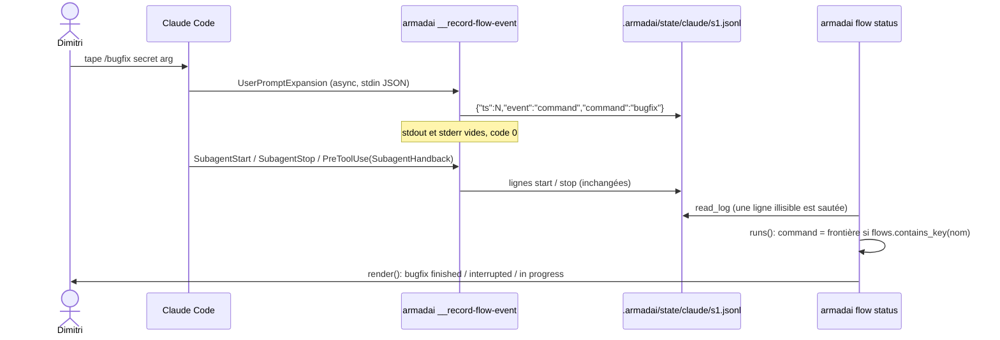
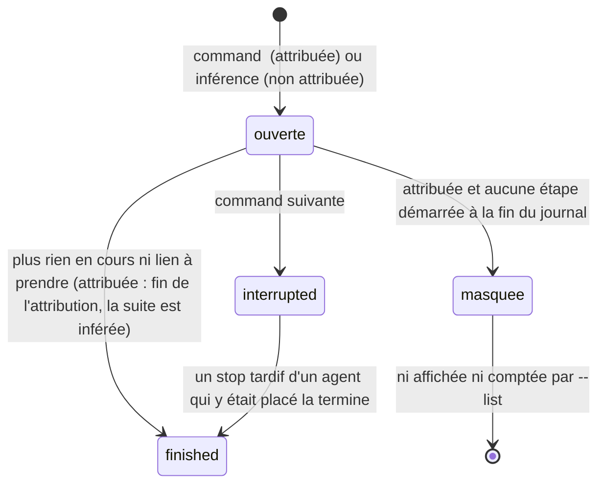
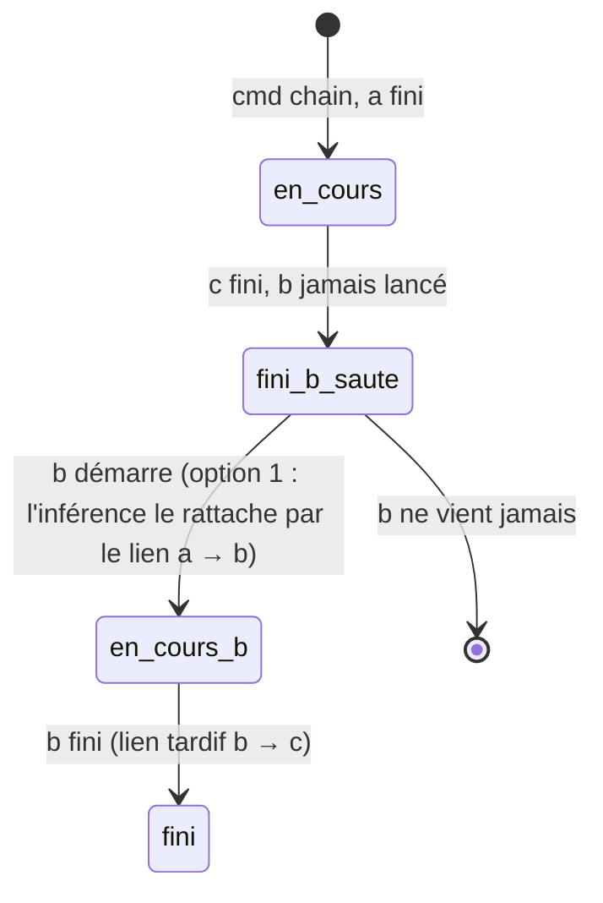

# flow status : attribuer une exécution au flow lancé — plan d'implémentation

> **Pour les agents :** sous-skill requise : superpowers:subagent-driven-development (recommandé) ou superpowers:executing-plans, tâche par tâche. Les étapes se cochent (`- [ ]`).

**Objectif :** enregistrer le nom de la commande que l'utilisateur tape dans Claude Code (`UserPromptExpansion`) et, quand ce nom est l'identifiant d'un flow, attribuer l'exécution à ce flow : plus de mauvais flow deviné, plus d'étape perdue quand des sous-agents se chevauchent, l'exécution précédente affichée `interrupted`. Sans ligne `command` dans le journal, la sortie ne change pas d'un caractère.

**Spec :** `docs/superpowers/specs/2026-10-26-flow-status-run-attribution-design.md` (avec son « Cadre » et les décisions de Dimitri du 2026-10-26). Issue publique : #527.

**Branche de lot :** `fix/flow-status-run-attribution`, depuis `master` (`6da1328` au moment du plan). La spec et ce plan, non suivis sur `master`, sont commités par la tâche 1 (étape 0).

**Architecture :** rien de neuf. `record.rs` apprend un 4e événement et une 3e sorte de ligne ; `claude_settings.rs` installe un 4e hook par le même chemin que les trois autres (fusion, manifeste, `unlink` inchangés : ils sont génériques) ; `runs.rs` traite la ligne `command` comme une frontière et place les sous-agents dans l'exécution attribuée ; `render.rs` affiche `interrupted`. `armadai-model` n'est pas touché (pas de `schema-specialist`, pas de vérification de `frozen/armadai-audit`).

## Ce que dit la doc des hooks (https://code.claude.com/docs/en/hooks.md, lue le 2026-10-26)

Cité :
- « Runs when a user-typed command expands into a prompt before reaching Claude. [...] typing `/skillname` directly bypasses `PreToolUse`. `UserPromptExpansion` fires on that direct path. »
- Matcher : « Matches on `command_name`. Leave the matcher empty to fire on every prompt-type command. »
- Entrée : « In addition to the common input fields, UserPromptExpansion hooks receive `expansion_type`, `command_name`, `command_args`, `command_source`, and the original `prompt` string. The `expansion_type` field is `slash_command` for skill and custom commands, or `mcp_prompt` for MCP server prompts. » Exemple : `{"session_id":"abc123","transcript_path":"/Users/.../00893aaf.jsonl","cwd":"/Users/...","permission_mode":"default","hook_event_name":"UserPromptExpansion","expansion_type":"slash_command","command_name":"example-skill","command_args":"arg1 arg2","command_source":"plugin","prompt":"/example-skill arg1 arg2"}`.
- Sortie : « The exceptions are `UserPromptSubmit`, `UserPromptExpansion`, `SessionStart`, and `PostModelSwitch`, where Claude Code adds plain-text stdout as context that Claude can see and act on. »
- Hooks asynchrones : « When an async hook fires, Claude Code starts the hook process and immediately continues without waiting for it to finish. The hook receives the same JSON input via stdin as a synchronous hook. » ; « After the background process exits, Claude Code delivers the `additionalContext` and `systemMessage` fields from the hook's JSON response to Claude on the next conversation turn ». La page ne dit pas ce que devient le texte brut de stdout d'un hook asynchrone sur `UserPromptExpansion` : on garde zéro octet (spec, critère 1).

Non trouvé dans la page : la version de Claude Code qui introduit `UserPromptExpansion` (non vérifié) ; la forme de `command_name` pour une commande de plugin (l'exemple a `command_source: "plugin"` et `command_name: "example-skill"`, sans espace de noms ; non vérifié). Règle de Dimitri : égalité stricte, toute autre forme retombe sur l'inférence.

## Séquence



Le hook n'écrit que le nom ; `command_args` et `prompt` ne quittent jamais le processus. La lecture reste pure (`runs(project, events)`) : la frontière est une ligne du journal comme une autre.



Une exécution attribuée sans aucune étape démarrée n'est pas rendue (décision de Dimitri du 2026-10-26, en fin de plan).

## Contraintes globales

- **Barrière complète**, code retour de chaque commande lu, jamais de tube qui le masque : `cargo fmt --all -- --check`, `cargo clippy --all-targets -- -D warnings`, `cargo test --no-fail-fast`, `cargo build -p armadai-core`, `cargo build -p armadai-model`. `frozen/armadai-audit` non concerné (aucun crate dont il dépend ne change) ; si une tâche touche `armadai-core` ou `armadai-model`, elle s'arrête et le dit.
- **Un worktree et un target cargo privés par tâche** : `git worktree add <wt> fix/flow-status-run-attribution` (ou une branche de tâche rebasée sur celle du lot), `CARGO_TARGET_DIR=<wt>/target`. Jamais `git stash`. Aucune commande en arrière-plan.
- **Tests** : `crates/armadai` est un binaire seul (`cargo test --bin armadai <nom>` ou `--test <fichier>`, jamais `--lib`), toujours `--no-fail-fast`. Égalité exacte (texte entier de `flow status`, ligne entière du journal, valeur JSON entière de `settings.json`), pas de `contains` qu'une autre sortie satisferait, sauf l'absence (`!contains("secret")`) en complément d'une égalité. Fixtures à valeurs distinctes deux à deux (horodatages, ids d'agents).
- **Une mutation vue rouge par test ajouté ou changé** : casser le code protégé, voir le rouge (sortie citée dans le rapport), restaurer avec une mtime neuve (`touch`, jamais `cp -p`). Les mutations prévues sont listées par tâche ; elles sont un minimum.
- **Essais du binaire** avec `HOME` et `ARMADAI_CONFIG_DIR` dans un dossier temporaire ; les tests d'intégration le font déjà (`Env`). Les tests du hook retirent `RUST_LOG` de l'environnement (`env_remove("RUST_LOG")`).
- **Journal** : une ligne JSON par événement, une seule écriture en ajout ; la ligne de commande est exactement `{"ts":N,"event":"command","command":"<command_name>"}`, rien d'autre. Les anciennes lignes se lisent telles quelles.
- **Règle du MVP** : `command_name == flow id`, sensible à la casse (`project.flows.contains_key(name)`). Une commande qui ne nomme aucun flow ne change rien.
- **Commits** Conventional, un type par sujet, en anglais, trailer `Co-Authored-By` fourni par la session. PR ouverte à la fin du lot, corps en français, pas de fusion sans l'accord exprès de Dimitri.

## Choix de conception

| Choix | Options et coût | Retenu |
|---|---|---|
| Forme de `FlowEvent` pour la ligne `command` | **A.** Garder la struct ; `EventKind::Command` ; `#[serde(default)]` sur `agent_id`/`agent_type` ; un champ `command: Option<String>` (`#[serde(default, skip_serializing_if = "Option::is_none")]`) ; une fonction `log_line(&FlowEvent) -> String` qui écrit la ligne `command` par une petite struct privée `{ts, event, command}` (ordre des clés garanti) et les autres par `serde_json::to_string` comme aujourd'hui. Coût : ~25 lignes, les littéraux `FlowEvent` des tests gagnent `command: None`. Les lignes `start`/`stop` restent identiques à l'octet. **B.** Une énumération étiquetée `#[serde(tag = "event")]` (`Start{..}`, `Stop{..}`, `Command{ts, command}`). Coût : réécrire les accès `e.agent_id`/`e.agent_type`/`e.state` de `runs.rs` (une vingtaine de sites) et `merge_stops`, pour un type plus juste. | **A** : le plus petit diff ; le `match` exhaustif sur `EventKind` force `runs()` et `merge_stops()` à traiter `Command`. Limite connue : une ligne `start` forgée sans `agent_id` se lit désormais avec `agent_id == ""` au lieu d'être sautée (jamais écrite par le hook). |
| Ordre des hooks | Le 4e en dernier dans `flow_status_entries` ; ou trié. | Dernier (Cadre, « Observé, non décidé » : habitude du code). |
| Lien d'une étape démarrée avant la fin de sa source (exécution attribuée) | **A.** L'étape est placée `running` sans transition et notée « en attente » ; quand une étape `s` finit, chaque étape en attente que `s` atteint (`reach`) reçoit la transition `s → t`, horodatée à la fin de `s`, avec l'état de `s`. Pour que ce lien ne reste pas « à prendre » (sinon l'exécution ne finit jamais), `linked_from(to)` compare au plus récent de `started[to]` et d'un nouveau `entered[to]` (le tick de cette fin). **B.** Réécrire le tick de départ de `t` : casse le cas où `t` a fini avant sa source (scénario 2 de l'issue : `fix-ui` finit à 30, `test` à 40 ; `fix-ui` ne mènerait plus à `review`). | **A** (B mesuré faux à la main sur le scénario 2, voir tâche 3). |
| Ordre des blocs | Aujourd'hui `finished` d'abord, puis l'ordre de départ. Le critère 5 veut le bloc `interrupted` (parti le premier) avant `bugfix  finished`, le critère 6 `finished` avant `in progress`. | Clé de tri : « terminée ou interrompue » avant « en cours », ordre de départ conservé (tri stable). Sans ligne `command`, aucune exécution n'est interrompue : ordre inchangé. |
| Exécution attribuée sans étape démarrée | Masquée partout ; ou affichée (`bugfix  in progress`, tout `pending`) mais non comptée par `--list`. | Masquée partout (le Cadre exige que `--list` ne la compte pas ; une seule règle). Décidé par Dimitri le 2026-10-26. |

---

### Tâche 1 [adapter-specialist] : enregistrer la commande tapée

**Fichiers :**
- Commit d'abord : `docs/superpowers/specs/2026-10-26-flow-status-run-attribution-design.md`, `docs/superpowers/plans/2026-10-26-flow-status-run-attribution.md`.
- Modifier : `crates/armadai/src/flow_status/record.rs` (types, `event_from_hook`, `log_line`, `record`, en-tête du module), les littéraux `FlowEvent` qui ne compilent plus (`crates/armadai/src/flow_status/runs.rs`, tests : helpers `start`/`stop` ; ajouter `command: None` sans rien changer d'autre).
- Test d'intégration : le fichier qui lance déjà `__record-flow-event` s'il existe (le trouver : `grep -rln "__record-flow-event" crates/armadai/tests`), sinon `crates/armadai/tests/record_flow_event_cli.rs`.

**Interfaces produites (pour les tâches 2 à 4) :**
```rust
pub enum EventKind { Start, Stop, Command }            // sérialisé start / stop / command
pub struct FlowEvent {
    pub ts: u64,
    pub event: EventKind,
    #[serde(default)] pub agent_id: String,
    #[serde(default)] pub agent_type: String,
    pub state: Option<String>,
    #[serde(default, skip_serializing_if = "Option::is_none")] pub command: Option<String>,
}
/// La ligne du journal, `\n` final compris.
pub fn log_line(e: &FlowEvent) -> String;
```
`event_from_hook` : `"UserPromptExpansion"` avec `expansion_type == "slash_command"` et un `command_name` non vide → `FlowEvent { event: Command, agent_id: "", agent_type: "", state: None, command: Some(command_name) }`, avec `session_id` et `cwd` exigés comme aujourd'hui. Les branches existantes ne changent pas.

- [ ] **Étape 0 :** créer la branche `fix/flow-status-run-attribution` depuis `master`, commiter la spec et ce plan : `docs(flow): spec and plan for run attribution from the typed command`.
- [ ] **Étape 1 — tests (rouges d'abord) :**
  - `record.rs`, const `EXPANSION` = l'exemple de la doc avec `"command_name":"bugfix"`, `"command_args":"secret arg"`, `"command_source":"project"`, `"prompt":"/bugfix secret arg"`, `session_id` `abc123`, `cwd` `/p`. Le helper `line()` passe à `log_line` (au lieu de `serde_json::to_string`), pour que les trois tests existants `subagent_start_records_a_start`, `subagent_stop_records_the_state_of_the_last_message`, `a_handback_records_the_state_of_its_message` protègent aussi `log_line`, avec leurs valeurs actuelles inchangées.
  - `a_typed_command_records_its_name_only` : `line(EXPANSION) == ("abc123", "/p", r#"{"ts":100,"event":"command","command":"bugfix"}"#)` (sans le `\n` si le helper le retire ; le dire).
  - `other_events_record_nothing` étendu de quatre entrées : `EXPANSION` avec `"expansion_type":"mcp_prompt"`, sans `expansion_type`, avec `"command_name":""`, sans `command_name` → `None` chacune (la boucle existante couvre chaque entrée ; vérifier qu'aucune n'est oubliée).
  - `old_and_command_lines_read_back` : `serde_json::from_str::<FlowEvent>` de `{"ts":1,"event":"start","agent_id":"i1","agent_type":"an","state":null}` donne l'événement avec `command: None` ; de `{"ts":2,"event":"command","command":"bugfix"}` donne `FlowEvent { ts: 2, event: Command, agent_id: "", agent_type: "", state: None, command: Some("bugfix") }`.
  - Intégration `a_typed_command_is_recorded_silently` (projet temporaire avec `.armadai/project.yaml`, `.git/`, `HOME`/`ARMADAI_CONFIG_DIR` isolés, `RUST_LOG` retiré), quatre lancements de `armadai __record-flow-event`, chacun vérifié par `(code, stdout en octets, stderr en octets) == (Some(0), b"", b"")` :
    1. la charge du critère 1 de la spec (`session_id` `s1`, `cwd` le projet) : le journal `.armadai/state/claude/s1.jsonl` vaut exactement `format!("{{\"ts\":{ts},\"event\":\"command\",\"command\":\"bugfix\"}}\n")`, `ts` relu dans la ligne et compris entre l'heure avant et après le lancement ; le fichier ne contient ni `secret` ni `/bugfix` ;
    2. la même avec `"expansion_type":"mcp_prompt"` : le journal n'a pas changé (une ligne) ;
    3. `{not json` : idem ;
    4. la charge valide avec un `cwd` hors de tout projet : aucun fichier créé sous ce `cwd`.
- [ ] **Étape 2 :** implémenter (le `record` écrit `log_line(&event)` ; la commande cachée et `main.rs` ne changent pas). Mettre à jour l'en-tête du module (`UserPromptExpansion`, « only the command name »).
- [ ] **Étape 3 — mutations à montrer rouges :** (a) écrire `command_args` dans la ligne → `a_typed_command_records_its_name_only` rouge ; (b) écrire la ligne `command` par `serde_json::to_string(&event)` → idem (les champs `agent_id`, `agent_type`, `state` apparaissent) ; (c) retirer la garde `expansion_type == slash_command` → `other_events_record_nothing` et l'intégration (cas 2) rouges ; (d) retirer `#[serde(default)]` de `agent_id` → `old_and_command_lines_read_back` rouge ; (e) un `println!` ou `eprintln!` dans `record_from_stdin` → l'intégration rouge sur stdout, puis sur stderr (deux mutations distinctes).
- [ ] **Étape 4 :** barrière ; commit `fix(flow): record the name of the command a user types`.

Critère couvert : 1.

### Tâche 2 [adapter-specialist] : `link` installe le 4e hook

**Fichiers :**
- Modifier : `crates/armadai/src/compile/claude_settings.rs` (`flow_status_entries` : `("UserPromptExpansion", None)` en dernier ; commentaire de la fonction avec la citation de la doc sur le matcher vide) ; `crates/armadai/tests/link_new_cli.rs` ; les golden outputs qui contiennent les hooks d'enregistrement ; `docs/wiki/link.md` (l. 57 : « four async hooks ... `UserPromptExpansion` (a typed command, its name only) »).
- Liste exacte des golden : **non dressée par l'architecte** (aucun outil de recherche dans cette étape). Le spécialiste la dresse en premier (`grep -rln "__record-flow-event" crates/armadai/tests crates/armadai/src`), la cite dans son rapport et met à jour chaque fichier listé (régénération par le mécanisme du dépôt, `UPDATE_GOLDEN=1` selon le plan précédent, à vérifier dans le harnais, puis relecture du diff) ou dit pourquoi il ne change pas. La spec nomme `crates/armadai/tests/golden/init_pack/` et `link_new_cli.rs`.
- Ne pas toucher : `compile/patch.rs`, `linker/manifest.rs`, `cli/unlink` : la fusion, la propriété par valeur et le retrait sont génériques sur `HookEntry` (lu dans `merge_settings`/`remove_entries`). Si un test montre le contraire, s'arrêter et le rapporter.

**Interfaces :** consomme le nom de commande `armadai __record-flow-event` seulement (indépendante de la tâche 1). Produit `flow_status_entries()` à 4 entrées.

- [ ] **Étape 1 — tests :**
  - `a_project_with_a_flow_records_subagents_after_the_gate` : la liste attendue devient `[gate_entry(), recording("SubagentStart", None), recording("SubagentStop", None), recording("PreToolUse", Some("SubagentHandback")), recording("UserPromptExpansion", None)]`.
  - Nouveau `a_project_linked_with_three_recording_hooks_gets_the_fourth_on_relink` (`claude_settings.rs`) : `old` = les trois premières entrées ; `(first, owned1) = merge_settings(Some(USER), &old, &none(), &Owned::default())` ; `(second, owned2) = merge_settings(Some(&first), &flow_status_entries(), &none(), &owned1)`. Attendus : `value(&second)["hooks"]["UserPromptExpansion"] == json!([{"hooks": [{"type": "command", "command": "armadai __record-flow-event", "async": true}]}])` ; `owned2.entries == flow_status_entries()` ; `value(&remove_entries(&second, &owned2).unwrap()) == value(USER)`.
  - `link_new_cli.rs::link_then_unlink_gives_the_user_tree_back_and_relinking_is_idempotent` : l'objet `hooks` attendu gagne `"UserPromptExpansion": [{"hooks": rec}]` ; le reste du test (relink sans changement, `unlink` qui rend l'arbre de l'utilisateur) inchangé : il couvre le retrait avec manifeste. `without_a_manifest_unlink_removes_only_unchanged_generated_files` (compare `settings.json` entier) couvre le retrait sans manifeste ; le lancer et citer sa sortie.
  - Golden : mis à jour et relus. La ligne de rapport reste une seule ligne, mais elle nomme désormais les quatre hooks, `SubagentStart, SubagentStop, PreToolUse (SubagentHandback), UserPromptExpansion` (décision de Dimitri du 2026-10-26, « Nommer les 4 (Recommandé) ») : chacun des 11 golden qui contiennent le rapport change de cette seule ligne, et d'aucune autre ; le vérifier dans le diff.
- [ ] **Étape 2 :** implémenter (une ligne dans `flow_status_entries`), régénérer les golden.
- [ ] **Étape 3 — mutations :** (a) retirer l'entrée `UserPromptExpansion` → les trois tests ci-dessus et les golden rouges (citer chacun) ; (b) lui donner un matcher (`Some("bugfix")`) → `a_project_with_a_flow...` et `link_then_unlink...` rouges ; (c) dans `merge_settings`, ne pousser dans `owned.entries` qu'une entrée déjà dans `previous.entries` → `..._gets_the_fourth_on_relink` rouge.
- [ ] **Étape 4 :** barrière ; commit `fix(link): install the UserPromptExpansion recording hook`.

Critère couvert : 8 (et la partie `link.md` du 9).

### Tâche 3 [cli-specialist] : la commande comme frontière dans `runs()`, et `interrupted`

Dépend de la tâche 1 (`EventKind::Command`, `FlowEvent.command`).

**Fichiers :**
- Modifier : `crates/armadai/src/flow_status/runs.rs`, `crates/armadai/src/flow_status/render.rs`, `crates/armadai/src/cli/flow.rs` (seulement le `long_about` : une phrase sur l'exécution attribuée à la commande tapée et la marque `interrupted` ; vérifier qu'aucun golden d'aide ne la fige, sinon le mettre à jour).

**Interfaces :**
- `Run` gagne `pub interrupted: bool` : fermée par une commande de flow suivante avant d'avoir fini ; jamais vrai quand `finished`. Les littéraux `Run` des tests existants gagnent `interrupted: false` et rien d'autre (tout autre changement d'un test existant est un signal d'alarme pour la revue).
- `Builder` gagne `attributed: Option<usize>` (l'exécution de la dernière commande de flow, tant qu'elle n'a pas fini : la tâche 5 le remet à `None`). `Building` gagne `attributed: bool`, `interrupted: bool`, `awaiting: BTreeSet<String>` (étapes placées sans lien), `entered: HashMap<String, usize>` (tick de la fin de la source qui a noté un lien tardif).
- Fonction factorisée (pas de copie) : l'enregistrement des sauts d'un lien (`from`, étapes du coordinateur traversées, `to`, ts, état) aujourd'hui dans `start`, appelée aussi par `stop`.

**Règles (spec §4.2) :**
1. `runs()` : `EventKind::Command` → si `project.flows.contains_key(name)`, `boundary(name)`, sinon rien ; `merge_stops` laisse passer la ligne sans toucher `last_stop`.
2. `boundary(flow)` : chaque exécution non `dropped`, non `closed`, non `finished` devient `interrupted` et `closed` (candidates groupées comprises ; une exécution déjà fermée par l'inférence, laissée bloquée par le redémarrage de son entrée, reste telle quelle, test `a_run_left_stuck_before_the_command_is_not_called_interrupted`) ; une `Building` neuve du flow s'ouvre dans son propre groupe, `attributed = true` ; `Builder.attributed = Some(index)`. Historique : la tâche 3 a livré `boundary` sans poser `closed` (écart approuvé par `guardian` : `attributed` restait `Some` jusqu'à la fin de la session, l'écriture était morte). Depuis la décision de Dimitri du 2026-10-26 (« Oui, à `finished` (Recommandé) »), l'inférence reprend après la fin de l'exécution attribuée, et `closed` redevient nécessaire : sans lui, l'inférence prolongerait une exécution interrompue, puisque `open_run` et la recherche de lien de `start` ne filtrent que `dropped` et `closed` (`runs.rs:395-399`, `:526-527`, lus par l'architecte). La tâche 5 le rétablit. Un `stop` tardif d'un agent placé dans l'exécution interrompue passe par `assigned`, et `closed` ne le touche pas.
3. L'attribution court de la commande jusqu'à ce que son exécution soit `finished`, ou jusqu'à la commande de flow suivante. Au `stop` qui termine l'exécution `i`, et seulement si `Builder.attributed == Some(i)`, `Builder.attributed` revient à `None` ; les sous-agents suivants reviennent à l'inférence, comme sur `master` (décision de Dimitri du 2026-10-26, portée par la tâche 5 ; la tâche 3 a livré une attribution qui durait jusqu'à la commande suivante, rejetée par `reviewer`). `start(e)` quand `Builder.attributed == Some(i)` : seules les étapes du flow de `i` tenues par `e.agent_type` comptent. Aucune → l'événement est ignoré (pas d'exécution fantôme). Deux ou plus → la règle actuelle (`?` « ambiguous step »). Une seule `sid` → `linked_from(sid)` s'il existe (transition comme aujourd'hui), sinon placée `running` sans transition et ajoutée à `awaiting`, sauf si `sid` est une étape où une exécution peut s'ouvrir, c'est-à-dire une étape d'entrée ou une étape juste après un relais : celle-ci n'entre jamais dans `awaiting` (écart de la tâche 3, approuvé par `guardian` : sinon `review-loop` prendrait un faux lien). Les branches d'inférence (entrée qui ferme, ouverture à mi-flow, groupes `a | b`) ne s'appliquent pas. Une étape en amont d'une étape placée qui n'a pas tourné dans l'exécution attribuée prend la marque `- … (not run in this session)` ; une étape en aval qui n'a pas encore tourné reste `○ pending` (décision de Dimitri du 2026-10-26, « not run in this session (Recommandé) »). Pas de condition « rien en cours » pour ce marquage : une étape pas encore lancée s'affiche `not run` dès qu'une étape après elle a fini, et jusqu'à son propre démarrage, où elle passe `running` ; cet affichage transitoire est accepté et le wiki l'explique (tâche 4). Une étape ainsi sautée ne retient pas l'exécution : dans une exécution attribuée, un lien vers une étape jamais démarrée qu'une étape arrêtée suit ne compte pas « à prendre » au calcul de `finished` (critère 11 ; la tâche 3 l'a manqué, `validator` l'a mesuré, la tâche 6 le corrige).
4. `stop` d'une étape `s` d'une exécution attribuée, après la mise à jour de sa vue et avant le calcul de `finished` : pour chaque `t` de `awaiting` que `reach(s)` atteint, la transition `s → t` est notée (ts de ce stop, état `leads_with(s)`, sauts du coordinateur compris), `taken` compté, `entered[t] = tick`, `linked_at[t] = ts`, `t` retiré d'`awaiting`. Deux gardes, conservées et testées : aucun lien tardif depuis une étape `?` ou `✗`, et aucun lien d'une étape vers elle-même (`s == t`).
5. `linked_from(to)` compare `max(started[to], entered[to])` au lieu de `started[to]` ; sans `entered` (toute exécution non attribuée), comportement identique.
6. Fin de `runs()` : une exécution `attributed` sans aucune étape démarrée n'est pas rendue ; `merge_candidates` calcule `interrupted` (interrompue si toutes ses candidates le sont, et jamais quand elle a fini) ; `finish()` n'a pas de ligne `interrupted && !finished` (écart de la tâche 3, approuvé par `guardian` : `merge_candidates` la calcule déjà). Lu au code par l'architecte, sans exécution : `merge_candidates` fait `interrupted = !finished && members.iter().all(|m| m.interrupted)` (`runs.rs:133`), et `a_late_stop_that_finishes_an_interrupted_run_leaves_it_finished` (`runs.rs:2751`) fige une exécution interrompue puis terminée par un `stop` tardif (`finished: true, interrupted: false`). La fin d'attribution de la tâche 5 ne change pas ce cas, puisque l'exécution qui finit n'est plus celle de `Builder.attributed` ; la tâche 5 le prolonge pour le vérifier.
7. `render` : statut `finished`, sinon `interrupted`, sinon `in progress` ; tri stable par « en cours » en dernier (`sort_by_key(|r| !(r.finished || r.interrupted))`). `print_painted` reconnaît déjà l'en-tête (`<flow>  ...`).

Vérification à la main faite par l'architecte (règle 4 et 5) sur les scénarios 1 et 2 de l'issue, en ticks : scénario 2 avec `bugfix`, `fix-ui` démarre (tick 3) avant `test` (tick 4) et finit (5) avant lui (6) ; au stop de `test`, `entered[fix-ui] = 6` ferme `test → fix-ui`, et `fix-ui` (départ 3 < arrêt 5) mène encore à `review`. À rejouer par les tests, pas à croire.

**Tests** (`runs.rs`, module de tests ; texte comparé par un helper `text(p, events) = render::render(&runs(p, events), "s1")`). Fixtures : `issue()` = projet de l'issue #527 (`schema_version: 1`, agents `an u t r v`, flows `evolution` et `bugfix` copiés de l'issue) ; `issue_with_docs()` = le même plus l'agent `x` et un flow `docs` (`steps:\n  write: { agent: x }\n`) ; `bugfix_only()` = agents `an t u r`, flow `bugfix` à quatre étapes (`analyse -> test -> fix-ui -> review`). `T = 1_792_660_500` (09:15:00 UTC). Helpers `start(ts, id, agent)`, `stop(ts, id, agent, None)` existants, et `cmd(ts, name)` = `FlowEvent { ts, event: Command, agent_id: "", agent_type: "", state: None, command: Some(name) }`. Notation ci-dessous : `an i1 0/10` = `start(T+0, "i1", "an")`, `stop(T+10, "i1", "an", None)`.

Séquences :
- `S1` (scénario 1 de l'issue) : `an i1 0/10`, `start(T+20,i3,t)`, `start(T+30,i2,u)`, `stop(T+40,i3,t)`, `stop(T+50,i2,u)`, `r i4 60/70`, `v i5 80/90`.
- `S2` (scénario 2) : `an i1 0/10`, `start(T+20,i2,u)`, `start(T+21,i3,t)`, `stop(T+30,i2,u)`, `stop(T+40,i3,t)`, `r i4 60/70`, `v i5 80/90`.
- `S4` (un seul flow) : `an i1 0/10`, `start(T+20,i2,t)`, `start(T+30,i3,u)`, `stop(T+40,i2,t)`, `stop(T+50,i3,u)`, `r i4 60/70`.
- `RUN(o)` (exécution complète décalée de `o`) : `an 10/20`, `t 30/40`, `u 50/60`, `r 70/80`, `v 90/100` (ids `i2`..`i6`), tous à `T+o+…`.

Textes attendus (en-tête compris, égalité exacte) :

`BUGFIX_S1` (`cmd(T,"bugfix")` + `S1`) :
```
session s1 (UTC)

bugfix  finished
  ✓ analyse   done
  ✓ test      done
  ✓ fix-ui    done
  ✓ review    done
  ✓ validate  done
  09:15:20  analyse → test  (done)
  09:15:40  test → fix-ui  (done)
  09:16:00  fix-ui → review  (done)
  09:16:20  review → validate  (done)
```
`BUGFIX_S2` (`cmd(T,"bugfix")` + `S2`) : comme `BUGFIX_S1`, la première transition à `09:15:21  analyse → test  (done)`.

`EVOLUTION_S2` (`cmd(T,"evolution")` + `S2`) :
```
session s1 (UTC)

evolution  finished
  ✓ analyse   done
  ✓ ui        done
  ✓ test      done
  ✓ review    done
  ✓ validate  done
  09:15:20  analyse → ui  (done)
  09:15:30  ui → test  (done)
  09:16:00  test → review  (done)
  09:16:20  review → validate  (done)
```
`BUGFIX_S4` (`bugfix_only()`, `cmd(T,"bugfix")` + `S4`) :
```
session s1 (UTC)

bugfix  finished
  ✓ analyse  done
  ✓ test     done
  ✓ fix-ui   done
  ✓ review   done
  09:15:20  analyse → test  (done)
  09:15:40  test → fix-ui  (done)
  09:16:00  fix-ui → review  (done)
```
`INTERRUPTED` (`t i1 0/10`, `cmd(T+3600,"bugfix")`, `RUN(3600)`) :
```
session s1 (UTC)

bugfix | evolution  interrupted
  - analyse   (not run in this session)
  ✓ test      done
  ○ review    pending
  ○ validate  pending

bugfix  finished
  ✓ analyse   done
  ✓ test      done
  ✓ fix-ui    done
  ✓ review    done
  ✓ validate  done
  10:15:30  analyse → test  (done)
  10:15:50  test → fix-ui  (done)
  10:16:10  fix-ui → review  (done)
  10:16:30  review → validate  (done)
```
`TWO_COMMANDS` (`cmd(T,"bugfix")`, `RUN(0)`, `cmd(T+200,"evolution")`, `start(T+210,"i7","an")`) :
```
session s1 (UTC)

bugfix  finished
  ✓ analyse   done
  ✓ test      done
  ✓ fix-ui    done
  ✓ review    done
  ✓ validate  done
  09:15:30  analyse → test  (done)
  09:15:50  test → fix-ui  (done)
  09:16:10  fix-ui → review  (done)
  09:16:30  review → validate  (done)

evolution  in progress
  ● analyse   running
  ○ ui        pending
  ○ test      pending
  ○ review    pending
  ○ validate  pending
```
Sorties actuelles de l'issue (sans ligne `command`), à **mesurer d'abord sur `master`** avant toute modification : si une sortie diffère du bloc ci-dessous, le test fige celle de `master` et le rapport cite l'écart.
- `ISSUE_S1` (`S1`) : `session s1 (UTC)\n\nbugfix  in progress\n  ✓ analyse   done\n  ✓ test      done\n  ○ fix-ui    pending\n  ○ review    pending\n  ○ validate  pending\n  09:15:20  analyse → test  (done)\n`
- `ISSUE_S2` (`S2`) : `session s1 (UTC)\n\nevolution  in progress\n  ✓ analyse   done\n  ✓ ui        done\n  ○ test      pending\n  ○ review    pending\n  ○ validate  pending\n  09:15:20  analyse → ui  (done)\n`
- `ISSUE_LONE` (`t i1 0/10`) : `session s1 (UTC)\n\nbugfix | evolution  in progress\n  - analyse   (not run in this session)\n  ✓ test      done\n  ○ review    pending\n  ○ validate  pending\n`
- `ISSUE_S4` (`bugfix_only()`, `S4`) : `session s1 (UTC)\n\nbugfix  in progress\n  ✓ analyse  done\n  ✓ test     done\n  ○ fix-ui   pending\n  ○ review   pending\n  09:15:20  analyse → test  (done)\n`

Tests, un par critère, sans boucle sur les scénarios (une assertion par séquence) :

| Test | Assertion | Mutation qui doit le faire rougir |
|---|---|---|
| `a_command_attributes_the_run_and_an_overlap_loses_no_step` | `text(issue, cmd+S1) == BUGFIX_S1` | ignorer `awaiting` au stop (règle 4) ; ne pas lire `entered` dans `linked_from` (règle 5 : l'exécution reste `in progress`) |
| `a_step_stopped_before_its_source_still_leads_on` | `text(issue, cmd+S2) == BUGFIX_S2` | réécrire `started[t]` au lieu d'`entered[t]` (option B) |
| `the_same_events_follow_the_flow_the_command_names` | `text(issue, cmd evolution + S2) == EVOLUTION_S2` | `boundary` ouvre le premier flow de `project.flows` au lieu du flow nommé |
| `one_flow_with_an_overlap_finishes` | `text(bugfix_only, cmd+S4) == BUGFIX_S4` | règle 4 retirée |
| `a_command_interrupts_the_open_run` | `text(issue, INTERRUPTED events) == INTERRUPTED` | `boundary` ne marque pas `interrupted` (`in progress` revient) ; tri de `render` inchangé (`finished` d'abord : ordre des blocs inversé) |
| `an_agent_no_step_of_the_attributed_flow_holds_is_ignored` | avec `issue_with_docs()`, les événements `INTERRUPTED` plus `start(T+3625,"x1","x")`, `stop(T+3626,"x1","x",None)` donnent `INTERRUPTED`, et la même chose sans `x1` aussi | en mode attribué, retomber sur l'inférence pour un agent hors du flow (un bloc `docs` apparaît) |
| `a_second_command_closes_the_first_run` | `text(issue, TWO_COMMANDS events) == TWO_COMMANDS` | depuis la tâche 5, `bugfix` finit avant la 2e commande et lève l'attribution : « `boundary` ne remplace pas `Builder.attributed` » ne mord plus ici (relevé par `validator`). Mutation de ce test : retirer `self.attributed = Some(…)` de `boundary` → l'`an` de 210 est inféré, `bugfix | evolution  in progress` au lieu d'`evolution  in progress`. « Ne remplace pas » (n'écrire `attributed` que s'il vaut `None`) est pris par `a_late_stop_of_an_unfinished_interrupted_run_keeps_both_states` et `a_late_stop_of_an_interrupted_run_keeps_the_attribution` (prévu à la lecture, à mesurer par la tâche 6) |
| `a_command_naming_no_flow_changes_nothing` | `text(issue, cmd(T,"deploy")+S1) == ISSUE_S1` et `text(issue, cmd(T,"Bugfix")+S1) == ISSUE_S1` | comparaison insensible à la casse ; toute commande traitée comme frontière |
| `a_command_alone_opens_no_run` | `runs(&issue(), &[cmd(T,"bugfix")]) == vec![]` et `runs(&issue(), &[cmd(T,"bugfix"), cmd(T+1,"evolution")]) == vec![]` | retirer le filtre de la règle 6 |
| `without_a_command_the_issue_scenarios_are_unchanged` | quatre assertions : `ISSUE_S1`, `ISSUE_S2`, `ISSUE_LONE`, `ISSUE_S4` | appliquer le placement attribué à toute exécution (sans commande) |
| `render.rs::an_interrupted_run_says_so_and_comes_before_the_running_one` | `render(&[running, interrupted, finished], "s")` (valeurs distinctes, l'interrompue partie la deuxième) : en-tête, puis le bloc `<flow>  interrupted` puis `finished` dans l'ordre de départ, puis `in progress`, texte exact | statut `in progress` pour une interrompue ; tri d'origine |

S'y ajoutent, pour les écarts de la tâche 3 : un test par garde des liens tardifs (aucun lien depuis `?`/`✗` ; aucun lien d'une étape vers elle-même), et un test sur `review-loop` où une étape d'entrée ou juste après un relais n'entre pas dans `awaiting` (mutation : la laisser y entrer → faux lien rendu) ; chacun avec sa mutation vue rouge.

Les tests existants de `runs.rs` et `render.rs` restent verts sans autre changement que `interrupted: false` ; la suite `flow_status_cli` aussi.

- [ ] **Étape 1 :** mesurer les quatre sorties `ISSUE_*` sur `master` (binaire du worktree, projet temporaire, `HOME`/`ARMADAI_CONFIG_DIR` isolés), les citer.
- [ ] **Étape 2 :** écrire les tests, les voir rouges ; implémenter les règles 1 à 7 ; vert.
- [ ] **Étape 3 :** mutations du tableau, chacune vue rouge puis restaurée (`touch`), sortie citée ; 5 passes de `cargo test --bin armadai flow_status` (rien ne lit l'environnement ici, mais la règle s'applique au module).
- [ ] **Étape 4 :** barrière ; commit `fix(flow): attribute a run to the flow its command names`.

Critères couverts : 2, 3, 4, 5, 6, 7.

### Tâche 4 [cli-specialist] : bout en bout, documentation, CHANGELOG

Dépend des tâches 1 à 3.

**Fichiers :**
- Modifier : `crates/armadai/tests/flow_status_cli.rs` (le `Env` y écrit déjà des journaux ; ajouter un écrivain de ligne `command` et un lancement de `__record-flow-event` avec stdin) ; `docs/wiki/flow-status.md` ; `CHANGELOG.md` (`## Unreleased`, `### Fixed`).

- [ ] **Étape 1 — tests :**
  - `a_typed_command_through_the_hook_attributes_the_run` : la charge `UserPromptExpansion` du critère 1 (`session_id` `s1`, `cwd` le projet de l'issue écrit dans l'`Env`) passée par stdin à `armadai __record-flow-event` ; puis les lignes de `S1` ajoutées au journal (le `ts` réel de la ligne `command` est plus grand que ceux de `S1` : sans effet, l'ordre du fichier fait foi, à confirmer par le test) ; `flow status` rend `(Some(0), BUGFIX_S1, "")`. Mutation : ne pas traiter `EventKind::Command` dans `runs()` → `ISSUE_S1` à la place.
  - `list_does_not_count_a_session_with_only_a_command` : session `c` avec la seule ligne `{"ts":1792660500,"event":"command","command":"bugfix"}` (mtime `T0`), session `s1` = boucle existante (mtime `T0 + 3600`) : `--list` rend exactement `SESSION  LAST EVENT (UTC)     RUNS\ns1       2026-10-22 10:15:00  1\nc        2026-10-22 09:15:00  0\n`. Mutation : retirer le filtre de la règle 6 → `1` pour `c`.
- [ ] **Étape 2 — `docs/wiki/flow-status.md` :** l. 13 « four asynchronous hooks » ; tableau : ligne `UserPromptExpansion` | « a command typed in Claude Code (`/name`, skill or custom command): its name only » ; l. 22-25 : la ligne `command` (nom seul, ni arguments ni prompt) ; nouvelle section « The command you type » : `command_name` égal à un id de flow (casse comprise) ouvre une exécution de ce flow seul, ferme la précédente (`interrupted`), place chaque sous-agent dans l'étape unique qu'il tient, même avant la fin de l'étape source (transition notée à sa fin), ignore un agent hors du flow ; une commande qui ne nomme pas de flow, ou un flow lancé en langage naturel, garde l'inférence ; un projet lié avant doit relancer `armadai link --target claude` ; table des marques/statuts : `interrupted` ; l. 101 (`a | b` seulement sans commande) ; limites l. 132 (arrière-plan : couvert quand la commande est enregistrée) et l. 142 ; ajouter les limites de la spec §4.3 (`/clear`, appel isolé d'un agent du flow attribué, chevauchement sans commande, pas de message quand le hook manque) et « version de Claude Code introduisant `UserPromptExpansion` : non vérifiée ». Ajouter aussi : la marque d'une étape amont sautée dans une exécution attribuée, `- … (not run in this session)`, une étape aval pas encore lancée restant `○ pending` ; l'affichage transitoire (une étape peut s'afficher `not run` dès qu'une étape après elle a fini, puis `running` quand elle démarre) ; la limite connue `agent_id` vide (décision de Dimitri du 2026-10-26, « Ne rien faire (Recommandé) ») ; le risque accepté par la spec au §6 : une transition tardive est horodatée à la fin de sa source, donc possiblement après la fin de l'étape cible. Vérifier que la page ne dit plus « three hooks » nulle part.
- [ ] **Étape 3 — `CHANGELOG.md` :** sous `## Unreleased`, `### Fixed` : « `flow status` attributes a run to the flow whose id is the command you typed (new `UserPromptExpansion` recording hook: relink with `armadai link --target claude`); overlapping background sub-agents no longer leave steps pending; a new flow command marks the previous run `interrupted` (#527). »
- [ ] **Étape 4 :** mutations de l'étape 1 vues rouges ; barrière ; commits `test(flow): pin run attribution end to end` puis `docs(flow): describe the command boundary of flow status`.
- [ ] **Étape 5 (lead puis validator) :** préparer l'essai réel du critère 10 : un projet temporaire aux deux flows de l'essai du 2026-10-26, `armadai link --target claude`, la commande du second flow tapée par Dimitri avec des sous-agents en arrière-plan, `flow status --watch` ; relever dans le journal la ligne `command` (sa présence prouve que `UserPromptExpansion` se déclenche sur cette version de Claude Code).

Critères couverts : 9, 10 (préparation), et 1/2/7 de bout en bout.

### Tâche 5 [cli-specialist] : l'attribution s'arrête à `finished`

Reprise du plan après le rejet de `reviewer` sur la branche entière (tête `355ff9c`). Dépend des tâches 3 et 4 (mêmes fichiers). Décision de Dimitri du 2026-10-26 : « Oui, à `finished` (Recommandé) ». L'attribution s'arrête quand l'exécution attribuée est `finished`, et les sous-agents suivants reviennent à l'inférence, comme sur `master`. Un agent du flow appelé seul pendant le flow arrive avant `finished` : son cas ne change pas (spec §4.3).

Le rejet, relu au code par l'architecte (lecture, pas d'exécution) : `start` fait `if let Some(i) = self.attributed { return self.start_attributed(i, e); }` (`runs.rs:510-511`), et rien ne remet `Builder.attributed` à `None`. Sur le projet de l'issue augmenté du flow `docs`, avec le journal `command bugfix`, une exécution complète, `x` de 3600 à 3610, puis `an` de 3700 à 3710 et `u` de 3720 à 3730, `reviewer` mesure un seul bloc, `bugfix  in progress` avec ses cinq étapes `✓ done` (son rapport, à rejouer).

**Fichiers :**
- Modifier : `crates/armadai/src/flow_status/runs.rs` (`Builder::stop`, `Builder::boundary`, le commentaire de `runs()` l. 71-77, qui dit « While it is the latest », et celui de `Builder.attributed` l. 390) ; `crates/armadai/tests/flow_status_cli.rs` (`Env::hook`) ; `docs/wiki/flow-status.md` (l. 26, l. 42-47, l. 53-55) ; `crates/armadai/src/cli/flow.rs`, seulement si son `long_about` dit que l'attribution court jusqu'à la commande suivante (le lire, et le dire dans le rapport).
- Ne pas toucher : `render.rs`, `record.rs`, `claude_settings.rs`.

**Interfaces :** aucune nouvelle. Le sens de `Builder.attributed` devient « l'exécution de la dernière commande de flow, tant qu'elle n'a pas fini ».

**Règles (tâche 3, règles 2 et 3 corrigées) :**
1. Dans `Builder::stop(i, …)`, après le calcul de `run.run.finished` : si `self.attributed == Some(i)` et que `self.open[i].run.finished`, alors `self.attributed = None`. Seule la fin de l'exécution attribuée lève l'attribution. Un `stop` tardif qui termine une exécution interrompue plus ancienne la laisse en place.
2. `boundary` pose `closed = true` sur chaque exécution qu'il marque `interrupted`, avec le même filtre (non `dropped`, non `closed`, non `finished`). Sans cela, l'inférence qui reprend après `finished` prolongerait une exécution interrompue.

Choix de construction : lever l'attribution dans `stop` (option retenue), ou dans la boucle de `runs()` après chaque `stop`. Le coût est le même, une condition. `stop` est retenu parce que c'est là que `finished` se calcule, et qu'un seul endroit le lit.

**Tests** (`runs.rs`, helpers de la tâche 3 : `issue_with_docs()`, `cmd`, `span`, `run_at`, `text`, `lines`), à égalité exacte. Les textes attendus sont **mesurés par le constructeur** : d'abord le test écrit avec l'attendu prévu ci-dessous, puis la sortie lue. Si elle diffère de la prévision, le constructeur s'arrête et cite les deux sorties dans son rapport, avant de figer quoi que ce soit, puisque c'est l'inférence de `master` qui les produit.

| Test | Journal et assertion | Mutation qui doit le faire rougir |
|---|---|---|
| `after_the_attributed_run_finishes_the_inference_takes_over` | journal du `reviewer` : `cmd(T,"bugfix")`, `run_at(0)`, `span(3600,3610,"x1","x")`, `span(3700,3710,"i7","an")`, `span(3720,3730,"i8","u")` ; `text(&issue_with_docs(), …)` égal au texte entier, trois blocs dans cet ordre : `bugfix  finished` (le premier bloc de `TWO_COMMANDS`, transitions comprises), `docs  finished` (`✓ write  done`), `evolution  in progress` (`✓ analyse`, `✓ ui`, `○ test`, `○ review`, `○ validate`, transition `10:17:00  analyse → ui  (done)`, prévue, à mesurer) | retirer la remise à `None` → un seul bloc `bugfix  in progress` (la mesure du `reviewer`) |
| `a_late_stop_of_an_interrupted_run_keeps_the_attribution` | `cmd(T,"docs")`, `start(T+1,"x1","x")`, `cmd(T+5,"docs")`, `stop(T+10,"x1","x",None)`, `span(20,30,"i9","an")` ; `runs(&issue_with_docs(), …)` égal au `vec![Run { flow: "docs", … finished: true, interrupted: false }]` de `a_late_stop_that_finishes_an_interrupted_run_leaves_it_finished` : `an` est ignoré, car la seconde exécution `docs` reste attribuée | lever l'attribution à n'importe quelle fin (sans `== Some(i)`) → un bloc `bugfix | evolution` en plus |
| `an_interrupted_run_is_closed_to_the_inference` | `cmd(T,"bugfix")`, `span(0,10,"i1","an")`, `cmd(T+100,"docs")`, `span(110,120,"x1","x")`, `span(130,140,"i2","t")` ; texte entier : `bugfix  interrupted` (`✓ analyse`, le reste `○ pending`), `docs  finished`, puis le bloc que l'inférence ouvre pour `t` (prévu : `bugfix | evolution  in progress`, `- analyse (not run in this session)`, `✓ test`, comme `ISSUE_LONE`, à mesurer) | `boundary` sans `closed` → `t` prolonge le bloc `bugfix  interrupted` (`✓ test`, transition `analyse → test`), et le troisième bloc disparaît |
| `a_review_loop_entry_is_not_awaited_and_the_loop_goes_on` (étendu, suggestion du `reviewer`, critère 11) | le journal actuel plus `start(T+40,"w2","dev")` : `loop  in progress`, `● write  running`, `✓ review  rejected`, transitions `09:15:20  write → review  (done)` puis `09:15:40  review → write  (rejected)` (prévues, à mesurer) | `waits` forcé à vrai dans `start_attributed` (l'entrée mise en attente) → faux lien `review → write` au stop de `review`, exécution `finished`, et un second bloc `loop` ouvert par l'inférence |

Hors `runs.rs` :
- `flow_status_cli.rs`, `Env::hook` : ajouter `env_remove("RUST_LOG")`, comme `flow_record.rs` (suggestion du `reviewer`, à vérifier au fichier). Vérification : lancer `RUST_LOG=debug cargo test --no-fail-fast --test flow_status_cli` avant et après le changement, et citer les deux sorties. Si la suite est verte dans les deux cas, le dire : le changement est alors une hygiène, sans mutation qui morde.
- `docs/wiki/flow-status.md` :
  - l. 26 : couper la ligne trop longue (au plus la largeur des autres lignes de la page), sans changer le texte ;
  - l. 42-43 : la commande ouvre une exécution attribuée « until that run is `finished` or the next flow command »; ensuite, les sous-agents sont de nouveau inférés ;
  - l. 47 : un agent qu'aucune étape du flow ne tient est ignoré « while the run is open » ; après `finished`, il relève de l'inférence (il peut ouvrir l'exécution d'un autre flow) ;
  - l. 53-55 : `/plugin:bugfix` devient « (not verified: how Claude Code names a plugin command) », puisque la forme de `command_name` pour une commande de plugin n'est pas vérifiée (plan l. 22) ; ajouter à la liste de ce qui relève de l'inférence « the sub-agents after an attributed run has finished ».

- [ ] **Étape 1 :** rejouer le journal du `reviewer` sur le binaire de la branche (projet temporaire, `HOME`/`ARMADAI_CONFIG_DIR` isolés), citer la sortie (un bloc `bugfix  in progress` attendu).
- [ ] **Étape 2 :** écrire ou étendre les quatre tests, les voir rouges ; implémenter les règles 1 et 2 ; vert ; mesurer les textes attendus (voir plus haut) ; mettre à jour les deux commentaires de `runs.rs`.
- [ ] **Étape 3 :** mutations du tableau, chacune vue rouge puis restaurée (`touch`), sortie citée ; 5 passes de `cargo test --no-fail-fast --bin armadai flow_status` ; la suite `flow_status_cli` et les tests existants de `runs.rs` restent verts, sans changement.
- [ ] **Étape 4 :** `Env::hook` et wiki ; barrière ; commits `fix(flow): end the attribution of a run when it finishes`, `test(flow): clear RUST_LOG for the flow status hook tests`, puis `docs(flow): say how long a typed command attributes a run`.

Critères couverts : 11 (boucle de relecture), 12.

### Tâche 6 [cli-specialist] : une étape sautée au milieu ne retient pas l'exécution

Reprise du plan après le rejet de `validator` (tête `8bb1ec1`) : le critère 11 n'est pas tenu. Dépend de la tâche 5 (mêmes fichiers).

**Le rejet, relu au code par l'architecte (lecture, pas d'exécution).** `validator` a joué, sur le projet de l'issue, `cmd 0 bugfix`, puis `an` 10/20, `u` 50/60, `r` 70/80, `v` 90/100, sans jamais lancer `test`. Il mesure `bugfix  in progress`, avec `- test (not run in this session)` et les quatre autres étapes `done` ; le critère 11 attend `bugfix  finished`. La cause, lue :
- `Builder::stop` calcule `to_take` par `linked_from(t)` sur toutes les étapes (`runs.rs:713-714`) ;
- `linked_from("test")` trouve `analyse`, arrêtée, alors que `test` n'a jamais démarré : le lien `analyse → test` reste « à prendre », et `finished` reste faux à chaque `stop` ;
- `mark_skipped` (`runs.rs:349`) ne tourne qu'en fin de `runs()` (`:113`), après le dernier calcul de `finished`, et ne change que la marque : il ne peut pas corriger `finished` ;
- `a_skipped_upstream_step_is_not_run_in_an_attributed_run` saute l'étape d'entrée de `deliver`, qu'aucune étape arrêtée ne précède : aucun lien amont n'y reste ouvert, et le cas du milieu n'a aucun test.

**Le correctif de `validator`, jugé contre le calcul réel.** « Ne pas compter un lien vers une étape marquée sautée » ne marche pas tel quel : la marque `NotRun` n'existe pas encore quand `stop` calcule `finished`. Le prédicat doit se calculer dans `stop`, à partir des mêmes données que `mark_skipped` : une étape jamais démarrée (absente de `started`) qui est en amont (`upstream`) d'une étape arrêtée (une clé de `stopped`).

**Règles :**
1. Une seule fonction pour le prédicat, appelée par `mark_skipped` et par `stop` (pas de copie) : `fn skipped(&self) -> BTreeSet<&'p str>`. `mark_skipped` garde son filtre `Mark::Pending`. La définition, reprise après trois rejets (`guardian` sur la tâche 6, puis `reviewer` à `8313a93`), est donnée ci-dessous, avec la liste des formes qu'elle couvre.

**Les façons dont une étape arrêtée `s` peut ramener à une étape amont `t`** (lues dans `armadai-model`, `Step { agent, states, on_failure }`, `Link { from, to, when }`, et dans `runs.rs` : `next_steps` l. 751, `reach` l. 285, `leads_with` l. 248) :
- **F1, lien conditionnel** `s → t when: <état>` (par exemple `rejected`), pris quand l'état réel de `s` vaut cet état.
- **F2, lien sans condition** (ou `when: done`) `s → t` : un cycle, pris par tout état sauf `failed`.
- **F3, échec** : `on_failure: t` sur `s`, ou un lien `when: failed`, pris quand `s` finit `failed`.
- **F4, par une étape du coordinateur** : `s → hub → t`, `hub` tenu par le coordinateur. Le premier saut est filtré par l'état de `s`, les sauts suivants ne le sont pas, puisqu'une étape du coordinateur n'enregistre aucun état. C'est la forme `qa → lead → dev` du wiki (l. 78-79), et le cas de `reviewer` (`guide`, `check → hub when rejected`). Le code actuel de `skipped()` ne la suit pas : il appelle `next_steps`, sans traverser le coordinateur (`runs.rs:351-358`).
- **F5, par plusieurs étapes du coordinateur à la suite** : `s → h1 → h2 → t`.
- **F6, état inconnu** : `s` arrêtée `?` (pas de ligne `STATE:`) ou `✗` (état non déclaré). `leads_with(s)` vaut alors `None`, et `next_steps` suit tous les liens : `s` peut ramener par n'importe lequel (voir Q2).
- **F7, reprise puis suite** : `s` a ramené à `t`, et `t` a tourné à nouveau. L'étape `u` entre `t` et `s`, sautée au premier passage, redevient la suivante de `t`.
- **F8, boucle sur la même étape** (`s → hub → s`, ou `s → s`) : `t == s`. Une étape arrêtée a démarré, et `upstream(s)` exclut `s` ; ce cas n'entre donc jamais dans le prédicat (garde `started`, et `a_step_does_not_follow_itself_through_the_coordinator` existant).
- **F9, plusieurs entrées** : une entrée `e2` jamais lancée, en amont de `m` par une autre entrée `e1` qui a tourné. Rien n'y ramène, elle est sautée.
- **Témoin, branche sœur** (pas une forme de retour) : `a → b`, `a → c`, `c` arrêtée, `b` jamais lancée. `b` n'est pas en amont de `c`, elle reste `○ pending`, et le lien `a → b` retient l'exécution.

**Définition (une seule, pour toutes les formes).** La « suite réelle » d'une étape arrêtée `s` est `reach(s)`, déjà dans le code : les liens que l'état réel de `s` fait prendre (`next_steps(flow, s, leads_with(s))`, `on_failure` compris ; tous les liens quand l'état est inconnu), les étapes du coordinateur traversées jusqu'à la première étape enregistrée. Une étape `t` est **sautée** quand les trois conditions suivantes tiennent :
- (a) elle n'a jamais démarré dans l'exécution (absente de `started`) ;
- (b) une étape arrêtée la suit (`t ∈ upstream(s)` pour un `s` de `stopped`) ;
- (c) le dernier arrêt d'une étape qui la suit est plus récent, en ticks, que le dernier arrêt d'une étape dont la suite réelle mène à `t`. S'il n'y en a aucune, (c) tient.

Dit autrement, la dernière nouvelle sur `t` est qu'une étape après elle a fini, et non qu'une étape la désigne comme suivante. Avec F1 à F6, la même étape `s` suit `t` et la désigne au même tick : (c) est faux, donc `t` n'est pas sautée. Dans F7, l'arrêt de `t` relancée est plus récent que celui de `s` : `u` n'est plus sautée. Au critère 11, `analyse` désigne `test` avant que `fix-ui` ne finisse : `test` est sautée. La garde (a) compte à part : une étape démarrée n'est jamais sautée, même si (b) et (c) tiennent.

C'est une règle, pas une implémentation imposée ; le constructeur peut écrire (c) autrement s'il couvre le même tableau, et il le dit.
2. Dans `Builder::stop`, pour toute exécution, `to_take` ne compte pas un `t` de `skipped()`. Le filtre « attribuées seulement » est retiré, dans un commit `refactor` (choix de construction retenu par `lead`).
   - Historique : avec l'ancien prédicat, `guardian` avait mesuré que le remplacement de `if run.attributed` par `if true` changeait 18 journaux sans commande sur 600 (cas minimal `r74`).
   - Avec la définition (a)+(b)+(c), le constructeur a mesuré 0 écart sur 20000 journaux sans commande, filtre contre `if true`.
   - L'argument par construction : dans une exécution inférée, aucune étape ne mène par son état réel à une étape sautée, sinon (c) l'exclurait. `to_take` est donc le même avec ou sans filtre.
   - Le journal `r74` reste un test, sous un autre nom, comme protection de la sortie sans commande (critère 7).
3. Le commentaire de `runs()` (« A run finishes when … », l. 67-70) gagne : « a link to a step skipped (never started, before a step that stopped, which no stopped step leads back to) is not one to take ».

**Effet sur une étape amont qui démarre plus tard (chevauchement), lu au code :**
- Si une étape en aval reste à prendre ou à finir, l'exécution reste `in progress` : le lien de l'étape arrêtée vers sa suivante compte toujours. Quand l'étape amont démarre, `start_attributed` la relie (`linked_from` trouve encore la source arrêtée), et son `stop` note le lien tardif vers l'étape d'après, restée dans `awaiting`.
- Si l'étape arrêtée en aval est la dernière du flow et que rien ne tourne, l'exécution se déclare `finished` avec l'étape `-`, et la tâche 5 lève l'attribution. Si l'étape amont démarre ensuite, l'inférence la place dans la même exécution : `start` cherche le dernier bloc du flow, fini compris (`runs.rs:526-531`), et `linked_from` y trouve le lien ouvert. L'exécution repasse `in progress`, puis `finished`. Le journal ne peut pas dire, au moment du rendu, si l'étape viendra : `finished` est vrai à cet instant. C'est la question pour Dimitri en fin de plan ; la tâche suit l'option recommandée.

**Tests** (`runs.rs`), à égalité exacte. Les textes sont prévus à la lecture et **mesurés par le constructeur**, qui s'arrête et cite les deux sorties si la mesure diffère de la prévision.

| Test | Journal et assertion | Mutation qui doit le faire rougir |
|---|---|---|
| `a_step_skipped_mid_flow_does_not_hold_the_run_open` (critère 11, séquence de `validator`) | `issue()`, `cmd(T,"bugfix")`, `span(10,20,"i2","an")`, `span(50,60,"i4","u")`, `span(70,80,"i5","r")`, `span(90,100,"i6","v")` ; texte prévu : `bugfix  finished`, `✓ analyse`, `- test      (not run in this session)`, `✓ fix-ui`, `✓ review`, `✓ validate`, transitions `09:16:10  fix-ui → review  (done)` et `09:16:30  review → validate  (done)` | retirer le filtre `skipped` de `to_take` → `bugfix  in progress` (la mesure de `validator`) |
| `an_upstream_step_starting_late_keeps_the_run_open` (chevauchement) | `issue()`, `cmd(T,"bugfix")`, `span(10,20,"i2","an")`, `span(50,60,"i4","u")` : texte entier `bugfix  in progress` (`- test (not run in this session)`, `✓ fix-ui`, `○ review`, `○ validate`) ; puis le même journal suivi de `span(65,75,"i3","t")`, `span(80,90,"i5","r")`, `span(100,110,"i6","v")` : un seul bloc `bugfix  finished`, cinq `✓`, transitions `analyse → test` (09:16:05), `test → fix-ui` (09:16:15, après la fin de `fix-ui` : le risque du §6), `fix-ui → review`, `review → validate`, dans l'ordre que le rendu donne | ne compter aucun lien dans `to_take` pour une exécution attribuée → le premier texte dit `finished` |
| `a_skipped_step_starting_after_the_end_rejoins_its_run` | flow `chain` (`a: { agent: ax }`, `b: { agent: ay }`, `c: { agent: az }`, liens `a → b → c`, agents de `project()`), `cmd(T,"chain")`, `span(0,10,"a1","ax")`, `span(20,30,"c1","az")` : `chain  finished`, `✓ a`, `- b (not run in this session)`, `✓ c` ; puis le même suivi de `span(40,50,"b1","ay")` : un seul bloc `chain  finished`, trois `✓`, transitions `09:15:40  a → b  (done)` et `09:15:50  b → c  (done)` | dans la branche d'inférence de `start`, exclure les exécutions finies de la recherche de lien (`&& !r.run.finished` à `runs.rs:529-530`) → un second bloc `chain` |
| test du journal `r74`, sous le nom que lui donne le constructeur (protection de la sortie sans commande ; ancien nom `without_a_command_the_skipped_filter_does_not_apply`) | le journal `r74` sans commande (`architect` arrêté, `dev` arrêté `failed`, `qa` arrêté `rejected`), avec le projet et les horodatages du rapport de `guardian` : texte entier, dont l'en-tête `coord | deliver  in progress` | la mutation `if run.attributed` → `if true` est **sans objet** depuis le retrait du filtre (0 écart sur 20000 journaux). Le test doit rougir sous une mutation de (c) : par exemple l'ancien prédicat (`next_steps` direct, sans comparaison de ticks), qui donnait `coord | deliver  finished`. À mesurer |
| `a_step_a_rejection_leads_back_to_is_not_skipped` (F1, rejet de `guardian`) | `deliver()`, `cmd(T,"deliver")`, puis le journal du rapport de `guardian` où `guard` s'arrête `rejected` et où `build` est à la fois en amont de `guard` et cible du lien de retour : texte entier, `deliver  in progress`, `build` en `○ pending` | (c) calculé sans les cibles en amont de `s` (liens vers l'avant seuls) → `- build`, `deliver  finished` |
| `a_step_an_unconditional_loop_leads_back_to_is_not_skipped` (F2) | flow `start: a`, `a → b`, `b → a` sans condition, `cmd`, `b` 10/20 : `in progress`, `○ a  pending` | ne suivre que les liens à `when:` pour (c) → `- a`, `finished` |
| `a_failure_path_back_is_not_skipped` (F3) | flow `design → build → test`, `build: { on_failure: design }`, `cmd`, `build` 10/20 `failed` : `in progress`, `○ design  pending` | (c) sans `on_failure` → `- design`, `finished` |
| `a_rejection_through_the_coordinator_is_not_skipped` (F4, mesure de `reviewer`) | coordinateur `lead`, flow `guide` = `plan(architect) → hub(lead) → build(dev) → check(qa)`, `check → hub when: rejected` ; `cmd(T,"guide")`, `plan` 0/10, `check` 40/50 `rejected` : `guide  in progress`, `○ build  pending` (aujourd'hui `guide  finished`, `- build`) | (c) par `next_steps` direct au lieu de `reach` → la sortie actuelle |
| `a_rejection_through_two_coordinator_steps_is_not_skipped` (F5) | le même avec `check → h1 → h2 → build` (`h1`, `h2` tenus par `lead`) : `in progress`, `○ build  pending` | ne traverser qu'une étape du coordinateur → `- build`, `finished` |
| `an_unknown_state_may_lead_back` (F6, selon Q2) | `deliver()`, `cmd`, `guard` 10/20 sans ligne `STATE:` : `deliver  in progress`, `- design` (aucun lien de `guard` n'y mène), `○ build` (cible possible de `rejected`), `? guard` (décision Q2 du 2026-10-27) | un état inconnu ne suit aucun lien → `- build` |
| `a_step_skipped_then_next_again_after_a_rejection_is_pending` (F7) | flow `a → b → c → d`, `d → b when: rejected` (`d` avec `states: [approved, rejected]`), `cmd` ; `a` 0/10, `b` 20/30, `d` 40/50 `rejected` : `✓ b`, `- c`, `in progress` (le lien `d → b` est à reprendre) ; puis `b` 60/70 : `○ c  pending`, `in progress` | (c) sans comparaison de ticks (sautée = (a) et (b) et « aucune étape qui la suit ne la désigne ») → `- c`, `finished` après la reprise de `b` |
| `a_second_entry_never_run_is_skipped` (F9) | flow à deux entrées `e1`, `e2` → `m`, `cmd`, `e1` 0/10, `m` 20/30 : `finished`, `- e2  (not run in this session)` | (b) limité aux étapes d'un seul chemin depuis l'entrée lancée → `○ e2`, `finished` (texte différent) |
| `a_sibling_branch_is_not_skipped` (témoin) | flow `a → b`, `a → c`, `cmd`, `a` 0/10, `c` 20/30 : `in progress`, `○ b  pending` | (b) remplacé par « une étape arrêtée a démarré après elle » → `- b`, `finished` |
| `a_step_that_started_is_never_skipped` (garde (a), rejet 2 de `reviewer`, remplace `a_step_that_started_is_never_skipped_so_a_rejection_keeps_the_run_open`, qui ne mord pas) | flow `chain` `a → b → c`, `cmd` ; `a` 0/10, `b` 20/30, `start(c)` à 40, `a` relancée 42/45, `stop(c)` à 50 : `chain  in progress` (le lien `a → b` est à reprendre, `b` a démarré avant le second arrêt de `a`) | retirer `!self.started.contains_key(..)` → `chain  finished` |

Note sur la séquence du rejet 2 : `reviewer` proposait `a` relancée 45/55 avec `c` arrêtée à 50. Dans ce cas, l'arrêt de `a` (55) est plus récent que celui de `c` (50), donc (c) tient déjà et la garde (a) ne mord pas. La séquence ci-dessus arrête `a` (45) avant `c` (50), pour que seule la garde (a) protège. C'est une prévision de lecture : le constructeur mesure les deux séquences et les cite.

Hors `runs.rs` :
- `crates/armadai/src/cli/flow.rs`, `long_about` de `flow status` (suggestion de `validator` et de `reviewer`) : la marque `-` dans une exécution attribuée (une étape jamais lancée avant une étape qui a fini, qui ne retient pas l'exécution), et la fin de l'attribution à `finished` (ensuite, les sous-agents sont inférés). Si un golden ou un test d'aide fige ce texte, le mettre à jour et le citer.
- `CHANGELOG.md`, l'entrée `### Fixed` de la tâche 4 : ajouter, avant « (#527) », « ; the attribution ends when that run finishes, and later sub-agents are inferred again ».
- `docs/wiki/flow-status.md` : dire, à la puce de la marque `-` de « The command you type », qu'une étape sautée ne retient pas l'exécution, et qu'une étape amont lancée après la fin rejoint la même exécution, qui repasse `in progress`. Vérifier que la table des marques (« never holds the run open ») dit vrai pour une exécution attribuée.

- [ ] **Étape 1 :** rejouer la séquence de `validator` sur le binaire de la branche (projet temporaire, `HOME`/`ARMADAI_CONFIG_DIR` isolés), citer la sortie (`bugfix  in progress` attendu).
- [ ] **Étape 2 :** écrire les trois tests, les voir rouges (le premier au moins ; dire lesquels sont déjà verts avant le correctif) ; implémenter les règles 1 à 3 ; vert ; mesurer les textes.
- [ ] **Étape 3 :** mutations du tableau, et celles de la ligne `a_second_command_closes_the_first_run` de la tâche 3, chacune vue rouge puis restaurée (`touch`), sortie citée ; 5 passes de `cargo test --no-fail-fast --bin armadai flow_status` ; les tests existants restent verts, sans changement.
- [ ] **Étape 4 :** aide, CHANGELOG, wiki ; barrière ; commits `fix(flow): let a skipped step end an attributed run`, puis `docs(flow): describe skipped steps and the end of attribution`.

Critère couvert : 11 (étape amont sautée au milieu).

## Ordre

1 → 2 → 3 → 4 → 5 → 6. La tâche 5 vient du rejet de `reviewer`, la tâche 6 de celui de `validator` ; elles se font après la 4, sur la même branche. La tâche 2 ne dépend pas de la tâche 1 et pourrait tourner en parallèle de la 3 dans un autre worktree ; recommandé : en série (même branche, revues `guardian` plus simples).

## Couverture

| Critère de la spec | Tâche |
|---|---|
| 1 hook silencieux, nom seul | 1 (et 4, bout en bout) |
| 2 `cmd bugfix` + scénario 1 | 3 (`a_command_attributes_the_run...`), 4 (bout en bout) |
| 3 scénario 2, `bugfix` et `evolution` | 3 |
| 4 un seul flow, chevauchement | 3 |
| 5 appel isolé puis commande ; agent `x` ignoré | 3 |
| 6 deux commandes | 3 |
| 7 compatibilité sans commande | 3 (`without_a_command...`, `a_command_naming_no_flow...`), suites existantes inchangées |
| 8 `link`/`unlink`, golden | 2 |
| 9 pages wiki | 2 (`link.md`), 4 (`flow-status.md`) |
| 10 essai réel, barrière, mutations | 4 (étape 5), chaque tâche (barrière, mutations), validator |
| 11 étape amont sautée ; `review-loop` pas `finished` avant la fin de `write` | 3 (`a_skipped_upstream_step_is_not_run_in_an_attributed_run`, étape d'entrée sautée ; `a_review_loop_entry_is_not_awaited...`), 5 (`a_review_loop...` étendu jusqu'à `start(write)`), 6 (`a_step_skipped_mid_flow_does_not_hold_the_run_open`, la séquence exacte du critère ; `an_upstream_step_starting_late_keeps_the_run_open` ; `a_skipped_step_starting_after_the_end_rejoins_its_run`) |
| 12 fin de l'attribution : trois blocs ; puis `stop` tardif d'une exécution interrompue non finie | 5 (1re partie : `after_the_attributed_run_finishes_the_inference_takes_over` ; 2e partie : `a_late_stop_of_an_unfinished_interrupted_run_keeps_both_states` ; et `a_late_stop_of_an_interrupted_run_keeps_the_attribution`, `an_interrupted_run_is_closed_to_the_inference`) |

## Review Focus

1. **Silence du hook** : zéro octet sur stdout et sur stderr, code 0, sur entrée valide, `mcp_prompt`, JSON invalide, hors projet (tâche 1). Limite connue, hors lot : avec `RUST_LOG=debug` exporté, `tracing::debug!` dans `record_from_stdin` écrit sur stderr pour une entrée rejetée, comme pour les trois hooks existants ; la doc lue dit que stdout (pas stderr) entre dans le contexte.
2. **Aucun texte de prompt** : ni `command_args` ni `prompt` dans le journal (égalité exacte de la ligne).
3. **Compatibilité** : les tests existants de `runs.rs`, `render.rs`, `flow_status_cli.rs`, `record.rs` ne changent que par `interrupted: false` / `command: None` ; un vieux binaire saute une ligne `command` (variant inconnu, `read_log` ignore la ligne), un nouveau lit un vieux journal sans frontière.
4. **Lien tardif** : il ne laisse aucun lien « à prendre » (l'exécution finit) et n'empêche pas l'étape tardive de mener plus loin (scénario 2).
5. **Ordre et statut des blocs** : `interrupted` avant `finished` selon l'ordre de départ, `in progress` en dernier ; une exécution attribuée vide n'apparaît ni dans `flow status` ni dans `--list`.
6. **`settings.json`** : le 4e hook passe par la même fusion ; `unlink` avec manifeste le retire seul, sans manifeste ne touche pas le fichier ; un projet lié avant le reçoit au relink.
7. **Fin d'attribution** (tâche 5) : seule la fin de l'exécution attribuée lève l'attribution ; une exécution interrompue est fermée à l'inférence qui reprend ensuite.
8. **Étape sautée** (tâche 6) : le prédicat `skipped` est le même pour la marque et pour `finished` (une seule fonction) ; il s'applique à toute exécution, le filtre « attribuées seulement » étant retiré (0 écart mesuré sur 20000 journaux sans commande, argument par construction de la règle 2) ; le journal `r74` protège la sortie sans commande ; une étape en amont qui est la cible d'un lien de retour pris par l'état réel de sa source (`build` après `guard` `rejected`) n'est pas sautée, et le lien de reprise retient l'exécution. Le relecteur vérifie que la définition (a)+(b)+(c) de la tâche 6 couvre chaque forme F1 à F9, en particulier F4 et F5 (le retour par le coordinateur, que `next_steps` seul ne suit pas) et F7 (la reprise, qui exige la comparaison de ticks), et que chaque test du tableau a sa mutation vue rouge.

## Décisions de Dimitri

- **Exécution attribuée avant le premier sous-agent** (2026-10-26) : « Rien jusqu'au 1er agent (Recommandé) ». L'exécution n'apparaît qu'au premier sous-agent placé ; une session qui n'a que des commandes compte `0` dans `--list` (règle 6 de la tâche 3, état `masquee` du second diagramme).
- **Ligne de rapport de `link`** (2026-10-26) : « Nommer les 4 (Recommandé) ». La ligne unique nomme `SubagentStart, SubagentStop, PreToolUse (SubagentHandback), UserPromptExpansion` ; les 11 golden qui contiennent le rapport changent chacun d'une ligne (tâche 2).
- **`agent_id` vide** (2026-10-26) : « Ne rien faire (Recommandé) ». Limite connue, écrite dans `docs/wiki/flow-status.md` (tâche 4, étape 2).
- **Étape amont sautée dans une exécution attribuée** (2026-10-26) : « not run in this session (Recommandé) ». Marque `- … (not run in this session)` ; une étape aval pas encore lancée reste `○ pending` (règle 3 de la tâche 3).
- **Fin de l'attribution** (2026-10-26, après le rejet de `reviewer`) : « Oui, à `finished` (Recommandé) ». L'attribution s'arrête quand l'exécution attribuée est `finished` ; les sous-agents suivants reviennent à l'inférence, comme sur `master` ; un agent du flow appelé seul pendant le flow ne change pas, puisqu'il arrive avant `finished` (tâche 5 ; règles 2 et 3 de la tâche 3).
- **Étape sautée lancée après la fin d'une exécution attribuée** (2026-10-27, Q1) : « Rejoindre son exécution (Recommandé) », soit l'option 1. L'exécution peut se dire `finished` avec l'étape `-` et lever l'attribution ; si l'étape démarre ensuite, l'inférence la rattache à la même exécution par le lien encore ouvert, qui repasse `in progress` puis `finished` (tâche 6, `a_skipped_step_starting_after_the_end_rejoins_its_run`).
- **Étape amont qu'une étape à l'état inconnu peut désigner** (2026-10-27, Q2) : « Possible retour : pending (Recommandé) », soit l'option a. Après une étape `?` ou `✗`, une étape amont jamais lancée qu'un de ses liens désigne reste `○ pending` ; les autres prennent `-` (tâche 6, F6, `an_unknown_state_may_lead_back`).

## Questions pour Dimitri

Aucune ouverte.

**Q2 (tranchée le 2026-10-27 : option a, voir « Décisions de Dimitri ») (tâche 6, 2026-10-27) : une étape arrêtée sans état connu peut-elle ramener en arrière ?** Une étape `?` (sans ligne `STATE:`) ou `✗` (état non déclaré) ne mène à aucune étape et ne laisse jamais l'exécution finir : ces deux points sont déjà en vigueur. La spec ne dit pas comment marquer les étapes amont jamais lancées qu'elle aurait pu désigner par un lien de retour, par exemple `design` et `build` quand `guard` s'arrête `?`. L'enjeu est la marque seule, puisque l'exécution reste `in progress` dans les deux cas.
- **Option a (recommandée)** : celles qu'un lien de l'étape inconnue désigne restent `○ pending` ; les autres (par exemple `design`, qu'aucun lien de `guard` ne désigne) prennent `-`. L'état inconnu peut valoir `rejected`, donc on ne prétend pas qu'elles ont été sautées. C'est ce que fait aujourd'hui `leads_with` (`None`, tous les liens suivis), et c'est cohérent avec `reach`. Coût : rien, plus le test `an_unknown_state_may_lead_back`.
- **Option b** : elles prennent `- … (not run in this session)`, puisqu'une étape après elles a fini. Coût : un cas à part dans (c), pour ne suivre aucun lien quand l'état est inconnu.

La tâche 6 suit l'option a.

**Q1 (tranchée le 2026-10-27 : option 1, voir « Décisions de Dimitri ») (tâche 6, 2026-10-27) : une exécution attribuée peut se dire `finished` avant qu'une étape sautée ne démarre.** Le critère 11 veut qu'une étape jamais lancée au milieu du flow ne retienne pas l'exécution. Le journal ne dit pas si elle viendra plus tard. Si la dernière étape du flow a fini et que rien ne tourne, l'exécution se dit donc `finished`, avec l'étape marquée `-`. Ta décision « Oui, à `finished` » lève alors l'attribution. Le cas n'arrive que si le coordinateur lance une étape amont après la fin de la dernière étape.



- **Option 1 (recommandée)** : garder cette règle. L'étape tardive rejoint la même exécution par le lien encore ouvert (`a → b`), et l'exécution repasse `in progress` puis `finished` ; le test `a_skipped_step_starting_after_the_end_rejoins_its_run` le fige. La limite : si un autre flow ouvert offre au même agent un lien plus récent, l'étape peut partir dans cet autre flow. Coût : rien de plus que la tâche 6.
- **Option 2** : ne pas lever l'attribution tant qu'il reste une étape sautée. L'exécution du critère 11, où `test` ne vient jamais, garderait alors l'attribution jusqu'à la commande suivante, et les sous-agents d'après y seraient rangés ou ignorés : c'est le défaut que `reviewer` a rejeté, pour ces exécutions-là. Coût : une condition de plus et un test.

La tâche 6 suit l'option 1 ; une réponse « option 2 » ne change que la règle 1 de la tâche 5 et un test.
