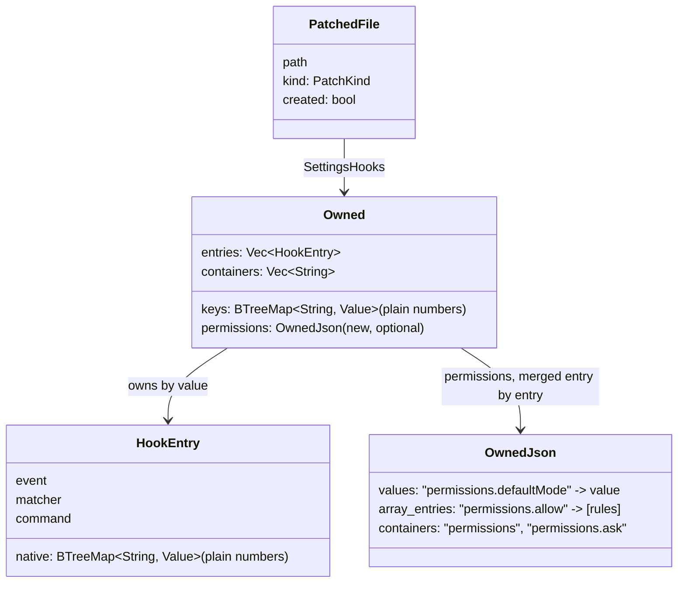

# Défauts ouverts avant la v1.0.0 — plan d'implémentation

> **Pour les agents :** sous-skill requise : superpowers:subagent-driven-development (recommandé) ou superpowers:executing-plans, tâche par tâche. Les étapes se cochent (`- [ ]`).

**Objectif :** corriger les dix défauts ouverts (#534, #522, #505, #523, #517, #524, #521, #525, #526, #506) sans changer ce qui marche : aucun hook, aucune permission ni aucun ordre de clés de l'utilisateur perdus, aucun projet valide qui se met à échouer.

**Spec :** `docs/superpowers/specs/2026-10-27-v1-open-defects-design.md`, avec sa section « Cadre » et les 14 décisions de Dimitri du 2026-10-27 (9 dans la spec, 5 dans le cadre), qui ne sont pas rejouées ici. Texte des issues : `/Users/bl209054/.claude/jobs/a97c66fb/tmp/v1-issues.md` (hors dépôt). Règles : skill `armadai-rules`.

**Branche de lot :** `fix/v1-open-defects`, worktree `../armadai-v1-defects` (`/Users/bl209054/work/misc/armadai-v1-defects`), depuis `master` (`6b22e0b` au moment du plan). Les tâches s'y suivent en série, de 1 à 4.

**Avant toute tâche :** `lead` soumet à Dimitri la section « Textes à valider par Dimitri » (décision du cadre « Toi, au plan (Recommandé) »). Une tâche n'écrit que des textes validés ; un texte changé par Dimitri se reporte ici, daté, avant la tâche qui l'écrit.

## Ce que l'architecte a lu, et ce qui reste à mesurer

Lu au dépôt (lecture seule, sans shell) : `compile/claude_settings.rs` (entier), `compile/patch.rs` (entier), `compile/json_keys.rs` (entier), `compile/report.rs`, `compile/mod.rs`, `cli/link.rs` (entier), `cli/mod.rs` (entier), `cli/native_pack.rs` (entier), `cli/validate.rs` (entier), `cli/config.rs` (entier), `cli/models.rs` (l. 1-120), `compile/opencode.rs` (l. 1-160), `linker/manifest.rs` (l. 1-200), `crates/armadai/Cargo.toml`, `Cargo.toml`, `armadai-model/src/{lib.rs,diag.rs,load.rs}`, `check.rs` (l. 280-800), `types.rs` (l. 1-150), `armadai-core/src/config.rs` (entier), `tests/init_pack.rs` (l. 690-770).

Faits établis à la lecture (à ne pas remesurer, sauf mention) :
1. **`preserve_order` est actif** : `serde_json = { workspace = true, features = ["preserve_order", "arbitrary_precision"] }` (`crates/armadai/Cargo.toml` l. 26). `Map::remove` y est un `swap_remove` (doc de serde_json ; à confirmer par le rouge de l'étape 1 de la tâche 1).
2. **#505, les sites** : `unmerge` (`doc.remove(*k)`, `claude_settings.rs` l. 246) et `prune` (`doc.remove("hooks")`, l. 236). `hooks.retain` (l. 226) et les `Vec::remove` de `remove_one` gardent l'ordre. `remove_entries` (l. 324) et `merge_settings` (l. 268, clés natives qui ne sont plus voulues) passent tous deux par `unmerge` puis `prune`. `json_keys.rs` utilise déjà `shift_remove` (l. 131, 157).
3. **#505, le critère 3 tel qu'écrit ne rougit pas sur `master`** (raisonné, à mesurer) : `link` ajoute `model` puis `hooks` en fin de fichier ; `unlink` retire `model` (avant-dernier : `hooks` prend sa place) puis `hooks` (dernier) ; l'ordre `zeta, permissions, alpha` revient intact. Le défaut se voit quand des clés suivent la clé retirée, par exemple deux clés que l'utilisateur ajoute après le `link` : `swap_remove` les permute. Le test de la tâche 1 ajoute donc deux clés après le `link` ; le critère 3 de la spec reste vérifié tel quel en plus.
4. **#505, voisin `native`** : `HookEntry.native` et `Owned.keys` sont des `BTreeMap<String, Value>` sérialisés par `derive(Serialize)` sans `serialize_with` (`claude_settings.rs` l. 24, 44) ; `OwnedJson` passe par `NativeValue` (`json_keys.rs` l. 43-57). Un nombre y sort donc très probablement sous la forme privée `$serde_json::private::Number` : à mesurer en étape 0 (décision 6).
5. **#534** : la ligne `existing identical hook kept, not owned` est écrite par `cli/link.rs` l. 519-528, pour chaque hook absent de `owned.entries` ; `merge_settings` ne revendique un hook présent que si `previous.entries` le contient (l. 289-294). `link` jette les avertissements du validateur (`load_project`, `Ok((p, _))`, `cli/link.rs` l. 61) : un avertissement de #524 ne paraît que dans `validate`.
6. **#506** : le crate est `armadai-core` (`src/config.rs`). `UserConfig.model_tiers` est typé `BTreeMap<String, BTreeMap<armadai_model::Tier, String>>` (l. 98) : une clé `medium` fait échouer la lecture du fichier entier. `Tier` vaut `fast`, `pro`, `max` (`types.rs` l. 132-136). Lecteurs vus : `OpencodeCompiler::compile` (`try_load_user_config()?`, `opencode.rs` l. 68) puis `model_for_tier` ; `config starters-dir add/remove` (`try_load_user_config()?`, `cli/config.rs` l. 99, 122) ; `starters_dir_list` et la recherche de packs (`load_user_config`, qui avertit et retombe sur les défauts). `models` ne lit pas `config.yaml` dans ses 120 premières lignes : la spec dit qu'il lit `model_tiers`, **à mesurer** (tâche 4, étape 0).
7. **#517** : `opencode.rs` connaît déjà ses agents intégrés : `BUILTIN_AGENTS` (8, dont `build` et `plan` primaires) et `BUILTIN_SUBAGENTS = ["general", "explore", "scout"]`, ceux qu'une délégation peut atteindre (l. 19-33). Un agent libre est une cible de délégation : pour OpenCode, la liste utile est celle des sous-agents, pas `build`/`plan` que l'issue cite.
8. **#523, la colonne** : dans `  - { from: b, to: c, when: rejected }` (ligne 8 de la repro), `when` est en colonne 23 et `rejected` en colonne 29 ; `3:37` est bien le `rejected` des `states` de l'étape `a`. Le plan retient **8:23**, la clé `when:` du lien, comme la spec et l'issue.
9. **#525** : `validate` écrit la ligne par `eprintln!` (`validate.rs` l. 69-71) avant `report(ds, json)` ; `init --pack` par `anstream::eprintln!("{w}  warn: ignored: …")` (`native_pack.rs` l. 155-160) ; `init --pack` n'imprime aujourd'hui aucun avertissement du validateur (seulement les erreurs, l. 162-166).
10. **CHANGELOG** : pas de `## Unreleased` (cadre) ; la tâche 1 la crée au-dessus de `## v1.0.0-rc.8 (2026-10-27)`, avec `### Added` puis `### Fixed`.

Non lu (aucune commande de recherche dans cette étape) : la liste des golden, `compile/claude.rs`, `cli/unlink.rs`, `cli/init.rs`, `armadai-core/src/starter.rs`, `docs/wiki/*.md`, `policy_gate.rs`. Chaque tâche les liste en étape 0 avec les commandes données.

## Diagrammes

### Ce que le manifeste garde de `settings.json` (#522, #505)



`Owned` gagne un seul champ, `permissions`, de type `OwnedJson` : le type, la fusion par entrée, le retrait et l'écriture des nombres que `opencode.json` utilise déjà (#504). `version` reste 1 (décision « Champ optionnel, v1 »). Un manifeste de la rc.8 se lit sans migration : `permissions` absent vaut vide ; une clé `permissions` entière dans `keys` (ce que la rc.8 écrivait quand elle créait la clé) est lue comme des entrées possédées (règle « héritage » de la tâche 1). Un binaire rc.8 lisant un manifeste de ce lot ignore `permissions` : son `unlink` laisserait les règles ajoutées (limite écrite dans `link.md`).

### Adopter des hooks sans manifeste (#534)

```mermaid
sequenceDiagram
    actor U as Utilisateur (clone, worktree)
    participant L as armadai link
    participant S as .claude/settings.json
    participant M as .armadai/link-manifest.yaml
    U->>L: link --target claude (pas de manifeste)
    L->>S: rien d'écrit, hooks identiques déjà là
    L->>M: owned.entries = [] (rien revendiqué)
    L->>U: hook … approximated (… not owned: unlink leaves it; adopt it with `armadai link --adopt-hooks`)
    U->>L: link --target claude --adopt-hooks
    L->>M: owned.entries = les hooks identiques
    L->>U: hook … compiled (existing identical hook adopted: unlink removes it)
    U->>L: unlink --target claude
    L->>S: retire les hooks possédés, garde ceux de l'utilisateur au texte différent
```

L'adoption ne prend que des hooks **identiques** à ceux que `link` ajoute, et seulement sur le geste `--adopt-hooks` ; sans l'option, le comportement de `master` reste (test `an_identical_entry_already_present_is_neither_duplicated_nor_claimed` inchangé).

## Contraintes globales

- **Barrière complète** dans chaque tâche, code retour de chaque commande lu, jamais de tube qui le masque : `cargo fmt --all -- --check`, `cargo clippy --all-targets -- -D warnings`, `cargo test --no-fail-fast`, `cargo build -p armadai-core`, `cargo build -p armadai-model`. Les tâches 2 (`armadai-model`) et 4 (`armadai-core`) vérifient aussi `cd frozen/armadai-audit && cargo check --all-targets && cargo test`.
- **Environnement** : worktree `../armadai-v1-defects`, `CARGO_TARGET_DIR=/Users/bl209054/work/misc/armadai-v1-defects/target`, jamais `git stash`, aucune commande en arrière-plan, `/usr/bin/grep`, `/bin/ls`, `/bin/ps`. Tout essai du binaire avec `HOME` et `ARMADAI_CONFIG_DIR` dans un dossier temporaire (les tests d'intégration le font par leur `Env`).
- **Tests** : `crates/armadai` est un binaire seul (`cargo test --bin armadai <nom>` ou `--test <fichier>`, jamais `--lib`), toujours `--no-fail-fast`. Égalité exacte : texte entier de `settings.json` pour tout ce qui touche l'ordre (#505) — une égalité de `Value` ignore l'ordre des clés —, ligne entière pour un diagnostic ou une ligne de rapport, ligne **et** colonne pour une position (#523/#517 : un `contains` sur `rejected` ou `claude` est satisfait par la mauvaise position, c'est le défaut). Fixtures à valeurs distinctes deux à deux.
- **Une mutation vue rouge par test ajouté ou changé**, sortie citée, restauration avec une mtime neuve (`touch`, jamais `cp -p`). Les mutations listées par tâche sont un minimum. Une boucle de test sur des sites (`allow`/`ask`/`deny`/`additionalDirectories`, les trois diagnostics) vérifie chaque site : un test par site plutôt qu'une boucle.
- **Textes** : chaque ligne de sortie nouvelle ou changée est celle de la section « Textes à valider par Dimitri », au caractère près, une fois validée.
- **Golden** : jamais régénérés en bloc sans relecture ; chaque ligne qui bouge dans un golden est une ligne que cette tâche fait bouger, sinon c'est un défaut à rapporter (cadre, « Golden »).
- **Commits** Conventional, un type par sujet, en anglais, trailer `Co-Authored-By` fourni par la session. Chaque commit de correctif porte son entrée de CHANGELOG. PR ouverte à la fin du lot, corps en français, pas de fusion sans l'accord exprès de Dimitri.
- **Formats natifs** : la forme de `permissions` de `settings.json` (`allow`, `ask`, `deny`, `additionalDirectories`, `defaultMode`, « deny gagne ») et les agents intégrés de Claude Code et d'OpenCode se relèvent dans la documentation officielle, citée avec l'URL et la date (tâche 1, étape 0).

## Choix de conception

| Choix | Options et coût | Retenu |
|---|---|---|
| Forme de l'adoption (#534) | Tranché par Dimitri (cadre) : option `--adopt-hooks` de `link`. Reste le passage du drapeau : **A.** un paramètre `adopt: bool` de `merge_settings` et `apply_settings` ; **B.** relire le fichier dans `link.rs` et corriger `owned` après coup. | **A** : la décision « possédé ou non » reste à un seul endroit (`merge_settings`). |
| Ce que `merge_settings` rend en plus | **A.** un `MergeNotes { adopted, kept, deny_over_allow }` en troisième valeur ; **B.** `link.rs` recalcule les hooks « gardés » et les `deny` par une seconde lecture. | **A** : `link.rs` calcule aujourd'hui « gardé » par `!owned.entries.contains(h)` (l. 520) ; avec l'adoption ce calcul ne distingue plus « adopté » de « déjà possédé ». Coût : les appels de test gagnent `false` et un `_`. |
| Fusion de `permissions` (#522) | **A.** réutiliser la fusion de `json_keys.rs` (chemins `permissions.<clé>`, `array_entries` pour une liste, `values` sinon, `OwnedJson` dans `Owned.permissions`), en exposant `merge_into(&mut Value, …)` et `remove_from(&mut Value, …)` dont `merge_json_keys`/`remove_json_keys` deviennent l'enveloppe ; **B.** écrire une fusion propre à `claude_settings.rs`. | **A** : une seule fusion par entrée, l'ordre (`shift_remove`) et les nombres (`NativeValue`) déjà réglés pour OpenCode (#504) ; B dupliquerait ~60 lignes et leurs défauts. |
| Message de conflit d'une valeur non liste | **A.** un seul message pour `settings.json` et `opencode.json`, qui nomme les deux valeurs (texte T4) ; **B.** nommer les valeurs pour `settings.json` seulement. | **A** : une fonction, un message. Coût : `json_keys.rs::a_wanted_key_set_by_the_user_to_another_value_is_an_error_naming_the_key` change de texte (OpenCode). À valider avec les textes. |
| `deny` contre `allow` (#522, décision 3) | **A.** contradiction = la même règle, au caractère près, dans le `deny` qu'ajoute ArmadAI et dans l'`allow` de l'utilisateur ; **B.** recouvrement de motifs (`Bash(git *)` contre `Bash(git push:*)`). | **A** : B demande de réimplémenter l'appariement de Claude Code et devinerait (anti-objectif). Limite écrite dans `link.md`. Question 1 pour Dimitri. |
| Héritage rc.8 de `permissions` | La rc.8 possédait `permissions` entier dans `Owned.keys` quand elle l'avait créé. **A.** le relire comme des entrées possédées (`array_entries` pour chaque liste, `values` sinon, conteneurs `permissions` et chaque liste) ; **B.** le traiter comme une clé disparue (retirée puis recréée : la clé change de place, l'ordre bouge). | **A** : un relink après la rc.8 ne change pas un octet (test de la tâche 1). |
| Position d'un lien fautif (#523) | **A.** recherche textuelle qui part de la clé `links:` et prend la n-ième paire `when: <état>` (n = nombre de liens précédents de même `when`), de même pour `from:`/`to:` ; `on_failure:` cherché après la clé de son étape ; `start:` comme clé ; **B.** un parseur YAML à positions (dépendance nouvelle, `armadai-model` doit rester pur). | **A** ; si la paire n'est pas trouvée (texte inhabituel), le diagnostic n'a pas de position plutôt qu'une position fausse (« ne jamais deviner »). Limite : un commentaire `# when: rejected` dans `links:` décale le compte. |
| Où vit la liste des agents intégrés (#517) | **A.** une table dans `armadai-model` (`check.rs`), par cible, et `opencode.rs` garde la sienne ; **B.** la table dans le modèle et `opencode.rs` la lit (une seule source, mais la tâche 2 toucherait l'adaptateur : une tâche de plus). | **A** pour ce lot (quatre tâches, décision 9). La duplication est notée en commentaire des deux côtés et vérifiée par `guardian` (Review Focus 6) ; la ramener à une source est une suite possible, hors lot. |
| Détection d'un chemin de skill (#524) | Où : **A.** au chargement (`load.rs`, qui lit déjà le dossier de la skill), avertissement positionné dans `SKILL.md` ; **B.** dans `check.rs`, qui n'a que le texte et ferait des E/S. | **A**. Règle d'extraction : voir la tâche 2. Un avertissement par chemin distinct (sa première occurrence). |
| Bit exécutable (#521) | **A.** `PackFiles.files: Vec<(PathBuf, Vec<u8>, bool)>`, le booléen « exécutable » ; **B.** une struct `PackFile`. | **A**, documenté dans le commentaire du champ ; `stage` prend `&PackFiles` (il en a besoin pour #525). |
| `model_tiers` (#506) | **A.** `UserConfig.model_tiers: NativeValue` (YAML libre, jamais d'échec de lecture), une fonction `model_tier_problems` qui liste les clés fautives, un avertissement dans les lectures qui n'en ont pas besoin, une erreur dans `try_load_user_config_for("opencode")` ; **B.** garder le type strict et rattraper l'erreur de lecture (on perdrait `starters_dirs` quand même). | **A** : `NativeValue` vient d'`armadai-model`, que `armadai-core` lit déjà ; aucune dépendance nouvelle. |
| Domaine de la tâche 4 | `config.rs` est dans `armadai-core`, son lecteur strict dans `opencode.rs`. `model_tiers` est la table de modèles, du périmètre d'`adapter-specialist` (`.claude/CLAUDE.md`). | `adapter-specialist` ; `cli/config.rs` n'est pas touché (voir la tâche 4). |

---

### Tâche 1 [adapter-specialist] : `settings.json` — ordre, nombres, `permissions`, adoption (#505, #522, #534)

**Fichiers :**
- Commit d'abord (étape 0) : `docs/superpowers/specs/2026-10-27-v1-open-defects-design.md`, `docs/superpowers/plans/2026-10-27-v1-open-defects.md`, `.armadai/skills/armadai-rules/SKILL.md` (les trois sont modifiés ou non suivis dans le dépôt principal), puis la copie `.claude/skills/armadai-rules/` par `armadai link --target claude`.
- Modifier : `crates/armadai/src/compile/claude_settings.rs`, `compile/json_keys.rs` (exposer la fusion, message de conflit), `compile/patch.rs` (`apply_settings`, `preflight_settings`), `cli/link.rs` (drapeau, lignes de rapport), `cli/mod.rs` (`Link { adopt_hooks }`), chaque appelant de `link::execute` (`/usr/bin/grep -rn "link::execute" crates/armadai/src`), `docs/wiki/link.md`, `CHANGELOG.md`.
- Tests : `claude_settings.rs`, `json_keys.rs`, `patch.rs` (modules de tests), `crates/armadai/tests/link_new_cli.rs` ; fixtures nouvelles `crates/armadai/tests/fixtures/rc8-manifest/` (voir étape 4).
- Golden à lister en étape 0 : `/usr/bin/grep -rln "existing identical hook\|already set to another value\|adopt" crates/armadai/tests crates/armadai/src docs` ; `/usr/bin/grep -rln "Overwrite existing files that differ" crates/armadai/tests` (aide de `link` figée) ; le test de complétion (`cli/mod.rs`) ne fige pas les options de `link`. Attendu par l'architecte, non vérifié : aucun golden de `tests/golden/` ne contient la ligne « not owned » (leurs projets partent d'un `settings.json` absent) ; `link_new_cli.rs` peut en contenir.

**Interfaces :**
```rust
// claude_settings.rs
#[derive(Debug, Clone, Default, PartialEq, Serialize, Deserialize)]
pub struct Owned {
    #[serde(default, skip_serializing_if = "Vec::is_empty")]
    pub entries: Vec<HookEntry>,                 // native: plain numbers (serialize_with)
    #[serde(default, skip_serializing_if = "BTreeMap::is_empty", serialize_with = "...")]
    pub keys: BTreeMap<String, Value>,           // top-level native keys, `permissions` excepted
    #[serde(default, skip_serializing_if = "Vec::is_empty")]
    pub containers: Vec<String>,
    /// Rules and values of `native.claude.permissions`, owned entry by entry. Absent from
    /// manifests written before 1.0.0, hence the default.
    #[serde(default, skip_serializing_if = "OwnedJson::is_empty")]
    pub permissions: OwnedJson,
}

/// What a merge did besides its text and what it owns: for the report.
#[derive(Debug, Default, PartialEq)]
pub struct MergeNotes {
    pub adopted: Vec<HookEntry>,        // identical hooks found and taken over (--adopt-hooks)
    pub kept: Vec<HookEntry>,           // identical hooks found and left to the user
    pub deny_over_allow: Vec<String>,   // deny rules link added that the user's allow also lists
}

pub fn merge_settings(existing: Option<&str>, entries: &[HookEntry],
    keys: &BTreeMap<String, Value>, previous: &Owned, adopt: bool)
    -> anyhow::Result<(String, Owned, MergeNotes)>;
pub fn remove_entries(existing: &str, previous: &Owned) -> anyhow::Result<String>; // inchangée

// json_keys.rs
impl OwnedJson { pub fn is_empty(&self) -> bool; }
pub(crate) fn merge_into(doc: &mut Value, wanted: &JsonKeys, previous: &OwnedJson) -> anyhow::Result<OwnedJson>;
pub(crate) fn remove_from(doc: &mut Value, previous: &OwnedJson);

// patch.rs
pub fn apply_settings(root, rel, trust, entries, keys, previous, adopt: bool)
    -> anyhow::Result<(PatchedFile, bool, MergeNotes)>;
// preflight_settings : signature inchangée (appelle merge_settings avec adopt = false : l'adoption ne change aucune erreur)

// cli/mod.rs, Command::Link
/// Take over the hooks already in .claude/settings.json that are identical to the
/// ones link adds (a clone or a worktree without .armadai/link-manifest.yaml), so
/// unlink removes them
#[arg(long)]
adopt_hooks: bool,
```

**Règles :**
1. **Ordre (#505)** : `unmerge` et `prune` utilisent `shift_remove`. Rien d'autre ne retire une clé de premier niveau dans ce fichier (le vérifier par `/usr/bin/grep -n "\.remove(" crates/armadai/src/compile/claude_settings.rs` et citer chaque ligne).
2. **Nombres (#505, voisin, seulement si l'étape 0 mesure la forme privée)** : `HookEntry.native` et `Owned.keys` s'écrivent par `NativeValue`, comme `OwnedJson` (même `serialize_with` que `plain_values`, partagé, pas copié). La lecture accepte les deux formes (désérialisation `Value` inchangée ; un test lit chacune).
3. **`permissions` (#522)** : si `keys["permissions"]` est un objet, il sort de la fusion « valeur entière » et devient un `JsonKeys` : pour chaque sous-clé `k`, une liste → `array_entries["permissions.k"]`, autre chose → `values["permissions.k"]`. Il passe par `json_keys::merge_into` **juste après** la boucle des clés natives (avant les hooks : un fichier neuf garde l'ordre d'aujourd'hui, `permissions` avant `hooks`). `remove_entries` appelle `remove_from` pour `previous.permissions`. Un `permissions` du projet qui n'est pas un objet garde la règle « valeur entière » (rien ne change pour lui).
4. **Héritage rc.8** : si `previous.keys` contient `permissions`, il en est retiré et converti en `OwnedJson` (listes → entrées, autres → valeurs, conteneurs `permissions` et `permissions.<liste>`), fusionné dans `previous.permissions` avant tout calcul. Même conversion dans `remove_entries`.
5. **Conflit** : une valeur non liste différente (premier niveau ou `permissions.<k>`) est une erreur qui nomme la clé et les deux valeurs (texte T4, JSON compact par `serde_json::to_string`). Les autres erreurs de `json_keys` (`is not an array`, `is inside a value that is not an object`, `was changed by hand since the last link`) gardent leur texte.
6. **`deny` contre `allow`** : à la fin de la fusion, chaque règle de `owned.permissions.array_entries["permissions.deny"]` présente telle quelle dans `doc["permissions"]["allow"]` et absente de `owned.permissions.array_entries["permissions.allow"]` va dans `notes.deny_over_allow`, dans l'ordre du `deny`. La règle est écrite comme les autres.
7. **Adoption (#534)** : dans la boucle des hooks, un hook `present` que `previous` ne possède pas va dans `owned.entries` et `notes.adopted` si `adopt`, dans `notes.kept` sinon. Sans `adopt`, `owned` est celui de `master` au champ près.
8. **Rapport (`cli/link.rs`)** : la boucle l. 519-528 lit `notes.kept` (texte T1), puis `notes.adopted` (texte T2), puis `notes.deny_over_allow` (texte T3). `--dry-run` ne change pas (il n'écrit aucune de ces lignes aujourd'hui).

**Étapes :**
- [ ] **Étape 0 — branche, documents, mesures :**
  - `git worktree add -b fix/v1-open-defects ../armadai-v1-defects master` ; `git config core.hooksPath .githooks` dans le worktree.
  - Copier depuis le dépôt principal, à l'octet, la spec, ce plan et `.armadai/skills/armadai-rules/SKILL.md` ; commit `docs(lot): spec, plan and rules for the v1 open defects`. Dire à `lead` que le dépôt principal garde ces fichiers non commités (à lui de décider de leur sort ; l'agent n'y touche pas).
  - `HOME=$(mktemp -d) ARMADAI_CONFIG_DIR=$(mktemp -d) cargo run -q -- link --target claude` dans le worktree ; `git status` doit ne montrer que `.claude/skills/armadai-rules/SKILL.md` (tout autre fichier changé : s'arrêter et le rapporter) ; commit `chore(armadai): relink the team for the updated rules`.
  - Mesurer et citer : (a) le YAML de `Owned { entries: [HookEntry { native: {timeout: 5} }], keys: {cleanupPeriodDays: 30} }` écrit par `armadai_model::yaml::to_string` (forme privée ou non : décide la règle 2) ; (b) le rouge du test d'ordre de l'étape 1 sur `master`, et le critère 3 de la spec tel qu'écrit (vert attendu sur `master`, fait 3 ci-dessus) ; (c) la liste des golden (commandes ci-dessus).
  - Relever et citer (URL, date, phrase) dans la documentation officielle de Claude Code (`https://code.claude.com/docs/en/settings`, `…/iam` ou la page « permissions ») : les clés de `permissions` et leur type, « deny » prioritaire. Et, pour la tâche 2, les agents intégrés que Claude Code fournit (page « sub-agents ») et ceux d'OpenCode (`https://opencode.ai/docs/agents`) qu'un sous-agent ou une délégation peut atteindre. Le relevé va dans le rapport de la tâche 1 ; `lead` le transmet tel quel à la tâche 2.
- [ ] **Étape 1 — #505 (rouges d'abord) :**
  - `unlink_keeps_the_key_order_of_the_user` (`claude_settings.rs`) : `user = {"zeta":1,"permissions":{"allow":["Bash(ls)"]},"alpha":{"x":true}}` ; `merge_settings(Some(user), &wanted(), &{"model":"opus"}, &Owned::default(), false)` ; le texte fusionné, relu en `Value`, reçoit à la fin `"beta":2` puis `"gamma":3`, rendu par `render` ; `remove_entries(&edited, &owned)` == `render` de `{"zeta":1,"permissions":{"allow":["Bash(ls)"]},"alpha":{"x":true},"beta":2,"gamma":3}`, **texte** comparé. Mutations : (a) `doc.remove` remis dans `unmerge` seul → rouge (ordre `…, gamma, beta`) ; (b) `doc.remove` remis dans `prune` seul → rouge ; chacune séparément.
  - `a_key_no_longer_wanted_leaves_the_order_on_relink` : même `user` avec `model` et `env` voulus, `beta`/`gamma` ajoutés après, relink sans `env` : texte exact (`env` retiré, le reste en place). Mutation : (a) ci-dessus.
  - Critère 3 tel qu'écrit, en intégration (`link_new_cli.rs`, `a_link_and_unlink_keep_the_user_key_order`) : `settings.json` = `{"zeta":1,"permissions":{"allow":["Bash(ls)"]},"alpha":{"unknown":true}}`, projet avec `native.claude.model: opus` et un flow ; `link` puis ajout de `"beta":2,"gamma":3` à la main, puis `unlink` : le fichier vaut exactement le texte de l'utilisateur plus `beta`, `gamma`, rendu par `to_string_pretty` + `\n`. Mutation : (a) → rouge.
- [ ] **Étape 2 — nombres (si l'étape 0 a vu la forme privée) :** `owned_numbers_are_plain_yaml_numbers_in_the_manifest` (`claude_settings.rs`) : `Owned` de l'étape 0 → YAML exact `entries:\n- event: PreToolUse\n  command: ./x.sh\n  native:\n    timeout: 5\nkeys:\n  cleanupPeriodDays: 30\n` (à ajuster à l'ordre réel des champs, mesuré, puis figé) ; relu, égal à l'`Owned` d'origine ; et le même YAML sous la forme privée (`timeout:\n      $serde_json::private::Number: '5'`, le texte mesuré à l'étape 0) relu égal aussi. Mutation : retirer `serialize_with` de `native` → rouge ; de `keys` → rouge (deux mutations). Si la forme privée n'est pas vue : pas de code, le rapport cite la sortie de l'étape 0 et le critère 3 (partie `timeout`) est sans objet (décision 6).
- [ ] **Étape 3 — #522 :** tests dans `claude_settings.rs`, chacun à texte exact (`render` du résultat attendu) :
  - `permission_lists_merge_rule_by_rule` (critère 2, repro) : `{"permissions":{"allow":["Bash(ls)"]}}` + `permissions.ask: ["Bash(git push:*)"]` → `{"permissions":{"allow":["Bash(ls)"],"ask":["Bash(git push:*)"]}}` ; second `merge_settings` avec l'`owned` rendu : même texte, même `owned` ; `remove_entries` → `render` de l'entrée. Mutation : traiter `permissions` comme une valeur entière (code de `master`) → erreur au lieu du texte.
  - `a_project_allow_goes_after_the_user_allow` : `allow: ["Bash(git *)"]` → `"allow":["Bash(ls)","Bash(git *)"]`. Mutation : insérer en tête.
  - `additional_directories_merge_like_the_rules` : utilisateur `"additionalDirectories":["../u"]`, projet `["../p"]` → `["../u","../p"]`. Mutation : ne fusionner que `allow`/`ask`/`deny` (liste figée) → rouge.
  - `a_rule_the_user_already_has_is_neither_duplicated_nor_claimed` : utilisateur et projet `ask: ["Bash(git push:*)"]` → texte inchangé, `owned.permissions` vide, `remove_entries` rend le texte. Mutation : pousser l'entrée sans tester `contains`.
  - `a_deny_the_user_allows_is_written_and_noted` : utilisateur `allow: ["Bash(curl:*)","Bash(ls)"]`, projet `deny: ["Bash(curl:*)","Bash(rm:*)"]` → `deny` écrit en entier, `notes.deny_over_allow == ["Bash(curl:*)"]` ; avec un `allow` utilisateur `["Bash(ls)"]` : `== []`. Mutation : ne rien noter ; noter toute règle `deny` (le second cas rougit).
  - `a_non_list_permission_with_another_value_names_both_values` : utilisateur `"defaultMode":"plan"`, projet `"acceptEdits"` → `err.to_string() ==` texte T4 avec `permissions.defaultMode`, `"plan"`, `"acceptEdits"`. Mutation : message de `master`.
  - `native_keys_are_added_owned_and_removed` (existant) : l'assertion `contains("`model`")` devient l'égalité au texte T4 (`"haiku"`, `"opus"`). Mutation : message de `master`.
  - `json_keys.rs::a_wanted_key_set_by_the_user_to_another_value_is_an_error_naming_the_key` : texte T4 pour `default_agent` (`"mine"`, `"lead"`) si Dimitri retient l'option A du message ; mutation : message de `master`.
  - `a_manifest_owning_the_whole_permissions_key_reads_as_rules` (héritage) : `previous = Owned { keys: {"permissions": {"ask":["Bash(git push:*)"]}} }`, fichier `{"permissions":{"ask":["Bash(git push:*)"]},"zeta":1}` (ce que la rc.8 écrivait, plus une clé de l'utilisateur après) : relink avec le même projet → texte inchangé et `owned.permissions` = l'entrée et les conteneurs `permissions`, `permissions.ask`, `owned.keys` vide ; `remove_entries(text, &previous)` (ancien manifeste) → `{"zeta":1}`. Mutation : ne pas convertir (la clé est retirée puis recréée : `permissions` passe après `zeta`).
  - Intégration `link_new_cli.rs::permissions_merge_into_the_user_settings_and_unlink_gives_them_back` (critère 2 entier, par le binaire) : la repro de #522 ; `link` rend 0 ; `settings.json` vaut exactement `{"permissions":{"allow":["Bash(ls)"],"ask":["Bash(git push:*)"]}}` rendu ; un second `link` ne change pas l'octet ; `unlink` rend exactement le fichier d'origine rendu (`{"permissions":{"allow":["Bash(ls)"]}}`) ; puis la variante `deny: ["Bash(ls)"]` : la ligne de rapport T3 est dans la sortie, ligne entière ; puis `defaultMode` en conflit : code 1, stderr contient la ligne T4 entière et rien n'est écrit (`.claude/agents/` absent).
- [ ] **Étape 4 — manifeste rc.8 réel :** construire la rc.8 (`git worktree add /tmp/armadai-rc8 <tag de la 1.0.0-rc.8, ou 33c8aae>`, son propre `CARGO_TARGET_DIR`), puis, `HOME` et `ARMADAI_CONFIG_DIR` isolés, lier avec elle un projet de fixture : un flow, une automation `before-tool` avec `native.claude.timeout: 5`, `native.claude.permissions.ask: ["Bash(git push:*)"]`, pas de `settings.json` avant. Copier tels quels sous `crates/armadai/tests/fixtures/rc8-manifest/` le projet (`.armadai/`), `.claude/settings.json` et `.armadai/link-manifest.yaml`. Une seconde copie du manifeste, `link-manifest-plain.yaml`, avec les nombres sous forme simple (ce qu'écrit le binaire du lot ; texte relevé après un `link` du lot sur la même fixture). Test `link_new_cli.rs::a_manifest_written_by_rc8_still_unlinks_and_relinks` (deux cas, un par manifeste, sans boucle) : `unlink` du binaire du lot retire hooks et permissions (le fichier disparaît, `created: true`) ; puis, sur une copie fraîche, `link` du binaire du lot ne change pas `settings.json` d'un octet et son manifeste possède les mêmes hooks et la règle `ask`. Mutation : retirer la conversion d'héritage (règle 4) → le relink déplace ou duplique ; retirer `#[serde(default)]` de `permissions` → la lecture échoue (`Lookup::Fallback`, `unlink` ne retire plus rien).
- [ ] **Étape 5 — #534 :**
  - `claude_settings.rs::an_identical_entry_already_present_is_neither_duplicated_nor_claimed` : inchangé hors l'appel (`false`, `_`), et assert `notes.kept == [mine]`, `notes.adopted == []`.
  - `an_identical_entry_is_adopted_on_request` : même fichier, `adopt = true` → texte inchangé, `owned.entries == [mine]`, `notes.adopted == [mine]`, `remove_entries` → `{}` rendu ; un hook de l'utilisateur au texte différent (`armadai check --mine`) reste. Mutation : ignorer `adopt` → rouge ; adopter aussi un hook non identique (`present` sans `same_matcher`) → le hook de l'utilisateur part, rouge.
  - Intégration `link_new_cli.rs::hooks_found_without_a_manifest_are_adopted_on_request` (critère 1) : projet avec un flow et `policy.delegation: strict`, `settings.json` de l'utilisateur avec un hook à lui (`./mine.sh`) ; `link`, puis suppression de `.armadai/link-manifest.yaml` (le clone) ; (a) `link` : code 0, les cinq lignes T1 (gate et quatre hooks d'enregistrement, une par hook), aucun hook dans le manifeste (lu en YAML), `unlink` laisse `settings.json` à l'octet près ; (b) `link --adopt-hooks` : les cinq lignes T2, le manifeste possède les cinq ; `unlink` : `settings.json` vaut exactement le fichier de l'utilisateur rendu (son hook `./mine.sh` gardé). Mutations : (i) `cli/link.rs` n'écrit plus T1 → rouge ; (ii) `--adopt-hooks` non passé à `apply_settings` → (b) rouge.
  - L'aide : `link --help` contient la ligne d'aide T7 (le test `every_kept_command_has_a_help_description` ne la couvre pas ; ajouter `link_help_names_adopt_hooks` à égalité sur la ligne `--adopt-hooks` du rendu de `Cli::command().find_subcommand("link")`). Mutation : retirer le commentaire de doc.
- [ ] **Étape 6 — doc et CHANGELOG :**
  - `docs/wiki/link.md` : la phrase « a hook identical to one link would add is left to you and reported » devient « … is left to you and reported, with the way to adopt it: `armadai link --adopt-hooks` takes over the hooks identical to the ones link adds (on a clone or a worktree, where `.armadai/link-manifest.yaml`, git-ignored, is missing), and `unlink` then removes them ». Ajouter : `native.claude.permissions` fusionné liste par liste (toute sous-clé liste ; une autre valeur garde la règle valeur entière, et un conflit nomme les deux valeurs) ; un `deny` ajouté que l'`allow` de l'utilisateur liste aussi, au caractère près, est signalé (Claude Code applique `deny`) ; une règle à motif recouvrant n'est pas vue ; un binaire rc.8 ne connaît pas `permissions` du manifeste : son `unlink` laisse les règles ajoutées ; l'ordre des clés est gardé par `link` et `unlink`.
  - `CHANGELOG.md` : créer `## Unreleased` au-dessus de `## v1.0.0-rc.8 (2026-10-27)`, avec `### Added` puis `### Fixed`. Added : « `armadai link --adopt-hooks` takes over the hooks of `.claude/settings.json` that are identical to the ones link adds (a clone or a worktree without `.armadai/link-manifest.yaml`), so `unlink` removes them; the report says so where it said `not owned` (#534). » Fixed : « `native.claude.permissions` is merged list by list into an existing `permissions` of `.claude/settings.json` (`allow`, `ask`, `deny`, `additionalDirectories` and any other list): your rules are kept, `unlink` removes only the rules link added, a `deny` link adds that your `allow` lists is reported, and a conflicting value names both values (#522). » et « `unlink` and a relink no longer reorder the keys of `.claude/settings.json`; numbers of hooks and keys recorded in the link manifest are plain YAML numbers (#505). » (la seconde moitié seulement si l'étape 2 a eu lieu).
- [ ] **Étape 7 :** golden de l'étape 0 relus ligne à ligne ; barrière ; 5 passes de `cargo test --bin armadai claude_settings` et de `cargo test --test link_new_cli`.

**Commits :** `fix(link): keep the key order of settings.json on unlink and relink (#505)` (étapes 1-2) ; `fix(link): merge native.claude.permissions list by list (#522)` (étapes 3-4) ; `feat(link): adopt identical hooks with --adopt-hooks (#534)` (étape 5) ; la doc et le CHANGELOG vont dans le commit de leur défaut.

Critères couverts : 1, 2, 3, 12 (préparation), 11 pour ses tests.

### Tâche 2 [schema-specialist] : positions et nouveaux contrôles du validateur (#523, #517, #524)

Dépend du relevé des agents intégrés (tâche 1, étape 0), transmis par `lead`. Indépendante du code de la tâche 1.

**Fichiers :**
- Modifier : `crates/armadai-model/src/diag.rs`, `check.rs`, `load.rs`, `docs/wiki/project-format.md` (table des codes : `skill-missing-path` ; section Validation : la phrase « première occurrence du mot » limitée aux diagnostics qui la gardent ; dossier de skill : « the folder's other files (scripts, references) are untouched » devient « … are copied as is; a path under `scripts/` or `references/` named by `SKILL.md` and absent gives the warning `skill-missing-path` »), `docs/wiki/policy-gate.md` si elle cite les agents intégrés (le lire), `CHANGELOG.md`.
- Tests : modules de tests de `diag.rs`, `check.rs`, `load.rs` ; les tests d'intégration de `validate` (les trouver : `/usr/bin/grep -rln "unknown-state\|unknown-step\|unknown-free-agent" crates/`).
- Golden à lister en étape 0 : `/usr/bin/grep -rn "unknown-state\|unknown-step\|unknown-free-agent" crates/*/tests crates/*/src docs` (positions figées) ; et tout test qui exige zéro diagnostic sur un pack ou un projet réel (`/usr/bin/grep -rn "validate(&env.root()), Vec::new()\|0 warning(s)" crates/armadai/tests`, par exemple `init_pack.rs:744`) : chaque skill embarquée qui cite `scripts/` ou `references/` sans le fichier ferait apparaître un avertissement. Mesurer : `armadai validate` sur chaque pack natif embarqué (`crates/armadai-core/starters/*`) et sur `.armadai/` du dépôt, avant et après, sorties citées.
- `frozen/armadai-audit` : `cargo check --all-targets && cargo test` (le modèle change).

**Interfaces (`diag.rs`, `pub(crate)` : aucune API publique nouvelle) :**
```rust
/// Byte offset just after the first `key:` used as a mapping key.
pub(crate) fn key_end(text: &str, key: &str) -> Option<usize>;
/// 1-based (line, column) of the first whole-word `token` at or after byte `from`.
pub(crate) fn locate_from(text: &str, from: usize, token: &str) -> (Option<usize>, Option<usize>);
/// 1-based (line, column) of the key of the `n`-th (0-based) `key: value` pair at or
/// after byte `from`, `value` a whole word, bare or quoted, in block or flow style.
pub(crate) fn locate_pair(text: &str, from: usize, key: &str, value: &str, n: usize) -> (Option<usize>, Option<usize>);
```
`check.rs` : `Out::unknown_ref_at(at, code, what, token, known, pos)` (même message et indice qu'`unknown_ref`, position donnée, par `emit_pos`). Une table de données :
```rust
/// Agents a target provides that a delegation can reach (official docs, <date>): a free agent named here is not reported.
const BUILTIN_SUBAGENTS: [(&str, &[&str]); 2] = [("claude", &[/* relevé */]), ("opencode", &[/* relevé */])];
```
Les cibles déclarées sont `manifest.targets`, ou `["claude"]` quand la liste est vide (la cible par défaut de `link`, `cli/link.rs::targets_of`).

**Règles :**
1. **`unknown-state`** (l. 718-724) : position `locate_pair(text, key_end(text, "links")?, "when", w, n)`, `n` = nombre de liens précédents du flow dont `when == Some(w)`.
2. **`unknown-step`** : extrémité de lien (l. 704-707) : `locate_pair(…, "from" | "to", end, n)`, `n` = liens précédents de même `from` (resp. `to`) ; `on_failure` (l. 662-663) : `locate_pair(text, fin de la clé de l'étape sid cherchée après key_end("steps"), "on_failure", t, 0)` ; `start` (l. 753-754) : `locate_pair(text, 0, "start", s, 0)`.
3. **`unknown-free-agent`** (l. 487-503) : position `locate_from(text, key_end(text, "free_agents")?, a)` ; un agent de `BUILTIN_SUBAGENTS` d'une cible déclarée n'est pas signalé ; l'indice devient le texte T6 (« did you mean » gardé quand il existe).
4. Position introuvable (texte inhabituel) : `(None, None)`, jamais la première occurrence du mot. Les autres diagnostics qui passent par `locate()` gardent le `shortcut` (décision 4).
5. **`skill-missing-path`** (`load.rs`, boucle des skills, après la lecture du frontmatter) : dans le corps (`body`, prose et code), chaque jeton qui commence par `scripts/` ou `references/` (ou `./scripts/`, `./references/`), précédé du début du texte ou d'un caractère hors de `[A-Za-z0-9._/-]` ; le jeton s'étend sur `[A-Za-z0-9._/-]` ; un `.`, `,`, `:` ou `)` final est retiré ; un jeton suivi de `<`, `{`, `*` ou `$`, ou réduit au préfixe, est un motif et n'est pas contrôlé. Si `dir.join(jeton)` n'existe pas : un avertissement `skill-missing-path` positionné sur le jeton dans `SKILL.md` (ligne et colonne du fichier entier), texte T5, une fois par jeton distinct. Code ajouté à la table de `project-format.md` (code, `warning`, sens, correction).

**Étapes :**
- [ ] **Étape 0 :** golden et mesures ci-dessus ; la repro de #523 sur `master` (sortie `3:37` citée) ; `armadai validate` sur les packs embarqués et sur `.armadai/` du dépôt.
- [ ] **Étape 1 — tests (rouges d'abord), positions à égalité de `render()` entier :**
  - `diag.rs` : `locate_pair` sur `"links:\n  - { from: a, to: b, when: rejected }\n  - from: b\n    to: c\n    when: \"rejected\"\n"` : `n = 0` → `(Some(2), Some(23))`, `n = 1` → `(Some(5), Some(5))`, `n = 2` → `(None, None)` ; `value` partiel (`reject`) → `(None, None)`. Positions à recompter par le constructeur sur la fixture écrite, puis figées. Mutation : ignorer `n` ; ne pas exiger le mot entier.
  - `an_unknown_state_points_at_its_link` (critère 4) : la repro de #523 → un seul diagnostic, `render()` == `<file>:8:23: error[unknown-state]: unknown state `rejected`\n  hint: known: done, failed`. Mutation : `unknown_ref` d'origine → `3:37`.
  - `the_second_link_with_the_same_state_is_found` : deux liens `when: rejected`, le premier valide (source `a` qui déclare `rejected`), le second fautif → position du second. Mutation : `n = 0` toujours.
  - `an_unknown_step_points_at_its_key` : trois flows, un par site (`to: zz` d'un lien, `on_failure: zz`, `start: zz`), chacun avec le mot `zz` placé plus haut dans sa `description` pour que la première occurrence soit fausse : chaque `render()` exact. Un test par site, pas de boucle. Mutation : chaque site remis à `unknown_ref`, séparément.
  - `a_free_agent_the_target_provides_is_not_reported` (critère 8) : `targets: [claude]`, `free_agents` = la liste relevée pour Claude Code → aucun `unknown-free-agent` ; `targets: [opencode]` et un agent de la liste OpenCode → aucun ; `targets: [opencode]` et `Explore` → signalé (la liste est par cible). Mutation : ignorer les cibles déclarées (union de toutes les listes) → le troisième cas rougit ; table vide → les deux premiers.
  - `an_unknown_free_agent_points_at_its_list_entry` : `schema_version: 1\ntargets: [claude]\npolicy:\n  free_agents: [inconnu-xyz]\n` → `render()` == texte T6 en `4:17`. Et `free_agents: [claude]` si `claude` n'est pas dans le relevé (Question 2) : position sur la ligne de `free_agents`, pas `2:…`. Mutation : `emit` avec `locate` d'origine.
  - `load.rs::a_skill_path_absent_from_its_folder_is_a_warning` (critère 5) : la repro de #524 → un seul diagnostic, `render()` == texte T5 en `5:25` ; avec `missing.sh` créé → aucun ; `references/x.md` en code en ligne absent → T5 sur ce jeton ; `scripts/run.sh` présent ne donne rien. Cas négatifs, chacun un assert : `see scripts/<name>.sh`, `https://x.test/scripts/a.sh`, `foo/scripts/a.sh`, `scripts/` seul → rien. Mutations : (a) ne lire que les codes en ligne → la repro (prose) rougit ; (b) ne pas retirer le `.` final (`scripts/missing.sh.` dans une phrase) → rouge ; (c) ne pas exclure les motifs → `scripts/<name>.sh` rougit.
  - Intégration (le fichier des tests de `validate` trouvé à l'étape 0) : la repro de #524 par le binaire : code 0, stdout == ligne T5 + `0 error(s), 1 warning(s)\n`.
- [ ] **Étape 2 :** implémenter ; documentation ; schémas : aucun type sérialisé ne change, `gen_schemas` non lancé (le dire).
- [ ] **Étape 3 :** mutations ci-dessus, vues rouges ; golden relus ; barrière ; `frozen/armadai-audit`.
- [ ] **CHANGELOG** (`## Unreleased`) : Added : « New diagnostic: `skill-missing-path` (warning), a path under `scripts/` or `references/` that a `SKILL.md` names and its folder lacks (#524). » Fixed : « `validate` positions `unknown-state`, `unknown-step` and `unknown-free-agent` on the faulty link, key or list entry instead of the first occurrence of the word (#523). » et « `validate` no longer reports as `unknown-free-agent` an agent that a declared target provides (Claude Code, OpenCode), and its hint lists them (#517). »

**Commits :** `fix(validate): position unknown-state, unknown-step and unknown-free-agent on their node (#523)` ; `fix(validate): know the built-in agents of the declared targets (#517)` ; `feat(validate): warn on a skill path missing from its folder (#524)`.

Critères couverts : 4, 5, 8, 11.

### Tâche 3 [cli-specialist] : packs — bit exécutable, `ignored-pack-file`, aide (#521, #525, #526)

**Fichiers :**
- Modifier : `crates/armadai/src/cli/native_pack.rs`, `cli/validate.rs`, `cli/mod.rs` (`long_about` d'`init`), tout autre appelant de `files`/`stage` (`/usr/bin/grep -rn "native_pack::\(files\|stage\)\|PackFiles" crates/armadai/src`), `docs/wiki/starter-packs.md` (l. 30-31), `docs/wiki/project-format.md` (table des codes : `ignored-pack-file`), `CHANGELOG.md`.
- Tests : `crates/armadai/tests/init_pack.rs` (l. 735-738 change), le fichier des tests de `validate` d'un pack (`/usr/bin/grep -rln "not part of a pack" crates/armadai/tests crates/armadai/src docs`).
- Golden à lister en étape 0 : la commande ci-dessus ; `/usr/bin/grep -rln "Use --pack to create the project" crates/armadai/tests` (aide d'`init` figée).

**Interfaces :**
```rust
pub struct PackFiles {
    /// (path relative to `.armadai/`, bytes, executable on Unix in the pack)
    pub files: Vec<(PathBuf, Vec<u8>, bool)>,
    pub ignored: Vec<PathBuf>,
}
/// Every diagnostic of the pack: the validator's, and one `ignored-pack-file`
/// warning per ignored file, first.
pub fn stage(pack_dir: &Path, pack: &PackFiles) -> anyhow::Result<(tempfile::TempDir, Vec<armadai_model::Diagnostic>)>;
impl Created { fn write(&mut self, base: &Path, rel: &Path, bytes: &[u8], executable: bool) -> anyhow::Result<()>; }
```

**Règles :**
1. **#521** : `files()` lit `meta.permissions().mode() & 0o111 != 0` (Unix ; `false` ailleurs). `Created::write` applique, après `write_all`, `mode | ((mode & 0o444) >> 2)` comme `copy_executable_bits` (`cli/link.rs` l. 360), seulement si `executable`. Rien d'autre ne change de mode.
2. **#525** : `stage` ajoute en tête de ses diagnostics, pour chaque `ignored`, `Diagnostic { severity: Warning, code: "ignored-pack-file", file: pack_dir.join(rel), path: "", line: None, column: None, message: T8, hint: Some(T8 hint) }`. `validate.rs` retire son `eprintln!` : `report` imprime et compte la ligne, `--json` la contient. `install` retire sa boucle `  warn: ignored:` et imprime sur stderr, par `d.render()`, chaque diagnostic `ignored-pack-file` de `stage` (ni styles ni retrait : la même forme que `validate`) ; les autres avertissements du validateur restent muets dans `init`, comme sur `master`.
3. **#526** : le `long_about` d'`init` et `starter-packs.md` donnent la liste blanche du code (`listed`, `native_pack.rs` l. 19-28), texte T9.

**Étapes :**
- [ ] **Étape 0 :** golden et appelants ; repro de #521 et de #525 sur `master`, sorties citées.
- [ ] **Étape 1 — tests (rouges d'abord) :**
  - `init_pack.rs::a_pack_script_keeps_its_executable_bit` (critère 9, Unix) : la repro de #521 (`chmod 0o755` sur `skills/s/scripts/run.sh`, `0o644` sur `SKILL.md`) ; après `init --pack … --no-link` : `mode & 0o777 == 0o755` pour le script, `0o644` pour `SKILL.md` ; après `link --target claude` : `.claude/skills/s/scripts/run.sh` en `0o755`. Mutation : ne pas lire le bit dans `files()` → `0o644` ; appliquer le bit à tous les fichiers → `SKILL.md` rougit.
  - `init_pack.rs:735-738` : `err` devient exactement la ligne T8 pour `templates/notes.txt` (chemin du pack de l'`Env`), hint compris, suivie de `\n`. Mutation : garder l'ancienne boucle → rouge.
  - Validate d'un pack (critère 6) : la repro de #525 ; `validate pack` : stdout == ligne T8 + `0 error(s), 1 warning(s)\n`, stderr vide, code 0 ; `validate pack --json` : le tableau vaut exactement `[{"severity":"warning","code":"ignored-pack-file","file":"pack/tests/x","path":"","line":null,"column":null,"message":<T8>,"hint":<T8 hint>}]` (comparé en `Value`), stderr vide. Mutation : ne pas ajouter le diagnostic dans `stage` → `[]` et `0 warning(s)`.
  - `cli/mod.rs::init_help_lists_the_whole_pack_white_list` (critère 7) : le `long_about` d'`init` contient la phrase T9 entière (une phrase, rien d'autre ne la contient). Mutation : retirer `commands/*.md`.
- [ ] **Étape 2 :** implémenter ; `starter-packs.md` l. 30-31 et la table des codes ; golden relus.
- [ ] **Étape 3 :** mutations vues rouges ; barrière.
- [ ] **CHANGELOG** : Added : « New diagnostic: `ignored-pack-file` (warning), a file of a pack folder that `init --pack` does not install: counted by `validate`, present in `--json`, printed the same way by `init --pack` (#525). » Fixed : « `init --pack` keeps the executable bit of a pack's files, so a skill's scripts stay runnable (#521). » et « The help of `init` and the starter-packs page list the whole white list of a pack, `templates/*.md` and `commands/*.md` included (#526). »

**Commits :** `fix(init): keep the executable bit of pack files (#521)` ; `feat(validate): report ignored pack files as ignored-pack-file warnings (#525)` ; `docs(init): list the whole pack white list in the help and the wiki (#526)`.

Critères couverts : 6, 7, 9, 11.

### Tâche 4 [adapter-specialist] : `model_tiers` tolérant sauf pour qui le lit (#506)

**Fichiers :**
- Modifier : `crates/armadai-core/src/config.rs`, `crates/armadai/src/compile/opencode.rs` (l. 68 seulement : `try_load_user_config()?` → `try_load_user_config_for("opencode")?`), et tout autre lecteur de `model_tiers` trouvé en étape 0 ; la doc qui décrit `config.yaml` (`/usr/bin/grep -rln "model_tiers" docs`), `CHANGELOG.md`.
- Ne pas toucher : `cli/config.rs` (il appelle `try_load_user_config`, qui devient tolérante et avertit d'elle-même).
- Tests : `config.rs` (module de tests), un test d'intégration dans le fichier qui lance déjà `config starters-dir` (`/usr/bin/grep -rln "starters-dir" crates/armadai/tests`), et un de `link --target opencode` (`/usr/bin/grep -rln "model_tiers" crates/armadai/tests`).
- `frozen/armadai-audit` : vérifier (`armadai-core` change ; il vendore un lecteur de cache, peut-être pas `config`).

**Interfaces (`armadai-core/src/config.rs`) :**
```rust
pub struct UserConfig {
    pub starters_dirs: Vec<String>,
    /// Target -> tier -> model id, as written: never fails the read of the file;
    /// checked by the commands that use it ([`try_load_user_config_for`]).
    #[serde(skip_serializing_if = "...is_null")]
    pub model_tiers: armadai_model::NativeValue,
}
/// Every problem under `model_tiers` as `(path, reason)`, e.g. `("model_tiers.opencode.medium", "is not a tier (fast, pro, max)")`.
pub fn model_tier_problems(config: &UserConfig) -> Vec<(String, String)>;
/// Tolerant read (for `config starters-dir`, the pack search): each problem is a warning (once).
pub fn try_load_user_config() -> anyhow::Result<UserConfig>;
/// Strict read for a command that uses `model_tiers.<target>`: a problem under it is an error.
pub fn try_load_user_config_for(target: &str) -> anyhow::Result<UserConfig>;
pub fn model_for_tier(config: &UserConfig, target: &str, tier: Tier) -> Option<String>; // signature inchangée
```

**Règles :**
1. `model_tiers` se lit comme YAML libre : la lecture de `config.yaml` n'échoue plus jamais à cause de lui ; `starters_dirs` est toujours lu.
2. Problèmes, dans l'ordre du fichier : `model_tiers` non mapping ; `model_tiers.<cible>` non mapping ; `model_tiers.<cible>.<palier>` dont le palier n'est pas `fast`, `pro` ou `max` (la liste tirée de `Tier`, pas recopiée) ; une valeur non chaîne. Le nom d'une cible n'est pas contrôlé.
3. `try_load_user_config` et `load_user_config` avertissent (texte T10, `warn_once`) pour chaque problème ; `try_load_user_config_for(t)` lit sans avertir et échoue (texte T11) au premier problème situé sous `model_tiers.<t>` (ou sur `model_tiers` entier) ; un problème sous une autre cible y reste un avertissement (T10).
4. `model_for_tier` ignore une entrée fautive (`None`).

**Étapes :**
- [ ] **Étape 0 :** lister les lecteurs : `/usr/bin/grep -rn "model_tiers\|model_for_tier\|load_user_config" crates/ --include=*.rs` ; dire si `models` (et `compile/claude.rs`) lit `model_tiers` (la spec le dit pour `models`, la lecture de l'architecte ne l'a pas vu) ; s'il le lit, il passe à `try_load_user_config_for` comme `opencode.rs`. Mesurer la repro de #506 sur `master` (les trois sorties citées).
- [ ] **Étape 1 — tests (rouges d'abord) :**
  - `config.rs::an_unknown_tier_does_not_hide_the_starter_dirs` : `starters_dirs: [/opt/a]\nmodel_tiers:\n  opencode:\n    medium: x\n    fast: m1\n` → `starters_dirs == ["/opt/a"]`, `model_tier_problems == [("model_tiers.opencode.medium", "is not a tier (fast, pro, max)")]`, `model_for_tier(opencode, Fast) == Some("m1")`. Mutation : type strict de `master` → erreur de lecture.
  - `config.rs::each_shape_problem_is_named` : un assert par forme (non mapping au premier niveau, cible non mapping, valeur non chaîne), texte exact. Mutation : ne pas descendre sous la cible.
  - `config.rs::the_strict_read_fails_on_its_own_target_only` (sous `env_lock()`, `ARMADAI_CONFIG_DIR` posé et relu sous le verrou) : problème sous `opencode` → `try_load_user_config_for("opencode")` échoue avec T11 ; problème sous `codex` seulement → réussit. Mutation : vérifier toutes les cibles.
  - Intégration (critère 10) : le `config.yaml` du critère ; `config starters-dir add <dir absolu>` : code 0, stderr == la ligne T10 entière, le fichier gagne le dossier ; `link --target opencode` sur un projet minimal : code 1, stderr contient la ligne T11 entière, `.opencode/` absent, `opencode.json` absent. Et la recherche de packs garde `starters_dirs` : `init --pack <nom d'un pack placé dans le dossier de config>` le trouve (code 0). Mutations : (a) `opencode.rs` remis à `try_load_user_config` → `link` rend 0 ; (b) avertissement retiré de `try_load_user_config` → stderr vide.
- [ ] **Étape 2 :** implémenter ; doc de `config.yaml` (une phrase : une erreur sous `model_tiers` ne bloque que `link --target opencode`, ailleurs un avertissement) ; `frozen/armadai-audit`.
- [ ] **Étape 3 :** mutations ; 5 passes des tests qui posent l'environnement ; barrière.
- [ ] **CHANGELOG** : Fixed : « A mistake under `model_tiers` of `config.yaml` (an unknown tier such as `medium`) no longer breaks `config starters-dir` nor hides your `starters_dirs` from the pack search: it is a warning there, and an error naming the key only for `link --target opencode`, which uses it (#506). »

**Commit :** `fix(config): read model_tiers tolerantly except where it is used (#506)`.

Critères couverts : 10, 11.

## Textes à valider par Dimitri

**Validés le 2026-10-28** (« Validés tels quels »).

Chaque texte est donné au caractère près, avec sa sortie et le cas qui le produit. `<…>` est une valeur insérée par le code ; `<root>` le dossier du projet.

**T1 — rapport de `link`, hook identique non adopté (#534)** (stdout, rapport de conformité, une ligne par hook ; remplace l'actuelle `(existing identical hook kept, not owned)`) :
```
claude: hook PreToolUse armadai __claude-policy-gate: approximated (existing identical hook kept, not owned: unlink leaves it; adopt it with `armadai link --adopt-hooks`)
```

**T2 — rapport de `link`, hook adopté (#534)** (avec `--adopt-hooks`, une ligne par hook adopté) :
```
claude: hook PreToolUse armadai __claude-policy-gate: compiled (existing identical hook adopted: unlink removes it)
```

**T3 — rapport de `link`, `deny` contre `allow` (#522)** (une ligne par règle) :
```
claude: permissions.deny Bash(curl:*): compiled (also in your permissions.allow: Claude Code applies deny)
```

**T4 — erreur de conflit d'une valeur non liste (#522)** (stderr, code 1, rien d'écrit ; la première ligne, le chemin seul, est celle d'aujourd'hui). Pour `settings.json` et, option A du choix « message », pour `opencode.json` :
```
Error: <root>/.claude/settings.json

Caused by:
    key `permissions.defaultMode` is already set to another value: "plan" (link writes "acceptEdits")
```
Pour une clé de premier niveau : ``key `model` is already set to another value: "haiku" (link writes "opus")`` (aujourd'hui : ``settings.json key `model` is already set to another value``). Pour OpenCode : ``key `default_agent` is already set to another value: "mine" (link writes "lead")``.

**T5 — `skill-missing-path` (#524)** (stdout de `validate`) :
```
<root>/.armadai/skills/s/SKILL.md:5:25: warning[skill-missing-path]: `scripts/missing.sh` is named here but is not in the skill folder
  hint: add it to .armadai/skills/s/, or correct the path
```

**T6 — `unknown-free-agent`, indice (#517)** (stdout de `validate` ; le message ne change pas ; la liste vient du relevé, l'exemple montre la forme) :
```
<root>/.armadai/project.yaml:4:17: warning[unknown-free-agent]: free agent `inconnu-xyz` is not an agent of this project
  hint: nor a built-in agent of a declared target (claude: Explore, Plan, general-purpose, …)
```
Avec plusieurs cibles : `(claude: …; opencode: explore, general, scout)`. Une cible sans liste connue (Codex, Copilot) n'apparaît pas dans l'indice.

**T7 — aide de `link --adopt-hooks` (#534)** (première ligne, `link --help`) :
```
      --adopt-hooks  Take over the hooks already in .claude/settings.json that are identical to the ones link adds (a clone or a worktree without .armadai/link-manifest.yaml), so unlink removes them
```

**T8 — `ignored-pack-file` (#525)** (stdout de `validate <pack>`, stderr d'`init --pack` ; le chemin est celui du pack tel que donné) :
```
pack/tests/x: warning[ignored-pack-file]: not part of a pack: init --pack does not install it
  hint: a pack installs project.yaml, agents/*.md, templates/*.md, commands/*.md, skills/**, flows/*.yaml and automations/*.yaml
```
Remplace `warning: ignored: tests/x (not part of a pack)` (validate) et `  warn: ignored: tests/x (not part of a pack)` (init).

**T9 — aide d'`init` (#526)** (`long_about`, la phrase de `--pack` ; remplace « is validated, then copied: project.yaml, agents/, skills/, flows/ and automations/; ») :
```
A native pack (`format: 1` in its pack.yaml) is validated, then copied by a white list: project.yaml, agents/*.md, templates/*.md, commands/*.md, skills/** (each skill folder whole), flows/*.yaml and automations/*.yaml; any other file is left out and reported (warning ignored-pack-file); its automations are listed (they become hooks).
```
`docs/wiki/starter-packs.md` l. 30-31 : la même liste, `commands/*.md` ajouté.

**T10 — avertissement `model_tiers` (#506)** (stderr, une fois par problème, dans `config starters-dir`, la recherche de packs, et `link` pour une autre cible) :
```
warning: <config>/config.yaml: model_tiers.opencode.medium is not a tier (fast, pro, max); ignored here, but `armadai link --target opencode` refuses it
```
Autres formes, même gabarit : `model_tiers.opencode.fast must be a model id (a string)` ; `model_tiers.opencode must map tiers to model ids` ; `model_tiers must map targets to tiers`.

Cette fin (« ignored here, but `armadai link --target opencode` refuses it ») ne vaut que pour un problème sous `model_tiers.opencode` ou sur `model_tiers` entier. Sous une autre cible, la ligne finit par `; ignored` (décision de Dimitri du 2026-10-28), par exemple :
```
warning: <config>/config.yaml: model_tiers.codex.medium is not a tier (fast, pro, max); ignored
```

**T11 — erreur `model_tiers` (#506)** (stderr de `link --target opencode`, code 1, rien d'écrit) :
```
Error: <config>/config.yaml: model_tiers.opencode.medium is not a tier (fast, pro, max); fix it or remove it
```

## Ordre

1 → 2 → 3 → 4, en série sur la branche du lot. La tâche 2 attend le relevé des agents intégrés (tâche 1, étape 0) ; 3 et 4 sont indépendantes du reste et pourraient tourner dans un autre worktree, recommandé : en série (même branche, revues `guardian` plus simples, `CHANGELOG.md` partagé).

## Couverture

| Critère de la spec | Tâche | Test |
|---|---|---|
| 1 (a) sans adoption : rien revendiqué, rapport, `unlink` laisse | 1 | `hooks_found_without_a_manifest_are_adopted_on_request` (a), `an_identical_entry_already_present_is_neither_duplicated_nor_claimed` |
| 1 (b) adoption, `unlink` retire, hook utilisateur gardé | 1 | même test (b), `an_identical_entry_is_adopted_on_request` |
| 2 fusion `permissions`, idempotence, `unlink`, ordre, `additionalDirectories`, `deny`, `defaultMode` | 1 | `permission_lists_merge_rule_by_rule`, `a_project_allow_goes_after_the_user_allow`, `additional_directories_merge_like_the_rules`, `a_deny_the_user_allows_is_written_and_noted`, `a_non_list_permission_with_another_value_names_both_values`, `permissions_merge_into_the_user_settings_and_unlink_gives_them_back` |
| 2 (manifeste, décision du cadre) rc.8 lisible | 1 | `a_manifest_written_by_rc8_still_unlinks_and_relinks`, `a_manifest_owning_the_whole_permissions_key_reads_as_rules` |
| 3 ordre des clés ; `timeout: 5` | 1 | `unlink_keeps_the_key_order_of_the_user`, `a_key_no_longer_wanted_leaves_the_order_on_relink`, `a_link_and_unlink_keep_the_user_key_order` ; `owned_numbers_are_plain_yaml_numbers_in_the_manifest` (si mesuré) |
| 4 `unknown-state` en `8:23` | 2 | `an_unknown_state_points_at_its_link`, `the_second_link_with_the_same_state_is_found` ; `unknown-step` : `an_unknown_step_points_at_its_key` |
| 5 `skill-missing-path` | 2 | `a_skill_path_absent_from_its_folder_is_a_warning`, intégration `validate` |
| 6 `ignored-pack-file` compté, `--json`, `init` | 3 | test `validate pack` (texte et `--json`), `init_pack.rs:735-738` |
| 7 aide et doc de la liste blanche | 3 | `init_help_lists_the_whole_pack_white_list` ; `starter-packs.md` relu par `guardian` |
| 8 agents intégrés, position | 2 | `a_free_agent_the_target_provides_is_not_reported`, `an_unknown_free_agent_points_at_its_list_entry` |
| 9 bit exécutable | 3 | `a_pack_script_keeps_its_executable_bit` |
| 10 `model_tiers` | 4 | `an_unknown_tier_does_not_hide_the_starter_dirs`, `each_shape_problem_is_named`, `the_strict_read_fails_on_its_own_target_only`, intégration |
| 11 barrière, mutations, `frozen/armadai-audit` | chaque tâche ; `validator` rejoue | — |
| 12 essai réel avec Dimitri | `lead` puis `validator`, après la tâche 4 | sur son projet : `link`, `unlink`, `jq 'keys_unsorted'` avant et après, `permissions` fusionné |

## Review Focus

1. **Rien de l'utilisateur ne part sans geste** : sans `--adopt-hooks`, `owned` est celui de `master` ; avec, seuls des hooks identiques (même événement, même matcher, même gestionnaire) sont pris ; une règle `permissions` déjà présente n'est jamais revendiquée (l'adoption ne couvre que les hooks, décision du 2026-10-28).
2. **Ordre, au texte** : chaque test d'ordre compare le texte, pas des `Value` ; les deux sites (`unmerge`, `prune`) ont chacun leur mutation rouge ; aucun autre `remove` de clé ne reste dans `claude_settings.rs`.
3. **Compatibilité du manifeste** : `version` reste 1 ; un manifeste rc.8 réel (fixture produite par le binaire rc.8, pas écrite à la main) se lit, s'`unlink` et se relinke sans un octet changé ; la conversion d'héritage de `permissions` n'est pas une migration écrite (le prochain manifeste est simplement écrit sous la forme nouvelle).
4. **Une seule fusion par entrée** : `claude_settings.rs` appelle `json_keys::merge_into`/`remove_from`, sans copie ; le changement de message touche OpenCode (option A) et rien d'autre dans `json_keys`.
5. **Positions** : ligne et colonne exactes, sur un texte où le mot apparaît d'abord ailleurs ; une position introuvable donne `None`, jamais la première occurrence ; les diagnostics hors du lot gardent `locate()`.
6. **Listes d'agents intégrés** : chaque nom vient de la documentation citée (URL, date) ; la liste OpenCode du modèle est égale à `BUILTIN_SUBAGENTS` d'`opencode.rs` (duplication connue, commentée des deux côtés) ; une cible non déclarée ne compte pas.
7. **`skill-missing-path`** : un avertissement, jamais une erreur ; les packs embarqués et l'équipe du dépôt (`.armadai/`) mesurés avant et après ; les faux positifs connus (chemin donné en exemple) sont écrits dans `project-format.md`.
8. **`ignored-pack-file`** : même ligne dans `validate` (stdout) et `init` (stderr), comptée, dans `--json` ; aucun autre avertissement du validateur n'apparaît dans `init`.
9. **`model_tiers`** : `starters_dirs` toujours lu ; l'erreur seulement pour la cible qui lit la table ; les tests qui posent `ARMADAI_CONFIG_DIR` le font sous `env_lock()`, 5 passes.
10. **Textes** : chaque ligne nouvelle est celle de la section « Textes », telle que Dimitri l'a validée.

## Décisions de Dimitri

Celles de la spec et du cadre (2026-10-27), non rejouées. Puis, le 2026-10-28, mot pour mot :
- **Textes T1 à T11** : « Validés tels quels ».
- **Q1, `deny` contre `allow`** : « Même règle exacte (Recommandé) ». La contradiction est la même règle au caractère près (tâche 1, règle 6) ; la limite des motifs recouvrants est écrite dans `link.md`.
- **Q2, #517** : « La doc seule (Recommandé) ». Consigne de la tâche 2 : la liste des agents intégrés suit la documentation officielle seule ; si `claude` ou `claude-code-guide` n'y figure pas, il reste signalé (avertissement), le constructeur le dit dans son rapport avec la page citée, et `lead` demande à `analyst` d'amender le critère 8 de la spec.
- **Q3, `--adopt-hooks`** : « Non, hooks seuls (Recommandé) ». L'option n'adopte que des hooks ; une règle `permissions` identique déjà présente n'est pas revendiquée, limite écrite dans `link.md`.
- **T10 sous une autre cible qu'`opencode`** (2026-10-28) : « Finir par « ; ignored » (Recommandé) ». T10 reste tel quel pour `model_tiers.opencode` et pour `model_tiers` entier ; sous toute autre cible, la ligne finit par `; ignored` (tâche 4, règle 3 ; un test de la tâche 4 fige chacune des deux fins).

## Questions pour Dimitri

Aucune. Q1 à Q3 sont tranchées le 2026-10-28 (voir « Décisions de Dimitri »).
