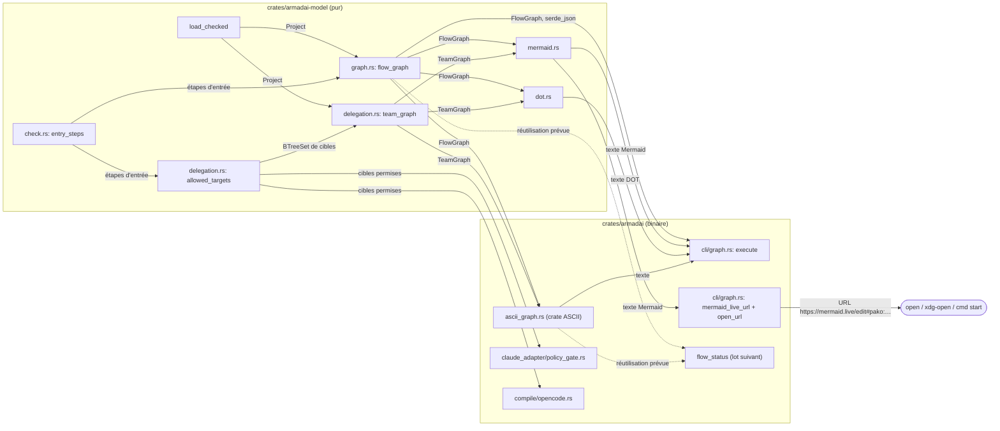

# Plan — améliorations de `armadai graph`

- Spec : `docs/superpowers/specs/2026-11-02-graph-improvements-design.md` (commit `f2f3b3a`).
- Cadre : rendu par `framer` le 2026-11-02 (règles, contrainte `--watch`, tableau des points à trancher). La réponse de Dimitri sur les dépendances est « Dans crates/armadai (Recommandé) ».
- Branche `feat/graph-improvements`, worktree `/Users/bl209054/work/misc/armadai-graph`.
- Neuf tâches : `T0` (mesure seule) puis `T1` à `T8`. Le lot reste d'un seul tenant, comme Dimitri l'a décidé ; rien ne justifie de le couper.

## 0. Contraintes globales (toutes les tâches)

1. **`armadai-model` reste pur.** Il ne gagne aucune dépendance, pas même en dev-dependency. Le graphe intermédiaire, Mermaid, DOT et le JSON (par `serde`/`serde_json`, déjà présents) y vivent. L'ASCII, la compression, le base64 et l'ouverture du navigateur vivent dans le crate binaire `crates/armadai`. Les dépendances se déclarent directement dans `crates/armadai/Cargo.toml`, pas dans `[workspace.dependencies]` (Dimitri, 2026-11-02 : « Dans crates/armadai (Recommandé) »).
2. **Pas de réseau.** `graph`, `--open` compris, ne lance qu'un seul processus : la commande d'ouverture du système. Aucun crate HTTP n'est ajouté.
3. **stdout ne porte que le résultat.** Erreurs et diagnostics vont sur stderr, avec le code 1. Avec `--open`, stdout reste vide.
4. **Une seule source pour chaque définition.** `entry_steps` reste la seule définition d'une étape d'entrée. `allowed_targets` n'existe qu'en un exemplaire (§2.3).
5. **Réutilisation par `flow status --watch` (lot suivant).** Ce lot ne la livre pas. Le graphe intermédiaire (`armadai_model::flow_graph`) et le rendu ASCII (`crate::ascii_graph::flow_to_ascii`) sont des fonctions pures, sans terminal ni réseau. Elles prennent un graphe et rendent un `String`, et `flow status` les appelle sans passer par `cli/graph.rs`. `flow_status` vit bien dans le crate binaire (`crates/armadai/src/flow_status/`, vérifié). Le rendu ASCII y est donc atteignable. **Critère :** des tests appellent `flow_graph` (T1) et `flow_to_ascii(&flow_graph(..))` (T6) directement, sans la commande. Toute logique enfouie dans `cli::graph::execute` les fait échouer, parce qu'elle manquerait au rendu appelé directement.
6. **Sortie déterministe dans chaque format.** L'ensemble des nœuds et des arêtes d'un flow ne change pas, ni l'ordre des arêtes (liens dans l'ordre déclaré, puis `on_failure` dans l'ordre des étapes). Seuls changent l'ordre des nœuds et leur marquage.
7. **Tests.** Chaque test ajouté ou changé est muté : le spécialiste casse le code, constate le rouge, restaure avec `touch` et reporte la sortie vue. On compare des lignes ou des documents entiers, pas des `contains`. Les fixtures ont des valeurs distinctes deux à deux. Les goldens (`crates/armadai-model/tests/mermaid.rs`, constantes `REVIEW`/`SHIP` de `crates/armadai/tests/graph_cli.rs`) se mettent à jour à la main et se relisent ligne à ligne contre la spec, jamais par régénération en bloc. Dans le crate binaire : `--bin armadai` ou `--test graph_cli`, toujours `--no-fail-fast`.
8. **Barrière à chaque tâche.** `cargo fmt --all -- --check`, `cargo clippy --all-targets -- -D warnings`, `cargo test --no-fail-fast`, `cargo build -p armadai-core`, `cargo build -p armadai-model`, avec `CARGO_TARGET_DIR=/Users/bl209054/work/misc/armadai-graph/target`. On lit le code retour, sans tube. `cargo audit` s'ajoute dans T6 et T7, les tâches qui ajoutent des dépendances.
9. **Textes nouveaux.** Les textes proposés au §3 ne s'écrivent qu'après validation de Dimitri. Un texte modifié à sa relecture se reporte ici, daté.
10. **Commits.** Conventional Commits en anglais, un seul type par sujet, trailer `Co-Authored-By` de la session. Pas de fusion : `lead` ouvre la PR.

## 1. Modules et flux



À regarder : tout ce qui est structure (ordre, rôles, délégation) se calcule une fois dans `armadai-model`. Chaque format n'est qu'une fonction de `FlowGraph` ou de `TeamGraph`. Le gate, l'adaptateur OpenCode et la vue équipe lisent la même `allowed_targets`. Seuls l'ASCII et `--open` tirent des dépendances, et elles restent dans le binaire.

## 2. Points que le plan tranche

### 2.1 Format du lien mermaid.live : vérifié à la source le 2026-11-02

Lu sur la branche `develop` de `mermaid-js/mermaid-live-editor` et dans les paquets cités :

- **Chemin.** `src/routes/(app)/` contient `edit/` et `view/`. `src/lib/util/state.svelte.ts` construit `` `${resolve('/edit', {})}#${serializeState(defaultState)}` ``. Le lien est donc **`https://mermaid.live/edit#<serde>:<charge>`**. Le nom d'hôte `mermaid.live` (le déploiement officiel) ne se confirme qu'à l'essai réel (critère 12).
- **Sérialisation** (`src/lib/util/serde.ts`) : `serializeState` fait `JSON.stringify(state)`, puis `pako` (`deflate(TextEncoder().encode(json), { level: 9 })`), puis `fromUint8Array(compressed, true)` ; il rend `` `${serde}:${serialized}` ``. Le serde `base64` vaut `toBase64(json, true)`.
- **zlib ou deflate brut : zlib.** Dans `pako@2.1.0/lib/deflate.js`, `deflateRaw` est « The same as [[deflate]], but creates raw data, without wrapper (header and adler32 crc) ». `deflate`, avec `windowBits: 15` et sans `raw`, produit donc le flux **zlib** (en-tête et adler32). Côté Rust, il faut un encodeur zlib (`ZlibEncoder`, `compress_to_vec_zlib`), pas du deflate brut.
- **Remplissage.** Dans js-base64 3.9.6, `_mkUriSafe = src.replace(/=/g, '').replace(/[+\/]/g, …)` : l'écriture se fait **sans `=`**, en alphabet URL-safe (`-`, `_`). À la lecture, `_tidyB64` jette tout caractère hors alphabet, ce qui accepte les deux formes. On écrit donc sans remplissage.
- **État minimal** (`src/lib/types.d.ts`) : les champs obligatoires sont `code`, `mermaid`, `updateDiagram` et `rough`. La valeur par défaut (`src/lib/constants.ts`) est `mermaid: '{}'`, `updateDiagram: true`, `rough: false`. On émet **`{"code":<mermaid>,"mermaid":"{}","updateDiagram":true,"rough":false}`**.
- **Risque restant.** Le format peut changer côté site. Le test du critère 9 vérifie notre encodage (aller-retour), pas le site. Les octets zlib d'un encodeur Rust peuvent différer de ceux de pako au même niveau : le test décode, il ne compare pas des octets.

### 2.2 Serde `pako` ou `base64` : règle fixée avant la mesure, appliquée par T0

T0 mesure la longueur de l'URL complète, sous les deux serdes, pour : les flows `lot` et `task` de ce dépôt, les quatre modèles de flow (`armadai new flow --template …`) et un flow synthétique de 30 étapes (pour une grosse vue équipe, voir T0).

**Règle.** Si toutes les URL `base64` mesurées font **2 000 caractères ou moins**, on retient `base64` : un crate de moins, pas de compression. Sinon on retient `pako`. Pourquoi 2 000 : c'est la longueur d'URL réputée sûre partout, et il reste une marge d'un facteur 4 sous la limite de 8 191 caractères d'une ligne `cmd` (`start` sous Windows). Le fragment n'est jamais envoyé au serveur, il n'y a donc pas de limite côté site. Une équipe deux fois plus grande que celle de ce dépôt dépasserait vite la limite en `base64`. Si la mesure tombe entre 1 000 et 2 000 caractères, `lead` le signale à Dimitri avec la mesure avant T7.

### 2.3 Emplacement d'`allowed_targets` : déplacée dans `armadai-model`

Aujourd'hui : `crates/armadai/src/claude_adapter/policy_gate.rs:116`, lue par le gate et par `compile/opencode.rs:14`. Elle ne dépend que de `Project` et d'`entry_steps`, tous deux dans `armadai-model`.

| Option | Coût | Verdict |
|---|---|---|
| A. Déplacer la fonction telle quelle dans `armadai-model/src/delegation.rs`. Le gate et OpenCode l'importent de là, la copie du binaire est supprimée. | Un module de plus dans le modèle (pur, sans dépendance) ; deux imports changés. | **Retenue.** Une seule source, et `team_graph` vit à côté de ses rendus. |
| B. La laisser dans le binaire et construire la vue équipe dans le binaire. | Les rendus Mermaid et DOT de l'équipe partent dans le binaire, loin de ceux du flow : deux endroits pour un même format. | Écartée. |
| C. `team_graph` dans le modèle prend une fermeture `Fn(Option<&str>) -> BTreeSet<String>`. | Une indirection qui n'existe que pour éviter le déplacement. | Écartée. |

Elle touche l'adaptateur : T3 (schema) l'ajoute au modèle, T4 (adapter) supprime la copie du gate. Entre T3 et T4, deux copies coexistent sur la branche ; T4 suit immédiatement T3. Le texte du gate et sa sémantique ne changent pas.

## 3. Points que le plan propose et que Dimitri valide (réponses à reporter ici, datées)

### Q1. Crates (posée après T0)
Pour l'ASCII, la compression et le base64, T0 rend un tableau par candidat : licence, dernière version, `cargo audit`, dépendances ajoutées, présence dans `Cargo.lock` et comportement sur un cycle. Je n'ai rien mesuré, donc je ne propose aucun nom.

Pour départager, je recommande cet ordre de critères :
1. `cargo audit` propre ;
2. licence permissive (MIT, Apache-2.0, BSD, Zlib, ISC), jusqu'aux dépendances transitives ;
3. crate déjà présent dans `Cargo.lock`, sinon le moins de dépendances ;
4. pour l'ASCII seulement, un cycle qui donne une sortie et le code 0.

Pour le base64, je recommande l'option écrite à la main, sans dépendance : une vingtaine de lignes, testées contre la RFC 4648, sauf si un crate candidat est déjà dans `Cargo.lock`.

### Q2. Combinaisons de drapeaux
Proposition (recommandée) :
- **`--view flows` et `--view team`** acceptent les quatre formats. Le rendu ASCII prend un graphe générique, donc la vue équipe ne coûte pas de code de plus.
- **`--open` avec `--format` autre que `mermaid`** : refus, code 1. Il n'est jamais ignoré en silence.
- **`--open` sans nom de flow** : accepté s'il n'y a qu'un flow, refus s'il y en a plusieurs.
- **`--open --view team`** : accepté.
- **`--view team <flow>`** : refus, code 1, parce qu'un nom de flow n'a pas de sens pour l'équipe.

Alternatives :
- (b) `--view team` limité à `mermaid`, `dot` et `json`. Cela fait un peu moins de tests, mais un refus de plus à expliquer.
- (c) `--open` avec un autre format : ignorer le format. Je la déconseille : la sortie ne serait plus celle qu'on a demandée.

### Q3. Marquage de `start` et `end`
Le marquage ne doit pas dépendre de la seule couleur.

- **A (recommandée) : forme native par format, marques dans le libellé seulement en ASCII.**
  - Mermaid : le départ en stade (`n_write(["write (dev)"])`) et la fin en sous-programme (`n_ship[["ship (ops)"]]`). Une étape à la fois départ et fin prend le stade. Les classes `classDef startStep stroke-width:3px` et `classDef endStep stroke-width:3px,stroke-dasharray:4 2` et les lignes `class <ids> startStep` sont émises après les arêtes. On évite le nom de classe `end`, mot réservé de Mermaid.
  - DOT : `style="rounded,bold"` pour le départ, `peripheries=2` pour la fin.
  - ASCII : `▶ write (dev)` pour le départ, `ship (ops) ■` pour la fin.
  - JSON : `"start": true`, `"end": true`.
- **B : la même marque dans le libellé partout** (`▶ ` et ` ■`, y compris en Mermaid et en DOT). C'est uniforme, mais moins naturel à l'œil dans un rendu graphique.
- **C : des mots** (`write (dev) [start]`, `ship (ops) [end]`) dans tous les formats. Pur ASCII, mais plus bruyant.

### Q4. Vue équipe : agents par flow et mention de la politique
Proposition (recommandée) :
- **Agents par flow.** La liste des flows suit le nom de chaque agent dans son libellé : `guardian · task`, et `lead` (coordinateur) en nœud de départ `main thread (lead)`. On n'utilise pas de sous-graphe par flow : un agent présent dans deux flows ne peut pas être dans deux sous-graphes Mermaid. En JSON, c'est `agents[].flows`.
- **Agents libres.** Un sous-graphe `free agents, callable from anywhere`, sans arêtes.
- **Mention de la politique**, en 1re ligne : `%% team (delegation: strict, enforced by the gate)` ou `%% team (delegation: off, not enforced)`. C'est le même usage que `%% flow: <id>` (`// …` en DOT). En ASCII, cette ligne vient en tête, sans `%%`. Sans coordinateur, le nœud de départ est `main thread`.
- **Alternative.** Des sous-graphes par flow quand les ensembles d'agents sont disjoints, une liste sinon. Je la déconseille : la forme de sortie dépendrait du projet.

### Q5. Textes nouveaux (stderr sauf mention ; préfixe `Error: ` d'anyhow comme aujourd'hui)
- `--open` avec un autre format : `--open draws Mermaid only; drop --format <format>`
- `--open` sans nom, avec plusieurs flows : `--open draws one diagram: name a flow (flows: <a>, <b>)`
- `--view team` avec un nom de flow : `--view team draws the whole team: drop the flow id <id>`
- Ouverture impossible :
  ```
  could not open the browser (<command>: <raison>); open this URL yourself:
  <url>
  ```
- Succès de `--open` : rien (recommandé), ou une ligne stderr `opened <flow|team> in mermaid.live`.
- Liste de repli de l'ASCII, sur stdout sous le dessin :
  ```
  links not drawn:
    check → write (rejected)
  ```
- Aide de `--format` : `Output format: mermaid, dot (Graphviz), json (nodes and edges), ascii (boxes for the terminal)`. Aide de `--view` : `What to draw: each flow's steps, or the team's delegations`. Aide de `--open` : `Open the Mermaid diagram in mermaid.live, in your browser (step and agent names leave this machine)`.

## 4. Tâches

Ordre : `T0` ∥ (`T1` → `T2` → `T3` → `T4`) → `T5` → `T6` → `T7` → `T8`.

- `T0` n'écrit rien : il tourne en parallèle de T1 à T4.
- T1 à T5 s'enchaînent sans attendre Dimitri sur les crates. Ils attendent ses réponses à Q2-Q5 pour les textes (T1 attend Q3 ; T3 attend Q4 ; T5 attend Q2 et Q5).
- T6 attend la réponse à Q1 pour le crate ASCII, et T7 pour la compression et le base64.
- T6 et T7 modifient tous deux `cli/graph.rs` et `crates/armadai/Cargo.toml` : ils restent séquentiels.
- La revue `guardian` d'une tâche peut tourner pendant la tâche suivante.

---

### T0 — Mesure des candidats (cli-specialist, sans écriture dans le dépôt, sans commit)

Le travail se fait dans un crate jetable hors du dépôt (`/tmp/armadai-graph-t0/`, son propre `CARGO_TARGET_DIR`), avec `HOME` et `ARMADAI_CONFIG_DIR` isolés pour tout essai du binaire.

**Candidats.** Leur existence et leurs propriétés sont à vérifier. Je n'ai rien mesuré : ce sont des noms à essayer, pas des faits.

| Besoin | Candidats |
|---|---|
| ASCII en boîtes | `ascii-dag`, `termgraph`, plus le meilleur résultat de `cargo search "ascii graph"` et `cargo search "box diagram"` qui dessine des boîtes (à rapporter). Si aucun ne dessine des boîtes : `termtree` (arbre, sans boîtes) comme repli à signaler, pas à choisir. |
| Compression zlib | `miniz_oxide` (`deflate::compress_to_vec_zlib`), `flate2` (`write::ZlibEncoder`, moteur Rust par défaut). |
| base64 URL-safe sans remplissage | `base64` (`URL_SAFE_NO_PAD`), `data-encoding` (`BASE64URL_NOPAD`), ou une fonction écrite à la main d'une vingtaine de lignes, sans dépendance, testée contre les vecteurs de la RFC 4648 §10. |

**À mesurer pour chaque candidat** (une ligne par candidat dans le rapport) :

1. Dernière version et sa date : `cargo info <crate>`, plus la date de publication sur crates.io. Un crate sans version depuis plus de 18 mois se signale comme peu maintenu.
2. Licence : `cargo info <crate>`, plus celles de ses dépendances transitives (`cargo tree -e normal --prefix none -f '{p} {l}'` dans le crate jetable). Le dépôt est sous PolyForm-Noncommercial-1.0.0 ; aucune règle ne fixe les licences acceptées, c'est Dimitri qui tranche. Le rapport signale toute licence autre que MIT, Apache-2.0, BSD, Zlib ou ISC.
3. Nombre de dépendances transitives ajoutées (`cargo tree | wc -l`, avant et après).
4. Présence déjà dans `Cargo.lock` du dépôt : `/usr/bin/grep -n '^name = "<crate>"' /Users/bl209054/work/misc/armadai-graph/Cargo.lock`. Un crate déjà présent ne coûte rien de plus.
5. `cargo audit` dans le crate jetable, avec le crate ajouté : avis, yanked, non maintenu. Si `cargo audit` n'est pas installé, le dire et demander à `lead` avant d'installer quoi que ce soit.
6. Compilation avec la toolchain du dépôt (édition 2024) : `cargo build` du crate jetable.
7. **ASCII seulement : comportement sur un cycle.** Un petit binaire jetable dessine trois graphes écrits à la main :
   - `plan-build-verify` : `plan→build`, `build→check`, `check→build` (failed) ;
   - `review-loop` : `dev→rev`, `rev→dev` (rejected), `rev→ops` (approved) ;
   - le flow `task` de ce dépôt (`.armadai/flows/task.yaml`).

   Rapporter, pour chacun : la sortie copiée telle quelle, le code retour, et s'il y a panique, erreur rendue, sortie vide ou blocage. Une commande qui dépasse 30 s compte comme bloquée : l'arrêter et vérifier avec `/bin/ps` que rien ne reste. Rapporter aussi si les arêtes portent un libellé (`rejected`) et si une séquence d'échappement apparaît quand stdout est redirigé vers un fichier (`od -c | /usr/bin/grep '033'`).
8. **Longueur d'URL** (règle du §2.2). Pour chaque Mermaid d'aujourd'hui (`armadai graph lot`, `armadai graph task` sur ce dépôt ; les quatre modèles créés dans un projet temporaire ; un flow `pipeline` de 30 étapes) :
   - construire l'état JSON du §2.1 ;
   - calculer `len("https://mermaid.live/edit#base64:" + b64url_nopad(json))` et `len("https://mermaid.live/edit#pako:" + b64url_nopad(zlib9(json)))`, par exemple avec `python3 -I -c` (`zlib.compress(b, 9)`, `base64.urlsafe_b64encode(...).rstrip(b'=')`).

   Rapporter le tableau et la conclusion de la règle.
9. Graphviz : `/usr/bin/which dot` ou `command -v dot`, et sa version, pour le critère 4 joué par `validator`.

**Rendu à `lead`.** Le tableau des candidats, le tableau des longueurs, la conclusion `pako`/`base64` selon la règle, et les sorties ASCII sur cycle. Pas de choix de crate : c'est Q1.

---

### T1 — Graphe intermédiaire d'un flow, ordre, rôles ; Mermaid branché dessus (schema-specialist)

**Fichiers**
- Nouveau `crates/armadai-model/src/graph.rs`.
- `crates/armadai-model/src/lib.rs` : `pub mod graph;` et `pub use graph::{EdgeKind, FlowGraph, GraphEdge, GraphNode, flow_graph};`.
- `crates/armadai-model/src/mermaid.rs` : réécrit sur `FlowGraph`.
- Nouveau `crates/armadai-model/tests/graph.rs`.
- `crates/armadai-model/tests/mermaid.rs` : goldens mis à jour à la main.
- `crates/armadai/tests/graph_cli.rs` : seulement les constantes `REVIEW` et `SHIP`, une mise à jour mécanique du golden produit par ce changement, faite dans la même tâche pour que la barrière reste verte.

**Interfaces**
```rust
#[derive(Clone, Debug, PartialEq, Eq, serde::Serialize)]
pub struct FlowGraph { pub id: String, pub nodes: Vec<GraphNode>, pub edges: Vec<GraphEdge> }

#[derive(Clone, Debug, PartialEq, Eq, serde::Serialize)]
pub struct GraphNode { pub id: String, pub agent: String, pub states: Vec<String>, pub start: bool, pub end: bool }

#[derive(Clone, Copy, Debug, PartialEq, Eq, serde::Serialize)]
#[serde(rename_all = "snake_case")]
pub enum EdgeKind { Link, OnFailure }

#[derive(Clone, Debug, PartialEq, Eq, serde::Serialize)]
pub struct GraphEdge { pub from: String, pub to: String, pub when: Option<String>, pub kind: EdgeKind }

pub fn flow_graph(id: &str, flow: &Flow) -> FlowGraph;
pub fn flow_graph_to_mermaid(g: &FlowGraph) -> String;
pub fn flow_to_mermaid(id: &str, flow: &Flow) -> String; // signature inchangée : flow_graph_to_mermaid(&flow_graph(id, flow))
```

**Règles du parcours**
- **Nœuds.** D'abord les étapes de `entry_steps(flow)`, dans son ordre. Puis un parcours en largeur : les successeurs d'une étape dans l'ordre de `edges`. Une étape est marquée vue quand elle entre dans la file, pour qu'un cycle ne boucle pas. Une cible inconnue est ignorée. Viennent ensuite les étapes non atteintes, par ordre alphabétique.
- **Arêtes.** Les `links` dans l'ordre déclaré (`kind: Link`, `when` tel quel), puis les `on_failure` dans l'ordre des étapes (`kind: OnFailure`, `when: None`). C'est l'ordre d'aujourd'hui. Une arête vers une étape inconnue est gardée, sans nœud.
- **`start`** : l'étape est dans `entry_steps`. **`end`** : aucune arête (lien ou `on_failure`) ne part de l'étape.
- **Mermaid.** Les ids de nœud (`n_` plus l'id assaini, suffixe `_2` en cas de collision) s'attribuent dans l'ordre des nœuds. Les flèches sont inchangées. Le marquage `start`/`end` suit la réponse de Dimitri à Q3 ; proposition A : forme, plus `classDef`/`class` après les arêtes, émis seulement s'ils servent. Un flow vide reste `%% flow: e\nflowchart TD\n`.

**Étapes**
- [ ] Écrire `graph.rs` et ses tests (`tests/graph.rs`), rouges puis verts.
- [ ] Réécrire `mermaid.rs` sur `FlowGraph`.
- [ ] Mettre à jour à la main les 9 goldens de `tests/mermaid.rs`, puis `REVIEW`/`SHIP`, en les relisant ligne à ligne. Vérifier que les arêtes sont identiques octet pour octet, et que les deux `contains` de `crates/armadai/tests/new_cli.rs` (:273, :440), qui ne portent que sur des arêtes, restent verts sans modification.
- [ ] Faire la barrière.

**Tests attendus (`tests/graph.rs`) et mutation qui doit les rougir**

| Test | Mutation |
|---|---|
| `nodes_follow_the_flow_not_the_alphabet` : `zeta→alpha→mid`, ordre attendu `[zeta, alpha, mid]` | itérer `flow.steps` (ordre alphabétique) au lieu du parcours |
| `a_declared_start_comes_first_in_a_cycle` : `start: write`, `write→review→fix→write` | remplacer `entry_steps(flow)` par « étapes sans arête entrante » |
| `links_are_followed_before_on_failure` : `a` a un lien vers `z` et un `on_failure` vers `b`, ordre attendu `[a, z, b]` | enchaîner `on_failure` avant `links` |
| `unreachable_steps_come_last_alphabetically` | omettre les non atteintes, ou les mettre en tête |
| `cycles_terminate_with_each_step_once` : `plan-build-verify` et `review-loop` (`flow_from_template`), vecteurs d'ids exacts | marquer vu au défilement plutôt qu'à l'enfilement (doublons) |
| `start_and_end_roles` : `pipeline` à 3 étapes, start = 1re, end = 3e, la 2e ni l'un ni l'autre ; un flow d'une étape est start et end | `end` calculé sur les seuls `links` (fixture où une étape n'a qu'un `on_failure` sortant : doit être `end: false`) ; `start` mis à `true` partout |
| `edges_keep_their_kind_and_order` : vecteur exact de `GraphEdge` pour `REVIEW` du CLI (lien `rejected` + `on_failure`) | `kind` des `on_failure` mis à `Link` ; inverser l'ordre |
| `an_unknown_link_target_keeps_its_edge` | filtrer les arêtes à extrémité inconnue |
| `an_empty_flow_has_no_node_nor_edge` | (garde-fou du cas limite ; mutation : pousser un nœud fantôme) |

Goldens Mermaid : mutation `classDef` émis même quand aucun nœud n'en porte ; `an_empty_flow_is_a_bare_flowchart` rougit.

**Commit** : `feat(model): order flow graph nodes from the entry and mark start and end steps`

---

### T2 — DOT et JSON d'un flow (schema-specialist)

**Fichiers**
- Nouveau `crates/armadai-model/src/dot.rs`.
- `lib.rs` : `pub mod dot; pub use dot::{flow_graph_to_dot, flow_to_dot};`.
- Nouveau `crates/armadai-model/tests/dot.rs`.
- Tests JSON ajoutés à `tests/graph.rs`.

**Interfaces**
```rust
pub fn flow_graph_to_dot(g: &FlowGraph) -> String;
pub fn flow_to_dot(id: &str, flow: &Flow) -> String;
```
Pas de fonction JSON dans le modèle : le JSON est `serde_json::to_string_pretty` des types de T1, que le binaire enveloppe (T5).

**Forme DOT (proposée, Q3)**
```
// flow: review
digraph "review" {
  "write" [label="write (dev)", shape=box, style="rounded,bold"];
  "check" [label="check (rev)", shape=box];
  "ship" [label="ship (ops)", shape=box, peripheries=2];
  "write" -> "check";
  "check" -> "write" [label="rejected"];
  "check" -> "write" [label="failed", style=dashed];
}
```
Ids et libellés sont entre guillemets ; `\` devient `\\` et `"` devient `\"`. Plusieurs flows donnent plusieurs `digraph` séparés par une ligne vide. `dot` les accepte dans un seul fichier, `validator` le vérifie (critère 4).

**Tests et mutations**
- `pipeline`, `review_loop`, `plan_build_verify` et `fan_out` : goldens DOT exacts. Mutation : `on_failure` rendu sans `style=dashed`.
- `hostile_ids_are_quoted` : ids `a"b`, `c\d`, `end`, `graph`. Mutation : retirer l'échappement de `\`.
- `flow_graph_json_golden` : `to_string_pretty(&flow_graph("review", …))` exact (champs `id`, `nodes[{id, agent, states, start, end}]`, `edges[{from, to, when, kind}]`, `when: null` et `kind: "on_failure"` pour un `on_failure`). Mutation : retirer `rename_all = "snake_case"`.
- `the_dot_export_is_deterministic`. Mutation : passer par un `HashMap` (plusieurs passes, 5).

**Commit** : `feat(model): export a flow graph as Graphviz DOT and JSON`

---

### T3 — Délégation et graphe de l'équipe dans le modèle (schema-specialist)

**Fichiers**
- Nouveau `crates/armadai-model/src/delegation.rs`.
- `lib.rs` : `pub mod delegation; pub use delegation::{TeamAgent, TeamEdge, TeamGraph, allowed_targets, team_graph};`.
- `mermaid.rs` et `dot.rs` : `team_to_mermaid`, `team_to_dot`.
- Nouveau `crates/armadai-model/tests/team.rs`.

**Interfaces**
```rust
/// Copied verbatim from claude_adapter/policy_gate.rs (doc comment included); T4 removes the copy there.
pub fn allowed_targets(project: &Project, caller: Option<&str>) -> BTreeSet<String>;

#[derive(Clone, Debug, PartialEq, Eq, serde::Serialize)]
pub struct TeamGraph {
    pub delegation: String,          // "off" | "strict", from project.manifest.policy.delegation
    pub coordinator: Option<String>,
    pub agents: Vec<TeamAgent>,      // project agents except the coordinator, by id
    pub edges: Vec<TeamEdge>,        // main thread first, then agents by id; targets sorted
    pub free_agents: Vec<String>,    // policy.free_agents, sorted
}
#[derive(Clone, Debug, PartialEq, Eq, serde::Serialize)]
pub struct TeamAgent { pub id: String, pub flows: Vec<String> } // flows where the agent runs a step, sorted
#[derive(Clone, Debug, PartialEq, Eq, serde::Serialize)]
pub struct TeamEdge { pub from: Option<String>, pub to: String } // from: None = main thread

pub fn team_graph(project: &Project) -> TeamGraph;
pub fn team_to_mermaid(g: &TeamGraph) -> String;
pub fn team_to_dot(g: &TeamGraph) -> String;
```

**Arêtes.** Pour l'appelant `None` (le fil principal) puis pour chaque agent (hors coordinateur, qui est le fil principal) : les arêtes vont vers `allowed_targets(project, caller)` privé de `free_agents`. Les agents libres sont rendus comme un groupe sans arêtes (spec §4.2). La forme du rendu Mermaid et DOT (agents par flow, mention de la politique) suit Q4. `delegation: off` donne les mêmes arêtes avec la mention `off`.

**Tests et mutations (`tests/team.rs`)**
- `the_repository_team` : fixture qui reprend `.armadai/` de ce dépôt (coordinateur `lead`, `strict`, flows `lot` et `task` réduits à leurs étapes et liens). `edges` sont exactes. On vérifie aussi que `lead` n'est jamais `to`, que chaque `build-*` mène à `guard`, et que `guard` mène à chaque `build-*` (critère 7). Mutation : retirer l'exclusion du coordinateur dans `allowed_targets`.
- `without_a_coordinator_the_main_thread_reaches_entry_steps_only`. Mutation : `main` à `true` sans coordinateur.
- `team_edges_match_allowed_targets` : pour chaque appelant, l'ensemble des `to` égale `allowed_targets(caller) − free_agents` (critère 8 côté modèle). Mutations : ne pas retirer les `free_agents` ; appeler `allowed_targets(Some(coordinator))` à la place de `None`. Les deux doivent rougir. Pour la seconde, la fixture doit avoir un coordinateur qui est aussi agent d'une étape.
- `free_agents_are_a_group_not_edges`. Mutation : ajouter les agents libres aux arêtes.
- `policy_off_keeps_the_edges` : `delegation: "off"`, mêmes arêtes. Mutation : rendre `edges` vide sous `off`.
- Goldens `team_to_mermaid` et `team_to_dot` sur la fixture du dépôt, plus le JSON de `TeamGraph`.

**Commit** : `feat(model): derive the team delegation graph from allowed_targets`

---

### T4 — Le gate et OpenCode lisent `armadai_model::allowed_targets` (adapter-specialist)

**Fichiers**
- `crates/armadai/src/claude_adapter/policy_gate.rs` : supprimer `fn allowed_targets` et son commentaire (lignes 107-155 aujourd'hui), importer `armadai_model::allowed_targets`.
- `crates/armadai/src/compile/opencode.rs:14` : `use armadai_model::allowed_targets;`.

**Étapes**
- [ ] Supprimer la copie et changer les deux imports, sans toucher aux messages du gate.
- [ ] Lancer les 24 tests du gate et ceux d'OpenCode, inchangés : `cargo test --no-fail-fast --bin armadai policy_gate` et `… opencode`.
- [ ] Vérifier par mutation que le gate lit bien la copie du modèle.
- [ ] Faire la barrière. Vérifier aussi que plus aucune définition `fn allowed_targets` ne reste dans `crates/armadai` (`/usr/bin/grep -rn "fn allowed_targets" crates/`).

**Mutations, à appliquer dans `crates/armadai-model/src/delegation.rs`**
- Retirer la chaîne `on_failure` : `on_failure_counts_as_a_path` (gate) rougit.
- Retirer l'exclusion du coordinateur : `the_coordinator_is_never_listed_as_a_target` rougit.
- Un test OpenCode qui couvre `permission.task` sous `strict` doit rougir sur l'une de ces mutations. S'il n'y en a aucun, le dire dans le rapport ; ce n'est pas un test à ajouter dans ce lot.

**Commit** : `refactor(gate): read delegation targets from armadai-model`

---

### T5 — `--format dot|json`, `--view flows|team`, combinaisons (cli-specialist)

**Fichiers**
- `crates/armadai/src/cli/graph.rs`.
- `crates/armadai/src/cli/mod.rs` : le variant `Graph`, son `long_about` et `after_help`.
- `crates/armadai/tests/graph_cli.rs`.

**Interfaces**
```rust
#[derive(Clone, Copy, Debug, Default, clap::ValueEnum)]
pub enum GraphFormat { #[default] Mermaid, Dot, Json } // Ascii arrives with T6
#[derive(Clone, Copy, Debug, Default, clap::ValueEnum)]
pub enum GraphView { #[default] Flows, Team }
pub fn execute(flow: Option<String>, format: GraphFormat, view: GraphView) -> anyhow::Result<()>;
```
- **JSON de la vue `flows`.** Toujours `{"flows": [FlowGraph, …]}`, même pour un seul flow, pour une forme stable.
- **JSON de la vue `team`.** `TeamGraph` tel quel.
- Les combinaisons et les textes d'erreur suivent les réponses à Q2 et Q5. La chaîne d'erreurs existante (flow inconnu, aucun flow, hors projet, legacy, invalide) est inchangée (critère 11).

**Tests (`graph_cli.rs`) et mutations**

| Test | Mutation |
|---|---|
| `one_flow_as_dot` : stdout exact | `--format` ignoré (sortie Mermaid) |
| `one_flow_as_json` : `serde_json::from_str` puis égalité avec un `json!` exact (nœuds, arêtes, `on_failure` distingué ; critère 5) | omettre l'enveloppe `flows` |
| `the_flow_order_reaches_the_cli` : fixture où l'ordre alphabétique diffère de l'ordre depuis `start`, lignes de nœuds exactes et marquage (critères 1-2) | rétablir l'appel à l'ancien parcours (impossible après T1 : la mutation est de passer `flow.steps` trié à `flow_graph`) |
| `every_format_is_byte_stable` : deux exécutions par format et par vue, égalité (critère 3) | — (garde du déterminisme ; mutation : horodatage dans le JSON) |
| `the_team_view` : Mermaid exact sur une fixture `strict` à coordinateur | `--view` ignoré |
| `the_team_view_agrees_with_the_gate` (critère 8) : lit `graph --view team --format json` ; pour chaque arête affichée, `armadai __claude-policy-gate` reçoit une charge `Agent` (`agent_type` = appelant ou vide, `subagent_type` = cible) et ne doit rien imprimer ; pour chaque agent du projet non affiché comme cible d'un appelant et hors `free_agents`, le gate doit refuser | (dans le modèle) ajouter à `team_graph` une arête que `allowed_targets` ne permet pas, ou en retirer une : rouge dans les deux sens |
| Combinaisons (Q2) : chaque refus, stdout vide, code 1, ligne d'erreur exacte | accepter la combinaison refusée |
| Les tests d'erreur existants, inchangés | — |

**Commit** : `feat(graph): add dot and json formats and the team view`

---

### T6 — Rendu ASCII (cli-specialist), après la réponse de Dimitri à Q1

**Fichiers**
- `crates/armadai/Cargo.toml` : le crate choisi, en dépendance directe.
- Nouveau `crates/armadai/src/ascii_graph.rs`, déclaré dans `main.rs`. Il est au premier niveau, pas sous `cli/`, pour que `flow_status` l'atteigne.
- `cli/graph.rs` : `GraphFormat::Ascii`.
- `graph_cli.rs`.

**Interfaces**
```rust
pub fn flow_to_ascii(g: &armadai_model::FlowGraph) -> String;
pub fn team_to_ascii(g: &armadai_model::TeamGraph) -> String;
```
- **Sans couleur.** Aucune séquence d'échappement, que stdout soit un terminal ou non : c'est le plus simple qui tienne le critère 6.
- **Marquage.** `start`/`end` dans le libellé de la boîte, selon Q3.
- **Repli sur cycle (critère 6).** Les arêtes que le crate ne dessine pas (refus de cycle, par exemple) sont écrites en liste sous le dessin, avec le titre et la forme de Q5. Si le crate échoue sur le graphe entier, on dessine le graphe sans les arêtes de retour (celles qui pointent vers un nœud déjà vu dans l'ordre de `FlowGraph`), puis on les liste. Jamais de panique, jamais de sortie vide, code 0. Si T0 montre que le crate retenu se bloque sur un cycle, `lead` le dit à Dimitri avant T6.

**Tests et mutations**
- Tests unitaires dans `ascii_graph.rs`, qui appellent `flow_to_ascii(&armadai_model::flow_graph(..))` sans la commande (contrainte `--watch`) :
  - `every_step_is_named` sur les quatre modèles : chaque id d'étape apparaît comme ligne de boîte ; comparer au golden complet si le crate est déterministe, sinon chaque libellé exact. Mutation : sauter le premier nœud.
  - `a_cycle_names_every_link` sur `plan-build-verify` et `review-loop` : golden exact, chaque arête dessinée ou listée. Mutation : supprimer la liste de repli.
  - `no_escape_sequence` : aucun `\x1b`. Mutation : préfixer une couleur.
  - `it_terminates` : rendu dans un thread, `recv_timeout(10 s)`. Le défaut visé est une boucle infinie, donc toute borne finie le détecte ; 10 s laisse de la marge sous charge.
- `graph_cli.rs` : `--format ascii` sur un flow à cycle, avec stdout redirigé (critère 6), code 0, sans ESC.
- Barrière, plus `cargo audit` (critère 10) et `cargo build -p armadai-model` (pas de nouvelle dépendance : `cargo tree -p armadai-model` inchangé).

**Commit** : `feat(graph): draw flows as ASCII boxes`

---

### T7 — `--open` vers mermaid.live (cli-specialist), après Q1 et la conclusion de T0 sur le serde

**Fichiers**
- `crates/armadai/Cargo.toml` : le base64 choisi ; plus la compression si `pako`.
- `cli/graph.rs`.
- `cli/mod.rs` : drapeau `--open`, aide.
- `graph_cli.rs`.

**Interfaces**
```rust
/// `https://mermaid.live/edit#pako:<b64url, no padding, of zlib level 9 of the state JSON>`
fn mermaid_live_url(code: &str) -> String;
/// macOS `open <url>`; Windows `cmd /C start "" <url>`; otherwise `xdg-open <url>`. Waits for its exit.
fn open_url(url: &str) -> anyhow::Result<()>;
```
- **État JSON.** `serde_json::json!({"code": code, "mermaid": "{}", "updateDiagram": true, "rough": false})` (§2.1).
- **Encodage.** Si T0 conclut `base64` : `edit#base64:` et pas de compression.
- **Ouverture.** `std::process::Command::status()`. Un échec de lancement ou un code non nul donne l'erreur de Q5, qui contient l'URL : stderr, code 1, stdout vide.
- **Succès.** Rien sur stdout (spec) ; ligne stderr éventuelle selon Q5.

**Tests et mutations**
- Unitaire `the_url_decodes_to_the_state` : enlever le préfixe, décoder le base64 URL-safe, inflater (zlib), parser le JSON ; `code` est exactement l'entrée et les trois autres champs valent ce qu'il faut. Mutations, chacune doit rougir :
  - deflate brut au lieu de zlib, en décodant par le décodeur zlib ;
  - remplissage `=` laissé : l'assertion « pas de `=` » rougit ;
  - alphabet standard (`+`, `/`).
- Intégration Unix (`#[cfg(unix)]`), critère 9 :
  - une fausse commande (`open` sous macOS, `xdg-open` ailleurs) est écrite dans un dossier temporaire placé en tête du `PATH` ; elle écrit `$1` dans un fichier ;
  - `graph review --open` sort avec le code 0 et un stdout vide ;
  - le fragment décodé du fichier égale le stdout de `graph review`.

  Mutation : passer à `open` le Mermaid d'un autre flow, ou ne pas lancer la commande.
- `--open` sans commande d'ouverture (`PATH` = dossier vide) : code 1, stdout vide, l'URL figure sur stderr en ligne entière. Mutation : avaler l'erreur.
- `--open` sans nom, avec plusieurs flows : erreur qui liste les flows (texte de Q5), code 1. `--open` sans nom avec un seul flow : accepté. Mutation : prendre le premier flow.
- `--open --view team` : accepté (un seul diagramme).
- Pas de test Windows : le risque est noté dans la spec et reste seulement relu.
- Barrière, plus `cargo audit`.

**Commit** : `feat(graph): open a flow in mermaid.live with --open`

---

### T8 — Documentation (cli-specialist)

**Fichiers**
- `docs/wiki/project-format.md`, section « Seeing a flow: `armadai graph` » (:272-279) : formats, ordre et marquage, vue équipe, forme JSON documentée champ par champ, `--open`. Pour `--open`, préciser que les noms d'étapes et d'agents partent vers mermaid.live via le navigateur : c'est un opt-in.
- `docs/wiki/templates.md` (:84, :98) : réécrire les exemples Mermaid avec le nouvel ordre et le marquage, en les copiant depuis la sortie réelle de `armadai graph` sur un projet temporaire, jamais à la main.
- `docs/wiki/getting-started.md:68` et `README.md` (:40, :66, :87) : seulement si la commande citée change ou si un exemple de sortie est montré.

**Vérification.** Chaque bloc de sortie collé dans la doc est rejoué et comparé octet pour octet (rapporter la commande).

**Commit** : `docs(graph): document formats, the team view and --open`

---

### Après les tâches

- **`reviewer`** relit la branche entière.
- **`validator`** :
  - rejoue les mutations ;
  - lance `dot -Tsvg` sur chaque flow et sur la vue équipe en DOT (critère 4, si Graphviz est présent selon T0) ;
  - vérifie l'absence de crate réseau dans `cargo tree -p armadai` ajouté par ce lot (critère 10) ;
  - lance `cargo audit` ;
  - prépare l'essai réel du critère 12 (flow ordonné, `--view team`, `--format ascii`, `--open`, sur ce dépôt, `HOME` isolé sauf pour `--open` qui doit atteindre le vrai navigateur).

## 5. Ce qui est refait si `guardian` ou `validator` rejette

Sans objet à cette première version.
