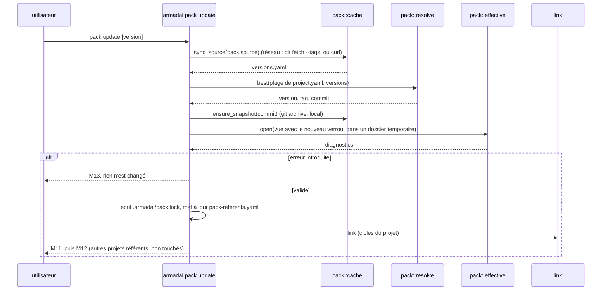
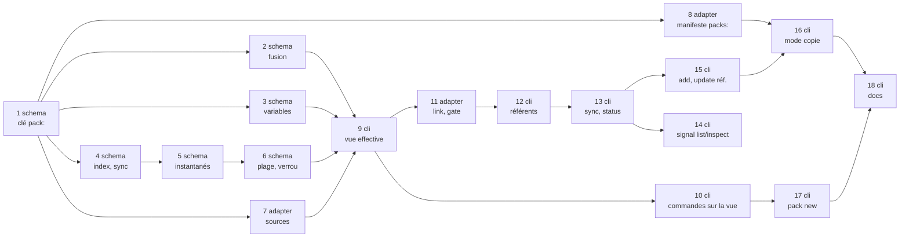

# Plan : gestion des packs (mise à jour, sync forcé, scaffolding, variables, signal de version)

Date : 2026-11-03 · Étape `plan` du flow `lot` · Branche `feat/pack-management` (tête `dd32842`, sur master `2ee093e`).
Spec : `docs/superpowers/specs/2026-11-03-pack-management-design.md` (17 critères, décisions A-L et décisions de cadre, non rediscutées ici). Cadre : `docs/superpowers/specs/2026-11-03-pack-management-frame.md` (Q1-Q8 en « 3 bis »). Règles : skill `armadai-rules` (dont, depuis `dd32842` : aucun réseau dans les tests ; rien de privé dans le dépôt public).

Lu pour ce plan (sans Bash ni recherche : ce qui suppose une recherche dans tout le dépôt est marqué « à recenser par grep ») : la spec, le cadre, `crates/armadai/src/starters_registry/mod.rs`, `linker/manifest.rs` (l. 1-1347), `cli/{mod,link,init,native_pack,new_wizard}.rs` (en-têtes), `compile/{mod,claude}.rs` (en-tête de `claude.rs`), `claude_adapter/policy_gate.rs` (en-tête), `crates/armadai/Cargo.toml`, `crates/armadai-model/src/{lib,types,load,agent_templates,write}.rs`, `crates/armadai-core/src/{starter,registries,project_registry}.rs`, `docs/wiki/project-format.md`, `docs/wiki/starter-packs.md` (début).

Les noms, les textes de sortie et les choix de la section 7 ont été validés par Dimitri le 2026-11-03 (section 7, décisions citées). Les tâches citent ces textes par leur numéro (`M1`…), pour que la mise à jour après sa réponse se fasse en un seul endroit.

## 1. Structure proposée (à valider par Dimitri)

```mermaid
flowchart LR
  REG["registries.yaml<br/>(sources de l'utilisateur)"]
  SRC[("source distante<br/>git ou archive")]
  CLONE["registry/starters/&lt;clé&gt;<br/>clone ou archive extraite"]
  VER["registry/packs/&lt;clé&gt;/versions.yaml"]
  SNAP["registry/packs/&lt;clé&gt;/&lt;pack&gt;/&lt;commit&gt;<br/>contenu figé d'une version"]
  PY[".armadai/project.yaml<br/>pack: name, source, version (plage)"]
  LOCK[".armadai/pack.lock<br/>version, tag, commit"]
  OVL[".armadai/ du projet<br/>surcouche par chemin"]
  MERGE["armadai_model::pack::overlay<br/>(pur)"]
  VARS["vars.yaml < vars.local.yaml<br/>< ARMADAI_VAR_*"]
  RENDER["armadai_model::pack_vars::render_files<br/>(pur)"]
  EFF["vue effective<br/>(.armadai/ temporaire)"]
  LINK["link : load_checked + compile"]
  OUT[".claude/, opencode.json"]
  REFS["pack-referents.yaml<br/>(pack, chemin)"]

  REG -->|"URL"| SRC
  PY -->|"URL"| SRC
  SRC -->|"pack sync (réseau)"| CLONE
  CLONE -->|"index + tags, sans réseau"| VER
  CLONE -->|"git archive commit:chemin"| SNAP
  VER -->|"pack update résout la plage"| LOCK
  LOCK -->|"commit"| SNAP
  SNAP -->|"fichiers du pack (lecture seule)"| MERGE
  OVL -->|"fichiers du projet"| MERGE
  MERGE -->|"arbre fusionné, project.yaml clé par clé"| RENDER
  VARS -->|"valeurs"| RENDER
  RENDER -->|"écrit"| EFF
  EFF --> LINK
  LINK -->|"écrit"| OUT
  LOCK -.->|"pack add / pack update"| REFS
```



Ce qu'il faut regarder :
- **Un seul endroit par version, en lecture seule** : le contenu d'un pack à un commit vit une fois, sous `registry/packs/<clé>/<pack>/<commit>/`, quel que soit le nombre de projets qui le référencent. Seuls `pack sync`, `pack add` et `pack update` y écrivent ; `link` ne fait que le lire (critère 9 : la surcouche n'écrit jamais dans le cache).
- **`link` ne lit jamais la plage**, seulement le verrou ; le verrou ne bouge qu'avec `pack update` (critères 2, 3, R5).
- **La fusion et les variables sont des fonctions pures du modèle** ; le binaire leur passe des octets et des valeurs déjà lus. `.armadai/` n'est jamais réécrit : la vue effective est un dossier temporaire, jeté après la commande.
- **Rien d'autre que `pack sync`/`add`/`update` ne lance `git` ou `curl`** : les surfaces du signal (`pack status`, `list`, `inspect`, `link`) ne lisent que `versions.yaml` et le verrou (critère 17).

Mode copie (inchangé dans ses grandes lignes, `init --pack`) : les fichiers sont recopiés dans `.armadai/`, et le link-manifest gagne une section `packs:` (source, version, empreinte de chaque fichier écrit) ; `pack update` s'en sert pour remplacer l'inchangé et garder le retouché.

Déroulé de `pack update` en mode référence :



## 2. Choix techniques tranchés ici (options, coût, choix)

### 2.1 Plusieurs versions d'une source git clonée `--depth 1`
Constat (lecture de `starters_registry/mod.rs:52-77`, non exécuté) : `GitFetcher` clone par `git clone --depth 1 -q <url> <dest>` et met à jour par `git pull --ff-only -q` ; ni `--recurse-submodules`, ni récupération des tags. Le cache ne porte donc que la tête.
- A (**retenu**) : `pack sync` complète le clone existant (`git fetch --unshallow --tags --force -q` si `.git/shallow` existe, sinon `git fetch --tags --force -q`), puis extrait chaque version demandée par `git archive --format=tar.gz <commit>:<chemin>` vers un instantané immuable `registry/packs/<clé>/<pack>/<commit>/` (extraction par `extract_archive` et `reject_escaping_links` existants : mêmes gardes zip-slip, liens, tailles). Coût : l'historique complet d'un dépôt de packs (Markdown, petit) ; un seul code d'extraction, déjà durci. Le clone `--depth 1` de `init --pack` (auto-sync sur échec) ne change pas.
- B : `git fetch --depth 1 origin <tag>` par version, clone resté superficiel. Coût : un fetch réseau par version ; un commit non tagué (version de l'index à la tête, ou tag déplacé) demande un fetch par SHA, que tous les serveurs n'acceptent pas (`uploadpack.allowReachableSHA1InWant`).
- C : `git checkout`/`git worktree` par version dans le clone. Coût : modifie l'état du clone partagé par toutes les commandes ; deux `link` concurrents s'y marcheraient dessus.
Pour une archive (pas de commit) : à chaque `pack sync`, chaque pack de l'index est figé sous `registry/packs/<clé>/<pack>/sha256-<hex>/` (empreinte du dossier du pack) avant que la synchronisation suivante ne remplace le cache ; `versions.yaml` garde les entrées des synchronisations précédentes.

### 2.2 Repli par sous-modules (demandé par Dimitri : « si trop complexes, voir si en sub module c'est plus simple »)
Évalué, **non retenu** : un dépôt par pack en sous-module d'`armadai-packs`, tags sans préfixe.
- Il ajoute une deuxième source de version (le commit épinglé par le dépôt parent, en plus des tags du sous-module), qui peut contredire la première.
- `GitFetcher` ne clone pas les sous-modules (constat ci-dessus) : il faudrait `--recurse-submodules` au clone, `git submodule update --init` à chaque sync, et un fetch des tags dans chaque sous-module.
- Chaque sous-module privé demande ses propres identifiants ; une source archive ne peut pas en porter.
- La résolution A (index + tags préfixés `<pack>-vX.Y.Z`) tient en une fonction pure de liste de versions (tâche 6) : elle n'est pas « trop complexe » au sens de la décision. Le repli reste possible plus tard sans changer le format du verrou (il porte déjà version, tag, commit).

### 2.3 Où vivent les versions disponibles
`pack sync` écrit `registry/packs/<clé>/versions.yaml` (versions par pack : `version`, `tag`, `commit` pour git ; `version`, `digest` pour une archive). Toutes les surfaces hors réseau lisent ce fichier ; aucune ne lance `git`. Alternative écartée : lister les tags par `git tag -l` à chaque `link`/`status` (un processus `git` par commande, et un test « aucun réseau » qui ne pourrait plus remplacer `git` par un faux).

### 2.4 Lecture d'un projet en mode référence par toutes les commandes
Les compilateurs lisent les dossiers de skills sous `root.join(".armadai/skills")` (constat : `compile/claude.rs:56-58`), et `validate`, `list`, `inspect`, `graph`, `new`, le gate et `flow status` chargent `root/.armadai/`. En mode référence, `.armadai/` n'est qu'une surcouche : chargée seule, elle est invalide (coordinateur ou skills du pack inconnus).
- A (**retenu**) : une vue effective (`pack::effective::open`) écrit l'arbre fusionné (et, pour `link`, les variables résolues) dans un dossier temporaire ; chaque commande charge ce dossier, les diagnostics sont replacés sur leurs fichiers d'origine. Les compilateurs reçoivent ce dossier comme source (`sources`) et la racine réelle comme destination. Un projet sans `pack:` et sans `{{var.…}}` garde exactement le chemin d'aujourd'hui (`sources == root`, aucun dossier temporaire) : les golden existants ne bougent pas.
- B : rendre le chargeur du modèle multicouche (plusieurs racines). Coût : toucher chaque lecture de `load.rs`, et le modèle saurait où vit le cache.
- C : matérialiser la fusion dans `.armadai/`. Contredit la décision (le cache et la surcouche restent séparés, `.armadai/` versionné ne porte que la surcouche).

### 2.5 Substitution des variables : sur l'arbre, avant le chargement
La substitution porte sur les fichiers de la vue effective : valeurs `String` du bloc `native` de `project.yaml` (parcours d'une valeur JSON, jamais du texte YAML, R3) et corps (après le frontmatter) de `agents/*.md`, `templates/*.md`, `commands/*.md`, `skills/*/SKILL.md`. Raison : `SKILL.md` est copié tel quel depuis le disque par les compilateurs (constat : `compile/claude.rs:56-74`) et n'est pas reconstruit depuis `Project` ; substituer dans `Project` après le chargement laisserait les skills de côté. Le frontmatter n'est jamais touché (une valeur contenant `:` y casserait le YAML). Hors portée, dit dans la doc : les autres fichiers d'une skill (`scripts/`, `references/`), les fichiers `native/<cible>/`, le frontmatter des agents (voir question Q5).

### 2.6 Fusion de `project.yaml` sur les valeurs écrites, pas sur le type
La fusion porte sur les valeurs YAML lues (`serde_json::Value`), puis le résultat est désérialisé en `Manifest`. Sur le type, un `delegation: off` explicite du projet disparaîtrait à la sérialisation (`skip_serializing_if = "is_off"`, `types.rs:104`) et le `strict` du pack gagnerait. Règles : deux tables se fusionnent clé par clé, récursivement ; deux listes se complètent (éléments du pack, puis ceux du projet absents de la première, ordre conservé) ; toute autre valeur vient du projet. Une liste du pack ne peut pas être raccourcie par le projet : dit dans la doc.

## 3. Contraintes globales (toutes les tâches)

- Règles de `armadai-rules`, sans les recopier : barrière complète au code retour lu, mutation par test avec la sortie vue, `--bin armadai` ou `--test <nom>` et `--no-fail-fast`, target cargo privé au worktree, isolation `HOME` et `ARMADAI_CONFIG_DIR` pour tout essai du binaire, `/usr/bin/grep`, `/bin/ls`, `/bin/ps`, aucune tâche en arrière-plan.
- **Aucun réseau dans les tests** : une source git de test est un dépôt local, désignée par une URL `file://` (avec un chemin nu, `git clone --depth 1` ignore `--depth` et le cas « superficiel » ne serait jamais exercé) ; une source archive passe par un faux `curl` (`starters_registry::archive_tests::fake_curl` en test unitaire, un script en tête de `PATH` en test d'intégration).
- **Rien de privé** : packs de test nommés `demo`, `other`, URL `https://example.com/…` ou `file://` d'un dossier temporaire, aucun chemin de machine en dur, aucun jeton.
- **Pureté** : `armadai-model` ne gagne aucune dépendance (`cargo build -p armadai-model` le garde) ; `semver` n'entre que dans `crates/armadai/Cargo.toml` (tâche 6) ; ni `std::env`, ni `~/.config` dans le modèle.
- **Testabilité sans verrou d'environnement** : chaque fonction qui lit l'environnement ou `config_dir()` a une variante qui reçoit la valeur (`env: &dyn Fn(&str) -> Option<String>`, `registry: &Path`) ; le test appelle la variante, l'enveloppe qui lit l'environnement tient en une ligne. Un test qui touche malgré tout l'environnement du processus prend `armadai_core::test_support::env_lock()` une seule fois par thread (non réentrant), lit ses valeurs de référence sous ce verrou, et se répète 5 passes. Les tests d'intégration passent les variables au processus fils (`assert_cmd` `.env(…)`), sans verrou.
- **Textes** : toute ligne nouvelle de sortie reprend mot pour mot le texte `Mn` de la section 5 tel que Dimitri l'aura validé ; un test l'assure en égalité de ligne entière (jamais un `contains` qu'une autre ligne satisferait).
- **Manifeste** : `link-manifest.yaml` reste `version: 1`, tout ajout est `#[serde(default, skip_serializing_if = …)]`.
- **Commits** : Conventional Commits en anglais, un type par sujet, trailer `Co-Authored-By` de la session. Un commit par tâche, avec le message donné (la tâche 1 met ses schémas régénérés dans le même commit).
- `frozen/armadai-audit/` : seule la tâche 4 touche `armadai-core` ; elle vérifie dans `frozen/armadai-audit/Cargo.toml` si ce crate en dépend et, si oui, lance `cd frozen/armadai-audit && cargo check --all-targets && cargo test`.
- `.armadai/state/` n'est écrit par aucune commande de ce lot (critère 8) : un test d'intégration le fige octet pour octet autour de `pack update` (tâche 15 et 16).

## 4. Tâches

Ordre : 1 → 2 → 3 → 4 → 5 → 6 → 7 → 8 → 9 → 10 → 11 → 12 → 13 → 14 → 15 → 16 → 17 → 18. Les tâches 1, 2, 3 sont indépendantes entre elles ; 4, 5, 6 aussi une fois 1 faite ; 7 et 8 ne dépendent que de 1.



---

### Tâche 1 (schema-specialist) : la clé `pack:` de `project.yaml`

Fichiers : `crates/armadai-model/src/types.rs`, `crates/armadai-model/src/check.rs`, `crates/armadai-model/src/write.rs` (si l'ordre des clés y est fixé à la main), `schemas/v1/` (régénérés), `docs/wiki/project-format.md`, chaque construction littérale `Manifest { … }` du dépôt (à recenser par `/usr/bin/grep -rn "Manifest {" crates`, `migrate/` en construit).

Type nouveau, champ placé juste après `name` dans `Manifest` (l'ordre des champs est l'ordre d'écriture canonique) :
```rust
/// A pack this project is built on (reference mode): its files come from the cache,
/// the project's own files overlay them.
#[derive(Debug, Clone, PartialEq, Eq, Serialize, Deserialize, JsonSchema)]
#[serde(deny_unknown_fields)]
pub struct PackRef {
    pub name: String,
    /// URL of the source (git repository or archive) holding the pack.
    pub source: String,
    /// `latest`, an exact version (`1.2.3`) or a semver range (`^1.3`, `~1.2`, `1`).
    pub version: String,
}

// in Manifest
#[serde(default, skip_serializing_if = "Option::is_none")]
pub pack: Option<PackRef>,
```
Validateur (`check.rs`) : `pack.name` qui n'est pas un id → `bad-id` (code existant, sa table s'étend) ; `pack.source` vide ou blanc → `pack-empty-source` (erreur, M20a) ; `pack.version` vide ou blanc → `pack-empty-version` (erreur, M20b). Positions par `locate_key` sur la clé fautive. `schema_version` reste `1`.

Étapes :
- [ ] Ajouter `PackRef` et le champ ; compléter chaque `Manifest { … }` littéral par `pack: None`.
- [ ] Les deux codes et l'extension de `bad-id` dans `check.rs`.
- [ ] `cargo run -p armadai-model --example gen_schemas` ; relire le diff de `schemas/v1/` (seule la propriété `pack` apparaît).
- [ ] `project-format.md` : la clé `pack:` dans l'exemple de `project.yaml` (une ligne par sous-clé, renvoi vers `starter-packs.md`), deux lignes dans la table des codes, `bad-id` complété (« … or `pack.name` »).

Tests attendus (unitaires, `cargo test -p armadai-model --no-fail-fast`) :
- `pack_ref_roundtrips` : `schema_version: 1\npack:\n  name: demo\n  source: https://example.com/packs.git\n  version: ^1.3\n` se relit et s'écrit à l'identique (égalité de chaîne). Mutation : retirer `pack` de `Manifest` (ou son `skip_serializing_if`) → rouge.
- `manifest_without_pack_writes_as_before` : `schema_version: 1\n` s'écrit `schema_version: 1\n`. Mutation : `skip_serializing_if` retiré → `pack: null` apparaît, rouge.
- `pack_ref_refuses_an_unknown_key` : `pack: { name: demo, source: s, version: "1", branch: x }` → `invalid-yaml` mentionnant `branch`. Mutation : retirer `deny_unknown_fields` de `PackRef`.
- `pack_ref_diagnostics` : trois projets (`name: Bad Name`, `source: ""`, `version: " "`) donnent exactement `[bad-id]`, `[pack-empty-source]`, `[pack-empty-version]`, chacun en ligne rendue entière (`file:line:col: error[code]: message` + hint). Mutation : inverser les deux codes, ou ne tester que `is_empty()` sans `trim()` → la troisième fixture passe, rouge.

Commit : `feat(model): add the pack reference key to project.yaml`

---

### Tâche 2 (schema-specialist) : fusion pure, surcouche par chemin et `project.yaml` clé par clé

Fichiers : `crates/armadai-model/src/pack.rs` (nouveau), `crates/armadai-model/src/lib.rs` (`pub mod pack;`).

Interface :
```rust
/// Where a file of the effective `.armadai/` comes from.
#[derive(Debug, Clone, Copy, PartialEq, Eq)]
pub enum Layer { Pack, Project, Merged }

#[derive(Debug, Clone, PartialEq, Eq)]
pub enum OverlayError {
    /// `project.yaml` of `layer` is not YAML.
    InvalidYaml { layer: Layer, message: String },
    /// The pack's own `project.yaml` has a `pack:` key.
    NestedPack,
}

/// Two `project.yaml` values merged: maps key by key (recursively), lists completed
/// (the pack's items, then the project's absent from them, order kept), any other
/// value taken from the project.
pub fn merge_manifest_values(pack: &serde_json::Value, project: &serde_json::Value) -> serde_json::Value;

/// The effective `.armadai/` of a project referencing a pack (paths relative to
/// `.armadai/`): every pack file, replaced by the project's file at the same path,
/// plus the project's other files; `project.yaml` merged by `merge_manifest_values`,
/// without the project's `pack` key, written with `crate::yaml` (numbers kept plain
/// through `NativeValue`).
pub fn overlay(
    pack: &BTreeMap<PathBuf, Vec<u8>>,
    project: &BTreeMap<PathBuf, Vec<u8>>,
) -> Result<BTreeMap<PathBuf, (Layer, Vec<u8>)>, OverlayError>;
```
Sans `project.yaml` côté projet, celui du pack est repris (`Layer::Pack`) ; sans `project.yaml` côté pack, celui du projet sans sa clé `pack` (`Layer::Merged`).

Étapes :
- [ ] `merge_manifest_values` (récursive, comparaison d'éléments de liste par égalité de `Value`).
- [ ] `overlay`, lecture YAML par `crate::yaml::from_str::<serde_json::Value>`, écriture par `crate::yaml::to_string(&NativeValue(v))`.

Tests attendus (fixtures à valeurs distinctes deux à deux) :
- `lists_are_completed_from_both_sides` (R6) : pack `policy.free_agents: [a, b]`, projet `[c, a]` → `[a, b, c]`. Mutation : remplacer la complétion par « le projet gagne » → `[c, a]`, rouge ; dédoublonnage retiré → `[a, b, c, a]`, rouge.
- `project_scalar_wins_and_pack_keys_stay` : pack `{coordinator: lead, targets: [claude]}`, projet `{coordinator: boss}` → `{coordinator: boss, targets: [claude]}`. Mutation : le pack gagne sur les scalaires.
- `explicit_off_of_the_project_wins` : pack `policy.delegation: strict`, projet `policy.delegation: off` → `off`. Mutation : fusionner après sérialisation de `Manifest` (le `off` disparaît), rouge.
- `native_maps_merge_recursively` : pack `native.claude.permissions.allow: [x]` + `native.claude.env.A: "1"`, projet `native.claude.permissions.allow: [y]` → `allow: [x, y]` et `env.A` présent ; un entier `7` et un booléen `true` du pack ressortent `7` et `true` (pas `"7"`). Mutation : remplacer la table entière par celle du projet au premier niveau.
- `files_overlay_by_path` : pack `{agents/a.md: A1, skills/s/SKILL.md: S1, skills/s/scripts/x.sh: X1}`, projet `{agents/a.md: A2, agents/b.md: B2}` → `a.md = (Project, A2)`, `b.md = (Project, B2)`, `SKILL.md = (Pack, S1)`, `x.sh = (Pack, X1)` (égalité de la table entière). Mutation : `extend` dans l'autre sens → `A1`, rouge.
- `the_project_pack_key_is_dropped_and_a_nested_pack_refused` : la clé `pack` du projet n'est pas dans le `project.yaml` fusionné ; un pack dont le `project.yaml` a `pack:` → `Err(NestedPack)`. Mutation : ne pas retirer la clé → la désérialisation suivante en `Manifest` lit un pack imbriqué, rouge sur l'égalité.

Commit : `feat(model): merge a project onto the pack it references`

---

### Tâche 3 (schema-specialist) : variables `{{var.name}}`, pures

Fichiers : `crates/armadai-model/src/pack_vars.rs` (nouveau), `lib.rs`.

Interface :
```rust
/// The environment variable read for `{{var.<name>}}`: `ARMADAI_VAR_` then the name
/// in capitals, `-` written `_` (`home-dir` -> `ARMADAI_VAR_HOME_DIR`).
pub fn env_name(name: &str) -> String;

/// The names of the `{{var.<name>}}` / `{{ var.<name> }}` of `text` (`name` an id).
pub fn names(text: &str) -> BTreeSet<String>;

/// `text` with each variable replaced by its value, verbatim (never rendered again);
/// a name `values` lacks becomes the empty string and is returned in the set.
/// `\{{` is kept as is and starts no variable; `{{var.Bad Name}}` is plain text.
pub fn render(text: &str, values: &BTreeMap<String, String>) -> (String, BTreeSet<String>);

/// Every string of `v`, nested ones included, rendered in place; keys and every
/// other JSON type (number, bool, null) untouched.
pub fn render_value(v: &mut serde_json::Value, values: &BTreeMap<String, String>, missing: &mut BTreeSet<String>);

pub struct Rendered { pub used: BTreeSet<String>, pub missing: BTreeSet<String> }

/// The names used by the files `render_files` renders.
pub fn files_names(files: &BTreeMap<PathBuf, Vec<u8>>) -> Result<BTreeSet<String>, String>;

/// Render, in place: the string values under `native` of `project.yaml` (a file with
/// no variable keeps its bytes), and the body (after the frontmatter) of
/// `agents/*.md`, `templates/*.md`, `commands/*.md` and `skills/*/SKILL.md`.
/// Frontmatters and every other file are left as they are.
pub fn render_files(files: &mut BTreeMap<PathBuf, Vec<u8>>, values: &BTreeMap<String, String>) -> Result<Rendered, String>;
```
Le scanner est propre à ce module (préfixe `var.` puis un id valide) ; `agent_templates::scan` n'est pas modifié : `var.x` n'y est pas un id (le `.` est refusé), donc un template laisse `{{var.x}}` tel quel, ce que le test ci-dessous fige.

Tests attendus :
- `both_spellings_and_missing_names` : `"{{var.a}} {{ var.a }} {{var.b}}"` avec `{a: X}` → `("X X ", {b})`. Mutation : ne pas collecter le manquant → set vide, rouge.
- `a_value_is_never_rendered_again` : `a = "{{var.b}}"`, `b = Y` → `"{{var.b}}"`. Mutation : boucle de rendu jusqu'à point fixe.
- `escaped_and_malformed_stay_literal` : `\{{var.a}}`, `{{var.A}}`, `{{var.}}`, `{{vara}}` restent identiques et `names` est vide. Mutation : accepter une majuscule dans le nom.
- `agent_template_vars_are_not_pack_vars` : `{{name}}` reste tel quel ici, et `agent_templates::render("{{var.x}}", &{})` rend `Ok("{{var.x}}")`. Mutation : faire accepter `.` par `is_valid_id` dans `scan` → rouge (et des tests d'agents templates rougissent aussi).
- `render_value_touches_strings_only` (R3) : `{"p": ["{{var.a}}", 7, true, null, {"k": "{{var.a}}"}], "{{var.a}}": 1}` → chaînes rendues, `7`, `true`, `null` inchangés, clé inchangée. Mutation : convertir le nombre en chaîne (`to_string` sur toute valeur), rouge.
- `render_files_scope` : un agent dont le frontmatter et le corps portent `{{var.a}}` → seul le corps change ; `project.yaml` avec `name: "{{var.a}}"` et `native.claude.x: "{{var.a}}"` → seul `native` change ; `skills/s/scripts/run.sh` contenant `{{var.a}}` inchangé ; `project.yaml` sans variable garde ses octets (commentaire compris). Mutation : rendre tout le texte de l'agent → le frontmatter change, rouge ; ne pas filtrer `skills/*/SKILL.md` → `run.sh` change, rouge.
- `env_name_maps_dashes` : `home-dir` → `ARMADAI_VAR_HOME_DIR`, `x1` → `ARMADAI_VAR_X1`. Mutation : oublier le remplacement de `-`.

Commit : `feat(model): render pack variables in project files`

---

### Tâche 4 (schema-specialist) : index versionné, `versions.yaml` et sync forcé d'une source

Fichiers : `crates/armadai-core/src/starter.rs` (`discover_packs` lit le nouvel index d'abord), `crates/armadai/src/pack/mod.rs` (nouveau, `pub mod cache;`), `crates/armadai/src/pack/cache.rs` (nouveau), `crates/armadai/src/main.rs` (déclaration du module `pack`), `crates/armadai/src/starters_registry/mod.rs` (une fonction pour compléter un clone).

Formats (noms proposés, question Q2) :
```yaml
# <source>/armadai-packs.yaml : index versionné de la source (nouveau)
format: 1
packs:
  - name: demo
    path: demo          # dossier du pack dans la source
    version: 1.4.0      # version du contenu à ce commit (facultative pour une source git)
```
```yaml
# ~/.config/armadai/registry/packs/<clé>/versions.yaml : écrit par pack sync, lu hors réseau
format: 1
packs:
  demo:
    path: demo
    versions:
      - { version: 1.3.2, tag: demo-v1.3.2, commit: <40 hex> }
      - { version: 1.4.0, commit: <40 hex> }          # version de l'index à la tête, sans tag
      # archive : - { version: 1.4.0, digest: sha256:<64 hex> }
```
Interface (`pack/cache.rs`) :
```rust
pub struct Index { pub format: u32, pub packs: Vec<IndexPack> }
pub struct IndexPack { pub name: String, pub path: String, pub version: Option<String> }
/// `<source>/armadai-packs.yaml`, or `None` (absent, or not readable: a warning).
pub fn read_index(source_dir: &Path) -> Option<Index>;

pub struct Versions { pub format: u32, pub packs: BTreeMap<String, PackVersions> }
pub struct PackVersions { pub path: String, pub versions: Vec<Available> }
pub struct Available { pub version: String, pub tag: Option<String>, pub commit: Option<String>, pub digest: Option<String> }
impl Available { /// commit, else `sha256-<hex>` of the digest: the snapshot folder name
    pub fn id(&self) -> String; }

/// `<registry>/packs/<cache_key(url)>`.
pub fn store_dir_in(registry: &Path, url: &str) -> PathBuf;
pub fn store_dir(url: &str) -> PathBuf; // store_dir_in(config::registry_cache_dir(), url)
/// `versions.yaml` of a source, no network, no git.
pub fn versions_in(registry: &Path, url: &str) -> Option<Versions>;

/// Refresh one source now, whatever its cache holds (objective 2): git — clone if
/// absent, else `pull --ff-only`, then its whole history and tags (`fetch --unshallow
/// --tags --force` when `.git/shallow` exists, else `fetch --tags --force`); archive —
/// `ArchiveFetcher`. Then write `versions.yaml`. Returns it.
pub fn sync_source_in(registry: &Path, source: &RegistrySource) -> anyhow::Result<Versions>;

/// `sha256:<hex>` of a pack folder: relative paths sorted, each `path NUL mode-exec NUL len NUL bytes`.
pub fn tree_digest(dir: &Path) -> anyhow::Result<String>;
```
Versions d'une source git : les tags `<pack>-vX.Y.Z` du clone (`git tag -l '<pack>-v*'`, commit par `git rev-parse <tag>^{commit}`, un tag dont le suffixe n'est pas une version semver est ignoré) ∪ la version de l'index à la tête (`git rev-parse HEAD`) si aucun tag ne porte déjà cette version (le tag gagne alors). La comparaison de versions de ce tri passe par `semver::Version` : cette tâche ajoute donc `semver = "1"` à `crates/armadai/Cargo.toml` (décision « Crate semver », binaire seul). Source archive : la version de l'index et `tree_digest` du dossier ; les entrées des `versions.yaml` précédents sont gardées (la synchronisation suivante remplace le cache). Les packs d'une source sans index sont ceux de `discover_packs`, sans version : `versions.yaml` les liste avec `versions: []`.
`discover_packs` (core) : `armadai-packs.yaml` d'abord (ses `path`, mêmes gardes `..`/absolu que l'ancien), sinon `armadai-starters.yaml`, sinon le parcours.

Étapes :
- [ ] `read_index`, `discover_packs` à trois niveaux.
- [ ] Complétion du clone (fonction dans `starters_registry`, `run_git` existant, secrets masqués par `git_failure`).
- [ ] Calcul et écriture atomique (`.tmp` puis `rename`) de `versions.yaml`.
- [ ] `frozen/armadai-audit` si `armadai-core` en est une dépendance (contraintes globales).

Tests attendus (dépôt local en `file://`, aucun réseau) :
- `sync_refreshes_a_cache_that_already_holds_the_pack` (critère 11, git) : origine avec `demo/pack.yaml` (description `v1`) ; `sync_source_in` ; commit `v2` dans l'origine ; second `sync_source_in` → le cache lit `v2`. Mutation : ne rien faire si le cache existe (comportement de l'auto-sync) → `v1`, rouge.
- `sync_refreshes_an_archive_source` (critère 11, archive) : faux `curl` servant `a.tar.gz` puis `b.tar.gz` (contenus différents) → deux entrées dans `versions.yaml`, digests différents. Mutation : écraser les entrées précédentes → une seule, rouge.
- `versions_from_tags_and_index` : tags `demo-v1.0.0`, `demo-v1.1.0`, `other-v9.0.0`, `demo-vbad` ; index `demo` en `1.2.0` à la tête → `demo` : exactement `[1.0.0 (tag), 1.1.0 (tag), 1.2.0 (sans tag, commit HEAD)]`, `other` absent si l'index ne le liste pas. Mutation : filtrer les tags par `-v` seulement (sans le nom du pack) → `9.0.0` apparaît, rouge.
- `a_shallow_clone_gets_its_history` : clone `--depth 1` d'une origine à deux tags ; après `sync_source_in`, `git cat-file -e <commit du premier tag>` réussit. Mutation : retirer `--unshallow` → rouge. (Avec un chemin nu au lieu de `file://`, ce test passerait muté : c'est la raison de l'URL `file://`.)
- `discover_prefers_the_new_index` : une source portant les deux index → seuls les chemins de `armadai-packs.yaml` ; avec `armadai-starters.yaml` seul → ses chemins (les tests existants de `discover_packs` restent verts). Mutation : inverser l'ordre de lecture.
- `tree_digest_sees_content_and_exec_bit` : deux dossiers ne différant que par un octet, puis que par le bit exécutable → trois empreintes distinctes. Mutation : ignorer le mode.

Commit : `feat(starters): refresh a pack source and record its versions`

---

### Tâche 5 (schema-specialist) : instantanés par version

Fichiers : `crates/armadai/src/pack/cache.rs`.

Interface :
```rust
/// `<store>/<pack>/<id>`: one pack at one version, written once, never modified.
pub fn snapshot_dir_in(registry: &Path, url: &str, pack: &str, id: &str) -> PathBuf;

/// The snapshot of `pack` at `available`, extracted when absent: git — `git archive
/// --format=tar.gz <commit>:<path>` from the local clone, then `extract_archive` and
/// `reject_escaping_links` into a staging folder renamed into place; archive — a copy
/// of the cache's pack folder, refused when its `tree_digest` differs from
/// `available.digest`. No network.
pub fn ensure_snapshot_in(registry: &Path, source: &RegistrySource, pack: &str, path: &str, available: &Available) -> anyhow::Result<PathBuf>;
```
Avant tout `git` ou `create_dir_all`, `ensure_snapshot_in` valide le nom du pack (`valid_name`) et l'identifiant (`valid_id` : 40 ou 64 caractères hexadécimaux minuscules, ou `sha256-<64 hex>`) ; un refus donne M27. Les tâches 9, 13 et 15, qui lisent un commit dans le verrou, passent par cette même validation. `extract_archive`, `reject_escaping_links`, `EXTRACT_LIMITS` et `private_tempdir` de `starters_registry` passent en `pub(crate)` ; aucun nouveau code d'extraction. À chaque `sync_source_in` d'une source archive, chaque pack listé est figé (le cache sera remplacé par la synchronisation suivante).

Tests attendus :
- `two_versions_live_side_by_side` : origine taguée `demo-v1.0.0` (agent `a.md` = `A1`) puis `demo-v1.1.0` (`A2`) ; deux `ensure_snapshot_in` → deux dossiers, `A1` et `A2`. Mutation : extraire `HEAD` au lieu du commit → deux fois `A2`, rouge.
- `a_snapshot_is_never_rewritten` : un instantané existant n'est pas réextrait (contenu modifié à la main dans l'instantané conservé après un second appel). Mutation : réextraire toujours → rouge.
- `an_interrupted_snapshot_is_never_visible` : extraction refusée (lien sortant dans l'arbre, `reject_escaping_links`) → aucun dossier `<id>` créé, aucun dossier de transit laissé. Mutation : extraire directement dans `<id>`.
- `an_archive_snapshot_checks_its_digest` : `available.digest` ≠ empreinte du cache → erreur, pas d'instantané. Mutation : ne pas comparer.
- `a_bad_name_or_id_runs_nothing` : un nom contenant `..` ou `/`, un identifiant `../x`, en majuscules ou de 39 caractères → M27, aucun `git` lancé, aucun dossier créé. Mutation : valider après `create_dir_all` → un dossier apparaît, rouge.

Commit : `feat(starters): keep one snapshot per pack version`

---

### Tâche 6 (schema-specialist) : plage semver et fichier verrou

Fichiers : `crates/armadai/src/pack/resolve.rs`, `crates/armadai/src/pack/lock.rs` (nouveaux).

Interface :
```rust
// resolve.rs
pub enum Range { Latest, Exact(semver::Version), Req(semver::VersionReq) }
/// `latest`; a string that parses as a whole version is exact (`1.2.3` means `=1.2.3`,
/// never `^1.2.3` as `VersionReq` would read it); anything else a `VersionReq` (`^1.3`, `1`).
pub fn parse_range(s: &str) -> Result<Range, String>;
/// The highest version `range` accepts; a pre-release only for an exact range.
pub fn best<'a>(range: &Range, available: &'a [Available]) -> Option<&'a Available>;

// lock.rs
pub const LOCK: &str = ".armadai/pack.lock";
#[derive(Debug, Clone, PartialEq, Eq, Serialize, Deserialize)]
#[serde(deny_unknown_fields)]
pub struct PackLock { pub format: u32, pub pack: String, pub source: String, pub resolved: Resolved }
#[derive(Debug, Clone, PartialEq, Eq, Serialize, Deserialize)]
#[serde(deny_unknown_fields)]
pub struct Resolved {
    pub version: String,
    #[serde(default, skip_serializing_if = "Option::is_none")] pub tag: Option<String>,
    #[serde(default, skip_serializing_if = "Option::is_none")] pub commit: Option<String>,
    #[serde(default, skip_serializing_if = "Option::is_none")] pub digest: Option<String>,
}
impl Resolved { /// commit, else digest: what `link` reads (the tag is never trusted alone)
    pub fn id(&self) -> String; }
pub fn read(root: &Path) -> anyhow::Result<Option<PackLock>>;
/// Written whole (`.tmp` then rename), never through a symbolic link.
pub fn write(root: &Path, lock: &PackLock) -> anyhow::Result<()>;
pub enum TagState {
    /// The tag now points to this other commit.
    Moved(String),
    /// The tag no longer exists in the clone.
    Gone,
}
/// Whether the lock's tag still points to its commit in the clone (`pack sync` only).
/// The tag is first checked as `<pack>-v<semver>` (`pack` not empty), then read by
/// `git rev-parse --verify --quiet --end-of-options refs/tags/<tag>^{commit}`: exit
/// code 1 is `Gone`, any other failure an error built by `git_failure`.
pub fn tag_moved(clone: &Path, pack: &str, resolved: &Resolved) -> anyhow::Result<Option<TagState>>;
```
Forme du fichier (nom proposé, question Q2) :
```yaml
format: 1
pack: demo
source: https://example.com/packs.git
resolved:
  version: 1.3.2
  tag: demo-v1.3.2
  commit: 0123456789abcdef0123456789abcdef01234567
```

Tests attendus :
- `exact_means_exact` : `1.2.3` contre `[1.2.3, 1.2.9]` → `1.2.3`. Mutation : passer `1.2.3` à `VersionReq::parse` → `1.2.9`, rouge.
- `ranges_and_latest` : `^1.3`, `~1.2`, `1`, `latest` contre `[1.2.0, 1.2.5, 1.3.1, 1.9.0, 2.0.0, 2.1.0-rc.1]` → `1.9.0`, `1.2.5`, `1.9.0`, `2.0.0`. Mutation : `latest` sans filtre des pré-versions → `2.1.0-rc.1`, rouge.
- `no_match_is_none` : `^3` → `None`.
- `lock_roundtrips_and_refuses_unknown_keys` : écriture puis lecture égales ; une clé `branch:` refusée. Mutation : retirer `deny_unknown_fields`.
- `lock_id_is_the_commit_not_the_tag` : `Resolved { tag: Some(t), commit: Some(c) }.id() == c`. Mutation : rendre le tag.
- `tag_moved_is_reported` : tag déplacé dans un clone local (`git tag -f`) → `Some(TagState::Moved(nouveau commit))` ; tag supprimé (`git tag -d`) → `Some(TagState::Gone)` ; tag en place → `None` ; tag qui n'a pas la forme `<pack>-v<semver>`, ou nom de pack vide → erreur, sans lancer `git`. Mutations : comparer le tag à lui-même ; traiter tout échec de `git` comme `Gone`.
- `write_refuses_a_link` : `.armadai/pack.lock` lien symbolique → erreur, cible intacte.

Commit : `feat(pack): resolve a version range and lock it`

---

### Tâche 7 (adapter-specialist) : les compilateurs lisent `sources`, écrivent sous `root`

Fichiers : `crates/armadai/src/compile/mod.rs` (`trait Compiler`), `compile/claude.rs`, `compile/opencode.rs`, `compile/legacy_targets.rs`, `cli/link.rs` (`prepare`, `copy_executable_bits`), et tout autre appelant de `compile(` (à recenser par `/usr/bin/grep -rn "\.compile(" crates/armadai/src`).

Interface :
```rust
pub trait Compiler {
    /// `root`: the project root, where files are written and the user's files read
    /// (`CLAUDE.md`, `opencode.json`). `sources`: the directory holding the
    /// `.armadai/` to compile — `root` itself, or the effective view of task 9.
    fn compile(&self, project: &Project, root: &Path, sources: &Path) -> anyhow::Result<Plan>;
}
```
Toute lecture de `.armadai/…` (dossiers de skills, `read_tree_skipping(dir, within)`) passe par `sources` ; toute lecture d'un fichier de destination ou partagé reste sur `root`. `copy_executable_bits` lit le bit exécutable des skills sous `sources` ; `native/<cible>/` reste lu sous `root` (un pack n'en porte pas : hors de la liste blanche). Ce changement est mécanique : tous les appels actuels passent `root` deux fois.

Tests attendus :
- Tous les golden de `link` restent identiques octet pour octet (c'est la preuve que le refactor ne change rien).
- `skills_are_read_from_sources` : `root` sans skill, `sources` avec `skills/s/SKILL.md` et `skills/s/scripts/run.sh` exécutable → artefacts `skills/s/SKILL.md` et `skills/s/scripts/run.sh`, et le fichier écrit sous `root/.claude/skills/s/scripts/run.sh` est exécutable ; idem pour OpenCode. Mutation : relire `root.join(".armadai/skills")` dans `claude.rs` → rouge ; dans `opencode.rs` seulement → le cas OpenCode rougit (la boucle de test couvre les deux cibles, à vérifier en mutant chacune).
- `the_root_claude_md_is_read_under_root` : `sources` porte un `CLAUDE.md` différent de celui de `root` → la ligne « existing CLAUDE.md kept » dépend de `root`. Mutation : lire sous `sources`.

Commit : `refactor(compile): read the sources apart from the project root`

---

### Tâche 8 (adapter-specialist) : section `packs:` du link-manifest et `.gitignore`

Fichiers : `crates/armadai/src/linker/manifest.rs`.

Interface :
```rust
/// A pack installed by copy (`init --pack`), for `pack update`.
#[derive(Debug, Clone, PartialEq, Eq, Serialize, Deserialize)]
pub struct InstalledPack {
    /// URL of its source, `embedded`, or the pack folder as given.
    pub source: String,
    #[serde(default, skip_serializing_if = "Option::is_none")] pub version: Option<String>,
    /// Commit or `sha256:` digest of the content installed, when known.
    #[serde(default, skip_serializing_if = "Option::is_none")] pub id: Option<String>,
    /// Path relative to `.armadai/` -> digest of the bytes the install wrote there.
    #[serde(default)] pub files: BTreeMap<PathBuf, String>,
}

// in Manifest
#[serde(default, skip_serializing_if = "BTreeMap::is_empty")]
pub packs: BTreeMap<String, InstalledPack>,

/// The packs installed by copy, empty when there is no usable manifest.
pub fn installed_packs(root: &Path) -> BTreeMap<String, InstalledPack>;
/// Record (replace) one installed pack; creates the manifest when absent.
pub fn write_installed_pack(root: &Path, name: &str, pack: InstalledPack) -> std::io::Result<()>;
```
`write_target`, `append_entries` et `remove_target` gardent `packs` (ils relisent le manifeste entier) ; `remove_target` ne supprime plus le fichier quand il reste une section `packs:` (sinon `unlink` effacerait l'origine du pack). `ensure_gitignore` : `vars.local.yaml` rejoint `state/` comme ligne garantie (fichier créé : `link-manifest.yaml\n.migrated/\nstate/\nvars.local.yaml\n` ; fichier existant : chaque ligne manquante ajoutée une fois, dans cet ordre).

Tests attendus :
- `a_manifest_of_the_previous_version_still_reads` (règle du dépôt) : le texte exact qu'écrit `master` aujourd'hui (fixture copiée d'un `link` réel, sans `packs:`) → `lookup_target` trouve la cible et `installed_packs` est vide. Mutation : `packs` sans `#[serde(default)]` → la lecture échoue, `Fallback`, rouge.
- `packs_survive_a_link_and_an_unlink` : `write_installed_pack`, puis `write_target`, puis `remove_target` de la seule cible → le fichier existe encore et `installed_packs` rend l'entrée (égalité). Mutation : `remove_target` qui supprime dès que `targets` est vide → rouge.
- `an_empty_packs_section_is_not_written` : un manifeste sans pack installé s'écrit sans la clé `packs`. Mutation : retirer `skip_serializing_if`.
- `ensure_gitignore_adds_the_vars_local_line` : le test existant `ensure_gitignore_adds_the_state_line_to_an_existing_file_once` est étendu (tableau avant/après, chaque ligne une fois, idempotent) ; ses attentes changent mécaniquement, relues ligne à ligne. Mutation : n'ajouter `vars.local.yaml` qu'à la création → les cas « fichier existant » rougissent.
- Les golden de `link` qui impriment `patched .armadai/.gitignore` ou figent le contenu de `.gitignore` changent : mise à jour mécanique, diff relu ligne à ligne.

Commit : `feat(link): record the packs installed by copy in the link manifest`

---

### Tâche 9 (cli-specialist) : la vue effective et les trois couches de variables

Fichiers : `crates/armadai/src/pack/effective.rs`, `crates/armadai/src/pack/vars.rs` (nouveaux), `pack/mod.rs`, `cli/native_pack.rs` (`listed` et la lecture par liste blanche passent en `pub(crate)`).

Interface :
```rust
// vars.rs
pub const SHARED: &str = ".armadai/vars.yaml";       // versionné (nom proposé, Q2)
pub const LOCAL: &str = ".armadai/vars.local.yaml";  // non versionné (nom proposé, Q2)
/// The value of each of `names`: `vars.yaml`, overridden by `vars.local.yaml`,
/// overridden by `ARMADAI_VAR_<NAME>` read through `env` (decision A: environment >
/// vars.local.yaml > vars.yaml).
/// A file that does not read, or a key that is not an id: an error naming the file (M19).
pub fn values(root: &Path, names: &BTreeSet<String>, env: &dyn Fn(&str) -> Option<String>) -> anyhow::Result<BTreeMap<String, String>>;

// effective.rs
pub enum Vars<'a> { Literal, Resolve(&'a dyn Fn(&str) -> Option<String>) }
pub struct LockedPack { pub name: String, pub lock: PackLock, pub snapshot: PathBuf }
pub struct Effective {
    /// The directory holding the `.armadai/` to read: `root`, or a scratch copy.
    pub sources: PathBuf,
    pub pack: Option<LockedPack>,
    /// Variables no layer sets (`Vars::Resolve` only): rendered empty.
    pub missing_vars: BTreeSet<String>,
    origins: BTreeMap<PathBuf, (Layer, PathBuf)>, // scratch file -> its real file
    _scratch: Option<tempfile::TempDir>,
}
/// The effective project of `root`: with a `pack:` key, the locked snapshot overlaid
/// by the project's files (`armadai_model::pack::overlay`); with `Vars::Resolve` and a
/// `{{var.…}}` somewhere, the variables rendered (`armadai_model::pack_vars`). Neither:
/// `sources == root`, nothing copied. Errors M5a-M5c (no network ever).
pub fn open(root: &Path, vars: Vars) -> anyhow::Result<Effective>;
/// Same, with the lock given (pack add/update check a lock before writing it).
pub fn open_with_lock(root: &Path, lock: &PackLock, vars: Vars) -> anyhow::Result<Effective>;
impl Effective {
    /// Diagnostics on the real files; one on a merged `project.yaml` points at the
    /// project's, without line nor column.
    pub fn remap(&self, ds: Vec<Diagnostic>) -> Vec<Diagnostic>;
    pub fn load_checked(&self) -> Result<(Project, Vec<Diagnostic>), Vec<Diagnostic>>; // remapped
    pub fn validate(&self) -> Vec<Diagnostic>; // remapped
}
```
Le dossier temporaire ne reçoit que les chemins de la liste blanche (`listed`) : ni `pack.lock`, ni les fichiers de variables, ni `state/`, ni le manifeste n'y entrent ; un lien symbolique parmi ces chemins est refusé (comme `native_pack::files`). Le bit exécutable est conservé. Seuls ces fichiers sont lus côté projet : un lien ailleurs dans `.armadai/` (hors liste) ne bloque pas.

Tests attendus (unitaires, variantes à valeurs injectées) :
- `layers_override_in_order` (R4, matrice) : pour chaque combinaison présente/absente des trois couches, sur trois variables distinctes (`a` dans les trois, `b` dans `vars.yaml` et `vars.local.yaml`, `c` dans `vars.yaml` seul, `d` nulle part) → `a = env`, `b = local`, `c = shared`, `d` absent. Mutation : inverser deux couches → `a` ou `b` faux, rouge ; lire l'environnement sans le préfixe → `a` faux.
- `a_bad_vars_file_names_itself` : `vars.local.yaml` avec une clé `Bad` → erreur M19 en ligne entière. Mutation : ignorer la clé.
- `a_plain_project_is_read_in_place` : ni `pack:` ni variable → `sources == root`, aucun dossier temporaire. Mutation : copier toujours → rouge sur l'égalité de chemin.
- `reference_mode_reads_the_locked_snapshot` : deux instantanés (`A1`, `A2`), verrou sur le premier → la vue lit `A1` ; verrou changé → `A2`. Mutation : lire le plus récent instantané au lieu du verrou → rouge (c'est la garde de R5).
- `the_overlay_never_writes_the_cache` (critère 9, unitaire) : empreinte (`tree_digest`) de l'instantané avant et après `open` d'un projet à surcouche → égales ; la surcouche est dans la vue, pas dans l'instantané. Mutation : fusionner dans le dossier de l'instantané → rouge.
- `missing_lock_and_missing_snapshot_are_named` : M5a, M5b, M5c en ligne entière ; aucun processus lancé (fonction pure du disque). Mutation : retomber sur la tête du clone.
- `diagnostics_point_at_their_files` : un agent invalide du pack → diagnostic sur le fichier de l'instantané ; un agent invalide de la surcouche → sur `.armadai/agents/…` ; une erreur du `project.yaml` fusionné → `.armadai/project.yaml` sans position. Mutation : ne pas replacer → chemin temporaire, rouge.
- `literal_mode_keeps_the_variables` : `Vars::Literal` → `{{var.a}}` intact dans la vue (pour `validate`, critère 8). Mutation : résoudre toujours.

Commit : `feat(pack): build the effective project of a pack reference`

---

### Tâche 10 (cli-specialist) : les commandes de projet lisent la vue effective

Fichiers : `cli/validate.rs`, `cli/list.rs`, `cli/inspect.rs`, `cli/graph.rs`, `cli/new.rs` (validation avant/après et annulation), `cli/unlink.rs` (repli #342 qui recompile), `flow_status/` (chargement), et tout autre appel de `armadai_model::load_checked`, `load_project` ou `validate` sur une racine de projet dans `crates/armadai/src` (à recenser par `/usr/bin/grep -rn "load_checked\|load_project\|armadai_model::validate" crates/armadai/src`). Exclus : `cli/link.rs` et `claude_adapter/policy_gate.rs` (tâche 11), `native_pack::stage` (valide un pack, pas un projet), `migrate/`, `cli/models.rs` (voir ci-dessous).

Chaque site appelle `pack::effective::open(root, Vars::Literal)` puis `load_checked`/`validate` de la vue. `models` n'est pas basculé : `models update` réécrit des agents en place et ne doit jamais écrire dans un instantané ; en mode référence il ne voit que la surcouche (limite écrite dans `starter-packs.md`, tâche 18).

Tests attendus (intégration, `crates/armadai/tests/pack_effective.rs` nouveau, `HOME` et `ARMADAI_CONFIG_DIR` temporaires, instantané posé à la main dans le registre temporaire, sans `git`) :
- `validate_accepts_a_reference_project` : surcouche dont l'agent `b` cite la skill `s` du pack → `validate` sort 0, sans diagnostic. Mutation : `validate` sur `root` → `unknown-skill`, rouge.
- `validate_keeps_an_unresolved_variable` (critère 8) : `{{var.home}}` dans `native` et dans un corps, aucune couche → `validate` sort 0 et `.armadai/` est inchangé octet pour octet.
- `list_and_inspect_show_the_pack_agents` : `list` liste `a` (du pack) et `b` (de la surcouche) en lignes entières ; `inspect a` montre le prompt de l'instantané.
- `new_agent_in_a_reference_project` : `new agent c --skills s` réussit (la skill vient du pack) et n'écrit que `.armadai/agents/c.md`. Mutation : validation de `new` sur `root` → annulée, rouge.
- `graph_reads_the_pack_flows` : la sortie Mermaid du flow du pack, en égalité de texte.

Commit : `feat(cli): read a pack reference through its effective project`

---

### Tâche 11 (adapter-specialist) : `link` et le gate sur la vue effective, variables résolues

Fichiers : `cli/link.rs`, `claude_adapter/policy_gate.rs`, `compile/report.rs` si une ligne nouvelle y demande une forme.

- `link::load_project` → `pack::effective::open(root, Vars::Resolve(&|n| std::env::var(n).ok()))`, `load_checked` de la vue ; `prepare` passe `sources = effective.sources` aux compilateurs (tâche 7).
- Rapport : une ligne `pack <name>` (M7) quand le projet référence un pack ; une ligne `var <name>` par variable manquante (M6, `approximated`), une fois par cible.
- Une note M4 sur stderr quand la tâche 13 dira qu'une version plus récente est au cache (ce branchement est fait en tâche 14 ; ici le point d'appel reçoit une `Option<String>` vide).
- Gate : `resolve_project` puis `open(root, Vars::Literal)` ; toute erreur de la vue = « pas d'avis » (rien sur stdout), comme un projet invalide aujourd'hui.

Tests attendus (intégration, `crates/armadai/tests/pack_link.rs` nouveau) :
- `link_writes_resolved_values_only_in_outputs` (critère 15) : `native.claude.permissions.additionalDirectories: ["{{var.data}}"]`, corps d'agent, de commande et de `SKILL.md` portant `{{var.data}}` ; `ARMADAI_VAR_DATA=/x/env` passé au processus → `.claude/settings.json`, `.claude/agents/…`, `.claude/commands/…`, `.claude/skills/s/SKILL.md` portent `/x/env` (égalité de la valeur JSON, de la ligne du corps) et `.armadai/` est inchangé octet pour octet. Mutation : ne pas passer `sources` au compilateur des skills → `SKILL.md` garde le repère, rouge.
- `a_missing_variable_warns_and_renders_empty` (critère 16) : aucune couche → la ligne M6 dans le rapport texte et dans `--json` (égalité de l'objet), la valeur `""` dans `settings.json`, jamais la chaîne `{{var.` dans `.claude/` (parcours de tous les fichiers écrits). Mutation : laisser le repère en place → rouge.
- `link_reads_the_lock_not_the_range` (critère 2, R5) : deux instantanés, verrou sur `1.0.0`, plage `latest` → sorties de `1.0.0` ; second `link` après ajout d'un instantané `1.1.0` → sorties identiques octet pour octet. Mutation : résoudre la plage dans `link`.
- `link_without_the_snapshot_names_pack_sync` (critère 2) : instantané retiré → sortie non nulle, M5c en ligne entière, aucun fichier de `.claude/` modifié.
- `two_machines_compile_the_same_outputs` (critère 3) : deux `HOME`/`ARMADAI_CONFIG_DIR` distincts, deux copies du projet (même verrou), chacun `pack sync` depuis la même origine `file://` → arbres `.claude/` identiques (empreintes égales). Mutation : écrire dans le rapport ou un fichier un chemin absolu de l'instantané → rouge.
- `a_dropped_output_is_removed` (critère 7) : verrou `1.0.0` (agent `old`), `link`, verrou avancé à `1.1.0` (sans `old`), `link` → `.claude/agents/old.md` retiré, ligne `stale … removed: no longer produced` existante ; retouché à la main → gardé avec la ligne existante. (Mécanisme existant, test nouveau sur le chemin pack.)
- `the_gate_reads_the_pack_flows` : un appel `Agent` hors topologie d'un flow du pack, sous `policy.delegation: strict` fournie par le pack → refus ; dans la topologie → pas de refus (JSON de décision en égalité). Mutation : gate sur `root` → aucun flow, pas d'avis, rouge.

Commit : `feat(link): compile a pack reference with its variables resolved`

---

### Tâche 12 (cli-specialist) : registre des projets référents

Fichiers : `crates/armadai/src/pack/referents.rs` (nouveau).

Forme (nom proposé, Q2) : `~/.config/armadai/pack-referents.yaml`
```yaml
format: 1
referents:
  - { pack: demo, source: https://example.com/packs.git, project: /chemin/absolu/du/projet }
```
Interface :
```rust
pub struct Referent { pub pack: String, pub source: String, pub project: PathBuf }
pub enum Standing { Present, Missing, NoLongerReferences }
pub fn path_in(config: &Path) -> PathBuf;
pub fn load_in(config: &Path) -> anyhow::Result<Vec<Referent>>;
/// Add or keep `(pack, source, project)` (project canonicalised); never removes an entry.
pub fn record_in(config: &Path, r: Referent) -> anyhow::Result<()>;
/// The other projects referencing `pack` from `source`, each with its standing
/// (`Missing`: no `.armadai/project.yaml`; `NoLongerReferences`: its `pack:` names another).
pub fn others(config: &Path, pack: &str, source: &str, current: &Path) -> anyhow::Result<Vec<(PathBuf, Standing)>>;
```
Aucune fonction ne retire une entrée (décision L).

Tests attendus :
- `record_is_idempotent_and_keeps_order` : deux `record_in` identiques → une entrée ; trois projets → ordre d'ajout.
- `a_moved_project_is_reported_never_removed` (R7, critère 10) : projet supprimé après `record_in` → `others` rend `Missing` ; le fichier est identique octet pour octet avant et après. Mutation : `retain` des présents → rouge.
- `prune_stale_leaves_the_referents_alone` (cadre) : `pack-referents.yaml` avec une entrée vers un projet absent ; `armadai_core::project_registry::prune_stale` sur un registre qui contient aussi ce projet → `pack-referents.yaml` identique octet pour octet. Mutation : faire pointer `path_in` sur `projects.json` → rouge.

Commit : `feat(pack): keep a registry of the projects referencing a pack`

---

### Tâche 13 (cli-specialist) : `armadai pack sync` et `armadai pack status`

Fichiers : `crates/armadai/src/cli/pack.rs` (nouveau), `cli/mod.rs` (sous-commande `Pack`), `crates/armadai/src/pack/status.rs` (nouveau).

Commandes (noms proposés, Q1) :
```rust
#[derive(Subcommand)]
pub enum PackCommand {
    /// Refresh the pack sources now (network), and the snapshot the project locks
    Sync { /// Only this source
        #[arg(long)] source: Option<String> },
    /// Show the project's pack, its locked and newest cached versions (no network)
    Status,
    // Add, Update: task 15 ; New: task 17
}
```
`pack sync` : sources = `effective_starter_sources()` ∪ `pack.source` du projet courant s'il y en a un (note M2 quand elle n'est pas dans `registries.yaml`) ; `cache::sync_source` pour chacune (échec : `sync_warning` existant, on continue, sortie non nulle si une a échoué) ; ligne M1 par source ; pour le projet courant en mode référence : `ensure_snapshot` du commit verrouillé (validé par `valid_id`, tâche 5), puis `tag_moved(clone, <nom de pack du verrou>, resolved)` : `Moved` → M3, `Gone` → M3b ; le verrou n'est jamais modifié ; puis le signal (M4) s'il y a lieu.
`pack status` : M17, à partir du verrou ou de la section `packs:`, de `versions.yaml` et du registre des référents ; ne lance aucun processus.
`pack::status` :
```rust
/// The version newer than the project's, read from `versions.yaml` (no network, no
/// process): the best of the range when it differs from the lock (reference mode), or
/// the newest one when it differs from the installed version (copy mode, a registry
/// source). `None` otherwise, and for a pack from a folder or the embedded ones.
pub fn newer(root: &Path, registry: &Path) -> Option<Newer>;
pub struct Newer { pub pack: String, pub current: String, pub available: String, pub mode: Mode }
pub fn note(n: &Newer) -> String; // M4
```

Tests attendus (intégration, `crates/armadai/tests/pack_cmd.rs` nouveau) :
- `sync_refreshes_and_reports` (critère 11, bout à bout) : origine `file://` dans `registries.yaml` ; `pack sync` → M1 en ligne entière ; commit de plus dans l'origine ; `pack sync` → `versions.yaml` gagne la version.
- `sync_signals_a_moved_tag` (critère 2) : verrou sur `demo-v1.0.0` ; tag déplacé dans l'origine (`git tag -f`) ; `pack sync` → M3 en ligne entière, `.armadai/pack.lock` identique octet pour octet. Mutation : réécrire le verrou → rouge.
- `sync_signals_a_gone_tag` : tag supprimé dans l'origine (`git tag -d`) puis `pack sync` → M3b en ligne entière, verrou identique octet pour octet. Mutation : émettre M3 pour `Gone` → rouge.
- `sync_reports_an_unreadable_file` : un index ou un `versions.yaml` illisible → M23 (`  warn: <chemin> is not readable: <erreur>`, tâche 4) en ligne entière. Mutation : avaler l'erreur en silence → rouge.
- `status_and_the_signal_touch_no_network` (critère 17) : `PATH` préfixé d'un dossier où `git` et `curl` sont des scripts qui écrivent un témoin puis échouent ; `pack status` (sortie M17 en égalité de lignes) → aucun témoin. Mutation : lister les tags par `git` dans `status` → témoin présent, rouge. (Le procédé reprend celui du test « link sans réseau » existant s'il en existe un : à chercher par `/usr/bin/grep -rln "network" crates/armadai/tests` ; sinon celui-ci.)
- `status_lists_referents_and_flags_the_missing` (critère 10) : deux référents, un supprimé → les deux lignes M12/M17, `(missing)` sur le second.
- `sync_continues_after_a_failing_source` : deux sources, la première invalide → la seconde est synchronisée, sortie non nulle, avertissement existant masquant les secrets.

Commit : `feat(cli): add pack sync and pack status`

---

### Tâche 14 (cli-specialist) : le signal dans `list`, `inspect`, `link`

Fichiers : `cli/list.rs`, `cli/inspect.rs`, `cli/link.rs` (le point d'appel préparé en tâche 11).

Chaque commande, après sa sortie normale, écrit `pack::status::note` sur stderr quand `newer` rend `Some` ; `link --json` garde stdout pur (la note reste sur stderr).

Tests attendus :
- `the_three_surfaces_signal_a_newer_version` (critère 17) : `versions.yaml` avec `1.1.0`, verrou `1.0.0`, plage `^1` → `list`, `inspect a`, `link` écrivent M4 en ligne entière sur stderr ; aucun témoin `git`/`curl` (même procédé que la tâche 13). Boucle sur les trois commandes : muter chacune à son tour pour vérifier que la boucle les couvre toutes.
- `no_signal_when_up_to_date_or_outside_the_range` : `1.1.0` au cache, plage `~1.0` → aucune note. Mutation : comparer à la plus récente sans la plage → note, rouge.
- `link_json_stays_pure` : `link --json` avec un signal → stdout se parse en JSON.

Commit : `feat(cli): signal a newer cached pack version`

---

### Tâche 15 (cli-specialist) : `pack add` et `pack update` en mode référence

Fichiers : `cli/pack.rs`, `pack/mod.rs` (orchestration).

Commandes (proposées, Q1) :
```rust
/// Build the project on a pack of a source, by reference (cache + lock)
Add { /// `<name>` or `<name>@<range>` (`@latest`, `@1.2.3`, `@^1.3`)
      pack: String, #[arg(long)] source: Option<String> },
/// Move the pack to the best cached version of its range (or the one given), then link
Update { /// An exact version instead of the range's best
         version: Option<String> },
```
`pack add` : refuse si `project.yaml` a déjà `pack:` (M15b) ; source = `--source`, sinon la source de `registries.yaml` dont `versions.yaml` (après sync) porte le pack (aucune : M15c ; plusieurs : erreur listant les URL) ; sync de cette source (réseau) ; plage donnée, sinon `^<meilleure version>` (Q1) ; résolution, instantané, vue `open_with_lock` validée (erreur introduite : M13, rien d'écrit) ; écrit `project.yaml` (créé `schema_version: 1` + `pack:` s'il n'existe pas ; sinon bloc `pack:` **ajouté en fin de texte**, pour garder les commentaires de l'utilisateur), `pack.lock`, l'entrée du registre, `ensure_gitignore` ; puis `link` ; M15a.
`pack update` (mode référence) : sync de `pack.source` (un échec arrête, message existant) ; résolution (`version` donnée : exacte) ; aucune version : M14 ; même version que le verrou : M11b puis `link` ; sinon instantané, vue validée avec le nouveau verrou (M13 si erreur introduite : verrou et sorties intacts, critère 8), écriture du verrou, registre (`record_in`), `link`, M11a, puis M12 pour les autres référents (jamais touchés). Mode copie : tâche 16. Ni l'un ni l'autre : M9.

Tests attendus (intégration, `pack_cmd.rs`) :
- `add_writes_the_reference_and_the_lock` (critère 1) : origine à `demo-v1.0.0`, `demo-v1.1.0` ; `pack add demo@^1.0` → `project.yaml` (égalité de texte), `pack.lock` avec version `1.1.0`, tag, commit (égalité), entrée du registre, `.claude/` compilé, M15a. Mutation : ne pas écrire le tag → égalité rouge.
- `add_keeps_the_comments_of_an_existing_project_yaml` : `project.yaml` commenté → commentaires présents après, bloc `pack:` en fin.
- `update_advances_the_lock_and_lists_other_projects` (critère 4) : deux projets référents ; `1.2.0` taguée dans l'origine ; `pack update` dans le premier → verrou `1.2.0`, sorties relinkées, M12 nomme le second ; le second projet est identique octet pour octet (y compris `.claude/` et son verrou). Mutation : relier aussi les autres → rouge.
- `update_that_would_break_changes_nothing` (critère 8) : `1.2.0` rend le projet invalide (agent de la surcouche citant une skill retirée) → M13 + diagnostics, verrou et `.claude/` identiques octet pour octet, sortie non nulle.
- `update_never_touches_state` (critère 8) : `.armadai/state/` (fichiers posés) identique octet pour octet après un `pack update` réussi.
- `an_overlay_never_reaches_the_other_project` (critère 9, bout à bout) : deux projets sur le même pack ; surcouche ajoutée dans le premier puis `link` ; empreintes de l'instantané avant/après égales ; `link` du second → `.claude/` identique à avant. Mutation : écrire la surcouche dans l'instantané → rouge.
- `update_with_an_unknown_version_names_it` : `pack update 9.9.9` → M14.

Commit : `feat(cli): add pack add and pack update for a pack reference`

---

### Tâche 16 (cli-specialist) : mode copie, `init --pack` trace l'origine, `pack update` remplace l'inchangé

Fichiers : `cli/native_pack.rs` (`install` rend les fichiers écrits et leurs empreintes), `cli/init.rs` (enregistre `InstalledPack` après une installation native réussie), `cli/pack.rs` / `pack/copy.rs` (nouveau : la mise à jour).

`init --pack` : après `native_pack::install`, `manifest::write_installed_pack(root, name, InstalledPack { source, version, id, files })` — `source` : URL de la source quand le pack vient d'un cache de `registries.yaml` (version et id lus dans `versions.yaml` si présent), `embedded` pour un pack intégré, le dossier tel que donné sinon ; `files` : chaque fichier écrit (pas ceux gardés). Un pack hérité (sans `format`) n'est pas tracé (hors périmètre : il est converti, pas copié).
`pack update` en mode copie :
```rust
pub enum CopyAction { Replace, Add, Remove, KeepEdited, KeepRemovedByHand, KeepDroppedEdited, MergeManifest }
/// What happens to each path: `recorded` (what the install wrote), `disk` (digest now,
/// `None` when absent), `incoming` (the pack's new files). Pure.
pub fn plan_copy_update(recorded: &BTreeMap<PathBuf, String>, disk: &BTreeMap<PathBuf, Option<String>>, incoming: &BTreeMap<PathBuf, Vec<u8>>) -> BTreeMap<PathBuf, CopyAction>;
```
Règles : chemin du pack inchangé sur disque → `Replace` ; absent du disque et jamais installé → `Add` ; installé puis supprimé à la main → `KeepRemovedByHand` ; retouché → `KeepEdited` ; installé, inchangé, absent du nouveau pack → `Remove` ; retouché et absent du nouveau pack → `KeepDroppedEdited` ; `project.yaml` inchangé → `Replace`, retouché → `MergeManifest` (`armadai_model::pack::merge_manifest_values(nouveau du pack, celui du disque)`, écrit par le writer canonique). Avant toute écriture : validation avant/après comme `install` (erreur introduite : tout est remis, M13). Puis `write_installed_pack` (empreintes des fichiers maintenant au pack ; un fichier gardé garde son ancienne empreinte, pour rester « retouché »), puis `link`. Sans section `packs:` : M8, rien n'est changé (critère 6).

Tests attendus :
- `plan_copy_update_table` (unitaire, pur) : une table d'entrée qui couvre les sept actions, valeurs distinctes ; égalité de la table de sortie entière. Mutation : chaque règle inversée à son tour fait rougir sa ligne (vérifier les sept).
- `update_replaces_unchanged_and_keeps_edited` (critère 5, intégration) : source `file://` ; `init --pack demo --no-link` ; `agents/a.md` retouché ; nouvelle version qui change `a.md` et `b.md` → `b.md` remplacé (M10a), `a.md` gardé avec M10d sur stderr en ligne entière, jamais sauté en silence. Mutation : `Replace` pour un fichier retouché → rouge.
- `update_merges_project_yaml` (critère 5, R6) : `policy.free_agents` complété des deux côtés → liste unie (égalité de la valeur relue).
- `update_after_a_fresh_clone_refuses` (critère 6) : `.armadai/link-manifest.yaml` supprimé → M8 en ligne entière, sortie non nulle, `.armadai/` identique octet pour octet. Mutation : retomber sur le nom du pack de `pack.yaml` → rouge.
- `update_removes_a_dropped_file_and_its_output` (critère 7) : `agents/old.md` absent de la nouvelle version → retiré de `.armadai/` (M10c) et `.claude/agents/old.md` retiré par `link` (ligne `stale` existante).
- `init_pack_records_its_origin` : après `init --pack <dossier>`, `installed_packs` rend le pack avec une empreinte par fichier écrit, rien pour un fichier gardé (`--force` sur un projet existant).

Commit : `feat(cli): update a pack installed by copy`

---

### Tâche 17 (cli-specialist) : `armadai pack new`

Fichiers : `cli/pack.rs`, `cli/new_wizard.rs` (réponses et `plan_pack`), `cli/native_pack.rs` (lecture par liste blanche réutilisée).

Commande (proposée, Q1) :
```rust
/// Create a native pack: guided, minimal (--empty) or from this project (--from-project)
New { name: String,
      #[arg(long, conflicts_with = "from_project")] empty: bool,
      #[arg(long)] from_project: bool,
      #[arg(long)] description: Option<String>,
      /// Parent folder (default: the current directory)
      #[arg(long)] dir: Option<PathBuf> },
```
Pur :
```rust
pub struct PackAnswers { pub name: String, pub description: String }
/// The files of a minimal native pack, relative to its folder: `pack.yaml`
/// (`name`, `description`, `format: 1`), `project.yaml` (`DEFAULT_PROJECT`), and
/// `agents/`, `skills/`, `flows/`, `automations/` kept by `.gitkeep`.
pub fn plan_pack(a: &PackAnswers) -> Vec<(PathBuf, Vec<u8>)>;
```
`--empty` : `plan_pack` avec le nom et `--description` (défaut M16d). Sans drapeau : un terminal est demandé (refus sinon, comme `new` sans genre), questions nom (pré-rempli) et description, puis le même `plan_pack`. `--from-project` : les fichiers de la liste blanche de `.armadai/` (donc jamais `link-manifest.yaml`, `state/`, `.migrated/`, `pack.lock`, `vars.yaml`, `vars.local.yaml`), plus `pack.yaml` ; refusé en mode référence (M16c). Écriture gardée : dossier cible existant refusé (M16e), rien à travers un lien, annulation si une écriture échoue ; puis `armadai_model::validate` du pack mis en scène (`native_pack::stage`) : une erreur annule tout.

Tests attendus :
- `pack_new_empty_validates` (critère 12) : `pack new demo --empty --description "Demo pack"` → `armadai validate <dir>/demo` sort 0 sans diagnostic ; `pack.yaml` en égalité de texte. Mutation : oublier `format: 1` → `init --pack` le lirait comme hérité ; le test vérifie aussi `StarterPack::load(..).format == Some(1)`.
- `pack_new_from_project_copies_the_white_list_only` (critère 13) : projet avec agents, skill à script exécutable, flow, `link-manifest.yaml`, `state/x`, `vars.local.yaml` (valeur `secret-local-value`), `pack.lock` → la liste des fichiers du pack est exactement la liste blanche + `pack.yaml`, le script reste exécutable, aucun fichier ne contient `secret-local-value`, et `validate` sort 0. Mutation : copier tout `.armadai/` → rouge.
- `the_wizard_writes_what_empty_writes` (critère 14, règle T9) : `plan_pack(&PackAnswers{…})` des réponses du guide = fichiers de `--empty` avec les mêmes valeurs (égalité de la liste). Mutation : un défaut de description différent dans le guide → rouge.
- `pack_new_refuses_an_existing_folder` : M16e, dossier existant intact.
- `pack_new_from_a_reference_project_refuses` : M16c.

Commit : `feat(cli): add pack new`

---

### Tâche 18 (cli-specialist) : documentation et `CLAUDE.md`

Fichiers : `CLAUDE.md` (racine), `docs/wiki/starter-packs.md`, `docs/wiki/project-format.md` (section `vars` et renvoi), `docs/wiki/link.md` (lignes `pack` et `var` du rapport), aide de `pack` dans `cli/mod.rs` (`long_about`, exemples).

- `CLAUDE.md`, Architecture : la phrase réseau devient « `link` never touches the network (only `init --pack` on a local miss, `pack sync`, `pack add`, `pack update`, `skills sync`/`add` and `update` do) » ; la liste des commandes gagne `pack` (`add|sync|status|update|new`) ; la ligne « `.armadai/` is versioned except `link-manifest.yaml`, `.migrated/` and `state/` » gagne `vars.local.yaml` ; « Where things live » cite `crates/armadai/src/pack/` et `armadai_model::{pack, pack_vars}`. (`CLAUDE.md` est la carte du dépôt : sa mise à jour est demandée par le cadre ; la relecture de `lead` est souhaitable avant fusion.)
- `starter-packs.md` : modes copie et référence ; `pack add|sync|status|update|new` avec exemples ; dépôt à plusieurs packs (un dossier par pack, `armadai-packs.yaml`, tags `<pack>-vX.Y.Z`, archive : index obligatoire dès qu'une plage est utilisée) ; variables (`{{var.name}}`, trois couches et leur ordre, portée exacte de la tâche 3, valeur vide et ligne `var` du rapport) ; limites (`models` ne voit que la surcouche ; les listes du pack ne se raccourcissent pas ; fichiers `scripts/`/`references/` non substitués ; un ancien binaire relisant le manifeste en perd la section `packs:`). Exemples en `example.com`, aucun chemin réel.
- Le test existant `every_kept_command_has_a_help_description` gagne `pack`.

Tests attendus : `every_kept_command_has_a_help_description` (mutation : retirer le commentaire `///` de `Pack` → rouge) ; un test de l'aide de `pack` en égalité de ligne si Dimitri en valide le texte (M21).

Commit : `docs(pack): document pack modes, commands and variables`

## 5. Textes de sortie (validés tels quels par Dimitri le 2026-11-03 ; anglais, comme toutes les sorties du binaire)

`<…>` est remplacé ; `<id12>` = 12 premiers caractères du commit (ou du digest sans `sha256:`).

- **M1** (`pack sync`, stdout, une par source) : `Synced <url>: <n> pack(s), <v> version(s)`
- **M2** (`pack sync`, stderr) : `note: <url> comes from .armadai/project.yaml (pack <name>), not from your registries.yaml`
- **M3** (`pack sync`, stderr) : `  warn: tag <tag> of pack <name> now points to <new12>, .armadai/pack.lock says <old12>: the lock is kept (link uses its commit)`
- **M4** (signal, stderr, `pack sync`, `list`, `inspect`, `link`) : référence : `note: pack <name> <available> is in the cache (locked: <current>): run \`armadai pack update\`` ; copie : `note: pack <name> <available> is in the cache (installed: <current>): run \`armadai pack update\``
- **M5a** : `.armadai/project.yaml references pack <name> but .armadai/pack.lock is missing: run \`armadai pack update\``
- **M5b** : `.armadai/pack.lock is for pack <lname> from <lsource>, but .armadai/project.yaml references <name> from <source>: run \`armadai pack update\``
- **M5c** : `pack <name> <version> (<id12>) is not in the local cache: run \`armadai pack sync\``
- **M6** (rapport, `approximated`) : élément `var <name>`, raison `set by none of ARMADAI_VAR_<NAME>, .armadai/vars.local.yaml, .armadai/vars.yaml: replaced by an empty value`
- **M7** (rapport, `compiled`) : élément `pack <name>`, raison `<version> (<id12>), from the cache`
- **M8** : `the origin of this project's pack is unknown here (.armadai/link-manifest.yaml has no packs: section, as after a fresh clone): pack update guesses nothing, nothing was changed`
- **M9** : `this project references no pack and records no installed pack: use \`armadai pack add <name>\` or \`armadai init --pack <name>\``
- **M10** (mise à jour en mode copie) : stdout a `  updated .armadai/<rel>`, b `  added .armadai/<rel>`, c `  removed .armadai/<rel> (no longer in the pack)`, e `  merged .armadai/project.yaml (your keys kept, the pack's added)` ; stderr d `  warn: .armadai/<rel> was edited since the pack installed it: kept, the pack's new version is not applied`, f `  warn: .armadai/<rel> was removed by hand: not added back`, g `  warn: .armadai/<rel> is no longer in the pack but was edited: kept`
- **M11** : a `Pack <name>: <old> -> <new> (<id12>), .armadai/pack.lock updated` ; b `Pack <name> is up to date: <version> (<id12>)`
- **M12** : `Other projects referencing pack <name> (not changed; run \`armadai pack update\` in each):` puis `  <path>`, `  <path> (missing)` ou `  <path> (no longer references <name>)`
- **M13** : `pack <name> <version> would make the project invalid; nothing was changed`
- **M14** : `no cached version of pack <name> matches <range> (cached: <v1, v2, …>): run \`armadai pack sync\`, or change pack.version in .armadai/project.yaml`
- **M15** : a `Added pack <name> <version> (<id12>): .armadai/project.yaml (version: <range>) and .armadai/pack.lock` ; b `.armadai/project.yaml already references pack <name>: use \`armadai pack update\`` ; c `pack <name> is in none of your sources (registries.yaml): add its source there, or pass --source <url>`
- **M16** : a `Created pack <name> in <dir>: pack.yaml, project.yaml, agents/, skills/, flows/, automations/` ; b `Created pack <name> in <dir> from .armadai/: <a> agent(s), <s> skill(s), <f> flow(s), <u> automation(s), <t> template(s), <c> command(s) (link-manifest.yaml, state/, pack.lock and the vars files left out)` ; c `this project references pack <name>: its .armadai/ is an overlay, not a pack; create the pack from its source instead` ; d (description par défaut) `A starter pack` ; e `<dir> already exists: choose another name, or --dir`
- **M17** (`pack status`) :
  ```
  Pack <name> (reference)
    source:    <url>
    range:     <range>
    locked:    <version> (tag <tag>, <id12>)
    in cache:  <best> matches the range (newest: <newest>)
  Projects referencing it:
    <path>
    <path> (missing)
  ```
  copie : `Pack <name> (copy)`, `source:`, `installed: <version> (<id12>)` ou `installed: (no version)`, `in cache:` ; sans pack : M9.
- M18 : pas de texte. Le numéro est un trou de numérotation : un brouillon le réservait à la mention du tag dans le résumé de `pack sync`, que M3 couvre déjà. Aucune tâche ne le cite.
- **M19** : `<file>: \`<key>\` is not a valid variable name (ids match [a-z0-9][a-z0-9-]{0,63})` ; illisible : `<file>: <erreur YAML>`
- **M20** (diagnostics) : a `pack-empty-source` : message ``pack.source` is empty``, hint `the URL of the pack's source, as in registries.yaml` ; b `pack-empty-version` : message ``pack.version` is empty``, hint `latest, a version such as 1.2.3, or a range such as ^1.3`
- **M21** (aide) : `pack` : `Install, refresh, update and create starter packs` ; les lignes `///` des sous-commandes des tâches 13, 15 et 17.
- **M22** (vue effective, `NestedPack`) : `pack <name>: its own project.yaml references a pack (pack:), which is not supported`

Textes ajoutés en cours d'exécution, **validés par Dimitri le 2026-11-03** :
- **M3b** (`pack sync`, tag disparu ; décision « Avertir ») : `warn: tag <tag> of pack <name> no longer exists, .armadai/pack.lock keeps <commit12>`
- **M23** (index ou `versions.yaml` illisible, tâche 4) : `  warn: <chemin> is not readable: <erreur>`
- **M24** : `pack <pack> has a version without commit or digest`
- **M25** : `pack <pack> <version> has no commit`
- **M26** : `the cache no longer holds pack <pack> <version> (digest <found>): run \`armadai pack sync\``
- **M27** (`valid_name`/`valid_id`, tâche 5) : `pack <pack> has an invalid name or version id: <valeur>`
- **M28** (`parse_range`, tâche 6) : `` `<s>` is not `latest`, a version or a version range: <erreur semver> ``
- **M29** : `<chemin> is a symbolic link; it is not written through`
- **M30** (lecture du verrou, tâche 6) : `.armadai/pack.lock: <erreur YAML>`

## 6. Ce que le plan laisse, et pourquoi

- `armadai link --update` : hors lot (décision Q8 du cadre).
- Conversion automatique copie → référence : non-objectif ; `pack add` sur un projet qui a déjà des fichiers est permis (ils deviennent surcouche), c'est le geste explicite.
- Variables dans le frontmatter des agents, `scripts/`/`references/` des skills, `native/<cible>/` : hors portée proposée (Q5).
- `models` en mode référence : ne voit que la surcouche (il réécrit des fichiers, il ne doit jamais toucher un instantané).
- Un projet ne référence qu'un pack (`pack:`, pas `packs:`) : la spec parle d'« un » pack ; plusieurs packs rouvriraient l'ordre de fusion entre packs.
- Le moment de pousser `armadai-packs` (« une fois un pack paramétré ») : à rappeler à Dimitri après la tâche 11, quand un pack réel pourra porter `{{var.…}}`.

## 7. Questions pour Dimitri (closes)

### Décisions de Dimitri (2026-11-03, mot pour mot, transmises par `lead`)
- Q0, structure : « Validée (Recommandé) ». Le diagramme de la section 1 est la structure retenue.
- Q1, commandes : « armadai pack … (Recommandé) ». Donc `pack add|sync|status|update|new` ; `init --pack` = mode copie ; plage par défaut de `pack add` : `^<version résolue>` ; `pack update` synchronise d'abord la source.
- Q2, noms : « Validés (Recommandé) ». Noms de l'option A ci-dessous.
- Q3, ordre des couches : pas reposée. Dimitri l'avait déjà tranchée (décision A de la spec : sur la proposition « priorité croissante 1) versionné → 2) local → 3) environnement », réponse « Oui, ces 3 couches »). Ordre retenu : environnement > `vars.local.yaml` > `vars.yaml` (tâche 9). `analyst` corrige l'objectif 3 et le critère 15 de la spec.
- Q4, textes : « Validés tels quels (Recommandé) ». Les textes M1 à M22 de la section 5 sont validés. M18 n'existe pas : c'est un trou de numérotation, pas un texte oublié (voir la section 5).
- Q5, portée : « native + corps (Recommandé) ». Option A.
- Q6, index : « Version courante + tags (Recommandé) ». Option A.

Le texte des questions, tel qu'il a été posé, suit.

### Q0. La structure du mode référence (diagramme de la section 1)
Un instantané immuable par version dans `registry/packs/<clé>/<pack>/<commit>/`, un verrou versionné que seul `pack update` avance, une vue effective temporaire construite par des fonctions pures du modèle, et aucune commande hors `pack sync|add|update` qui lance `git`/`curl`.
- A (recommandé, **retenu**) : valider telle quelle.
- B : valider avec des changements (à dire).

### Q1. Les commandes
- A (recommandé, **retenu**) : `armadai pack add <name>[@<range>] [--source <url>]` (mode référence), `armadai pack sync [--source <url>]`, `armadai pack status`, `armadai pack update [<version>]` (les deux modes ; en référence il synchronise d'abord la source du pack, réseau), `armadai pack new <name> [--empty | --from-project] [--description …] [--dir …]` ; `armadai init --pack` reste l'installation en mode copie. Plage par défaut de `pack add` sans `@` : `^<version résolue>` (comme `cargo add`), pour qu'un `pack update` ne saute pas de version majeure.
- B : même jeu, mais le mode référence s'installe par `armadai init --pack <name> --reference` (pas de `pack add`).
- C : A, mais `pack update` ne touche jamais le réseau (il faut `pack sync` avant) et la plage par défaut est `latest`.

### Q2. Les noms de fichiers et de clé
- A (recommandé, **retenu**) : clé `pack: { name, source, version }` dans `project.yaml` ; verrou `.armadai/pack.lock` (YAML) ; variables `.armadai/vars.yaml` (versionné) et `.armadai/vars.local.yaml` (ajouté à `.armadai/.gitignore`) ; index de source `armadai-packs.yaml` ; registre `~/.config/armadai/pack-referents.yaml` ; versions synchronisées `~/.config/armadai/registry/packs/<clé>/versions.yaml` ; tags `<pack>-vX.Y.Z`.
- B : A, avec des fichiers suffixés `.yaml` partout (`.armadai/pack-lock.yaml`).
- C : autres noms (à dire).

### Q3. Ordre des trois couches de variables : la spec se contredit
La décision A (mots de Dimitri) range par priorité croissante : 1. fichier versionné → 2. fichier local → 3. variable d'environnement ; l'objectif 3 et le critère 15 de la spec écrivent l'ordre inverse (« `ARMADAI_VAR_<NOM>`, puis fichier local, puis fichier versionné, la dernière qui répond gagne »), ce qui ferait gagner le fichier versionné. Le test matriciel (tâche 9) dépend de la réponse.
- A (recommandé, décision A, **retenu**) : l'environnement gagne, puis `vars.local.yaml`, puis `vars.yaml` (on surcharge une valeur d'équipe sur sa machine, et une fois en CI par l'environnement) ; la spec est corrigée par `analyst`.
- B : le fichier versionné gagne (lettre de l'objectif 3).

### Q4. Les textes de sortie M1 à M22 (section 5)
- A (recommandé, **retenu**) : valider tels quels.
- B : valider avec des corrections (à dire, par numéro).

### Q5. La portée de la substitution
La décision dit « project.yaml (blocs native compris) et corps des agents, skills et commandes ».
- A (recommandé, **retenu**) : dans `project.yaml`, les seules valeurs texte du bloc `native` ; les corps (après le frontmatter) des agents, templates, commandes et `SKILL.md`. Rien dans les frontmatters, ni dans `scripts/`/`references/`, ni dans `native/<cible>/`. Ce qui reste hors portée n'est jamais touché, donc jamais cassé.
- B : A, plus toutes les valeurs texte de `project.yaml` (`name`, `outputs`…), ce qui permettrait un `outputs` par machine mais aussi un `coordinator` ou une cible variable.
- C : A, plus le bloc `native` du frontmatter des agents et des commandes (un `native.claude.model` par machine).

### Q6. Forme de l'index de source
- A (recommandé, **retenu**) : l'index donne, par pack, son chemin et la version de son contenu au commit courant ; l'historique vient des tags `<pack>-vX.Y.Z` (l'union des deux est offerte à la plage). Une source archive n'a que la version de son index, plus celles des synchronisations précédentes gardées dans le cache.
- B : l'index liste toutes les versions avec leur commit (`versions: [{version, commit}]`), les tags deviennent inutiles ; il faut le tenir à jour à chaque publication.
