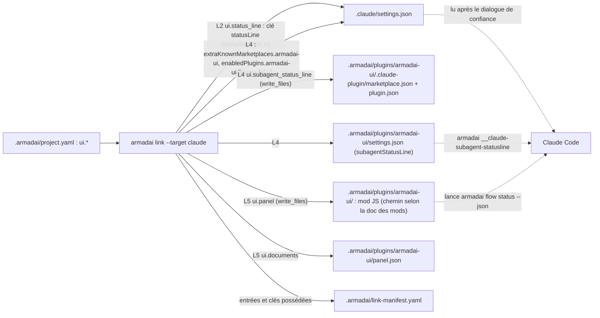

# Plan : interface dans les orchestrateurs (L1 à L5)

Spec : `docs/superpowers/specs/2026-11-04-orchestrator-ui-design.md`. Cadre : `docs/superpowers/specs/2026-11-04-orchestrator-ui-frame.md` (7 réponses de Dimitri et 2 règles adoptées, 2026-11-05). Recherche : `docs/superpowers/specs/2026-11-04-orchestrator-ui-research.md`. La piste 3 (OpenCode) est hors plan jusqu'à l'essai réel.

Écrit sans shell, par lecture du dépôt (tête `cf40e82`). Lu : `cli/flow.rs`, `cli/mod.rs`, `cli/graph.rs`, `cli/link.rs`, `cli/unlink.rs`, `flow_status/{record,render,runs}.rs`, `compile/{mod,claude,claude_settings,patch,json_keys}.rs`, `linker/manifest.rs` (garde par contenu, `ensure_gitignore`), `armadai-model/src/{lib,load,types,pack,mermaid}.rs`, `tests/link_golden.rs`, `docs/wiki/{flow-status,project-format}.md`, la spec du lot watch (lecture seule). **Non lu** : `armadai-model/src/{check,write,schema}.rs`, les tests d'intégration de `flow status` (nom de fichier non trouvé sans shell : le spécialiste le cherche avec `/usr/bin/grep -l '"flow", "status"' crates/armadai/tests`), l'emplacement exact de `schemas/v1/`.

## Décisions de Dimitri (2026-11-05, plan)

Réponses aux 7 questions de la fin de ce document, mot pour mot :
1. Marques avec la couleur : « Marques + couleur (Recommandé) ».
2. Forcer la couleur : « --color auto|always|never (Recommandé) » ; `ui.status_line` reste un booléen.
3. Commande de la barre : « Deux commandes » (option B) : `__claude-statusline` existe en plus de `flow status --line`, comme dans la spec 4.2 ; tâche L2-T0.
4. Barre déjà présente : « Écrit le reste, not-compiled (Recommandé) ».
5. Plugin : « Versionné (Recommandé) ».
6. Noms : « ui.subagent_status_line, ui.panel (Recommandé) » (avec `ui.documents` et le code `bad-document-folder` de cette option).
7. Collision avec `native.claude` : « Erreur de link (Recommandé) ».

Le plan ci-dessous applique ces réponses.

## 0. Contraintes globales (toutes les tâches)

- **Règles** : skill `armadai-rules`, en particulier : barrière complète avant push (fmt, clippy `-D warnings`, `cargo test --no-fail-fast`, `cargo build -p armadai-core`, `-p armadai-model`) ; un `CARGO_TARGET_DIR` privé au worktree ; mutation vue rouge pour chaque test ajouté ou changé, restauration avec `touch` ; égalité exacte de lignes entières plutôt que `contains` ; fixtures à valeurs distinctes deux à deux ; `/usr/bin/grep`, `/bin/ls`, `/bin/ps` ; aucune tâche en arrière-plan ; essais du binaire avec `HOME` et `ARMADAI_CONFIG_DIR` isolés ; rien de privé ni de chemin de machine dans fixtures, docs, wiki.
- **Règles adoptées le 2026-11-05** : sortie machine versionnée (champ de version, ajout seul) ; clé de compilation en opt-in (absente : `link` n'écrit rien ; en conflit : refus et ligne `not-compiled`, jamais de masquage silencieux).
- **Pureté** : `armadai-model` ne gagne que des types (`Ui`) et une vérification ; le JSON, la ligne et le Markdown se calculent dans le binaire (`flow_status/`) à partir de `runs()`, dont la sémantique ne change pas.
- **Aucune dépendance nouvelle** : `serde_json`, `chrono`, `anstream`/`anstyle` sont déjà là. Couleur : `anstream::ColorChoice`.
- **Textes figés** : chaque texte de la section 9 est repris mot pour mot ; un écart se rend à `lead`, il ne s'improvise pas.
- **Formats natifs** (`statusLine`, `subagentStatusLine`, `extraKnownMarketplaces`, `enabledPlugins`, plugin, mods) : l'adapter-specialist les vérifie dans la doc officielle de Claude Code avant d'écrire (URL et date en commentaire, comme `flow_status_entries`). Un écart avec ce plan se rend à `lead` avant d'écrire du code.
- **Golden** : `tests/golden/link/{claude,codex,copilot,opencode}.txt` **ne changent dans aucune livraison** (le projet de `link_golden.rs` n'a pas de clé `ui`) : c'est la preuve principale de « rien sans opt-in ». Un golden nouveau, `tests/golden/link/claude-ui.txt`, naît en L2 et grandit en L4 et L5 ; il se relit ligne à ligne contre ce plan. `flow status` sans nouveau drapeau garde exactement sa sortie (les tests de `render.rs` ne changent pas d'une ligne).
- **Manifeste** : reste `version: 1`. L2 n'en change pas la forme. L4 ajoute un champ optionnel et une valeur de `produced_by.kind` (précédent : `command`, `native`).
- **Une PR par livraison** : L1 sur `feat/orchestrator-ui` ; chaque livraison suivante sur sa branche, partie de `master` une fois la précédente fusionnée (L2 et L3 peuvent partir en parallèle de `master` après L1). PR ouverte, pas de fusion sans le brief de Dimitri.
- **Lot watch (en pause)** : il reprendra `Mark::sign()` (table de marques unique, tâche L1-T1) et le JSON ; conflit de rebase attendu sur `GraphFormat` (`Ascii` contre `Md`) et `cli/flow.rs`, sans conflit de sens.

## 1. Diagrammes

### 1.1 La ligne d'état, de la barre au journal

```mermaid
sequenceDiagram
    participant B as widget ccstatusline (ou statusLine du projet)
    participant L as armadai flow status --line (ou __claude-statusline, 3.6)
    participant P as policy_gate::resolve_project
    participant J as .armadai/state/claude/
    participant R as runs()
    B->>L: stdin JSON {session_id?, cwd?} puis fermeture
    Note over L: stdin terminal : non lu ; tube : lecture bornée à 250 ms
    L->>P: cwd du JSON, sinon répertoire courant
    P-->>L: racine du projet (aucune : ligne vide, code 0)
    alt --session, ou session_id dans le JSON
        L->>J: log_path(root, id)
    else aucun id, --line seulement (widget, stdin vide)
        L->>J: latest_session(root) : dernier journal modifié
    else aucun id, __claude-statusline
        L-->>B: rien (zéro octet), code 0
    end
    J-->>L: lignes JSONL lues par read_log : Vec<FlowEvent> (journal absent : ligne vide pour --line, rien pour __claude-statusline)
    L->>R: runs(&project, &events)
    R-->>L: Vec<Run>
    L-->>B: une ligne + "\n" (SGR si --color always ; toujours pour __claude-statusline), code 0
```

À regarder : il n'y a qu'un lecteur du journal (`runs()`), et la commande ne peut ni bloquer (lecture bornée) ni échouer bruyamment (tout cas d'exécution donne une ligne vide et le code 0). La barre du projet écrite par `link` appelle `armadai __claude-statusline` (décision 3), qui suit le même chemin à deux différences près (3.6) : sans `session_id` elle n'imprime rien, sans repli sur le dernier journal ; et elle colore toujours.

### 1.2 Ce que `link --target claude` écrit selon les clés `ui`



À regarder : sans aucune clé `ui`, aucune de ces flèches n'existe (diff nul, golden inchangés). L4 et L5 écrivent **sous `.armadai/`**, ce que la garde `compile::check_destination` interdit aujourd'hui (« would write into .git/ or .armadai/ ») : le choix de Dimitri (Q5 du cadre) demande une exception à cette garde, limitée au dossier exact `.armadai/plugins/armadai-ui/` (tâche L4-T3, question 5).

## 2. Faits vérifiés au dépôt qui orientent le plan

1. **Chargeur strict et `plugins/`** : `armadai_model::load_project` (`load.rs`) ne parcourt pas `.armadai/` ; il lit `project.yaml`, puis seulement `templates/`, `agents/`, `skills/`, `flows/`, `automations/`, `commands/`. Un dossier `.armadai/plugins/` ne soulève **aucun** diagnostic (`unknown-*` ou autre) et ne se confond avec aucun dossier connu. Les listes blanches de `init --pack` et `pack new --from-project` l'excluent aussi (sans effet ici). Aucune tâche de chargeur n'est donc nécessaire.
2. **Écriture sous `.armadai/`** : `compile::check_destination` refuse toute destination dont la première composante est `.git` ou `.armadai` ; `unlink::trust_root` ne fait confiance à `.` que pour un fichier `native` hors de `.armadai`. Le plugin demande donc une exception mesurée dans les deux (L4-T3).
3. **Garde par contenu (#342)** : sans manifeste, `unlink_via_fallback` recompile le plan et ne supprime que les artefacts **du plan du compilateur** dont les octets égalent ce que `link` écrirait ; il ne touche jamais `settings.json` ni le bloc de `CLAUDE.md` et le dit sur stderr. Un clone frais n'a pas le manifeste (ignoré par `.armadai/.gitignore`).
4. **`.armadai/.gitignore`** : `ensure_gitignore` ajoute `state/` et `vars.local.yaml` à **tout** fichier existant à chaque `link`. Une ligne de plus ajoutée de la même façon changerait la sortie de `link` (`patched .armadai/.gitignore`) pour tous les projets, sans opt-in : contraire à la règle adoptée. Si le plugin est ignoré (question 5, option B), la ligne ne s'ajoute que lorsque `ui.subagent_status_line` ou `ui.panel` est vrai.
5. **Conflit de clé dans `settings.json`** : `merge_settings` renvoie une **erreur** (`key \`X\` is already set to another value: ...`) et `preflight_settings` arrête `link` avant toute écriture, sans rapport. Le précédent d'une ligne `not-compiled` avec code 0 est le fichier existant laissé en place (`file exists and was not written by link (use --force)`). D'où la question 4.
6. **Collision avec `native.claude`** : `native_settings` refuse déjà `native.claude.hooks` (« project.yaml: native.claude key \`hooks\` collides with the generated hooks »). Le plan suit ce précédent pour `statusLine`, `extraKnownMarketplaces`, `enabledPlugins` (question 7).
7. **Clé inconnue de `project.yaml`** : `Manifest` est `deny_unknown_fields` ; une valeur de mauvais type ou une clé inconnue sous `ui` donne `invalid-yaml`, positionné, code déjà publié. L2 et L4 n'ont donc pas besoin de code nouveau ; L5 en a besoin d'un pour les dossiers (`bad-document-folder`, question 6).
8. **Fusion avec un pack** : `merge_manifest_values` fusionne `project.yaml` clé par clé, récursivement : `ui` y passe sans code.
9. **Coût par mise à jour** : `flow status` ouvre la vue effective (`pack::effective::open`) puis valide tout le projet ; pour un projet à pack, la vue copie les fichiers dans un dossier de travail à chaque appel. Rien n'est optimisé dans ce lot ; le temps se mesure à l'essai (critères 10 et 10b) et se rapporte.

## 3. Conception commune

### 3.1 Table de marques unique

`flow_status/runs.rs`, sur `Mark` :

```rust
impl Mark {
    /// The glyph `flow status`, `--line`, `--json` and the watch view share.
    pub fn sign(&self) -> &'static str;   // ✓ ● ○ ? ✗ ~ -
    /// The machine name used by `--json`.
    pub fn name(&self) -> &'static str;   // done running pending unsure unexpected coordinator not-run
}
```

`render::render` remplace son `match` local par `v.mark.sign()` (le mot `running`/`pending` reste dans `render`). Le lot watch reprendra `sign()`.

### 3.2 `flow status --json` (schéma `armadai.flow-status/1`)

Nouveau module `flow_status/json.rs` :

```rust
pub const SCHEMA: &str = "armadai.flow-status/1";
/// `session`: (id, events of its log); `None` when no log exists at all.
pub fn document(session: Option<(&str, &[FlowEvent])>, runs: &[Run]) -> serde_json::Value;
```

Document (une session, les runs dans l'ordre où ils ont commencé, pas l'ordre d'affichage du texte) :

```json
{
  "schema": "armadai.flow-status/1",
  "session": {
    "id": "s1",
    "started_at": "2026-10-22T09:15:00Z",
    "last_event_at": "2026-10-22T09:15:50Z"
  },
  "runs": [
    {
      "flow": "deliver",
      "status": "in-progress",
      "steps": [
        { "step": "design", "mark": "done", "sign": "✓", "state": "done", "note": null },
        { "step": "guard", "mark": "running", "sign": "●", "state": null, "note": null }
      ],
      "loops": [ { "from": "build", "to": "guard", "times": 2 } ],
      "transitions": [
        { "at": "2026-10-22T09:15:20Z", "from": "design", "to": "build", "state": "done" }
      ]
    }
  ]
}
```

- `status` : `in-progress`, `finished`, `interrupted`. `mark` : les noms de 3.1. `sign` est là pour que le mod (L5) n'ait pas sa propre table. `started_at`/`last_event_at` : `ts` du premier et du dernier événement du journal, RFC 3339 UTC à la seconde ; `null` si le journal est vide ou absent.
- Aucun journal du tout : `"session": null, "runs": []`, code 0. `--session S` sans fichier : `"session": {"id": "S", "started_at": null, "last_event_at": null}, "runs": []`, code 0 (critère 3). Un id que `log_path` refuse reste une erreur (texte actuel).
- Le filtre positionnel `flow` s'applique comme au texte. Sortie `serde_json::to_string_pretty` + `\n`, rien d'autre sur stdout.

### 3.3 `flow status --line`

Nouveau module `flow_status/line.rs`, pur :

```rust
/// The one-line summary of a session (no trailing newline); empty when no run.
pub fn line(runs: &[Run]) -> Vec<(Piece, String)>;   // pieces to colour; joined by `text()`
pub enum Piece { Flow, Mark(Mark), Progress, Loops, Status }
pub fn text(pieces: &[(Piece, String)]) -> String;   // plain text, single spaces
```

Règles :
- **Run montré** : le dernier (ordre de départ) qui n'est ni `finished` ni `interrupted` ; à défaut le dernier run ; aucun run : ligne vide.
- **Étape courante** (run en cours) : la première `Running` ; sinon la première `Unsure` ou `Unexpected` ; sinon la première `Pending` ; sinon aucune.
- **Avancement** `d/n` : `n` = étapes dont la marque n'est ni `Relay` (`~`) ni `NotRun` (`-`) ; `d` = étapes `Done`.
- **Boucles** `k` = somme de `times - 1` sur `run.loops` ; affiché seulement si `k > 0`.
- **Formes** (textes figés, section 9) : `deliver ● guard 2/4 (loops 1)` ; `review ? check 0/2` ; en cours sans étape courante `deliver 3/4` ; `hotfix finished 2/2` ; `bugfix interrupted 1/2`.
- **Couleur** (si active) : flow `style::accent`, marque et étape selon la marque comme `print_painted` (✓ ok, ● running, ○ et ~ muted, ? warn, ✗ err, - aucune), avancement `muted`, boucles `warn`, mot d'état `muted`. Les marques restent avec la couleur (question 1).

CLI (`cli/flow.rs`) :
- **stdin** : s'il est un terminal (`IsTerminal`), il n'est pas lu ; sinon lu dans un fil séparé, attendu au plus 250 ms (`mpsc::recv_timeout`), puis ignoré (`// shortcut: the reader thread is left behind when stdin stays open; the process exits anyway`). JSON accepté : `session_id` (chaîne), `cwd` (chaîne, dossier existant) ; tout le reste ignoré ; JSON invalide = pas de JSON.
- **Session** : `--session` > `session_id` du JSON > dernier journal modifié du projet.
- **Projet** : `cwd` du JSON, sinon le répertoire courant, résolu par `policy_gate::resolve_project` (comme les hooks).
- **Jamais bruyant** : pas de projet, projet invalide, flow inconnu, journal absent ou illisible, stdin invalide : ligne vide (`\n`), rien sur stderr, code 0. Seules les erreurs de `clap` (drapeaux incompatibles) restent des erreurs.
- **Toujours une ligne** : exactement un `\n` sur stdout.

### 3.4 Couleur forcée (question 2, option recommandée A)

`flow status --color <auto|always|never>` (défaut `auto`), appliqué par `anstream::ColorChoice::write_global` avant toute sortie de `flow status` ; `NO_COLOR` et `CLICOLOR_FORCE` restent honorés en `auto` par `anstream`. `--json` et `--format md` n'émettent jamais de couleur, quel que soit `--color`. La doc du widget ccstatusline indique `armadai flow status --line --color always`. La `statusLine` écrite par `link` appelle `armadai __claude-statusline` (3.6), qui colore toujours.

### 3.6 `__claude-statusline` (décision 3, spec 4.2)

Commande cachée (`hide = true`), écrite par `link` dans la `statusLine` du projet. Elle partage avec `--line` la lecture bornée de stdin, la résolution du projet et `line::line`, et ne diffère qu'en ceci :
- **Session obligatoire** : elle lit `session_id` dans le JSON de stdin et le journal `log_path(root, session_id)`, **sans repli** sur le dernier journal (spec 4.2 : « trouve `<session_id>.jsonl` » ; risque 4 : le repli ne se décide qu'après la mesure de l'essai 10). Sans `session_id`, avec un id que `log_path` refuse, une session inconnue ou un JSON invalide : **rien** sur stdout (zéro octet, critère 9), code 0.
- **Projet** : le `cwd` du JSON, sinon le répertoire courant.
- **Couleur toujours** : la `statusLine` accepte l'ANSI (V) ; aucun drapeau.
- **Aucun argument**, et jamais rien sur stderr. Journal présent sans run : rien non plus.
- Une ligne (un `\n`) seulement quand il y a un run à montrer.

### 3.5 Le modèle : clé `ui` de `project.yaml`

`armadai-model/src/types.rs` :

```rust
#[derive(Debug, Clone, Default, PartialEq, Eq, Serialize, Deserialize, JsonSchema)]
#[serde(deny_unknown_fields)]
pub struct Ui {
    /// L2: compile a Claude Code statusLine running `armadai flow status --line`.
    #[serde(default, skip_serializing_if = "is_false")]
    pub status_line: bool,
    // L4: subagent_status_line: bool ; L5: panel: bool, documents: Option<Vec<String>>
}
// Manifest: #[serde(default, skip_serializing_if = "Ui::is_default")] pub ui: Ui,
```

Chaque livraison n'ajoute que son champ (L2 `status_line`, L4 `subagent_status_line`, L5 `panel` et `documents`). Un `project.yaml` sans `ui` s'écrit à l'octet près comme avant.

```yaml
ui:
  status_line: true            # L2
  subagent_status_line: true   # L4 (plugin armadai-ui)
  panel: true                  # L5 (mod JS, opt-in)
  documents: [docs, notes]     # L5, défaut [docs]
```

## 4. Livraison L1 : socle (2 tâches, PR 1)

### L1-T1 (`cli-specialist`) : table de marques et `flow status --json`

Fichiers : `crates/armadai/src/flow_status/runs.rs` (impl `Mark`), `flow_status/render.rs` (usage de `sign()`), `flow_status/json.rs` (nouveau), `flow_status/mod.rs`, `cli/flow.rs` (drapeau `--json`, conflits `watch`, `list`), `docs/wiki/flow-status.md`, `CHANGELOG.md` (`## Unreleased`).

Étapes :
- [ ] `Mark::sign()` et `Mark::name()` ; `render` utilise `sign()` ; les tests de `render.rs` passent sans changer une ligne.
- [ ] `json::document` selon 3.2 ; `View` gagne une méthode qui rend `(Option<(String, Vec<FlowEvent>)>, Vec<Run>)` partagée par `text()` et le JSON (aucune deuxième lecture du journal).
- [ ] `--json` : `#[arg(long, conflicts_with_all = ["watch", "list"])]`, aide de la section 9.
- [ ] Golden de forme : `crates/armadai/tests/golden/flow-status/v1.json` (le document du fixture « trois runs » de 3.2).
- [ ] Doc : section « Machine-readable output » de `flow-status.md` (schéma, règle « ajout seul », table des valeurs de `mark` et `status`).

Tests :
1. `document` sur trois runs (`in progress` avec boucle, `finished`, `interrupted`) et une étape de chaque marque : égalité exacte avec un `json!` littéral. Mutations : permuter `Unsure`/`Unexpected` dans `name()` ; rendre `interrupted` comme `finished` ; trier les runs comme le texte ; chacune rouge.
2. Sans journal : `{"schema": SCHEMA, "session": null, "runs": []}` exact. Mutation : omettre `schema` quand il n'y a pas de session.
3. Intégration (`assert_cmd`) : journal écrit à la main, `flow status --json` ; `serde_json::from_str` réussit, valeur égale à l'attendu ; `--session inconnue` : session sans dates, zéro run, code 0. Mutation : garder le `bail!("no session ...")` actuel pour `--json` (rouge : code 1).
4. Stabilité du schéma : chaque chemin de clé de `tests/golden/flow-status/v1.json` existe dans la sortie courante avec le même type JSON (ajouts permis). Mutation : renommer `sign` en `glyph` ; rouge.
5. `flow status` sans drapeau : les tests de `render.rs` inchangés ; mutation : permuter `✓` et `●` dans `sign()` ; rouge.

Commit : `feat(flow): print a session as JSON with flow status --json`

### L1-T2 (`cli-specialist`) : `flow status --line` et `--color`

Fichiers : `flow_status/line.rs` (nouveau), `cli/flow.rs` (drapeaux `--line`, `--color`, lecture bornée de stdin), `cli/style.rs` si une fonction `for_mark` y est plus simple, `docs/wiki/flow-status.md` (section « In a status bar » : statusLine, widget Custom Command de ccstatusline, cache et timeout du widget, repli sur le dernier journal et sa limite à deux sessions parallèles), `CHANGELOG.md`.

Étapes :
- [ ] `line` et `text` selon 3.3, purs.
- [ ] `--line` : `conflicts_with_all = ["watch", "list", "json"]` ; lecture bornée de stdin ; projet par `cwd` ; silence total sur les cas d'exécution.
- [ ] `--color` (3.4) sur `flow status`.
- [ ] Doc et textes de la section 9.

Tests :
1. `line` pur, un cas par forme de 3.3 (dont `~` et `-` hors du compte, deux runs en cours dont seul le dernier est montré, aucun run) : égalité exacte de `text(..)`. Mutations : compter `Relay` dans `n` ; prendre le premier run en cours ; `k = times` au lieu de `times - 1` ; préférer `Pending` à `Unsure` ; chacune rouge.
2. Couleur : `--color always` sur un journal à une étape `●` : la ligne égale exactement `<SGR accent>deliver<reset> <SGR running>● guard<reset> ...` construite avec les mêmes `style::*` ; `--color never` : aucune `\x1b`. Mutation : ignorer `--color` (rouge sur `always`, stdout étant un tube dans le test).
3. Critère 4b, trois journaux à mtimes distincts (`File::set_modified`) : stdin `{"terminal_width":120}` → ligne du plus récent ; stdin `/dev/null` → la même ; `{"session_id":"S"}` → ligne de `S`, plus ancien. Chaque fois un seul `\n`, code 0. Mutation : ignorer `session_id` (rouge sur le 3e cas).
4. Ne bloque pas : stdin en tube **laissé ouvert** (`Stdio::piped()`, poignée gardée), `try_wait` en boucle ; la commande doit finir en moins de 5 s (le défaut est un blocage infini ; la lecture nominale est bornée à 250 ms). Répété 5 fois. Mutation : `read_to_string` direct sur stdin ; rouge (délai dépassé).
5. Silence : hors projet, projet invalide, flow inconnu en positionnel : stdout `"\n"`, stderr vide, code 0. Mutation : laisser passer le `bail!` du projet invalide ; rouge.
6. `cwd` du JSON : lancé depuis un dossier hors projet avec `{"cwd":"<projet>"}` : ligne du projet. Mutation : ignorer `cwd`.

Commit : `feat(flow): add a one-line summary for status bars (flow status --line)`

Fin de L1 : la PR répond aux critères 1 à 5 de la spec (critère 4 réécrit, voir section 10).

## 5. Livraison L2 : statusLine (3 tâches, PR 2)

### L2-T0 (`cli-specialist`) : commande cachée `__claude-statusline`

Fichiers : `crates/armadai/src/flow_status/line.rs` (fonction partagée), `cli/flow.rs` (lecture bornée de stdin et résolution du projet sorties dans des fonctions appelables des deux commandes), `cli/mod.rs` (variante `#[command(hide = true, name = "__claude-statusline")] ClaudeStatusline`, `handle`, liste du test `there_are_hidden_subcommands_to_strip`), `docs/wiki/flow-status.md`.

Interface :

```rust
// flow_status/line.rs
/// The line of `__claude-statusline` (3.6): `None` when it must print nothing.
pub fn statusline_from_stdin(raw: Option<&str>, cwd: &Path) -> Option<String>;
// cli/mod.rs : Command::ClaudeStatusline => crate::flow_status::line::statusline_main()
```

Étapes :
- [ ] Comportement de 3.6 ; la couleur passe par `anstream` avec `ColorChoice::Always` pour cette commande seulement.
- [ ] La lecture bornée et la résolution du projet de L1-T2 sont réutilisées, pas recopiées.
- [ ] Doc : une ligne dans la section « In a status bar » (la commande que `link` écrit, sans repli sur le dernier journal).

Tests :
1. Critère 9 : `{"session_id":"S","cwd":"<projet>"}` avec deux journaux, `S` le plus ancien : stdout égal à la ligne colorée de `S` construite avec les mêmes `style::*`, plus `\n`, code 0. Mutation : couleur selon le terminal au lieu de toujours (rouge : stdout est un tube).
2. Pas de repli : `{"cwd":"<projet>"}` (sans `session_id`), `{"session_id":"inconnue","cwd":...}`, `{"session_id":"../x"}`, `not json`, stdin vide : stdout vide (zéro octet), stderr vide, code 0, pour chacun des cinq (une assertion par cas, pas de boucle muette : chaque cas nommé dans le message). Mutation : réutiliser le repli de `--line` sur le dernier journal (rouge sur le premier cas).
3. Ne bloque pas : test 4 de L1-T2 rejoué sur cette commande, 5 passes. Mutation : `read_to_string` direct.
4. `there_are_hidden_subcommands_to_strip` liste `__claude-statusline`, et les scripts de complétion ne la proposent pas (test existant). Mutation : retirer `hide = true` (rouge).

Commit : `feat(flow): add the hidden __claude-statusline command for Claude Code`

### L2-T1 (`schema-specialist`) : clé `ui.status_line`

Fichiers : `crates/armadai-model/src/types.rs` (`Ui`, champ `ui` de `Manifest`), le schéma de `project.yaml` sous `schemas/v1/` (régénéré par `cargo run -p armadai-model --example gen_schemas`), `docs/wiki/project-format.md` (bloc `project.yaml` et paragraphe `ui`), `CHANGELOG.md`.

Étapes :
- [ ] `Ui { status_line }` comme en 3.5, `deny_unknown_fields`.
- [ ] Schéma régénéré, relu (seule la propriété `ui` apparaît).
- [ ] Doc : `ui:` dans l'exemple de `project.yaml` ; paragraphe « `ui` » (Claude Code seul, ce que `link` écrit, refus en conflit, masque la barre utilisateur).

Tests (crate `armadai-model`) :
1. `ui: { status_line: true }` se charge ; `project.manifest.ui.status_line == true`. Mutation : `#[serde(skip)]` sur le champ.
2. `ui: { status_line: maybe }` : un diagnostic, rendu exact `.../project.yaml:2:16: error[invalid-yaml]: ...` (ligne et colonne de la valeur, message tel que serde le donne, recopié du premier rouge). Mutation : `status_line: serde_json::Value` (rouge : plus de diagnostic).
3. `ui: { colour: true }` : `invalid-yaml` positionné sur `colour`. Mutation : retirer `deny_unknown_fields` de `Ui`.
4. Écriture canonique : un projet sans `ui` se réécrit à l'octet près ; avec `ui: { status_line: false }` il se réécrit sans `ui`. Mutation : retirer `skip_serializing_if` du champ `ui`.
5. `validate` sort avec 1 sur le cas 2 (critère 5b). Mutation : celle du cas 2 (champ non typé : code 0, rouge).

Commit : `feat(model): add the ui.status_line key to project.yaml`

### L2-T2 (`adapter-specialist`) : compiler `ui.status_line`

Fichiers : `crates/armadai/src/compile/claude_settings.rs`, `compile/claude.rs`, `cli/link.rs` (`prepare`, report), `compile/opencode.rs` et `compile/legacy_targets.rs` (ligne `not-compiled`), `tests/link_golden.rs` (projet `claude-ui`), `tests/golden/link/claude-ui.txt` (nouveau), `docs/wiki/flow-status.md`, `docs/wiki/link.md` si le rapport y est décrit, `CHANGELOG.md`.

Interfaces :

```rust
// claude_settings.rs
pub const STATUS_LINE_COMMAND: &str = "armadai __claude-statusline";
/// `{"type":"command","command":STATUS_LINE_COMMAND,"refreshInterval":5}`
pub fn status_line_value() -> serde_json::Value;
/// The keys link wants, `ui` included; `native.claude.statusLine` with `ui.status_line` is an error.
pub fn native_settings(project: &Project) -> anyhow::Result<BTreeMap<String, Value>>;
/// When `.claude/settings.json` already holds another statusLine that `previous` does not own:
/// the key is taken out of `keys` and the reason returned for a `not-compiled` line.
pub fn keep_users_status_line(existing: Option<&str>, keys: &mut BTreeMap<String, Value>, previous: &Owned) -> anyhow::Result<bool>;
```

Étapes :
- [ ] Vérifier dans la doc officielle (`code.claude.com/docs/en/statusline`) : forme de `statusLine`, unité de `refreshInterval`, ANSI accepté ; noter URL et date.
- [ ] `native_settings` ajoute `statusLine` si `ui.status_line` ; collision avec `native.claude.statusLine` : erreur, texte de la section 9.
- [ ] `prepare` (Claude) : lit `settings.json`, appelle `keep_users_status_line` **avant** `preflight_settings` ; si la clé est retirée : ligne `not-compiled` ; sinon ligne `compiled`.
- [ ] Autres cibles : ligne `not-compiled` quand `ui.status_line` est vrai.
- [ ] Golden `claude-ui` : projet de `link_golden.rs` + `ui: { status_line: true }`, rendu comme `claude` plus `.claude/settings.json` en entier.
- [ ] Doc (section « In a status bar ») : la voie `project.yaml`, le masquage de la barre utilisateur, le refus.

Tests :
1. **Rien sans opt-in** : projet à flows sans `ui` puis avec `ui: {}` : après `link`, l'ensemble des clés de premier niveau de `settings.json` est exactement `["hooks"]`, aucun dossier `.armadai/plugins/`, et `claude.txt` inchangé. Mutation : ajouter `statusLine` sans condition ; rouge (et golden `claude.txt` rouge).
2. Avec la clé : `settings.json["statusLine"] == status_line_value()` ; ligne de rapport exacte ; `unlink` rend un `settings.json` égal au fichier de l'utilisateur d'avant (`USER` de `claude_settings.rs`). Mutations : mauvaise commande ; clé non enregistrée comme possédée (`unlink` la laisse).
3. Barre existante : `settings.json` à l'octet près inchangé, ligne `not-compiled` exacte, le reste écrit (hooks présents), code 0 (décision 4). Mutation : supprimer `keep_users_status_line` ; rouge (link échoue sur le conflit).
4. Relink : deux `link` successifs : second `settings.json` identique, même rapport ; la clé reste possédée. Mutation : `keep_users_status_line` qui ignore `previous` (rouge : le second link se refuse à lui-même).
5. Collision `native.claude.statusLine` + `ui.status_line` : erreur exacte, rien écrit. Mutation : retirer la vérification.
6. `link --target opencode` avec `ui.status_line` : ligne `not-compiled` exacte ; sans la clé, aucune ligne (golden `opencode.txt` inchangé). Mutation : écrire la ligne sans condition.
7. Golden `claude-ui.txt` relu ligne à ligne contre la section 9.

Commit : `feat(link): compile ui.status_line into the Claude Code statusLine`

Ordre : L2-T0 et L2-T1 sont indépendantes ; L2-T2 vient après les deux (elle écrit la commande de L2-T0).

## 6. Livraison L3 : vue Markdown (2 tâches, PR 3, parallèle à L2)

### L3-T1 (`cli-specialist`) : `graph --format md`

Fichiers : `crates/armadai/src/cli/graph.rs` (`GraphFormat::Md`, utilisation de `format`), `cli/mod.rs` (`long_about` et exemples de `graph`), `docs/wiki/project-format.md` (section `graph`), `CHANGELOG.md`.

Interface : `fn markdown_block(id: &str, mermaid: &str) -> String` = `"## {id}\n\n```mermaid\n{mermaid}```\n"` ; les blocs séparés par une ligne vide, comme aujourd'hui.

Tests :
1. Deux flows : sortie exacte ; pour chaque flow, le contenu entre ```` ```mermaid ```` et ```` ``` ```` égale `flow_to_mermaid(id, f)`. Mutation : retirer la ligne `%% flow:` du bloc ; rouge.
2. `--format mermaid` : sortie inchangée (test existant ou nouveau, octet pour octet). Mutation : faire passer `Mermaid` par `markdown_block`.
3. Flow inconnu avec `--format md` : même erreur qu'aujourd'hui. Mutation : traiter `md` avant la recherche du flow.

Commit : `feat(graph): print flows as Markdown with --format md`

### L3-T2 (`cli-specialist`) : `flow status --format md`

Fichiers : `flow_status/render.rs` (`render_md`), `cli/flow.rs` (`--format text|md`, conflits `watch`, `list`, `json`, `line`), `docs/wiki/flow-status.md`, `CHANGELOG.md`.

Interface : `pub fn render_md(runs: &[Run], session: &str, last_event_at: Option<u64>) -> String`. Forme figée en section 9. Les colonnes « Status » reprennent exactement le texte d'état de `render` (état ou mot, note entre parenthèses) : une seule fonction privée sert les deux.

Tests :
1. `render_md` sur `looping()` + `finished()` (fixtures de `render.rs`) : égalité exacte ; aucune `\x1b` (critère 12). Mutation : colonne « Status » sans la note ; rouge.
2. Sans journal : la ligne `NO_ACTIVITY` actuelle ; session sans run : texte de la section 9. Mutation : en-tête de session absent.
3. `flow status` sans `--format` : tests de `render.rs` inchangés.

Commit : `feat(flow): print a Markdown snapshot with flow status --format md`

## 7. Livraison L4 : `subagentStatusLine` par plugin (3 tâches, PR 4)

### L4-T1 (`schema-specialist`) : clé `ui.subagent_status_line`

Comme L2-T1, pour le champ `subagent_status_line: bool`. Tests 1, 3 et 4 de L2-T1 refaits pour ce champ, mêmes mutations. Doc `project-format.md`.

Commit : `feat(model): add the ui.subagent_status_line key`

### L4-T2 (`adapter-specialist`) : commande cachée `__claude-subagent-statusline`

Fichiers : `crates/armadai/src/claude_adapter/subagent_status.rs` (nouveau), `claude_adapter/mod.rs`, `cli/mod.rs` (`#[command(hide = true, name = "__claude-subagent-statusline")]`, test `there_are_hidden_subcommands_to_strip`), lecture bornée de stdin de L1-T2 (déplacée dans une fonction partagée si besoin).

Interface :

```rust
/// One `(task id, content)` per task whose agent type holds a step of a run in progress.
pub fn lines(project: &Project, runs: &[Run], tasks: &[Task]) -> Vec<(String, String)>;
pub struct Task { pub id: String, pub agent_type: String }
```

`content` = la ligne de 3.3 du run qui contient l'étape tenue par cet agent (marque et étape de **cette** étape), couleurs actives (ANSI accepté par la surface, V). Une tâche sans étape : aucune sortie pour elle. Session : `session_id` du JSON s'il y est, sinon dernier journal.

Étapes :
- [ ] Vérifier dans la doc : champs de `tasks[]`, forme exacte de la sortie (une ligne JSON par tâche ou un tableau), présence de `session_id`. Écart : à `lead`.
- [ ] Commande jamais bruyante : entrée vide ou invalide → rien, code 0.

Tests :
1. `lines` : deux tâches, une tenant `guard` (en cours), une sans étape : un seul élément, contenu exact. Mutation : prendre l'étape courante du run au lieu de celle de l'agent.
2. Intégration : entrée vide, `{"tasks":"x"}`, JSON tronqué : stdout vide, code 0, aucune panique. Mutation : `unwrap` sur le parse.
3. Format de sortie exact selon la doc (une ligne attendue écrite en entier). Mutation : clé `content` renommée.

Commit : `feat(claude): add the hidden __claude-subagent-statusline command`

### L4-T3 (`adapter-specialist`) : écrire le plugin `armadai-ui`

Fichiers : `compile/mod.rs` (`ArtifactKind::Plugin`, exception de `check_destination`), `compile/claude.rs` (artefacts du plugin), `compile/claude_settings.rs` (clés imbriquées), `linker/manifest.rs` (`ProducedByKind::Plugin`), `cli/link.rs` (`rel()` : chemin relatif à la racine comme `Native` ; `remove_stale`), `cli/unlink.rs` (`trust_root`, message du repli), `compile/patch.rs` si `Owned` change, golden `claude-ui.txt`, `docs/wiki/link.md` et `flow-status.md`, `CHANGELOG.md`.

Fichiers écrits (à confirmer à la doc, `marketplace-reference.md` et la page des plugins) :
- `.armadai/plugins/armadai-ui/.claude-plugin/marketplace.json` : `{"name": "armadai-ui", "owner": {"name": "ArmadAI"}, "plugins": [{"name": "armadai-ui", "source": "./", "description": "Flow progress from ArmadAI, in Claude Code"}]}`
- `.armadai/plugins/armadai-ui/.claude-plugin/plugin.json` : `{"name": "armadai-ui", "description": "Flow progress from ArmadAI, in Claude Code"}` (sans `version`, pour que le fichier ne change pas à chaque release, si la doc le permet).
- `.armadai/plugins/armadai-ui/settings.json` : `{"subagentStatusLine": {"type": "command", "command": "armadai __claude-subagent-statusline"}}`
- Dans `.claude/settings.json`, deux clés imbriquées possédées entrée par entrée : `extraKnownMarketplaces.armadai-ui = {"source": {"source": "directory", "path": "./.armadai/plugins/armadai-ui"}}` et `enabledPlugins.armadai-ui@armadai-ui = true`.

Interfaces :

```rust
pub const PLUGIN_DIR: &str = ".armadai/plugins/armadai-ui";
// compile/mod.rs : check_destination accepte rel ssi rel est lexicalement et réellement
// sous PLUGIN_DIR (aucun lien symbolique sur le chemin), le reste de `.armadai/` refusé comme avant.
// claude_settings.rs : Owned gagne
//   #[serde(default, skip_serializing_if = "OwnedJson::is_empty")] pub plugin: OwnedJson,
// fusionné par json_keys::merge_into comme `permissions`.
```

Étapes :
- [ ] Vérifier les formats (marketplace `directory` relatif, `enabledPlugins`, `settings.json` de plugin).
- [ ] Artefacts `Plugin` (chemin relatif à la racine), `ProducedByKind::Plugin`, exception étroite de `check_destination`, `trust_root` de `unlink` : `.` pour `Plugin` sous `PLUGIN_DIR` seulement.
- [ ] Clés imbriquées : conflit (par exemple `enabledPlugins.armadai-ui@armadai-ui: false` posé par l'utilisateur) : clé retirée, ligne `not-compiled`, même règle que L2 (question 4) ; collision avec `native.claude.extraKnownMarketplaces` ou `native.claude.enabledPlugins` : erreur (question 7).
- [ ] Repli sans manifeste : une ligne stderr (section 9) quand `PLUGIN_DIR` existe ; les fichiers ne sont pas supprimés (comme `settings.json`, rien n'est prouvé à `link`).
- [ ] `.gitignore` : rien (décision 5, plugin versionné) ; `ensure_gitignore` inchangé.

Tests :
1. Sans la clé : aucun fichier sous `.armadai/plugins/`, aucune clé `enabledPlugins`/`extraKnownMarketplaces` (test 1 de L2-T2 étendu). Mutation : écrire le plugin sans condition.
2. Avec : les trois fichiers exacts, les deux valeurs imbriquées exactes ; l'`enabledPlugins` de l'utilisateur (une autre entrée) conservé ; `unlink` retire fichiers, dossiers créés et entrées, laisse l'entrée de l'utilisateur (égalité exacte du JSON). Mutations : posséder `enabledPlugins` en entier (rouge : conflit avec l'entrée de l'utilisateur) ; `trust_root` laissé à `.claude` (rouge : `unlink` refuse et sort avec 1).
3. Garde : `rel = .armadai/plugins/armadai-ui-x/a`, `.armadai/plugins/other/a`, `.armadai/project.yaml` toujours refusés ; `.armadai/plugins` en lien symbolique vers un dossier hors projet : refusé. Mutation : exception écrite `starts_with(".armadai/plugins")` ; rouge sur `other`.
4. Manifeste de la version précédente (sans `plugin`, sans `kind: plugin`) : lu, `link` puis `unlink` corrects. Mutation : retirer `#[serde(default)]` de `plugin` ; rouge.
5. Repli sans manifeste : message stderr exact, fichiers du plugin laissés. Mutation : les ajouter aux candidats du repli.
6. Golden `claude-ui.txt` : projet avec `subagent_status_line: true` aussi ; rendu étendu au dossier du plugin.

Commit : `feat(link): write the armadai-ui plugin for the sub-agent status line`

## 8. Livraison L5 : mod (2 tâches, PR 5)

### L5-T1 (`schema-specialist`) : `ui.panel`, `ui.documents`, code `bad-document-folder`

Fichiers : `types.rs` (`panel: bool`, `documents: Option<Vec<String>>`), `check.rs` (vérification), schéma régénéré, `docs/wiki/project-format.md` (clés et ligne de la table des codes), `CHANGELOG.md`.

Règle : chaque entrée de `ui.documents` est un dossier relatif du projet ; refusés (erreur `bad-document-folder`, positionnée sur l'entrée) : vide, absolu, contenant `..`, `.` (la racine entière), sous `.armadai/` ou `.git/`. Liste vide permise (aucun document listé). `documents` sans `panel` : accepté, sans effet.

Tests : un cas par refus, rendu exact du diagnostic ; `docs` et `notes/specs` acceptés ; `validate` sort avec 1. Mutations : oublier `..` ; comparer `.armadai` sans la casse (`.ARMADAI/x` doit être refusé, précédent `into_sources`) ; chacune rouge.

Commit : `feat(model): add ui.panel and ui.documents with bad-document-folder`

### L5-T2 (`adapter-specialist`) : le mod du panneau

Fichiers : `crates/armadai/src/compile/ui/armadai-ui-panel.js` (nouveau, inclus par `include_str!`), `compile/claude.rs` (artefacts), golden `claude-ui.txt`, `docs/wiki/flow-status.md` (section « Panel (mod) »), `CHANGELOG.md`.

Comportement du JS (API des mods vérifiée dans `plugins/mods/overview.md`, `interface.md`, `reference.md` avant d'écrire ; chemin du fichier dans le plugin selon cette doc) : ouvre un panneau ; toutes les 2 s lance `armadai flow status --json`, refuse un `schema` autre que `armadai.flow-status/1` (message dans le panneau, section 9) ; affiche chaque run (flow, statut, étapes avec `sign`) ; lit `panel.json` (`{"documents": [...]}`, écrit par `link`, défaut `["docs"]`) et liste les fichiers `.md` de ces dossiers modifiés depuis `session.started_at`, les plus récents d'abord, 20 au plus. Le JS est écrit tel quel (mêmes octets que le fichier inclus) ; seules les données vont dans `panel.json`.

Étapes :
- [ ] Vérifier l'API des mods, le chemin du fichier, la version minimale.
- [ ] Artefacts : le JS et `panel.json`, seulement si `ui.panel` ; ligne de rapport `approximated` (jamais `compiled` : `link` ne sait pas si le mod est chargé).
- [ ] `claude plugin test` n'est pas dans la CI (Claude Code absent) : étape de `validator` à l'essai (critère 18).

Tests :
1. Sans `ui.panel` : aucun fichier JS ni `panel.json` (liste exacte des fichiers du plugin). Mutation : écrire le JS dès que le plugin existe.
2. Avec : JS octet pour octet égal au fichier inclus ; `panel.json` exact, avec et sans `documents`. Mutation : défaut `[]` au lieu de `["docs"]`.
3. Ligne de rapport exacte. Mutation : statut `compiled`.
4. `unlink` retire le JS et `panel.json`. Mutation : `ProducedByKind` du JS laissé à `Plugin` mais chemin hors `PLUGIN_DIR` (rouge : refusé).

Commit : `feat(link): write the opt-in armadai-ui panel mod`

## 9. Textes figés à valider par Dimitri

Rapport de `link` (format actuel `<target> <element>: <status> (<reason>)` rendu par `report.rs`) :

| Cas | Élément | Statut | Raison |
|---|---|---|---|
| L2 écrite | `ui.status_line` | `compiled` | `statusLine in .claude/settings.json, running armadai __claude-statusline; it hides the statusLine of your user settings` |
| L2 refus | `ui.status_line` | `not-compiled` | `.claude/settings.json already has a statusLine; link leaves it (add armadai flow status --line to your own bar instead)` |
| L2/L4/L5 autre cible | `ui.status_line` / `ui.subagent_status_line` / `ui.panel` | `not-compiled` | `Claude Code only` |
| L4 écrit | `ui.subagent_status_line` | `compiled` | `plugin armadai-ui in .armadai/plugins/armadai-ui, enabled in .claude/settings.json; Claude Code loads it once you trust the folder` |
| L4 refus | `ui.subagent_status_line` | `not-compiled` | `key <path> of .claude/settings.json already has another value; link leaves it` |
| L5 écrit | `ui.panel` | `approximated` | `mod in .armadai/plugins/armadai-ui: runs JavaScript and the armadai command with your permissions; needs Claude Code 2.1.287 or later, off under --safe-mode, disableAllHooks or claude -p` |

Erreurs de `link` (précédent `hooks`) :
- `project.yaml: native.claude key \`statusLine\` collides with ui.status_line`
- `project.yaml: native.claude key \`enabledPlugins\` collides with ui.subagent_status_line` (et `extraKnownMarketplaces`, même forme)

`unlink` sans manifeste (stderr, style warn, comme la ligne des hooks) :
- `  .armadai/plugins/armadai-ui/ not removed: no manifest records what link wrote there`

Diagnostic (L5) : `error[bad-document-folder]: ui.documents entry \`<value>\` must be a folder inside the project, outside .armadai/ and .git/` ; table de `project-format.md` : `| \`bad-document-folder\` | error | A \`ui.documents\` entry is empty, absolute, climbs with \`..\`, is the project root, or points into \`.armadai/\` or \`.git/\` | Name a folder of the project such as \`docs\` |`

Ligne d'état (3.3) : `deliver ● guard 2/4 (loops 1)`, `deliver 3/4`, `hotfix finished 2/2`, `bugfix interrupted 1/2`, ligne vide.

`__claude-statusline` (3.6) : la même ligne, toujours colorée ; sans `session_id`, session inconnue, JSON invalide ou journal sans run : aucune sortie (zéro octet). Commentaire de la variante clap (caché de l'aide, sur le modèle de `__record-flow-event`) : `Internal: called by the Claude Code statusLine that link writes for ui.status_line. Reads the status line JSON from stdin (session_id, cwd) and prints the line of that session, or nothing. Hidden from help.`

JSON (3.2) : `schema` `armadai.flow-status/1` ; `status` `in-progress|finished|interrupted` ; `mark` `done|running|pending|unsure|unexpected|coordinator|not-run`.

Markdown de `flow status --format md` :

```markdown
# Flow status: session s1

Snapshot at the last recorded event, 2026-10-22 09:15:50 UTC.

## deliver: in progress

| Step | Mark | Status |
|---|---|---|
| design | ✓ | done |
| guard | ● | running |

Links taken more than once: build → guard (2).

| Time (UTC) | From | To | State |
|---|---|---|---|
| 2026-10-22 09:15:20 | design | build | done |
```

Session sans run : `# Flow status: session s1` puis `No run of a declared flow in this session yet.` ; sans journal : la ligne actuelle `no flow activity recorded yet (...)`.

Markdown de `graph --format md` : `## <flow id>`, ligne vide, bloc ```` ```mermaid ```` identique à `--format mermaid`.

Aide (`clap`) :
- `--json` : `Print the session as JSON (schema armadai.flow-status/1) on stdout, and nothing else`
- `--line` : `Print one line for a status bar: the flow, its current step and its progress; reads session_id and cwd from a JSON on stdin when piped; never fails`
- `--color` : `When to colour the output: auto (a terminal; NO_COLOR and CLICOLOR_FORCE honoured), always, never`
- `--format` (flow status) : `Output format: text, or md (a Markdown snapshot for GitHub, GitLab or VS Code)`
- `GraphFormat::Md` : `Markdown: a heading and a mermaid block per flow`
- `long_about` de `flow status`, phrase ajoutée : `--json and --format md print a snapshot for other tools; --line prints one line for a status bar (Claude Code's statusLine, or a custom command in your own bar).`
- exemples ajoutés : `armadai flow status --line`, `armadai flow status --json`, `armadai flow status --format md > status.md` ; pour `graph` : `armadai graph --format md > flows.md`.
- Mod : message du panneau quand le schéma diffère : `armadai flow status --json gave schema <value>; this panel reads armadai.flow-status/1. Run armadai link again.`

## 10. Phrases de la spec à réaligner (pour `analyst`)

Selon les décisions de Dimitri du 2026-11-05 (plan). La commande `__claude-statusline` de la spec 4.2 reste telle quelle (décision 3).
1. 4.1, puce « Résumé en une ligne » : « sans ANSI par défaut » → « en couleurs ANSI quand stdout est un terminal ou sur `--color always`, sans couleur sinon ; les marques ✓ ● ○ ? ✗ ~ - restent avec la couleur ». Dans la même puce : « Exposé par `flow status --line` (nom provisoire, fixé au plan) » → « Exposé par `flow status --line` ».
2. 4.2, deuxième puce : « (nom et forme fixés au plan, avec code de diagnostic et schéma) » → « (`ui.status_line: true`, un booléen ; une valeur invalide donne `invalid-yaml` ; schéma de `project.yaml` régénéré) ».
3. 4.2, troisième puce : « imprime une ligne ; sortie vide si pas de journal » → « imprime la ligne de `--line`, toujours en couleurs ANSI ; sans `session_id`, pour une session inconnue ou sans journal, aucune sortie (sans repli sur le dernier journal tant que la mesure C n'est pas faite) ».
4. 4.2, quatrième puce : « `link` n'écrit rien, rapporte `not-compiled` avec la raison » → « `link` n'écrit pas cette clé, écrit tout le reste, rapporte `not-compiled` avec la raison et sort avec le code 0 ».
5. 4.4, deuxième puce : « `flow status` en Markdown (drapeau fixé au plan) » → « `flow status --format md` ».
6. Critère 4 : « imprime une seule ligne (un `\n`), sans séquence d'échappement, qui nomme » → « imprime une seule ligne (un `\n`), sans séquence d'échappement quand stdout n'est pas un terminal et sans `--color always` (avec `--color always`, des séquences SGR seulement), qui nomme ».
7. Critère 4b : « dans les deux cas, code 0, une seule ligne » → « dans les deux cas, code 0, une seule ligne sans séquence d'échappement ».
8. Critère 5b : « une valeur invalide donne un diagnostic positionné à code stable » → « une valeur invalide de `ui.status_line` donne un diagnostic positionné de code `invalid-yaml` ».
9. Critère 8 : « sort avec le code habituel des refus de fusion » → « écrit le reste (hooks, agents), sort avec le code 0, comme un fichier existant laissé en place ».
10. Critère 9 : « imprime la ligne du critère 4 pour le journal de la session `S`, et rien (code 0) pour une session inconnue ou un JSON invalide » → « imprime la ligne du critère 4, en couleurs ANSI (séquences SGR seulement), pour le journal de la session `S`, et rien (zéro octet, code 0) pour une session inconnue, un JSON sans `session_id` ou un JSON invalide ».
11. Critère 14 : « Avec la demande » → « Avec `ui.subagent_status_line: true` ».
12. Critère 17 : « Sans demande explicite de mod dans `project.yaml` » → « Sans `ui.panel: true` dans `project.yaml` » ; et « la ligne de rapport nomme l'exécution de JS avec les permissions de l'utilisateur » → « la ligne de rapport, `approximated`, nomme l'exécution de JS et de la commande `armadai` avec les permissions de l'utilisateur ».
13. Risque 9 et critère 10b(5) : « pour décider si `--line` reste sans couleur » → « pour décider si le widget passe `--color always` ».
14. « Questions ouvertes » de la spec : « À fixer au plan (texte validé par Dimitri) : noms des drapeaux et de la clé de `project.yaml`, dossiers parcourus pour les documents produits (L5), repli exact de `--line` entre plusieurs sessions. » → « Fixés au plan (2026-11-05) : `--json`, `--line`, `--color`, `--format md`, clés `ui.status_line`, `ui.subagent_status_line`, `ui.panel`, `ui.documents` (défaut `[docs]`, code `bad-document-folder`) ; repli de `--line` sur le dernier journal modifié, à revoir après l'essai 10b. »

## 11. Récapitulatif

| Livraison | Tâches | Domaines | Golden |
|---|---|---|---|
| L1 socle | 2 | cli, cli | `tests/golden/flow-status/v1.json` (nouveau) ; aucun golden de `link` |
| L2 statusLine | 3 | cli, schema, adapter | `tests/golden/link/claude-ui.txt` (nouveau) |
| L3 Markdown | 2 | cli, cli | aucun golden existant |
| L4 plugin | 3 | schema, adapter, adapter | `claude-ui.txt` étendu |
| L5 mod | 2 | schema, adapter | `claude-ui.txt` étendu |

Total : 12 tâches. `tests/golden/link/{claude,codex,copilot,opencode}.txt` restent identiques à chaque livraison.

## Questions pour Dimitri (historique : toutes répondues le 2026-11-05, voir « Décisions de Dimitri (2026-11-05, plan) » en tête)

**Q1. La ligne garde-t-elle les marques avec la couleur ?**
- A. Marques et couleur (`deliver ● guard 2/4`) : lisible sans couleur (tube, daltonisme), même table que `flow status` et le watch. **Recommandé.**
- B. Couleur seule (`deliver guard 2/4`, l'étape colorée) : plus court, illisible quand la couleur saute.

**Q2. Forcer la couleur quand stdout est un tube, et forme de `ui.status_line`.**
- A. Drapeau `flow status --color auto|always|never` ; `link` écrit `--color always` dans la commande ; `NO_COLOR` et `CLICOLOR_FORCE` honorés en `auto` ; `ui.status_line` reste un booléen. Coût : un drapeau. **Recommandé** (marche aussi dans le widget ccstatusline et sous Windows).
- B. Variable seulement (`CLICOLOR_FORCE=1 armadai flow status --line`), zéro code ; mais la commande écrite par `link` dépend d'un shell POSIX.
- C. Objet `ui.status_line: { color: true, refresh: 5 }` : ne couvre que la barre écrite par `link`, pas le widget.

**Q3. Une seule commande pour la barre ?** La spec en prévoit deux : `flow status --line` (widget) et `__claude-statusline` (barre du projet), qui font la même chose (lire `session_id` et `cwd` sur stdin, une ligne, jamais d'échec), voir diagramme 1.1.
- A. Une seule : `link` écrit `armadai flow status --line --color always`. Une surface de moins, un seul code testé. **Recommandé.** Change 4.2 et le critère 9 (section 10).
- B. Les deux, comme la spec : une tâche de plus (L2-T0), une commande cachée de plus à garder alignée.

**Q4. Une `statusLine` déjà présente dans `.claude/settings.json` : code de sortie de `link` ?** Aujourd'hui un conflit de clé arrête `link` avant toute écriture, code 1, sans rapport (fait 5).
- A. `link` écrit tout le reste, laisse la barre, ligne `not-compiled`, code 0 (précédent : un fichier existant laissé en place). **Recommandé.**
- B. Refus actuel : rien écrit, code 1, message d'erreur, pas de ligne de rapport (contredit « rapporte `not-compiled` » de la règle adoptée).
- C. Tout le reste écrit, ligne `not-compiled`, puis code 1 : aucun précédent dans `link`.
La même règle s'applique aux clés du plugin (L4).

**Q5. Le plugin dans `.armadai/plugins/armadai-ui/` : versionné ou ignoré ?** Le chargeur strict n'y voit rien (fait 1). Coût commun aux deux options : une exception à la garde qui interdit à `link` d'écrire sous `.armadai/` (fait 2), limitée au dossier exact et testée contre les liens symboliques (L4-T3, test 3).
- A. Versionné, comme `.claude/agents/` : un clone fonctionne sans `link` ; sur un clone frais (sans manifeste), `unlink` laisse le plugin et le dit, comme il laisse déjà les hooks. **Recommandé.**
- B. Ignoré par une ligne `plugins/armadai-ui/` de `.armadai/.gitignore`, ajoutée seulement quand une clé `ui` qui écrit le plugin est vraie (sinon tous les projets verraient `patched .armadai/.gitignore`, fait 4) ; un clone doit relancer `link`, et d'ici là `.claude/settings.json` (versionné) pointe vers un dossier absent (comportement de Claude Code à mesurer).
- (Pour mémoire : `.claude/armadai-ui/` éviterait l'exception à la garde ; c'était l'option B du cadre, que vous n'avez pas retenue.)

**Q6. Noms des clés de L4 et L5, et code de diagnostic des dossiers.**
- A. `ui.subagent_status_line`, `ui.panel`, `ui.documents` ; code `bad-document-folder` (famille `bad-*`, comme `bad-output`). **Recommandé.**
- B. `ui.mod` au lieu de `ui.panel` (le nom dit le mécanisme, le JS, plutôt que ce qu'on voit) ; même code.
- C. Code préfixé par la clé : `ui-bad-documents`.

**Q7. `native.claude.statusLine` (ou `enabledPlugins`, `extraKnownMarketplaces`) en même temps que la clé `ui` correspondante.**
- A. Erreur de `link`, comme `native.claude.hooks` aujourd'hui (texte en section 9) ; aucun code de diagnostic nouveau. **Recommandé** (précédent existant).
- B. Diagnostic de `validate`, positionné, code nouveau `duplicate-status-line` (famille `duplicate-*`) : vu plus tôt, une ligne de plus à la table des codes, un code par clé concernée.
