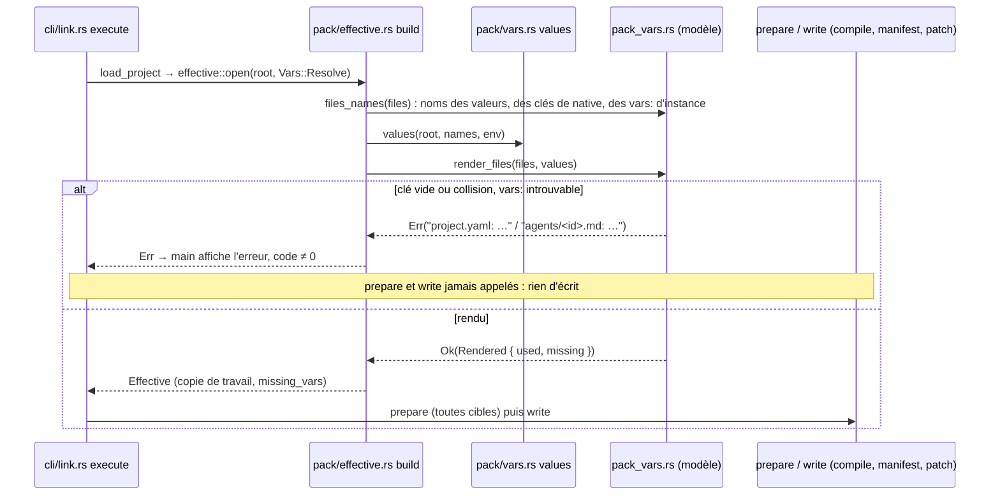

# Plan : variables de pack dans les clés de `native` et les `vars:` des instances

Date : 2026-11-04 · Étape `plan` du flow `lot` · Spec : `docs/superpowers/specs/2026-11-04-pack-vars-keys-instances-design.md` (#545, #546) · Cadre : `docs/superpowers/specs/2026-11-04-pack-vars-keys-instances-frame.md` (section 3 bis) · Branche `fix/pack-vars-keys-instances` sur `54db202`.

Décisions de Dimitri appliquées (2026-11-04, mot pour mot) : « Substituer (Recommandé) » (#546) ; « Hors lot, issue (Recommandé) » (contrôle général, #547) ; « Erreur (Recommandé) » (collision) ; « Erreur pour une clé (Recommandé) » (variable absente dans une clé) ; « Refuser une clé élargie (Recommandé) », règle : toute variable vide dans une clé = erreur, avant toute écriture. Valeurs et `vars:` d'instance : avertissement + vide, inchangé.

## 1. Contraintes globales

- Toute la logique dans `crates/armadai-model/src/pack_vars.rs` (crate pur, aucune dépendance ajoutée). Le binaire ne change pas de code : `pack/effective.rs` propage déjà l'erreur de `render_files` (`map_err(anyhow::Error::msg)`, ligne 224-225).
- Signatures publiques inchangées sauf `render_value` (section 3). Avant T1, le spécialiste vérifie ses appelants : `/usr/bin/grep -rn 'render_value' crates/armadai crates/armadai-model/src` (`agent_templates::render_value` est une autre fonction, intouchée).
- `Vars::Literal` (`validate`, `list`, …) ne rend rien : aucun nouveau refus hors `link`. Aucun code de diagnostic du validateur, aucun schéma JSON à régénérer (aucun type de `project.yaml` ne change).
- Aucune sortie existante ne bouge : les golden de `crates/armadai/tests/` passent sans mise à jour (critère 8). Un golden qui change est un défaut, pas une mise à jour.
- Fixtures génériques (`data-dir`, `/srv/data`, `a`, `x`) ; aucun chemin de machine. Valeurs distinctes deux à deux ; erreurs comparées en égalité exacte de la chaîne entière.
- Chaque test nomme sa mutation (colonne « Mutation » des tâches) ; rouge constaté, restauré avec `touch`, sortie reportée. `crates/armadai` : `--test <nom>` ou `--bin armadai`, toujours `--no-fail-fast`.
- Les tests d'intégration lancent le binaire en sous-processus avec `Command::env` / `env_remove` : pas d'`env_lock` ; `HOME` et `ARMADAI_CONFIG_DIR` isolés comme les tests voisins.

## 2. Où tombent les erreurs (atomicité, critères 4 et 5)



`execute` appelle `load_project` en premier (`link.rs`, l. 735) ; aucune écriture ne précède. L'erreur de `render_files` sort donc avant `prepare`, avant le manifeste et avant toute sortie compilée. Une seule erreur est rendue (la première rencontrée), pas d'accumulation.

## 3. Choix techniques

### 3.1 Clés de `native` (#545)

`render_value` reconstruit chaque objet : pour chaque entrée, dans l'ordre d'itération de la `serde_json::Map`, la clé d'abord, puis la valeur (récursion).
- Clé sans variable : gardée telle quelle.
- Clé avec variable : si une de ses variables est absente de `values` **ou** vaut `""` → erreur E2. Sinon rendue par `render`.
- Clé rendue déjà présente dans l'objet reconstruit → erreur E1 qui nomme la clé d'origine déjà placée, la clé d'origine courante et la clé rendue.
- Les variables d'une clé ne vont jamais dans `missing` (erreur, pas de ligne de rapport).

Signature :

```rust
/// Every string of `v` rendered in place, object keys included; numbers, bools and null
/// untouched. Err (the message, without file) on a key whose variable is unset or empty,
/// or on two keys of one object that render the same text; `v` is then partly rendered.
pub fn render_value(
    v: &mut Value,
    values: &BTreeMap<String, String>,
    missing: &mut BTreeSet<String>,
) -> Result<(), String>
```

`value_names` compte aussi les noms des clés (critère 3). `render_files` préfixe l'erreur par `{chemin}: ` comme ses erreurs actuelles.

### 3.2 `vars:` des instances (#546) : options

| Option | Principe | Coût | Positions des diagnostics |
|---|---|---|---|
| A. Édition ciblée des scalaires | trouver l'empan de chaque valeur dans le texte et y écrire le rendu | il faut l'empan d'un scalaire YAML (pur, sans parseur positionné : `diag.rs` n'a que `locate`) ; l'échappement dépend du style (nu, `'…'`, `"…"`, bloc `\|`) | exactes |
| **B. Ré-émission de la seule entrée `vars:`** (recommandée) | remplacer les lignes de l'entrée de premier niveau `vars:` par `vars: <objet JSON>` puis autant de lignes vides qu'il en faut pour garder le même nombre de lignes | ~40 lignes ; une valeur JSON entre guillemets doubles est un scalaire YAML double-quoted valide (échappements JSON ⊂ YAML) : insérée comme chaîne, jamais re-parsée en structure (critère 7) | exactes hors de l'entrée `vars:` ; une position sur une clé de `vars` tombe sur la ligne `vars:` (approchée) |
| C. Ré-émission de tout le frontmatter | parse + `yaml::to_string` | court | décalées partout, commentaires perdus, risque sur les autres clés (critère 8) |
| D. Rendu dans le chargeur | passer les valeurs de pack à `load_checked` | nouvelle API du chargeur, mélange des deux moteurs de variables | exactes |

Retenue : B (position approchée sur les clés de `vars` acceptée par Dimitri le 2026-11-04 : « Accepter (Recommandé) »). Règles :
- Portée : `agents/*.md` seulement (pas `templates/`), frontmatter qui parse en `Map` et contient `from`, entrée `vars` qui est un objet dont au moins une valeur texte porte un `{{var.…}}`. Sinon le fichier garde ses octets (le chargeur signale ce qui ne parse pas).
- Seules les valeurs texte de `vars` sont rendues (`render`, absente → `""` et `missing`), jamais les noms de `vars` ni les autres clés (`description: "{{var.x}}"` reste littéral, critère 8).
- Entrée : la ligne du frontmatter qui commence (colonne 0) par `vars:` suivi de fin de ligne, espace ou tabulation ; elle court jusqu'à la ligne suivante qui commence par un caractère autre qu'espace, tabulation, `#` ou fin de ligne.
- Garde : le nouveau frontmatter est re-parsé ; il doit égaler l'ancien `Map` avec `vars` remplacé par sa version rendue. Ligne `vars:` introuvable ou garde en défaut (frontmatter en style flux, `"vars":` entre guillemets, accolade fermante en colonne 0, …) → erreur E3, jamais un littéral silencieux.
- La valeur rendue entre ensuite dans le template par `agent_templates::render`, qui insère sans re-rendre (comportement existant, testé par `a_value_is_inserted_verbatim_never_rendered_again`).

`files_names` compte les noms des `vars:` d'instance (un projet sans pack dont seule une instance porte une variable est copié et rendu).

### 3.3 R3 : clé de premier niveau de `native.<cible>` qui contient un `.` après rendu

Accepté sans code : la clé est rendue avant que l'adaptateur la lise, son refus nomme donc la clé rendue. T3 relève le texte exact du refus dans `crates/armadai/src/compile/opencode.rs` (la spec cite `native.opencode key ... contains a .`, à vérifier) et T4 le documente. Une variable dans une clé de premier niveau (`permission`, `model`, …) n'a pas d'usage connu.

## 4. Textes (E1, E2, E3 validés par Dimitri le 2026-11-04 : « Validés tels quels (Recommandé) »)

Tels qu'imprimés après `Error: ` (le chemin est relatif à `.armadai/`, comme les erreurs actuelles de `render_files`) :

- **E1, collision** :
  `project.yaml: under native, the keys "{{var.a}}/**" and "/srv/data/**" both render as "/srv/data/**"`
- **E2, variable vide ou absente dans une clé** :
  `project.yaml: under native, the key "{{var.data-dir}}/**" uses variable data-dir, which is empty or set by none of ARMADAI_VAR_DATA_DIR, .armadai/vars.local.yaml, .armadai/vars.yaml: a key never takes an empty value`
- **E3, `vars:` d'instance non réécrivable** :
  `agents/reviewer.md: vars holds a pack variable but is not a "vars:" block at the start of a frontmatter line: write it that way`
- Aucune ligne de rapport nouvelle : une variable absente d'une `vars:` d'instance rejoint la ligne existante `var <name>: approximated (set by none of …: replaced by an empty value)`.
- Wiki (T4), section Variables, texte proposé (le wiki n'est pas une sortie de l'outil : non soumis à validation) :
  - liste : « in the body … » ; « in the text values **and the keys** of the `native` block of `project.yaml` » ; « in the text values of `vars:` of an agent that is a template instance (`from:`) ».
  - « Frontmatters (except `vars:` of an instance), `scripts/`, `references/` and `native/<target>/` files are never substituted. »
  - après l'exemple `var home-dir: approximated …` : « In a key of `native`, a variable is a rule selector: if no layer sets it, or a layer sets it to an empty value, `link` stops before writing anything (a key `"{{var.data-dir}}/**"` would otherwise become `"/**"`). Two keys of one object that render the same text stop it too. »
  - section Limits, puce existante « The `scripts/` and `references/` files … and the frontmatters, are not substituted » → « …, and the frontmatters (except `vars:` of an instance), are not substituted. » ; nouvelle puce : « A key at the top of `native.<target>` is checked once rendered: an error about it names the rendered key. »

## 5. Tâches

Ordre : T1 → T2 → T3 → T4 (T2 touche le même fichier que T1 ; T3 teste le binaire construit sur T1+T2 ; T4 décrit le comportement mesuré).

### T1 (schema-specialist) : clés de `native`

Fichier : `crates/armadai-model/src/pack_vars.rs`.
- [ ] Vérifier les appelants de `pack_vars::render_value` (grep ci-dessus), adapter s'il y en a.
- [ ] `render_value` → `Result<(), String>` selon 3.1 ; messages E1 et E2 sans préfixe de fichier (`under native, …`) ; E2 nomme `env_name(name)`.
- [ ] `value_names` : noms des clés aussi.
- [ ] `render_files` : `render_value(...).map_err(|e| format!("{}: {e}", p.display()))?`.
- [ ] Mettre à jour les doc-comments (« keys untouched » devient faux) et l'en-tête de `render_files`.

| Test (`pack_vars::tests`) | Attendu | Mutation qui doit le rougir |
|---|---|---|
| `render_value_renders_keys` (remplace `render_value_touches_strings_only`, inversé) | `{"p": ["{{var.a}}", 7, true, null, {"{{var.a}}/k": "{{var.a}}"}], "{{var.a}}/**": 1, "keep": 2}` → `{"p": ["X", 7, true, null, {"X/k": "X"}], "X/**": 1, "keep": 2}` ; la partie « jamais re-rendu » gardée | itérer `m.values_mut()` comme avant (clés non rendues) |
| `two_keys_rendering_the_same_text_are_an_error` | `{"{{var.a}}/**": "allow", "/srv/data/**": "deny"}`, `a=/srv/data` → `Err` égal au texte E1 sans préfixe (ordre des deux clés = ordre d'itération) | insérer sans tester la présence (écrasement) |
| `an_unset_variable_in_a_key_is_an_error` | `{"{{var.data-dir}}/**": "allow"}`, `values` vide → `Err` = E2 sans préfixe ; `missing` reste vide | traiter la clé comme une valeur (rendu vide + `missing`) |
| `an_empty_variable_in_a_key_is_an_error` | même clé, `data-dir=""` → même `Err` | ne tester que l'absence (`get(name).is_none()`) |
| `an_empty_variable_in_a_value_stays_accepted` | `{"k": "{{var.a}}/x", "j": "{{var.b}}"}`, `a=""`, `b` absente → `Ok`, `{"k": "/x", "j": ""}`, `missing = {b}` | appliquer la règle des clés aux valeurs |
| `a_variable_only_in_a_key_is_rendered` (critère 3) | `project.yaml` `native: {opencode: {permission: {external_directory: {"{{var.d}}/**": allow}}}}` → `files_names = {d}`, clé rendue `/srv/data/**` après re-lecture | `value_names` sans les clés |
| `render_files_names_the_file_of_a_key_error` | collision dans `project.yaml` → `render_files` rend `Err` égal au texte E1 complet | retirer le préfixe `{path}: ` |

Commit : `fix(model): render pack variables in the keys of native`

### T2 (schema-specialist) : `vars:` des instances

Fichier : `crates/armadai-model/src/pack_vars.rs` (une fonction privée `instance_vars(path, text, values, done) -> Result<Option<String>, String>`, appelée pour `agents/*.md` avant le rendu du corps ; le corps se rend ensuite sur le texte réécrit, comme aujourd'hui).
- [ ] `scope` distingue `agents/*.md` de `templates/`/`commands/` (seul `agents/` passe par `instance_vars`).
- [ ] `instance_vars` selon 3.2 (portée, entrée, `serde_json::to_string` de l'objet `vars` rendu, lignes vides de remplissage, garde de re-parse, E3).
- [ ] `files_names` : noms des valeurs texte de `vars` d'une instance.

| Test (`pack_vars::tests`) | Attendu | Mutation |
|---|---|---|
| `instance_vars_are_rendered_in_place` (critères 6, 8) | `---\nfrom: t\ndescription: "{{var.x}}"\nvars:\n  dir: "{{var.data-dir}}"\n  other: plain\nmodel: m\n---\nbody\n`, `data-dir=/srv/data` → octets exacts `---\nfrom: t\ndescription: "{{var.x}}"\nvars: {"dir":"/srv/data","other":"plain"}\n\n\nmodel: m\n---\nbody\n` | (a) sauter `instance_vars` ; (b) rendre tout le frontmatter (`description` change) ; (c) retirer le remplissage (nombre de lignes) |
| `a_value_with_yaml_syntax_stays_one_string` (critère 7) | `data-dir = a: b # c "q"` → le frontmatter re-lu donne `vars.dir == "a: b # c \"q\""` ; `crate::load_project` sur un dossier temporaire avec `templates/t.md` au corps `In {{dir}}` charge sans diagnostic et le corps de l'agent vaut `In a: b # c "q"` | insérer la valeur sans `serde_json::to_string` (texte brut) |
| `an_instance_without_pack_variable_keeps_its_bytes` | instance dont `vars` n'a pas de `{{var.` ; agent sans `from` ; `templates/t.md` avec `{{var.a}}` en frontmatter → octets inchangés hors corps | réécrire `vars` sans condition |
| `an_unset_variable_in_instance_vars_is_empty` | `data-dir` absente → `vars: {"dir":""…}`, `missing = {data-dir}`, `Ok` | traiter comme une clé (erreur) |
| `instance_vars_count_as_used_names` | `files_names` d'un projet dont seule une instance porte `{{var.d}}` = `{d}` | `files_names` ignore `vars` |
| `unwritable_instance_vars_are_an_error` | frontmatter en style flux `{from: t, vars: {dir: "{{var.d}}"}}` → `Err` = E3 complet | rendre `Ok` sans réécrire (littéral silencieux) |

Commit : `fix(model): render pack variables in the vars of template instances`

### T3 (adapter-specialist) : `link` de bout en bout

Fichier : le test d'intégration qui couvre déjà les variables de pack au `link` (`/usr/bin/grep -rl ARMADAI_VAR_ crates/armadai/tests`), sinon `crates/armadai/tests/link_pack_vars.rs`. Un test unitaire dans `crates/armadai/src/pack/effective.rs`. Aucun code de production attendu ; si un test en réclame, s'arrêter et le rapporter.
- [ ] Relever le texte exact du refus d'une clé de premier niveau à `.` (`compile/opencode.rs`) pour T4 (R3).

| Test | Attendu | Mutation |
|---|---|---|
| clé OpenCode par environnement, `vars.yaml`, `vars.local.yaml` (critère 1) | `opencode.json` : `permission.external_directory` a exactement la clé `/srv/data/**`, aucun `{{` dans le fichier ; trois cas, valeurs distinctes par couche (`/srv/env`, `/srv/local`, `/srv/shared`) pour voir la priorité | T1 : clés non rendues |
| clé Claude sous `env` (critère 2) | `.claude/settings.json` : `env` a la clé rendue exacte | idem |
| collision (critère 4) | premier `link` valide, puis collision : code ≠ 0, stderr contient la ligne E1 entière, `opencode.json` et `.armadai/link-manifest.yaml` identiques octet pour octet | T1 : écrasement |
| clé vide : absente, `""` dans `vars.yaml`, `ARMADAI_VAR_DATA_DIR=` (critère 5) | code ≠ 0, ligne E2 entière, sorties identiques octet pour octet ; la même variable dans une valeur : `link` réussit, valeur vide, ligne `var data-dir: approximated (…)` si absente | T1 : test « absente » seul |
| instance (critères 6, 7) | `.claude/agents/<id>.md` contient la ligne exacte rendue avec `/srv/data`, puis avec `a: b # c` ; `.armadai/agents/<id>.md` identique octet pour octet | T2 : sauter `instance_vars` |
| `validate` (critère 9) | projet avec une clé `"{{var.data-dir}}/**"` (variable absente des trois couches) et une instance à `vars:` littéral : code 0, aucune ligne `error` | ouvrir la vue de `validate` en `Vars::Resolve` (l'erreur E2 tomberait) |
| `effective.rs` : `an_instance_keeps_its_diagnostic_lines` | instance avec `vars:` sur 3 lignes portant `{{var.d}}` puis `skills: [nope]` : le diagnostic `unknown-skill` pointe la ligne d'origine dans le fichier réel | T2 : retirer le remplissage |

Golden : `cargo test --no-fail-fast` vert sans toucher un fichier de `tests/` existant (critère 8).

Commit : `test(link): cover pack variables in native keys and instance vars`

### T4 (cli-specialist) : documentation

Fichier : `docs/wiki/starter-packs.md`, section Variables et Limits, textes de la section 4 (ajustés au texte R3 relevé par T3). Aucun chemin de machine.

Commit : `docs(wiki): pack variables in native keys and instance vars`

Hors lot (pour `lead`, après le lot) : le contrôle général des `{{var.…}}` résiduels est l'issue #547.

## Questions pour Dimitri (closes)

1. Les trois textes E1, E2, E3 (section 4), tels quels ? Réponse de Dimitri (2026-11-04) : « Validés tels quels (Recommandé) ».
2. Technique de #546 : ré-émission de la seule entrée `vars:` en objet JSON sur une ligne, lignes vides de remplissage (option B, 3.2) : une erreur ou un avertissement qui vise une clé de `vars` pointe la ligne `vars:`, pas la ligne de la clé. Réponse de Dimitri (2026-11-04) : « Accepter (Recommandé) ».
