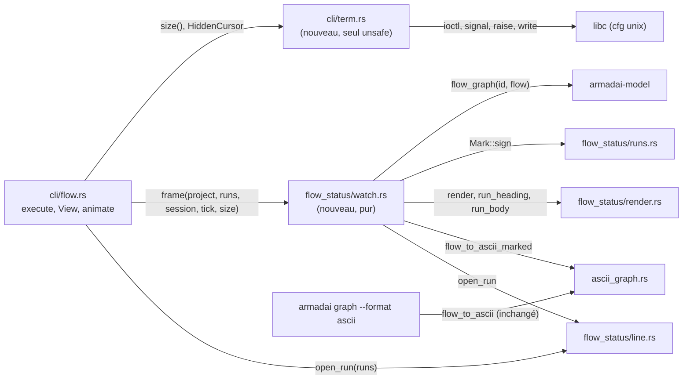
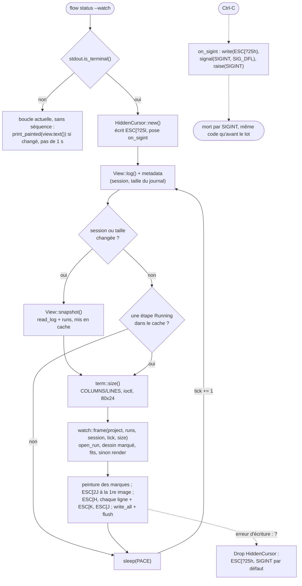

# Plan : `flow status --watch` animé (ASCII)

Spec : `docs/superpowers/specs/2026-11-02-flow-status-watch-animated-design.md` (commit `d481f48`). Cadre : `docs/superpowers/specs/2026-11-02-flow-status-watch-animated-frame.md` (commit `ec1439c`). Worktree `armadai-watch`, branche `feat/flow-watch-animated`, partie de `master` `e263db5`. La PR ira vers `master`.

Cinq tâches, toutes du domaine `cli-specialist`, à exécuter dans l'ordre : chaque tâche passe par une exécution du flow `task`. Le lot ne touche ni `armadai-model`, ni `armadai-core`, ni `link`.

## 1. Contraintes globales (valent pour chaque tâche)

- Règles `armadai-rules` (P1 et P2 comprises, Dimitri, 2026-11-09). La barrière complète passe à chaque commit : `cargo fmt --all -- --check`, `cargo clippy --all-targets -- -D warnings`, `cargo test --no-fail-fast`, `cargo build -p armadai-core`, `cargo build -p armadai-model`. Lire le code retour de chaque commande, sans tube.
- Le crate `crates/armadai` est un binaire seul : lancer les tests avec `--bin armadai` ou `--test flow_status_cli`, toujours avec `--no-fail-fast`. Utiliser `CARGO_TARGET_DIR=<worktree>/target`.
- Pour chaque test ajouté : appliquer la mutation nommée dans la tâche, constater le rouge, restaurer avec `touch`, puis lancer `cargo build` avant tout essai au binaire. Reporter la sortie vue. Comparer des lignes entières ou des sorties entières (`assert_eq!`), pas des `contains`, et utiliser des fixtures dont les valeurs sont distinctes deux à deux.
- Rien de redéfini : la table de marques reste `Mark::sign()`, le calcul des exécutions reste `runs()`, le dessin reste celui de `flow_to_ascii`. La règle « dernière exécution ouverte » est partagée avec `--line` (tâche 1), la table Mark -> style reste celle de `painted()`.
- Sorties inchangées : `flow status` sans `--watch`, `--list`, `--json`, `--line`, `--format md` et `armadai graph --format ascii` ne changent pas d'un octet. Les golden existants (`tests/flow_status_cli.rs`, `ascii_graph.rs`, `render.rs`, `line.rs`) restent tels quels. **Un golden existant modifié est un défaut**, sauf mention contraire dans la tâche.
- `unsafe` : seulement dans `crates/armadai/src/cli/term.rs` (tâche 4), et chaque bloc porte un commentaire `// SAFETY:` qui énonce son invariant. Le gestionnaire de signal n'appelle que `write`, `signal` et `raise`, qui sont async-signal-safe.
- Dépendances : `libc = "0.2"` s'ajoute sous `[target.'cfg(unix)'.dependencies]` de `crates/armadai/Cargo.toml`, et rien d'autre. `Cargo.lock` ne gagne aucun `[[package]]`.
- Aucune séquence de positionnement ni d'effacement (`\x1b[H`, `\x1b[2J`, `\x1b[J`, `\x1b[K`, `\x1b[?25l/h`) n'est écrite hors terminal, même avec `--color always` (Dimitri, 2026-11-09, Q1 du cadre).
- Hors `cfg(unix)`, l'animation reste active sous `IsTerminal`, sans curseur masqué et sans gestionnaire de signal (Dimitri, 2026-11-09, Q2 du cadre). Ce code n'est compilé ni ici ni par la CI (Linux seul) : il doit rester minimal.
- Les textes nouveaux sont ceux du §9, une fois validés par Dimitri. Aucun autre texte de sortie n'est ajouté.
- Les tests restent purs et hors terminal (Dimitri, 2026-11-02, « Pur + hors terminal (Recommandé) »). Pas de pty : la boucle en terminal et Ctrl-C se vérifient à l'essai réel (§10).
- `rust-analyzer` n'est pas fiable dans ce dépôt : vérifier au compilateur, en particulier l'API d'`anstream` 1.0 et les types de `libc` sous macOS.

## 2. Structure



Seuls `watch.rs` et `term.rs` sont nouveaux. Les deux modules sont séparés pour une raison : tout ce que l'image contient est pur et se teste sans terminal (`watch.rs`) ; tout ce qui touche au terminal et au signal est confiné, avec son `unsafe`, dans `term.rs`. `cli/flow.rs` assemble les deux et n'écrit les séquences de positionnement que si stdout est un terminal.

## 3. La boucle `--watch`



Le journal n'est relu (`snapshot`) que si sa taille ou la session change ; le reste du temps, le pas ne fait qu'un `stat`. On redessine seulement quand le journal change ou quand une étape tourne. Sans étape `Running`, l'image reste fixe et aucun octet n'est écrit. La taille d'écran est relue à chaque image. Un Ctrl-C ne passe jamais par `Drop` : le gestionnaire restaure le curseur lui-même, puis laisse le signal tuer le processus comme aujourd'hui. Le pas `PACE` vaut 250 ms, au repos comme pendant qu'une étape tourne (Q2, décidée).

## 4. Tâche 1 : partager la règle « dernière exécution ouverte » (`cli-specialist`)

**Fichiers** : `crates/armadai/src/flow_status/line.rs`.

**Interface nouvelle**
```rust
/// The run a live view follows: the last one still open (neither finished nor interrupted).
pub fn open_run(runs: &[Run]) -> Option<&Run>
```
`line()` devient `open_run(runs).or(runs.last())`. Le repli sur la dernière exécution reste dans `line()`, ce qui laisse la sortie de `--line` inchangée (écart relevé par `framer`).

**Étapes**
- [ ] Avant tout changement, vérifier que `git diff --stat e263db5 HEAD -- crates/` est vide : le code du worktree est alors celui de `master`.
- [ ] Ajouter `open_run`, puis faire passer `line()` par elle.
- [ ] Ajouter les tests, appliquer les mutations, lancer la barrière.

**Tests** (dans `line.rs`)
- `open_run_is_none_without_an_open_run` : une exécution finie et une interrompue donnent `None`. Mutation : ajouter `.or(runs.last())` dans `open_run` → rouge.
- `open_run_is_the_last_open_one` : avec `[open "one", open "two", finished "three"]`, la fonction rend `"two"`. Mutation : `find` au lieu de `rfind` → rouge.
- Les tests actuels de `line()` restent inchangés. Mutation : retirer `.or(runs.last())` de `line()` → `without_an_open_run_the_last_run_is_shown` passe au rouge.

**Commit** : `refactor(flow): share the last open run between --line and --watch`

## 5. Tâche 2 : le dessin avec un préfixe et un suffixe par étape (`cli-specialist`)

**Fichiers** : `crates/armadai/src/ascii_graph.rs`.

**Interface nouvelle**
```rust
/// `flow_to_ascii` with each node's label written `{before}{label}{after}`,
/// `(before, after) = wrap(step id)`; the label keeps its `▶ ` / ` ■`.
pub fn flow_to_ascii_marked(g: &armadai_model::FlowGraph, wrap: &dyn Fn(&str) -> (String, String)) -> String

pub fn flow_to_ascii(g: &armadai_model::FlowGraph) -> String {
    flow_to_ascii_marked(g, &|_| (String::new(), String::new()))
}
```
Rien d'autre ne change dans `ascii_graph.rs`.

**Étapes**
- [ ] Déplacer le corps de `flow_to_ascii` dans `flow_to_ascii_marked`, en appliquant `wrap(&n.id)` autour du libellé déjà préfixé par `▶ ` ou suffixé par ` ■`.
- [ ] **Mesure à reporter** : `ascii-dag` garde-t-il les espaces en fin de libellé (`"✓ design  "`) ? Le golden ci-dessous le montre. S'il les retire, la cellule du repère n'est plus réservée et le critère 1 tombe. Dans ce cas, s'arrêter et le rendre à `lead`, sans choisir de remplaçant (U+00A0 est une piste) : ce choix change ce que Dimitri voit.
- [ ] Ajouter le test, appliquer les mutations, lancer la barrière.

**Tests**
- `a_marked_drawing_wraps_each_label` : `pipeline` (`a`, `b`, `c`) avec `wrap` = (`"✓ "`, `"  "`) pour `a`, (`"● "`, `" |"`) pour `b`, (`"○ "`, `"  "`) pour `c`. On compare la sortie entière à un golden, relu ligne à ligne : mêmes boîtes et mêmes flèches que `PIPELINE`, libellés élargis. Mutations : appliquer `wrap` à l'index du nœud voisin → rouge ; oublier `after` → rouge.
- Les golden `every_step_is_named` et `an_edge_to_an_unknown_step_is_listed`, inchangés, protègent `armadai graph --format ascii` octet pour octet (critère 8). Mutation : faire rendre `(" ", "")` par défaut dans `flow_to_ascii` → rouge.

**Commit** : `refactor(graph): let flow_to_ascii wrap the label of each step`

## 6. Tâche 3 : l'image pure du watch (`cli-specialist`)

**Fichiers** : `crates/armadai/src/flow_status/watch.rs` (nouveau), `flow_status/mod.rs` (`pub mod watch;`) et `flow_status/render.rs` (extraction, sans changement de sortie).

**Extraction dans `render.rs`** (les golden actuels de `render` gardent la sortie)
```rust
pub(super) fn ordered(runs: &[Run]) -> Vec<&Run>       // already there, made visible
pub(super) fn run_heading(run: &Run) -> String         // "{flow}  {status_word}"
pub(super) fn run_body(run: &Run) -> String            // the step lines, `a → b : n`, the transitions, each ending in '\n'
```
`render()` devient `header + Σ "\n" + run_heading + "\n" + run_body`.

**Interface de `watch.rs`**
```rust
#[derive(Clone, Copy, Debug, PartialEq, Eq)]
pub struct Size { pub cols: usize, pub rows: usize }

/// The spinner of the running step: `| / - \`, one per tick.
pub fn spinner(tick: u64) -> char

/// The image of `--watch` in a terminal, as plain text (no colour, no escape).
/// The last open run of a known flow is drawn (its heading, the drawing,
/// then its body), and the other runs are listed under it as `render` lists them.
/// Without such a run, or when the drawn part does not fit `size`, the
/// image is `render(runs, session)`.
pub fn frame(project: &armadai_model::Project, runs: &[Run], session: &str, tick: u64, size: Size) -> String

/// Whether `text` (the session header included) fits: no line wider than
/// `cols` (counted in chars), at most `rows - 1` lines (the last row keeps the cursor, so nothing scrolls).
fn fits(text: &str, size: Size) -> bool
```

**Forme de l'image** (Q1 décidée : le bloc complet suit le dessin) :
```
session <id> (UTC)

<flow>  in progress
<flow_to_ascii_marked sans sa première ligne `flow: <id>`>

<run_body(run)>                      ← bloc complet : étapes, liens, transitions (Q1)

<run_heading(autre)>
<run_body(autre)>                    ← chaque autre exécution, dans l'ordre de `ordered`
```
- Exécution dessinée : `line::open_run(runs)`, à condition que `project.flows.get(&run.flow)` existe. Une exécution `a | b` n'a pas de flow connu et reste donc en liste.
- `wrap(step)` : le préfixe vaut `"{sign} "` si l'étape a un `StepView`, sinon deux espaces (aucun état inventé, largeur constante). Le suffixe vaut `" {spinner(tick)}"` sur une étape `Mark::Running`, sinon deux espaces.
- On applique `fits` au texte complet de la partie dessinée, en-tête de session compris. Les autres exécutions listées dessous ne comptent pas (spec §4.1). Le risque de hauteur est à regarder à l'essai réel.
- La fonction reste `#[allow(dead_code)] // wired by task 4` tant que la tâche 4 ne l'appelle pas. La tâche 4 retire cette ligne.

**Tests** (dans `watch.rs`, projet construit en mémoire comme `ascii_graph::tests::template`, flow `deliver` de `flow_status_cli.rs` : `design`, `build`, `guard`, `validate`, avec le retour `guard → build`)
- `spinner_turns` : `spinner(0..5)` donne `| / - \ |`. Mutation : rendre `'|'` en constante → rouge.
- `a_running_run_is_drawn_with_its_marks` (critères 1 et 2) : on compare l'image entière à un golden pour `design ✓`, `build ✓`, `guard ●`, `validate ○`, `tick 0`, taille 200×100. Le golden est relu contre `armadai graph --format ascii deliver` (mêmes boîtes, mêmes arêtes, `guard → build (rejected)` sous `links not drawn:`). Mutations : permuter les signes `✓` et `○` → rouge ; supprimer le préfixe → rouge ; changer `Mark::Pending.sign()` → rouge, ce qui montre que l'image suit la table.
- `two_ticks_differ_only_by_the_spinner` (critère 1) : on compare `frame(tick 0)` à `frame(tick 1)`. Même nombre de lignes, mêmes largeurs, un seul caractère différent (`|` puis `/`), situé sur la ligne de la boîte `guard`. Mutations : repère constant → rouge ; repère sur toutes les boîtes → rouge (plusieurs différences) ; suffixe vide sur les étapes qui ne tournent pas : rouge dans `a_running_run_is_drawn_with_its_marks` et `every_mark_reads_in_plain_text`, **pas** ici (les deux ticks ont les mêmes largeurs). Un second cas, `fan-out` (deux boîtes sur une ligne), vérifie que seule la boîte qui tourne change.
- `every_mark_reads_in_plain_text` (critère 2) : un flow de sept étapes, une par `Mark`. Chaque ligne de boîte, comparée en entier, commence par `[{sign} `. Mutation : préfixe pris dans une table locale au lieu de `Mark::sign()`, avec une valeur différente → rouge.
- `the_last_open_run_is_drawn_and_the_others_listed` (critère 7) : `[open pipeline, open deliver, finished hotfix, interrupted bugfix]`, comparé à un golden entier. On attend `deliver` dessiné, et `pipeline`, `hotfix`, `bugfix` en blocs `render`. Mutations : `find` au lieu de `rfind` dans `open_run` → rouge ; oublier les autres exécutions → rouge.
- `a_group_or_no_open_run_is_the_list` (critère 7) : `frame` vaut `render(runs, session)` pour un run `deliver | ship` ouvert, puis pour des runs tous finis. Mutation : dessiner `runs.last()` → rouge.
- `a_screen_too_small_gives_the_list` (critère 7) : `cols = largeur − 1` donne `render(...)` ; `cols = largeur` avec `rows = hauteur + 1` donne le dessin ; `rows = hauteur` donne `render(...)`. Mutations : supprimer `fits` → rouge ; `<` au lieu de `<=` → rouge ; oublier le `− 1` des lignes → rouge.
- `a_cycle_flow_names_every_link` (critère 7) : `plan-build-verify` en cours. L'image contient la ligne `links not drawn:` et la ligne entière `  check → build (failed)`, sans panique. Mutation : retirer la liste des liens non dessinés dans `draw` → rouge.

**Commit** : `feat(flow): build the frame of the animated watch`

## 7. Tâche 4 : la boucle en terminal, le curseur, le signal, la taille (`cli-specialist`)

**Fichiers** : `crates/armadai/Cargo.toml`, `crates/armadai/src/cli/term.rs` (nouveau, le seul `unsafe` du lot), `cli/mod.rs` (déclaration), `cli/flow.rs`, `tests/flow_status_cli.rs`.

**Étape 1, mesures avant tout changement de la boucle** (à reporter dans le rapport de tâche, puis dans ce plan au §9)
- [ ] Écrire d'abord le test `ctrl_c_outside_a_terminal_still_kills_by_sigint` (voir plus bas) et le lancer **sur la boucle actuelle**. Vert attendu : `ExitStatusExt::signal() == Some(2)`, ce qui est la mesure du code retour hors terminal sur le code de `master`. Reporter la sortie.
- [ ] `cargo tree -i libc -e normal`, avant et après l'ajout de `libc` à `crates/armadai/Cargo.toml`. Puis `git diff Cargo.lock` : seule la liste `dependencies` du paquet `armadai` doit gagner `"libc"`, sans `[[package]]` nouveau. Si un paquet apparaît, s'arrêter et le rendre à `lead` (P2).

**Interface de `cli/term.rs`**
```rust
/// The terminal size: `COLUMNS`/`LINES`, else the size `ioctl(TIOCGWINSZ)` gives for stdout, else 80x24, axis by axis.
pub fn size() -> Size
/// Pure: one axis from the env value, then the ioctl value; "0", empty or not a number is skipped.
fn pick(env: Option<&str>, ioctl: Option<u16>, default: usize) -> usize
/// Hides the cursor while alive. On unix it also catches SIGINT to show the cursor before dying of the signal.
pub struct HiddenCursor;
impl HiddenCursor { pub fn new() -> std::io::Result<Self> }   // ESC[?25l, then on unix signal(SIGINT, on_sigint)
impl Drop for HiddenCursor { /* ESC[?25h; on unix signal(SIGINT, SIG_DFL) */ }
#[cfg(unix)]
extern "C" fn on_sigint(_: libc::c_int)  // write(STDOUT_FILENO, ESC[?25h), signal(SIGINT, SIG_DFL), raise(SIGINT); nothing else
```
- `ioctl` : `libc::ioctl(libc::STDOUT_FILENO, libc::TIOCGWINSZ, &mut ws)`, **sans aucun `as` sur la requête**. Le crate `libc` donne à chaque plateforme le type de requête que son `ioctl` attend (`c_ulong` sous macOS et glibc). Un `as` déclencherait `clippy::unnecessary_cast` sur l'une des deux, et la CI ne compile que Linux. La tâche est vérifiée par la barrière sous macOS (machine locale) et sous Linux (CI). Un retour `!= 0` ou une valeur 0 font passer au défaut, jamais à une erreur.
- Pose du gestionnaire : `libc::signal(libc::SIGINT, on_sigint as extern "C" fn(libc::c_int) as libc::sighandler_t)`. Vérifier au compilateur et à clippy sous les deux plateformes.
- Hors `cfg(unix)` : `size()` lit `COLUMNS`/`LINES` puis prend 80×24 ; `HiddenCursor` n'écrit rien et ne pose rien.

**Changements dans `cli/flow.rs`**
- Après `if !watch { … }` : si `std::io::stdout().is_terminal()`, appeler `view.animate()`. Sinon, garder la boucle actuelle **sans** la ligne `anstream::print!("\x1b[2J\x1b[H")`, avec un pas de 1 s et `print_painted(&view.text())`. La sortie hors terminal reste ainsi la liste d'aujourd'hui (objectif 3), sans aucune séquence de positionnement.
- `View::animate(&self) -> anyhow::Result<()>` suit la boucle du §3 : cache `(session, longueur, snapshot)`, `tick` augmenté à chaque image dessinée tant qu'une étape tourne, `PACE` = 250 ms partout, au repos compris (un `stat`, ni relecture ni redessin : Q2), et image vide `NO_ACTIVITY` comme `text()`.
- Écriture d'une image : construire tout le tampon, puis `std::io::stdout().lock()`, `write_all` et `flush` d'un seul coup, avec `?`. Une erreur d'écriture sort de la boucle, et `Drop` restaure le curseur. **Piège** : `anstream` en mode `auto` sans couleur (`NO_COLOR`) retire toutes les séquences, positionnement compris. Les séquences de positionnement s'écrivent donc sur `std::io::stdout()` brut, et seul le contenu passe par la décision de couleur : `anstream::AutoStream::choice(&std::io::stdout())`, puis `anstream::adapter::strip_str` si la couleur est coupée. Vérifier ces deux noms dans la source d'`anstream` 1.0, qui est au registre local.
- Peinture : `print_painted` est découpée en `paint_line(&str) -> String`, sans changement de sortie pour `flow status`. On y ajoute `paint_boxes(&str) -> String`, appelée seulement par `animate`, qui peint le signe placé juste après un `[` avec le style de `painted(&[(Piece::Mark(m), sign)])`. Le `Mark` se retrouve à partir du signe en parcourant les sept variantes : aucune table nouvelle.
- Supprimer le `#[allow(dead_code)]` de la tâche 3.
- `--help` de `--watch` : texte du §9.

**Tests**
- `term::tests::size_is_env_then_ioctl_then_default` : on vérifie `pick(Some("132"), Some(100), 80) == 132`, `pick(Some("0"), Some(100), 80) == 100`, `pick(Some("x"), None, 80) == 80`, `pick(None, Some(0), 24) == 24`. Mutations : ioctl avant l'environnement → rouge ; accepter 0 → rouge.
- `flow::tests::the_mark_after_a_box_bracket_is_painted` : on compare la sortie de `paint_boxes("  [✓ a (x)  ]   [● b (y) |]")` à la chaîne attendue, construite avec `paint(style::ok(), "✓")` et `paint(style::running(), "●")`. Mutations : styles de `Done` et `Running` permutés → rouge ; peindre un signe qui ne suit pas un `[` → rouge (ajouter `[○ c ✓  ]`, le `✓` du libellé doit rester brut). Peindre le repère `-` ne change rien : le style de `NotRun` est vide, la mutation ne peut pas rougir.
- `tests/flow_status_cli.rs`, `watch_outside_a_terminal_is_the_list_once_without_escape` (critère 3) : lancer `flow status --watch` sur le journal `looping` avec `std::process::Command` (stdout en tube, `HOME` et `ARMADAI_CONFIG_DIR` isolés, `NO_COLOR=1`). Un fil lit stdout jusqu'à avoir `LOOPING.len()` octets, avec une borne de 20 s comptée sur le démarrage lent sous charge, pas sur le temps nominal. Attendre ensuite 2,5 s (plus de deux pas de 1 s), tuer le processus et lire le reste. La sortie entière doit valoir `LOOPING`. Mutations : réintroduire `print!("\x1b[2J\x1b[H")` → rouge ; redessiner à chaque pas → rouge (deux images).
- Le même test avec `--color always` : après retrait des séquences SGR (`\x1b[` … `m`), on attend exactement `LOOPING`, aucun autre `\x1b`, et au moins une séquence SGR dans la sortie brute (sans quoi le test serait vide). Mutation : la ligne `\x1b[2J\x1b[H` d'aujourd'hui, qui sort sur `master` en `always` → rouge.
- `#[cfg(unix)] ctrl_c_outside_a_terminal_still_kills_by_sigint` (critère 4, partie mesurable sans pty) : lancer, attendre la première image comme ci-dessus, envoyer `/bin/kill -INT <pid>` par `std::process::Command` (pas d'`unsafe` dans les tests), puis vérifier `status.signal() == Some(2)`. Ce test est vert sur `master` (étape 1). **Mesure du gestionnaire sans pty**, temporaire et non commitée : poser `HiddenCursor` aussi hors terminal. Le test doit rester vert, ce qui montre que le gestionnaire rend bien la mort par le signal. Remplacer ensuite `raise(SIGINT)` par `libc::_exit(0)` : rouge attendu. Restaurer les deux et reporter les deux sorties.
- Répéter 5 fois les trois tests d'intégration (règle des bornes de temps).

**Commit** : `feat(flow): animate flow status --watch in a terminal`

## 8. Tâche 5 : documentation (`cli-specialist`)

**Fichiers** : `docs/wiki/flow-status.md`, `CHANGELOG.md`.

- [ ] Remplacer la ligne `--watch` du bloc de « Reading the output » et ajouter le paragraphe du §9 sous ce bloc, avec une image copiée **telle quelle** du golden `a_running_run_is_drawn_with_its_marks` (tâche 3), sans la réécrire à la main.
- [ ] Ajouter aux « Limits » la ligne Windows du §9.
- [ ] Ajouter la ligne du `CHANGELOG` du §9 sous `## Unreleased` / `### Added`.
- [ ] Vérifier qu'aucun chemin absolu de machine n'apparaît.

**Tests** : aucun (documentation). Le relecteur compare chaque texte au §9 validé.

**Commit** : `docs(flow): document the animated watch`

## 9. Textes et valeurs (validés par Dimitri le 2026-11-09, Q3 : « Validés tels quels (Recommandé) »)

| Valeur | Valeur retenue | Statut | Raison |
|---|---|---|---|
| Pas en terminal (`PACE`) | 250 ms partout, au repos compris : un `stat` du journal à chaque pas, une image seulement si le journal change ou si une étape tourne | Validé (Q2, Q3) | Un tour complet du repère par seconde (4 images). Un événement s'affiche en 250 ms au plus, sous la borne de 1 s du critère 6. |
| Pas hors terminal | 1 s, inchangé | Validé (Q3) | « la sortie est celle d'aujourd'hui » (objectif 3) |
| Taille par défaut | 80 colonnes × 24 lignes | Validé (Q3) | Taille d'ouverture de Terminal.app, et largeur de la liste de `graph --view team` |
| Seuil de repli | Largeur max (en caractères) ≤ colonnes, et lignes de la partie dessinée, en-tête de session compris, ≤ lignes − 1 | Validé (Q3) | La dernière ligne garde le curseur : rien ne défile, donc `ESC[H` revient bien au début de l'image. |
| Repère | `\|` `/` `-` `\`, suffixe `" " + repère` sur l'étape `Running`, deux espaces ailleurs | Validé (spec du 2026-11-09, Q3) | Cellule réservée à toutes les boîtes |
| Étape sans marque | Préfixe de deux espaces | Validé (Q3) | Aucun état inventé, et largeur égale à `"✓ "` |
| Sous le dessin | Une ligne vide, puis le bloc complet de `render` : lignes d'étapes, liens, transitions | Validé (Q1, puis « Ajouter une ligne vide », 2026-11-09) | Aucune information ne disparaît ; la liste `links not drawn:` ne se confond pas avec les lignes d'étapes |
| Code retour de Ctrl-C | **Non mesuré à ce jour** (le plan est écrit sans shell). Attendu : mort par le signal 2, soit `$?` = 130 sous zsh. Valeur à reporter ici après la tâche 4, étape 1 (hors terminal), et après l'essai réel avec le binaire de `master` (en terminal). | Méthode validée (Q3), valeur à mesurer | Critère 4 |

**Aide de `--watch`** (validée, Q3 ; remplace « Redraw on every new event (checked each second) until Ctrl-C ») :
> Follow the session until Ctrl-C: in a terminal, the running flow is drawn in boxes with its marks and a spinner on the running step; elsewhere, the text is printed again on each new event

**Wiki, ligne du bloc « Reading the output »** (validée, Q3) :
> `armadai flow status --watch            # follow the session until Ctrl-C (in a terminal: the running flow drawn in boxes)`

**Wiki, paragraphe sous ce bloc** (validé, Q3) :
> In a terminal, `--watch` draws the run in progress in boxes (the drawing of `armadai graph --format ascii`), each step with its mark, and a spinner (`| / - \`) after the running step. The last run still open is drawn (the one `--line` names), and the other runs are listed under it as above. The view is redrawn within 250 ms of a new event, without clearing the screen, and stays still while no step runs. When the drawing does not fit the terminal (`COLUMNS` and `LINES`, else the terminal's size, else 80×24), that run is listed instead of drawn. A flow shown as `a | b` is listed too. The cursor is hidden while watching and shown again on exit, Ctrl-C included. Outside a terminal (a pipe, a file), `--watch` prints the list again on each new event, with no cursor or erase sequence, even with `--color always`.

**Wiki, ligne des « Limits »** (validée, Q3) :
> - `--watch` on Windows is not tested: it draws without hiding the cursor. A terminal that shows `●` or `✓` two columns wide shifts the boxes. A list taller than the terminal scrolls, and the view is then redrawn from the top of the screen.

**CHANGELOG**, sous `## Unreleased` / `### Added` (validée, Q3) :
> - `armadai flow status --watch` in a terminal draws the run in progress in boxes, each step with its mark (`✓ ● ○ ? ✗ ~ -`) and a spinner on the running step, redrawn within 250 ms of a new event without clearing the screen; the other runs stay listed under it, and a run that does not fit the terminal is listed instead. The cursor is hidden while watching and shown again on exit, Ctrl-C included. Outside a terminal the output is the list, as before, and no longer carries a clear-screen sequence, even with `--color always`. See [Flow status](docs/wiki/flow-status.md).

Aucune autre ligne de sortie nouvelle : pas de diagnostic, pas de message d'erreur. Les lignes de l'image sont celles de `render` et de `flow_to_ascii`.

## 10. Essai réel (Claude Code, macOS, avec Dimitri)

Préparation, par `validator` :
- `cargo build` dans le worktree. Le binaire à essayer est `<worktree>/target/debug/armadai`, et le binaire de référence est l'`armadai` de `master` (rc.10 installé, dont le code de `--watch` est celui de `e263db5`).
- Projet : ce dépôt (`.armadai/`, flows `lot` et `task`), déjà lié pour Claude Code. Les hooks d'enregistrement écrivent avec le binaire installé, dont le format de journal ne change pas.

Déroulé :
1. Terminal 1 : une session Claude Code qui lance une étape de flow à sous-agent (une revue `guardian` en lecture seule suffit).
2. Terminal 2 : `<worktree>/target/debug/armadai flow status --watch`. Vérifier que le dessin suit l'exécution et que le repère tourne seulement pendant qu'une étape est `running`. Juger le clignotement dans Terminal.app ou iTerm, puis dans tmux si Dimitri l'utilise.
3. Réduire la fenêtre sous la largeur du dessin : on doit voir la liste. L'agrandir : le dessin revient à l'image suivante. Essayer aussi `COLUMNS=40 … --watch` : on doit voir la liste.
4. Ctrl-C : le curseur doit être visible, puis `echo $?`. Refaire le même geste avec le binaire de `master` : les deux valeurs doivent être égales (critère 4).
5. `… --watch | cat`, puis `… --watch --color always | cat -v` : aucune séquence autre que SGR (critère 3).
6. Au repos (aucune étape `running`), pendant 10 s : `/bin/ps -o time= -p <pid>` pour les deux binaires, et aucune image redessinée (critère 5).
7. Ajouter une ligne au journal pendant le watch : elle doit apparaître en moins d'une seconde, sur 5 essais (critère 6). Le plus simple est qu'une étape démarre dans le terminal 1.

## 11. Ordre et tâches à refaire

Ordre : 1 → 2 → 3 → 4 → 5, chaque tâche dépendant de la précédente. Il n'y a pas de tâche à refaire (premier plan du lot, aucune tâche commencée avant les réponses ci-dessous).

## Décisions de Dimitri (2026-11-09, plan)

Mot pour mot, relayées par `lead` :
- Q1 : « Le bloc complet (Recommandé) ». Sous le dessin vient le bloc complet de `render` : lignes d'étapes, liens, transitions (tâche 3).
- Q2 : « 250 ms, sans redessin (Recommandé) ». Un seul pas de 250 ms, au repos compris, où la boucle ne fait qu'un `stat` du journal, sans relecture ni redessin (tâche 4). La spec §4.2 est alignée, et le critère 6 reste inchangé.
- Q3 : « Validés tels quels (Recommandé) ». Toutes les valeurs et tous les textes du §9 sont validés.

## Questions posées (historique, réponses ci-dessus)

**Q1. Ce qui reste sous le dessin de l'exécution en cours** (tâche 3). La spec dit « les lignes de `render` de cette exécution (liens pris plusieurs fois, transitions UTC) pour qu'aucune information ne disparaisse ». Or l'état et la note d'une étape (`approved`, `(no STATE line)`) ne tiennent pas dans les boîtes sans les faire bouger d'une image à l'autre.
- (a) Le bloc complet de `render` sous le dessin : lignes d'étapes, liens, transitions. Rien ne disparaît et aucun texte n'est nouveau, mais la vue est plus haute (environ 4 lignes de plus pour `deliver`) et passe plus tôt en liste sur un petit terminal. **Recommandé** : c'est la lecture qui tient la promesse « aucune information ne disparaît ».
- (b) Seulement les liens pris plusieurs fois et les transitions. La vue est plus courte, mais l'état et la note de chaque étape ne se lisent plus que par `flow status`.

**Q2. Le pas au repos** (tâche 4). La spec §4.2 dit « sans étape Running, la boucle dort par pas de 1 s », alors que le critère 6 demande qu'un nouvel événement apparaisse en moins d'une seconde. Avec un pas de 1 s au repos, un événement qui arrive au repos peut mettre jusqu'à 1 s.
- (a) Un seul pas de 250 ms : au repos, un `stat` du journal par pas, sans relecture ni redessin. Le critère 6 tient partout. Le coût CPU d'un `stat` toutes les 250 ms est à mesurer à l'essai réel (critère 5 : « pas plus de CPU que master »). **Recommandé.**
- (b) Garder 1 s au repos, et réécrire le critère 6 en « moins d'une seconde quand une étape tourne, une seconde au plus sinon ».
- (c) 500 ms au repos (compromis).

**Q3. Les valeurs et textes du §9** (aide de `--watch`, ligne et paragraphe du wiki, ligne des limites, ligne du CHANGELOG, défaut 80×24, seuil de repli à `lignes − 1`, préfixe de deux espaces) : les valider en bloc, ou dire lesquels changer.
