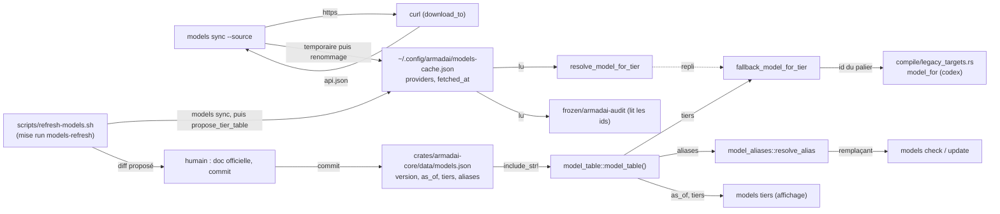
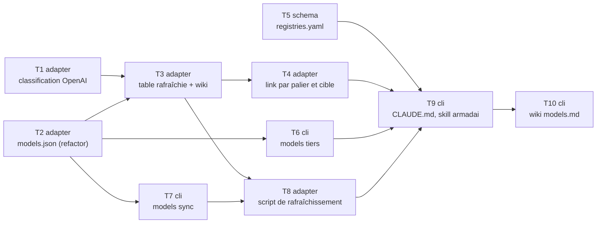

# Plan : table de modèles et `armadai models sync` (#455)

Date : 2026-11-10 · Spec : `docs/superpowers/specs/2026-11-09-models-table-455-design.md` (commit `6342031`) · Branche `feat/models-table-455` · Statut : T1 à T9 livrées ; repris le 2026-11-10 après le rejet de la revue de branche (chemins absolus dans ce plan, ligne 5 du wiki) : T10 ajoutée, D7 et T9 réécrits selon la décision de Dimitri. Les choix D1 à D6 sont pris par défaut par `lead` sous mandat de Dimitri (fin du document).

## 0. Ce que le plan a vérifié (sans Dimitri)

Lu par `architect` le 2026-11-10, dans le worktree et sur les pages officielles.

| Point | Constat | Source |
|---|---|---|
| URL de models.dev | `https://models.dev/api.json` ; le README la donne telle quelle (`curl https://models.dev/api.json`). Réponse lue : environ 6 Mo, un objet dont chaque clé est un id de fournisseur ; chaque fournisseur a `id`, `name`, `env`, `npm`, `doc`, `api`, `models` ; `models` est un objet indexé par id de modèle, chaque modèle porte `id` (égal à sa clé), `name`, `cost: {input, output, …}`, `limit`. | `github.com/sst/models.dev` (README, section API), `https://models.dev/api.json` (lu le 2026-11-10) ; même URL déjà citée dans `model_resolution.rs:1249`. |
| Le validateur accepte-t-il `latest:*` dans `native.<cible>.model` ? | **Oui.** Le contenu de `native` n'est pas vérifié : « Only its keys are checked … its content is "native, not checked" ». `link` l'écrit ensuite tel quel (`legacy_targets.rs:33-35` pour Codex). Lu dans la doc et le code, pas exécuté. Conséquence hors lot : `native.codex.model: latest:pro` part tel quel dans le fichier Codex ; à ouvrir en issue (pas dans ce lot). | `docs/wiki/project-format.md:279-283`, `crates/armadai/src/compile/legacy_targets.rs:26-43` |
| Taille de la réponse et transport | `download_to` (`starters_registry/mod.rs:520-562`) borne à 100 Mio et 300 s, refuse tout ce qui n'est pas `https://`, ignore `.curlrc` (`-q`), retire le fichier en cas d'échec. 6 Mo passe. | code lu |
| Faux `curl` existant | `crate::starters_registry::archive_tests::{fake_curl, retry_busy}` ; usage dans `cli/update.rs:164-187`. | code lu |
| `tempfile` | dépendance normale de `crates/armadai` (`Cargo.toml:45`, utilisée hors test par `update.rs:76`) ; optionnelle dans `armadai-core` (feature `test-support`). Aucun paquet nouveau. | `crates/armadai/Cargo.toml`, `crates/armadai-core/Cargo.toml` |
| `chrono` | dépendance normale de `crates/armadai` (`Cargo.toml:42`) : sert à afficher `fetched_at`. Absent d'`armadai-core` : le cœur n'en a pas besoin. | idem |
| Format du cache | Lecteurs : `load_cached_models` (`model_resolution.rs:277-316`, lit `providers.<fournisseur>[].id` et `.cost.{input,output}`) et le crate gelé (`frozen/armadai-audit/src/vendored/model_registry.rs`, lit `providers.<fournisseur>[].id`, ignore le reste). `fetched_at` : entier (secondes Unix) dans les fixtures tirées d'un vrai cache (`catalog-2026-*.json`), ignoré par les deux lecteurs. | code lu |
| Qui lit `RegistriesConfig.agents` / `.models` | **`migrate`** : `migrate/convert.rs:547-604` rapporte chaque source `registries.agents` / `registries.models` d'un projet hérité comme abandonnée (« no command reads … registries »), via `ProjectConfig.registries: Option<RegistriesConfig>` (`armadai-core/src/project.rs:73`). Retirer les deux champs de `RegistriesConfig` sans plus ferait **perdre ces lignes en silence**. Voir le choix C2. | code lu ; `docs/wiki/project-format.md:572-607` |
| Où vit la skill `armadai` | **Hors dépôt** : la skill utilisateur `armadai` (dossier de skills de l'utilisateur, avec ses annexes `references/*.md`). Aucune `.armadai/skills/armadai/` dans le dépôt. Elle est périmée bien au-delà de ce lot (fonctionnalités cargo, `providers/`, `tui/`, `shell/`…). Voir D7. | fichiers lus |

### Identifiants : pages officielles lues le 2026-11-10

Aucun identifiant ci-dessous n'est écrit de mémoire ; chacun vient de la page citée, lue le 2026-11-10 (critère 6). Le reviewer relit ces pages.

| Fournisseur | Page | Ce qu'elle dit |
|---|---|---|
| OpenAI (API) | `https://developers.openai.com/api/docs/models` et `…/models/all` | Modèles phares : `gpt-6-astra` (« flagship for complex reasoning and coding »), `gpt-6.1-sol` (équilibre intelligence/coût, « Choose GPT-6.1 Sol »), `gpt-6.1-terra` (rapide, visuel, usage d'ordinateur), `gpt-6-luna` (« most efficient », le moins cher : 0,10 $ / 0,50 $ par Mtok). **Dépréciés** : `gpt-4o`, `gpt-4o-mini`, `o3-pro`, `o3`, `gpt-4.1`, `gpt-4.1-mini`, `gpt-5`, `gpt-5-mini`, `gpt-5-nano`, `gpt-5-pro`, `gpt-5.4-nano`… ; `gpt-4-turbo`, `gpt-3.5-turbo` : arrêtés. Non dépréciés : `gpt-5.6-sol`, `gpt-5.6-terra`, `gpt-5.6-luna`. |
| OpenAI (Codex) | `https://learn.chatgpt.com/docs/models` (redirection de `developers.openai.com/codex/models`) | Modèles du CLI Codex : `gpt-6-astra` (« most capable »), `gpt-6.1-sol` (« near-Astra performance … at a lower cost »), `gpt-6.1-terra` (« requires Codex CLI 0.159.0 or later »), `gpt-6-luna` (« most efficient model for focused, high-volume tasks »). Exemple de `config.toml` : `model = "gpt-6.1-sol"`. |
| OpenAI (dépréciations) | `https://developers.openai.com/api/docs/deprecations` | Remplaçants : `gpt-4o` → `gpt-6-luna` ; `gpt-4o-mini` → `gpt-6-luna` ; `o3` → `gpt-5.6-sol` ; `gpt-4-turbo` → `gpt-5.6-sol` ; `gpt-3.5-turbo` → `gpt-5.6-terra` ; `gpt-4.1` → `gpt-6-luna` ; `gpt-4.1-mini` → `gpt-6-luna` ; `gpt-5` → `gpt-5.6-sol` ; `gpt-5-mini` → `gpt-5.6-terra` ; `gpt-5-nano` → `gpt-5.6-luna` ; `gpt-5.4-nano` → `gpt-6-luna` ; `o3-pro` et `gpt-5-pro` → « `gpt-5.6-sol` (`reasoning.mode: pro`) » (un paramètre en plus : pas un simple remplacement d'id). |
| Anthropic | `https://platform.claude.com/docs/en/about-claude/models/overview` | IDs de l'API : `claude-haiku-5-5`, `claude-sonnet-5-5`, `claude-opus-5-5`, et `claude-fable-5-2` au-dessus d'Opus (« demanding reasoning and long-horizon agentic work »). « Every Claude model ID is a pinned snapshot, including the dateless IDs ». Haiku 4.5, Sonnet 4.6, Opus 4.6 : « Legacy models (still available) ». |
| Google | `https://aistudio.google.com/docs/models` (redirection de `ai.google.dev/gemini-api/docs/models`) | Pro : `gemini-3.1-pro-preview` (**preview**, seul Pro listé) ; `gemini-2.5-pro` **déprécié**. Flash : `gemini-3.8-flash` (« New », statut non dit), `gemini-3.6-flash` (stable), `gemini-2.5-flash` **déprécié**. Flash-Lite : `gemini-3.5-flash-lite`, `gemini-3.1-flash-lite` (stables). |
| Google (dépréciations) | `https://aistudio.google.com/docs/deprecations` | `gemini-2.5-pro` → `gemini-3.8-flash` (1er déc. 2026) ; `gemini-2.5-flash` → `gemini-3.5-flash-lite` (1er déc. 2026) ; `gemini-2.0-flash` → `gemini-3.6-flash` ; `gemini-3-pro-preview` → `gemini-3.1-pro-preview`. `gemini-2.0-pro`, `gemini-1.5-pro`, `gemini-1.5-flash`, `gemini-1.0-pro` : absents de la page. |

Constat qui change le lot : **les trois identifiants Codex actuels (`gpt-4o-mini`, `gpt-4o`, `o3-pro`) sont dépréciés**, et **la nouvelle gamme OpenAI ne se classe pas** : `classify_model_tier` (`model_resolution.rs:51-80`) rend `Pro` pour `gpt-6-luna`, `gpt-6.1-sol` et `gpt-6-astra` (aucun ne finit par `-pro`, ne contient `mini`/`nano`). Le critère 5 de la spec (chaque entrée se classe vers son palier) échoue donc pour `fast` et `max` sans toucher à la classification. C'est l'exception que la spec prévoit (non-objectif : « touchée seulement si les nouveaux identifiants la font échouer ») ; voir D1.

## 1. Vue d'ensemble



À regarder : **`link` ne lit que `models.json`** (flèche `FB → LT`) ; le cache écrit par `sync` n'est lu que par `resolve_model_for_tier` (aucun appelant dans `link`) et par le crate gelé. `models.json` n'est jamais écrit par le binaire : seul un humain le commite, après le diff du script.

## 2. Contraintes globales (toutes les tâches)

Reprises du cadre de `framer` et de `armadai-rules` ; chaque spécialiste charge `armadai-rules` avant de commencer.

1. **Barrière complète, identique à la CI**, avant chaque push : `cargo fmt --all -- --check`, `cargo clippy --all-targets -- -D warnings`, `cargo test --no-fail-fast`, `cargo build -p armadai-core`, `cargo build -p armadai-model`. Lire le code retour de chaque commande, sans tube. `CARGO_TARGET_DIR=<worktree>/target` (un target privé au worktree).
2. **Crate gelé** : il vendore `MODELS_CACHE_FILE` et lit `ModelTier` et `parse_latest_placeholder`. Aucun des trois ne change de nom ni de forme. Toute tâche qui touche `armadai-core` (T1, T2, T3, T5, T8) finit par `cd frozen/armadai-audit && cargo check --all-targets && cargo test`.
3. **La donnée vit dans `armadai-core`** ; `armadai-model` ne change pas dans ce lot (aucun fichier).
4. **`link` reste hors réseau et ne lit jamais le cache** (`legacy_targets.rs:24-25`) ; T4 le prouve par test.
5. **Aucun réseau réel en test** : faux `curl` injecté en paramètre (`archive_tests::fake_curl`) ou placé en tête de `PATH` pour un test du binaire. Le transport est `download_to` tel quel (durci : `-q` en premier, HTTPS seul, taille et durée bornées).
6. **Aucun paquet nouveau au lock.** `tempfile`, `chrono`, `serde_json` sont déjà déclarés par les crates qui s'en servent.
7. **Chaque test est muté** (casser, voir rouge, restaurer avec `touch`, rapporter la sortie), assertions à **égalité exacte**, fixtures à valeurs distinctes deux à deux ; la mutation attendue est nommée dans chaque tâche. Reconstruire (`cargo build`) avant tout essai au binaire après une mutation.
8. **`models-cache.json` garde sa forme** : `providers: {<fournisseur>: [{id, name?, cost?, limit?}]}` et `fetched_at` (entier, secondes Unix). Aucun champ retiré ni renommé ; `MODELS_CACHE_FILE` inchangé.
9. **Écriture atomique** : temporaire dans le dossier de destination (`tempfile::NamedTempFile::new_in`), puis `persist` ; aucun fichier temporaire laissé, même en échec. Pas de helper maison.
10. **Isoler `HOME` et `ARMADAI_CONFIG_DIR`** pour tout essai du binaire ; en test, `armadai_core::test_support::IsolatedConfigDir` (non réentrant : un seul garde par thread).
11. **Textes de sortie** : ceux de la section 5 (choix D5, D6) ; aucune autre ligne nouvelle.
12. **Une seule source pour les identifiants** : après T2, aucun identifiant de modèle de repli ni alias embarqué n'existe ailleurs que dans `models.json` (les tests le lisent ; ils ne le recopient pas, sauf les golden de `link`, mis à jour mécaniquement et relus ligne à ligne).
13. Commits Conventional, un type par sujet, en anglais ; trailer `Co-Authored-By` repris de la session. Ne pas fusionner.
14. `/usr/bin/grep`, `/bin/ls`, `/bin/ps` ; jamais `git stash` ; rien en arrière-plan.

## 3. Choix de conception (tranchés au plan, ou renvoyés à Dimitri)

### C1. Forme de `models.json` (Q-A tranchée : JSON embarqué)

```json
{
  "version": 1,
  "as_of": "2026-11-10",
  "tiers": {
    "anthropic": { "fast": "…", "pro": "…", "max": "…" },
    "google":    { "fast": "…", "pro": "…" },
    "openai":    { "fast": "…", "pro": "…", "max": "…" }
  },
  "aliases": { "<id déprécié>": "<remplaçant>" }
}
```

- `max` absent pour `google` : `effective_tier` (`model_resolution.rs:143-148`) replie déjà Max sur Pro ; la donnée ne le répète pas.
- Lecture stricte (`deny_unknown_fields`, `version == 1`), une fois (`OnceLock`), avec `expect` : la donnée est compilée dans le binaire et un test la lit, une donnée cassée ne peut pas sortir.
- Les pages sources ne sont pas dans le JSON : elles sont dans `docs/wiki/models.md` (là où le relecteur les lit). Recommandation retenue au plan : rien de plus que ce que Q-A a fixé, plus `aliases` (exigé par « lu par `fallback_model_for_tier` et les alias embarqués, à un seul endroit »).

### C2. `registries.yaml` sans `models:` ni `agents:`, sans perdre le rapport de `migrate`

| Option | Coût | Effet |
|---|---|---|
| **A (recommandée, retenue)** : `RegistriesConfig` (fichier utilisateur) perd `agents` et `models` ; `ProjectConfig.registries` (projet hérité, lu par `migrate` seul) prend un type `LegacyRegistries` aux quatre listes. | un petit struct dans `project.rs` | `registries.yaml` les ignore sans erreur ; `migrate` rapporte toujours chaque source abandonnée, comme le wiki le dit (`project-format.md:572-607`). |
| B : retirer les champs partout | aucun | `migrate` cesse en silence de rapporter `registries.agents` / `registries.models` d'un projet hérité : contraire à la règle « jamais de masquage silencieux ». |

A ne change rien de ce que Dimitri obtient : c'est la décision « Les retirer » appliquée sans régression ; pas de question.

### C3. Où vit le code de `sync`

Tout dans `crates/armadai/src/cli/models.rs` (transport, conversion, écriture). Le lecteur reste dans le cœur ; le test de T7 relit le fichier écrit **par `resolve_model_for_tier`** et le crate gelé le relit en T7 aussi (essai manuel) : c'est ce qui tient les deux côtés ensemble, sans déplacer le format.

### C4. Le script de rafraîchissement (Q-B tranchée)

`scripts/refresh-models.sh`, appelé par la tâche mise `models-refresh` : `models sync` dans un dossier de config temporaire, puis l'exemple `cargo run -p armadai-core --example propose_models -- <AAAA-MM-JJ>` qui imprime un `models.json` candidat (paliers tirés du cache par `resolve_model_for_tier`, `aliases` repris tels quels), puis `diff -u` contre `crates/armadai-core/data/models.json` (les deux normalisés, voir l'écart noté en T8). Le script **n'écrit pas** `models.json` ; il finit par rappeler les pages officielles à relire (celles de la section 0) avant de commiter.

## 4. Tâches

Ordre et dépendances :



T1 à T9 sont livrées ; T10 vient du rejet de la revue de branche et part seule.

---

### T1 (adapter-specialist) : classer la gamme OpenAI 6 (choix D1)

Fichier : `crates/armadai-core/src/model_resolution.rs`.

Dans la branche `"openai"` de `classify_model_tier`, avant `id.contains("mini") || id.contains("nano")` :
- `id.ends_with("-astra")` → `Some(ModelTier::Max)` ;
- `id.ends_with("-luna")` → `Some(ModelTier::Fast)` ;
- `-sol`, `-terra` restent `Pro` (règle `gpt-` existante).

Étapes :
- [ ] Lire `classify_model_tier`, `compare_candidates` et les tests #404/#412 (`model_resolution.rs:468-1347`).
- [ ] Ajouter les deux branches, avec un commentaire qui cite la page OpenAI lue le 2026-11-10.
- [ ] Mettre à jour `test_classify_openai_tiers` : `gpt-6-luna` → Fast, `gpt-6-astra` → Max, `gpt-6.1-sol` → Pro, `gpt-6.1-terra` → Pro (égalités exactes).
- [ ] Relancer les tests d'échelle (`the_tier_ladder_does_not_invert_on_the_{july,august}_catalog`) et `within_one_generation_the_unsuffixed_id_wins_over_its_named_variants` : `gpt-5.6-luna` passe de Pro à Fast dans la fixture d'août. **Mesurer** ce que rendent les trois paliers OpenAI sur les deux catalogues avant et après, et le rapporter. Si une échelle s'inverse : s'arrêter et rendre la mesure (ne pas changer `compare_candidates`).
- [ ] Barrière ; crate gelé.

Tests et mutations :
- `test_classify_openai_tiers` : retirer la branche `-astra` → rouge ; retirer la branche `-luna` → rouge.
- Les tests d'échelle : déjà en place ; ils doivent rester verts (reporter les ids rendus).

Commit : `feat(models): classify OpenAI's luna and astra lines into the fast and max tiers`

---

### T2 (adapter-specialist) : la table embarquée, sans changer une valeur

Fichiers :
- nouveau `crates/armadai-core/data/models.json` : **les valeurs actuelles** (`model_resolution.rs:234-241`, `model_aliases.rs:5-18`), `as_of` = `"2026-08-28"` (date de la dernière revue de la table, celle des commentaires de #404/#412 ; à défaut de mieux, le relecteur la vérifie par `git log -S'"o3-pro"' -- crates/armadai-core/src/model_resolution.rs`).
- nouveau `crates/armadai-core/src/model_table.rs`, déclaré dans `lib.rs` :

```rust
#[derive(Debug, serde::Deserialize)]
#[serde(deny_unknown_fields)]
pub struct ModelTable {
    pub version: u32,
    pub as_of: String,
    pub tiers: std::collections::BTreeMap<String, VendorTiers>,
    pub aliases: std::collections::BTreeMap<String, String>,
}

#[derive(Debug, serde::Deserialize)]
#[serde(deny_unknown_fields)]
pub struct VendorTiers {
    pub fast: String,
    pub pro: String,
    #[serde(default)]
    pub max: Option<String>,
}

/// The table built into the binary (`data/models.json`), parsed once.
pub fn model_table() -> &'static ModelTable;
```

- `model_resolution.rs` : `fallback_model_for_tier(provider, tier) -> &'static str` (signature inchangée) lit `model_table()` : fournisseur inconnu → ligne `anthropic` (comportement actuel du `(_, palier)`, gardé) ; `max` absent → `pro` (après `effective_tier`, ne sert qu'à Google). Le `match` écrit à la main disparaît.
- `model_aliases.rs` : `embedded_aliases()` (même signature) construit sa `HashMap` depuis `model_table().aliases`. Le `HashMap::from([...])` disparaît.

Étapes :
- [ ] Écrire `models.json` (valeurs actuelles), `model_table.rs`, brancher les deux lecteurs.
- [ ] Vérifier que **aucun** test existant ne change (`test_fallback_models_per_tier`, `model_aliases` tests, golden de `link --target codex`) : c'est la preuve que T2 ne fait que déplacer.
- [ ] Ajouter dans `model_table.rs` le test `the_embedded_table_reads` : `version == 1`, `as_of` au format `AAAA-MM-JJ` (10 caractères, chiffres et tirets aux bonnes places), les trois fournisseurs présents.
- [ ] Barrière ; crate gelé.

Mutations :
- Inverser `fast` et `pro` dans la lecture de `fallback_model_for_tier` → `test_fallback_models_per_tier` rouge.
- Ajouter une clé inconnue dans `models.json` → `the_embedded_table_reads` rouge (`deny_unknown_fields`).
- Mettre `"version": 2` → rouge.

Commit : `refactor(models): read the fallback tier table and the aliases from embedded data`

---

### T3 (adapter-specialist) : la table rafraîchie, et le wiki qui la suit (choix D1 à D4)

Fichiers : `crates/armadai-core/data/models.json`, `model_resolution.rs` (tests), `model_aliases.rs` (tests), `model_table.rs` (tests), `docs/wiki/models.md`, golden et tests de `link --target codex` qui figent les anciens ids, test de comparaison du wiki.

Contenu (choix D1 à D3) :

| Fournisseur | `fast` | `pro` | `max` |
|---|---|---|---|
| `anthropic` | `claude-haiku-5-5` | `claude-sonnet-5-5` | `claude-opus-5-5` |
| `google` | `gemini-3.6-flash` | `gemini-3.1-pro-preview` | (repli sur `pro`) |
| `openai` | `gpt-6-luna` | `gpt-6.1-sol` | `gpt-6-astra` |

`aliases` (choix D4 : ceux que les pages de dépréciation nomment, sans les remplaçants conditionnels) :
`gpt-4o` → `gpt-6-luna`, `gpt-4o-mini` → `gpt-6-luna`, `o3` → `gpt-5.6-sol`, `gpt-4-turbo` → `gpt-5.6-sol`, `gpt-3.5-turbo` → `gpt-5.6-terra`, `gpt-4.1` → `gpt-6-luna`, `gpt-4.1-mini` → `gpt-6-luna`, `gpt-5` → `gpt-5.6-sol`, `gpt-5-mini` → `gpt-5.6-terra`, `gpt-5-nano` → `gpt-5.6-luna`, `gpt-5.4-nano` → `gpt-6-luna`, `gemini-2.5-pro` → `gemini-3.8-flash`, `gemini-2.5-flash` → `gemini-3.5-flash-lite`, `gemini-2.0-flash` → `gemini-3.6-flash`, `gemini-3-pro-preview` → `gemini-3.1-pro-preview`.

`as_of` : `"2026-11-10"` (date de lecture des pages de la section 0 ; si le commit a lieu plus tard, relire les pages et mettre la date du jour de relecture).

Étapes :
- [ ] Écrire la donnée.
- [ ] Mettre à jour les tests qui figent les valeurs : `test_fallback_models_per_tier` (les huit lignes, égalités exactes, plus la ligne `openai`/`Pro` qui manque aujourd'hui), `test_resolve_model_for_tier_fallback` (remplacer les `contains` par une égalité exacte sous `IsolatedConfigDir`), tests de `model_aliases.rs` (`gemini-3.0-pro`, `gemini-1.0-pro` disparaissent (D4) : prendre `gpt-4o` → `gpt-6-luna` et une chaîne réelle s'il en existe une, sinon un test de transitivité sur un fichier local `model-aliases.json`).
- [ ] Nouveau test `every_table_entry_classifies_to_its_tier` (`model_table.rs`) : pour chaque fournisseur et chaque palier présent, l'id ne contient pas `latest` et `classify_model_tier(id, fournisseur) == Some(effective_tier(fournisseur, palier))` ; la boucle compte les entrées vues et l'assertion finale porte sur ce compte (8 avec la table ci-dessus), pour qu'une boucle vide ne passe pas.
- [ ] Nouveau test `every_alias_points_somewhere_else` : aucun alias vers lui-même, aucun cycle (via `resolve_alias` qui doit terminer et rendre une valeur différente), aucune cible qui contient `latest`.
- [ ] `docs/wiki/models.md`, section « The static tier table » réécrite : date (`as_of`), table des trois fournisseurs entre deux marqueurs `<!-- tier-table:start -->` / `<!-- tier-table:end -->`, pages sources et date de lecture (section 0), ce que fait Codex, comment la table est rafraîchie (script, T8).
- [ ] Nouveau test `the_wiki_shows_the_embedded_table` (dans `crates/armadai/tests/models_wiki.rs`, lit `concat!(env!("CARGO_MANIFEST_DIR"), "/../../docs/wiki/models.md")` à l'exécution, pas par `include_str!`, pour ne pas lier le paquet du cœur au wiki) : le bloc entre les marqueurs est **égal** au Markdown rendu depuis `model_table()` :

```
Table as of 2026-11-10.

| Vendor | `fast` | `pro` | `max` |
|---|---|---|---|
| `anthropic` | `claude-haiku-5-5` | `claude-sonnet-5-5` | `claude-opus-5-5` |
| `google` | `gemini-3.6-flash` | `gemini-3.1-pro-preview` | `gemini-3.1-pro-preview` |
| `openai` | `gpt-6-luna` | `gpt-6.1-sol` | `gpt-6-astra` |
```

  (La colonne `max` montre ce que `fallback_model_for_tier` rend, donc le repli Google.)
- [ ] Golden de `link --target codex` : mise à jour mécanique, chaque ligne changée relue contre la table ; lister les fichiers touchés dans le rapport.
- [ ] Barrière ; crate gelé.

Mutations :
- Remettre `"fast": "gpt-4o-mini"` dans `models.json` → `every_table_entry_classifies_to_its_tier` reste vert (`gpt-4o-mini` se classe Fast) mais `the_wiki_shows_the_embedded_table` et `test_fallback_models_per_tier` rougissent ; remettre `"max": "gpt-6.1-sol"` → `every_table_entry_classifies…` rouge.
- Ajouter `"fast": "latest:fast"` → rouge.
- Changer une cellule du wiki → `the_wiki_shows…` rouge ; changer `as_of` seul → rouge.
- Ajouter un alias `a → b`, `b → a` → `every_alias_points_somewhere_else` rouge.

Commit : `feat(models): refresh the built-in tier table and aliases from the vendors' docs`

---

### T4 (adapter-specialist) : `link` par palier et par cible (critères 1 à 5 et 7)

Fichiers : tests d'intégration de `link` existants (`crates/armadai/tests/`, chercher ceux qui couvrent `tier` par cible avant d'en écrire) ; aucun code de production attendu.

Projet témoin : agents `quick` (`tier: fast`), `steady` (`tier: pro`), `deep` (`tier: max`), `plain` (sans `tier` ni `native`).

Étapes :
- [ ] Recenser ce qui est déjà testé (Claude alias, OpenCode `approximated`/`compiled`, Copilot `not-compiled`) ; ne compléter que les trous, en le disant dans le rapport.
- [ ] Codex (critère 1) : les quatre fichiers d'agent portent, à égalité exacte de la ligne `model`, `fallback_model_for_tier("openai", Fast|Pro|Max)` et `Pro` pour `plain` ; une assertion vérifie que les trois valeurs sont distinctes deux à deux.
- [ ] Claude (critère 2) : `model: haiku`, `sonnet`, `opus`, et aucune clé `model` pour `plain`.
- [ ] OpenCode (critère 3) : sans `model_tiers`, ligne `agent quick model` `approximated` au texte exact actuel ; avec `model_tiers.opencode.fast: opencode/witness-fast` (id fictif distinct), l'id est écrit et la ligne est `compiled`.
- [ ] Copilot (critère 4) : aucune ligne `model` écrite ; une ligne `agent <id> tier` `not-compiled` par agent à palier (3), aucune pour `plain`.
- [ ] Critère 7, `link_never_reads_the_models_cache` : sous `IsolatedConfigDir`, `link --target codex --dry-run` (ou écriture dans un dossier temporaire), puis écrire un `models-cache.json` dont la ligne `openai` ne contient que des ids fictifs (`gpt-99-witness`, `gpt-99-witness-mini`, `gpt-99-witness-pro`), relancer : sortie octet pour octet identique.
- [ ] Critère 7, `link_opens_no_connection` (test du binaire, `assert_cmd`) : `PATH` préfixé d'un dossier où `curl` et `git` sont des scripts qui créent un fichier témoin ; `https_proxy=http://127.0.0.1:9` ; après `link --target codex`, le fichier témoin n'existe pas.

Mutations :
- `legacy_targets.rs` : `fallback_model_for_tier` → `resolve_model_for_tier` → `link_never_reads_the_models_cache` rouge.
- Inverser `Tier::Fast => ModelTier::Fast` et `Tier::Max => ModelTier::Max` dans `tier()` → test Codex rouge.
- Défaut `Tier::Pro` → `Tier::Fast` pour `plain` → rouge.
- Ajouter dans `link` un `std::process::Command::new("curl").status()` → `link_opens_no_connection` rouge.

Commit : `test(link): pin the model each target writes for every tier`

---

### T5 (schema-specialist) : `registries.yaml` sans `models:` ni `agents:` (critère 9)

Fichiers : `crates/armadai-core/src/registries.rs`, `crates/armadai-core/src/project.rs`, `crates/armadai/src/migrate/convert.rs` (seulement le type lu), docs qui décrivent `registries.yaml` (chercher `agents:` et `models:` dans `docs/wiki/`).

Interfaces :

```rust
// registries.rs: the user file, two lists
pub struct RegistriesConfig {
    pub skills: Vec<RegistrySource>,
    pub starters: Vec<RegistrySource>,
}

// project.rs: what a legacy project config declared, read only by `migrate`
#[derive(Debug, Clone, Default, PartialEq, Eq, Deserialize)]
#[serde(default)]
pub struct LegacyRegistries {
    pub agents: Vec<RegistrySource>,
    pub skills: Vec<RegistrySource>,
    pub models: Vec<RegistrySource>,
    pub starters: Vec<RegistrySource>,
}
// ProjectConfig.registries: Option<LegacyRegistries>
```

Étapes :
- [ ] Retirer `agents` et `models` de `RegistriesConfig` ; corriger l'en-tête du module (`registries.rs:1-10`) et le commentaire de `ProjectConfig.registries` (qui le lit vraiment : `migrate`).
- [ ] Si un appelant passe `ProjectConfig.registries` à `resolved_sources` (le compilateur le dira), le convertir explicitement (`skills`/`starters` seuls) et le dire dans le rapport ; sinon rien.
- [ ] Tests de `registries.rs` : `deserializes_full_registries_yaml` lit un fichier **de premier niveau** (la vraie forme du fichier utilisateur, sans `registries:`) qui contient `agents:`, `skills:`, `models:`, `starters:` : `skills` et `starters` à égalité exacte, aucune erreur. Retirer les assertions sur `agents`/`models` des autres tests.
- [ ] Test `load_user_registries_ignores_agents_and_models` : un `registries.yaml` réel sous `IsolatedConfigDir` avec les quatre clés ; `load_user_registries()` rend les `skills` attendus (prouve qu'il n'est pas tombé dans la branche « ne se lit pas », qui rend le défaut avec un avertissement).
- [ ] `migrate` : vérifier qu'un test couvre déjà les lignes « registries.agents » / « registries.models » abandonnées ; s'il n'y en a pas, en ajouter un (lignes exactes du rapport).
- [ ] Docs : retirer `agents:`/`models:` de la description de `registries.yaml` là où elle les cite.
- [ ] Barrière ; crate gelé.

Mutations :
- `#[serde(deny_unknown_fields)]` sur `RegistriesConfig` → les deux tests de lecture rougissent.
- Dans `migrate/convert.rs`, retirer l'entrée `("models", &reg.models, None)` → le test de `migrate` rougit.

Commit : `refactor(registries): drop the agents and models keys nothing reads from registries.yaml`

---

### T6 (cli-specialist) : afficher la table (`armadai models tiers`, choix D5)

Fichiers : `crates/armadai/src/cli/models.rs`, `crates/armadai/src/cli/mod.rs` (aide de `Models`), `docs/wiki/models.md`.

Interface :

```rust
/// Show the tier table built into armadai, with its date
Tiers,

fn tiers_lines(table: &armadai_core::model_table::ModelTable) -> Vec<String>;
```

`tiers_lines` est pure (colonnes alignées sur la plus large, sans style) ; `execute` l'imprime avec `crate::cli::style` (en-tête `header`, ids `accent`, dernière ligne `muted`). La colonne `max` montre ce que `fallback_model_for_tier` rend.

Étapes :
- [ ] Ajouter la sous-commande, le texte exact de la section 5.
- [ ] Aide de `Models` (`cli/mod.rs:193-207`) : `about` « Check model deprecations, show the tier table, sync the models cache », `after_help` avec `armadai models tiers` et `armadai models sync`.
- [ ] Test `tiers_lines_aligns_the_table` sur une table de fixture (pas la table embarquée) aux valeurs distinctes deux à deux, dont un fournisseur sans `max` et un id plus long que les autres : lignes exactes.
- [ ] Test du binaire : `armadai models tiers` sort 0 et sa deuxième ligne non vide commence par `  vendor` (forme), sa première ligne est exactement `Tier table built into armadai, as of <as_of>:` avec `as_of` lu dans `model_table()`.
- [ ] Wiki : une ligne sous la table, « `armadai models tiers` shows this table ».

Mutations :
- Échanger les colonnes `pro` et `max` → `tiers_lines_aligns_the_table` rouge.
- Largeur de colonne fixe au lieu de la plus large → rouge.
- `as_of` en dur → test du binaire rouge (la fixture et la donnée diffèrent).

Commit : `feat(models): show the built-in tier table with models tiers`

---

### T7 (cli-specialist) : `armadai models sync [--source <url>]` (critères 10 et 11, choix D6)

Fichiers : `crates/armadai/src/cli/models.rs`, `crates/armadai-core/src/config.rs` (commentaire de `MODELS_CACHE_FILE` : plus « nothing writes it »), `docs/wiki/models.md`, test du binaire.

Interfaces :

```rust
/// Download the models.dev catalog into the local models cache (network)
Sync {
    /// Catalog URL (https only)
    #[arg(long, default_value = MODELS_DEV_URL)]
    source: String,
},

const MODELS_DEV_URL: &str = "https://models.dev/api.json";

struct Synced { providers: usize, models: usize, fetched_at: u64 }

/// Fetch `source` with `curl` (via `download_to`), check it, write `dest` atomically.
/// On any error `dest` is left as it was and no temporary file remains.
fn sync(curl: &str, source: &str, dest: &std::path::Path) -> anyhow::Result<Synced>;

/// models.dev `api.json` -> the cache document (`providers`, `fetched_at`).
fn catalog_to_cache(body: &str, fetched_at: u64) -> anyhow::Result<(serde_json::Value, usize, usize)>;
```

Règles :
- `download_to(curl, source, <tempdir>/api.json)` ; `tempdir` système, comme `update.rs:76`.
- Validation avant toute écriture : JSON lisible ; un objet ; pour chaque fournisseur qui a un objet `models`, chaque modèle a un `id` texte ; au moins un modèle en tout. Sinon erreur.
- Conversion : `providers.<id du fournisseur> = [ {id, name, cost, limit} ]` (les champs présents seulement, valeurs reprises telles quelles), fournisseurs sans modèle omis ; `fetched_at` = secondes Unix.
- Écriture : `create_dir_all(dest.parent())`, `NamedTempFile::new_in(parent)`, écrire, `persist(dest)`.
- Une seule ligne d'erreur : les retours à la ligne de la cause (stderr de `curl`) remplacés par `; `.
- URL affichée par `redact_url` (une `--source` peut porter un jeton).

Étapes :
- [ ] Code, textes exacts de la section 5.
- [ ] Tests unitaires (unix, faux `curl` par `archive_tests::fake_curl`, `retry_busy`) :
  - `sync_writes_the_cache_resolve_reads` : faux catalogue à deux fournisseurs (`openai` : `gpt-77-witness` à 1/5, `gpt-77-witness-mini` à 0,1/0,5 ; `anthropic` : `claude-witness-sonnet-9` à 3/15), sous `IsolatedConfigDir` : `Synced { providers: 2, models: 3, .. }`, puis `resolve_model_for_tier("openai", Pro) == "gpt-77-witness"` et `resolve_model_for_tier("openai", Fast) == "gpt-77-witness-mini"`.
  - `sync_keeps_the_cache_on_failure` : trois cas (faux `curl` qui sort 6 avec `curl: (6) Could not resolve host: models.dev` ; corps `not json` ; corps `{"openai":{"models":{}}}`) : erreur à égalité exacte avec le texte de la section 5, cache préexistant identique octet pour octet, dossier de destination qui ne contient que `models-cache.json` (`read_dir`).
  - `sync_uses_the_hardened_curl` : `args` du faux `curl` : premier `-q`, dernier = la source, `--proto`, `--proto-redir`, `--max-filesize` présents.
- [ ] Test du binaire (`assert_cmd`, `PATH` préfixé d'un faux `curl`, `HOME` et `ARMADAI_CONFIG_DIR` temporaires) : succès → code 0, première ligne de stdout exacte (hors date) ; échec → code non nul, stderr = une ligne `Error: …` exacte.
- [ ] Crate gelé : il ne s'étend pas. Vérifier à la main (rapporté avec la sortie) que le document écrit par `sync` a la forme que son test `stale_cache_is_still_read` lit déjà (`providers.<fournisseur>[].id`), et lancer `cd frozen/armadai-audit && cargo check --all-targets && cargo test`.
- [ ] Wiki : section « Syncing the models cache » : la commande, ce qu'elle écrit, que `link` ne la lit pas, `--source`, le réseau.
- [ ] Barrière.

Mutations :
- Écrire directement `dest` au lieu du temporaire → le cas « corps invalide » rougit si la validation suit l'écriture ; et retirer la validation → les cas 2 et 3 rougissent.
- Clé `providers` renommée → `sync_writes_the_cache_resolve_reads` rouge.
- Oublier `cost` dans la conversion → `resolve_model_for_tier(Fast)` rend l'autre id (prix absent) : rouge.
- Ne pas remplacer les retours à la ligne → test du binaire (une ligne) rouge, avec un faux `curl` dont le stderr a deux lignes.

Commit : `feat(models): models sync writes the models.dev catalog into the local cache`

---

### T8 (adapter-specialist) : le rafraîchissement à la release (Q-B tranchée)

Fichiers : `crates/armadai-core/src/model_table.rs`, nouveau `crates/armadai-core/examples/propose_models.rs`, nouveau `scripts/refresh-models.sh` (exécutable), `.mise.toml`, `docs/wiki/models.md`.

Interfaces :

```rust
// model_table.rs
/// The embedded table with each tier re-resolved from the local models cache
/// (`resolve_model_for_tier`), `as_of` set to `as_of`, aliases kept: what a
/// release proposes, for a human to check against the vendors' docs.
pub fn propose_tier_table(as_of: &str) -> serde_json::Value;
```

```toml
[tasks.models-refresh]
description = "Propose a refreshed built-in tier table (network; prints a diff, writes nothing)"
run = "scripts/refresh-models.sh"
```

Le script : `set -eu` ; `tmp=$(mktemp -d)` ; `trap 'rm -rf "$tmp"' EXIT` ; `HOME="$tmp" ARMADAI_CONFIG_DIR="$tmp" cargo run -q -p armadai -- models sync` ; `ARMADAI_CONFIG_DIR="$tmp" cargo run -q -p armadai-core --example propose_models -- "$(date -u +%F)" > "$tmp/models.json"` ; les deux côtés normalisés par `python3 -m json.tool --sort-keys` ; `diff -u` de la table commitée normalisée contre la proposition normalisée, `|| true` ; puis le rappel : relire chaque id dans la doc officielle (liste des pages de `docs/wiki/models.md`) avant de copier et commiter. Le script n'écrit rien dans le dépôt.

**Écart au plan initial, retenu** : la normalisation par `python3 -m json.tool --sort-keys` n'était pas prévue. Raison mesurée par `guardian` : sans elle, le diff porte 33 lignes de bruit (ordre des clés et indentation) qui noient les vrais changements d'ids. `python3` est déjà épinglé dans `.mise.toml` : aucun outil nouveau. Le wiki le dit (T10).

Étapes :
- [ ] `propose_tier_table` et son test `propose_reads_the_cache` : cache semé (ids fictifs distincts pour les trois fournisseurs et les trois paliers) sous `IsolatedConfigDir` ; la valeur rendue est **égale** à un JSON attendu écrit en entier (dont `aliases` = ceux de la table embarquée, `as_of` = l'argument, pas de `max` pour Google).
- [ ] L'exemple : lit son argument, imprime `propose_tier_table` en JSON indenté, rien d'autre.
- [ ] Script et tâche mise ; essai manuel sous `HOME`/`ARMADAI_CONFIG_DIR` isolés (réseau réel, hors test) : rapporter la sortie du diff.
- [ ] Wiki : « How the table is refreshed » (`mise run models-refresh`, le diff, la relecture humaine).
- [ ] Barrière ; crate gelé.

Mutations :
- `propose_tier_table` qui rend la table embarquée sans résoudre → rouge.
- `as_of` repris de la table au lieu de l'argument → rouge.
- Aliases vidés → rouge.

Commit : `build(models): add the models-refresh task that proposes a new tier table`

---

### T9 (cli-specialist) : `CLAUDE.md` et la skill `armadai` (Q-E, choix D7)

Fichiers : `CLAUDE.md` (racine) ; **hors dépôt** : la skill utilisateur `armadai` (`SKILL.md` et ses annexes `references/*.md`), ni commitée ni dans la PR.

Étapes :
- [ ] `CLAUDE.md`, « Flow » : ajouter `models sync` à la liste des commandes qui vont sur le réseau (« only `init --pack` …, `skills sync`/`add`, `update` **and `models sync`** do »).
- [ ] `CLAUDE.md`, « Where things live », `armadai-core` : la table de modèles est `data/models.json` (lue par `model_table.rs`), rafraîchie par `mise run models-refresh` ; « model resolution (static tier table) » devient « (embedded `data/models.json`) ».
- [ ] `CLAUDE.md`, la ligne des commandes : `models` (`check|update|list|tiers|sync`).
- [ ] La skill utilisateur `armadai` (D7), **hors dépôt** : `SKILL.md` réécrit pour décrire l'état actuel du dépôt (compilateur déclaratif, commandes, barrière, carte des crates de `CLAUDE.md`), sans les surfaces retirées (fonctionnalités cargo, `providers/`, `tui/`, `shell/`…) ; elle dit que `models sync` est la seule commande `models` qui va sur le réseau et que la table de paliers est `crates/armadai-core/data/models.json`, affichée par `armadai models tiers`. Ses annexes `references/*.md` sont réécrites à part, chacune contre le dépôt. Rien de ce qui est écrit n'entre dans la PR.
- [ ] Relecture : `/usr/bin/grep -rn "models" CLAUDE.md docs/wiki/*.md` pour une mention restée fausse (`models list` montre des projets, pas la table).

Pas de test (documentation). Commit : `docs: describe models sync and the embedded tier table` ; trailer `Co-Authored-By` repris de la ligne de session (décision de Dimitri).

---

### T10 (cli-specialist) : `docs/wiki/models.md` décrit l'état final (rejet 2 de la revue de branche)

Fichier : `docs/wiki/models.md`.

Étapes :
- [ ] Ligne 5 : « Everything here works offline: `link` never touches the network. » devient « Everything here works offline except `armadai models sync`; `link` never touches the network. » La page documente `models sync`, qui va sur le réseau (ses lignes 70-72 le disent) ; l'objectif 6 de la spec demande que le wiki décrive l'état final.
- [ ] Lignes 56-58 : passer à la ligne avant « The table is refreshed… » (la phrase est collée à la précédente, au-delà de la largeur du reste de la page) ; suggestion du reviewer.
- [ ] Section « How the table is refreshed » : dire que `mise run models-refresh` demande `python3` (déjà épinglé dans `.mise.toml`), qui normalise les deux JSON avant le diff (écart noté en T8).
- [ ] Relire la page entière contre ce qui est livré (T3, T6, T7, T8) : aucune autre phrase fausse.

Tests : `the_wiki_shows_the_embedded_table` (`crates/armadai/tests/models_wiki.rs`) compare déjà le bloc entre les marqueurs à la table ; il doit rester vert (les trois changements sont hors marqueurs). Mutation de contrôle : déplacer par erreur une ligne dans le bloc marqué → rouge. Les phrases changées sont de la prose : pas de test nouveau.

Commit : `docs(wiki): say models sync is the networked models command`

## 5. Textes de sortie (choix D5 et D6, à confirmer par Dimitri)

`armadai models tiers` (stdout, avec la table de T3) :

```
Tier table built into armadai, as of 2026-11-10:

  vendor     fast              pro                     max
  anthropic  claude-haiku-5-5  claude-sonnet-5-5       claude-opus-5-5
  google     gemini-3.6-flash  gemini-3.1-pro-preview  gemini-3.1-pro-preview
  openai     gpt-6-luna        gpt-6.1-sol             gpt-6-astra

`link --target codex` uses the openai row for an agent without native.codex.model; link never reads the models cache.
```

`armadai models sync`, succès (stdout, code 0) :

```
Synced 112 providers, 4321 models from https://models.dev/api.json into /home/me/.config/armadai/models-cache.json (fetched 2026-11-10 14:03 UTC).
link does not read this cache: the tier table built into armadai (as of 2026-11-10) is unchanged.
```

`armadai models sync`, échecs (stderr, code 1 ; `Error: ` est ajouté par `main`) :

```
Error: models sync failed, /home/me/.config/armadai/models-cache.json unchanged: download https://models.dev/api.json failed (exit status: 6): curl: (6) Could not resolve host: models.dev
Error: models sync failed, /home/me/.config/armadai/models-cache.json unchanged: https://models.dev/api.json did not answer a models.dev catalog: expected ident at line 1 column 2
Error: models sync failed, /home/me/.config/armadai/models-cache.json unchanged: https://models.dev/api.json did not answer a models.dev catalog: no provider lists a model
Error: models sync failed, /home/me/.config/armadai/models-cache.json unchanged: download http://example.com/api.json refused: archive sources must use an https:// URL
```

La cause après le dernier `: ` vient de `curl` ou de `serde_json` : le test la fixe par le faux `curl` et par un corps connu, et compare la ligne entière. La dernière ligne reprend le texte actuel de `download_to` (« archive sources ») : il est partagé avec `init --pack`, `pack` et `update` ; le changer est hors lot (D6).

## 6. Risques

- **La table Codex change la sortie de `link --target codex`** pour tout agent sans `native.codex.model` (`gpt-4o` → `gpt-6.1-sol` par défaut) : voulu (les anciens ids sont dépréciés, arrêt de `gpt-4o` le 14 janvier 2027 selon OpenAI), à dire dans la PR et à jouer à l'essai réel.
- **La classification change pour `latest:*` depuis un cache** (T1) : `gpt-5.6-luna` passe Pro → Fast. Mesuré en T1 sur les deux catalogues de fixture ; aucun appelant de `link` n'en dépend.
- **Google sans Pro stable** : la seule ligne Pro est `preview` (D2).
- **`gpt-6.1-terra` exige Codex CLI ≥ 0.159.0** ; la table ne le prend pas (D1).
- **Les pages bougent** : `as_of` dit quand la table a été lue ; le script de T8 sert à la release suivante.
- **`native.<cible>.model: latest:*`** passe le validateur et part tel quel vers Codex et Claude (section 0) : défaut préexistant, hors lot, à ouvrir en issue.

## Choix par défaut (mandat du 2026-11-10, à confirmer par Dimitri)

Dimitri étant absent, `lead` a pris l'option recommandée par le plan pour chaque question, sous ce mandat : « Prends les recommandations pour les questions en me remontant les éléments choisis (je challengerai à mon retour si besoin) ». Ce sont des choix par défaut de `lead`, pas des réponses de Dimitri ; il peut les contester à son retour.

- **D1, ligne OpenAI (Codex)** : `fast` = `gpt-6-luna`, `pro` = `gpt-6.1-sol`, `max` = `gpt-6-astra` ; `classify_model_tier` apprend `-luna` → Fast et `-astra` → Max (T1).
- **D2, ligne Google** : `fast` = `gemini-3.6-flash` (stable), `pro` = `gemini-3.1-pro-preview` (seul Pro listé, en preview).
- **D3, `max` d'Anthropic** : `claude-opus-5-5` (pas `claude-fable-5-2`).
- **D4, alias** : les quinze paires que nomment les pages de dépréciation d'OpenAI et de Google (liste en T3), sans `o3-pro` ni `gpt-5-pro` ; les entrées qu'aucune page ne cite (`gemini-3.0-pro`, `gemini-1.x`) sont retirées.
- **D5, commande d'affichage** : `armadai models tiers`, avec le texte de la section 5.
- **D6, lignes de `models sync`** : celles de la section 5, telles quelles ; une `--source` en `http://` garde le texte actuel de `download_to`.

Décisions de Dimitri (2026-11-10), qui remplacent le défaut de D7 :

- **D7, skill `armadai`** : « La réécrire en T9 (Recommandé) » : la skill utilisateur `armadai` (hors dépôt) est réécrite en T9, pas complétée d'une ligne ; ses annexes `references/*.md` aussi, « Les réécrire à part ».
- **Trailer de commit** : « Garder la ligne de session (Recommandé) ».
