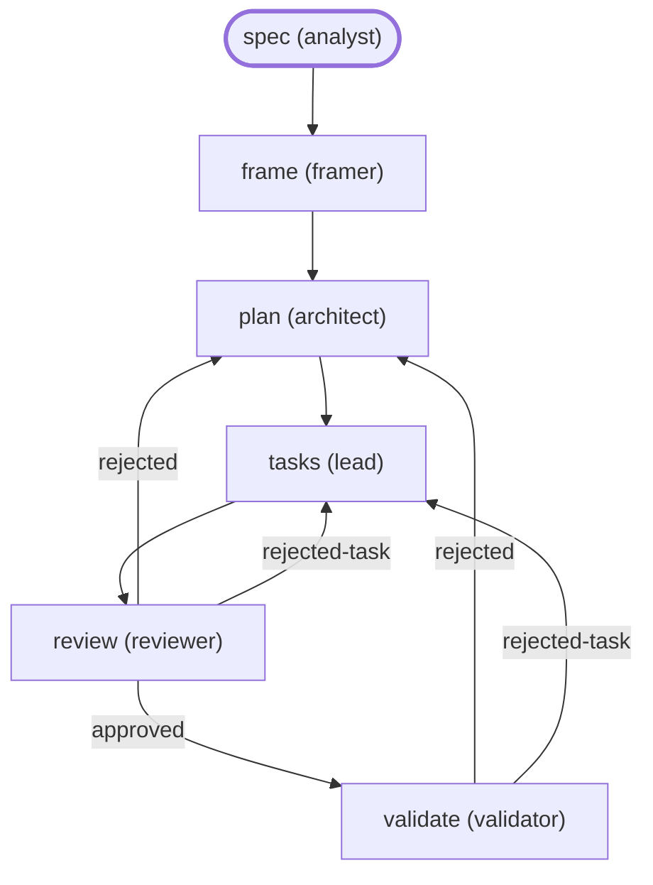

# Plan : retour d'expérience orchestration (lot #12)

Spec : `docs/superpowers/specs/2026-11-10-retex-orchestration-design.md` (décisions de Dimitri du 2026-11-10). Branche `feat/retex-orchestration`. Ce plan suit l'ordre de la spec : **A**, **P1**, **P2**, **P3**, puis **P4**, **P5**. Deux PR : la PR 1 porte A et P1 à P3, la PR 2 porte P4 et P5.

Légende : **V** = relu au code du dépôt par l'architecte (fichier:ligne, tête `963eec9`) ; **D** = lu dans la documentation officielle, cité une fois en §2 ; **C** = à mesurer, c'est la première tâche de sa phase.

## 0. Ce que la relecture du code et de la doc change à la spec

1. **L'identifiant.** La spec dit que `flow`, `étape` et `lot` suivent `is_valid_id`, « lettres, chiffres, `.`, `_`, `-` ». Le code dit autre chose (V, `crates/armadai-model/src/check.rs:210-218`) : `[a-z0-9][a-z0-9-]{0,63}`. Le plan garde `is_valid_id` tel qu'il est, avec le lot limité à 40 caractères. `rejected-task` est donc un état valide (V, `record.rs:60-66` lit le mot avec `is_valid_id`).
2. **Le mécanisme de `grant`.** La doc tranche la mesure (b) de la spec **par la négative** : un `allow` rendu par un hook `PreToolUse` ne passe pas une règle `ask` (citations D5 et D6). La spec prévoit ce cas : on s'arrête et Dimitri choisit. Un autre point d'accroche est documenté, le hook `PermissionRequest` (D7 à D9), et il accepte le champ `if` (D2). La phase P2 commence donc par une mesure de `PermissionRequest`. La suite est fixée d'avance par le choix par défaut Q1 (§6).
3. **La corrélation `mark` ↔ `SubagentStart`.** `SubagentStart` ne porte que `agent_id` et `agent_type` (D11), pas de `tool_use_id`. La corrélation se fait donc par l'ordre du journal, avec la règle d'ambiguïté de la spec (risque 2). `SubagentStart` se déclenche aussi sur une reprise (D10) : un `start` d'un `agent_id` déjà vu hérite de son marqueur et ne consomme aucune ligne `mark`.
4. **Les annexes d'une skill.** `link` recopie tout l'arbre d'une skill, sauf les sauvegardes égarées (V, `compile/claude.rs:56-74`, `read_tree_skipping`). La mesure A.0 ne vérifie donc plus que la présence de l'annexe et son bit d'exécution.
5. **`Explore` pour `analyst` et `architect`.**
   - `Explore` est déjà un agent libre du projet (V, `.armadai/project.yaml:7`).
   - Le gate laisse un agent libre être appelé depuis n'importe quel agent (V, `policy_gate.rs`, test `a_free_agent_is_reachable_from_anywhere`).
   - `capabilities.delegate` absent ne retire pas l'outil `Agent` : seul `deny` écrit `disallowedTools` (V, `compile/claude.rs:370-386`).
   - Ce qui empêche ces deux agents de passer par `Explore`, c'est donc la phrase « tu ne délègues jamais » de leur prompt. A.2 la change, et déclare `delegate: allow`, qui ne change que la ligne de rapport (« inherited tools »).
   - `git log` et `grep` sont des commandes en lecture seule, que Claude Code lance sans demande (D14).
6. **La protection de l'état de `grant`.** Le cadre (Q2 = a) demande que le gate refuse toute écriture d'un agent dans `.armadai/state/grants.yaml`. Un second chemin existe : un agent peut lancer `armadai grant` par `Bash`. Q3 propose de fermer les deux chemins par des règles `deny` natives.
7. **Un ancien binaire et le nouveau journal.** Un binaire antérieur au lot ignore les lignes `mark`, comme toute ligne qu'il ne sait pas lire (V, `cli/flow.rs:364-371`, `filter_map(... .ok())`). Le journal reste donc lisible par la version précédente, et un test le vérifie.

## 1. Contraintes globales (toutes les tâches)

- **Règles du dépôt.** La skill `armadai-rules` s'applique, version du worktree, avec A5, A6 et les deux invariants de sécurité. En particulier :
  - barrière complète avant chaque push ;
  - mutation vue rouge pour chaque test, et `touch` après restauration ;
  - `cargo build` avant tout essai au binaire ;
  - `HOME` et `ARMADAI_CONFIG_DIR` isolés pour tout essai, `CARGO_TARGET_DIR` privé au worktree ;
  - jamais `stash`, aucune tâche en arrière-plan ;
  - `/usr/bin/grep`, `/bin/ls`, `/bin/ps`.
- **Crates.** `armadai-model` reste pur. Les schémas se régénèrent par `cargo run -p armadai-model --example gen_schemas` dans toute tâche qui touche `types.rs`. `frozen/armadai-audit` doit rester compilable dès qu'un crate dont il dépend change.
- **Dépendances.** Aucun paquet nouveau. `chrono` est déjà déclaré par `crates/armadai` (`Cargo.toml:42`, vérifié par lead). Les délais (barre enchaînée à 1 s, `pack test` à 60 s) se codent avec `std::process` et `try_wait` en boucle, et la copie isolée réutilise `tempfile`, déjà utilisé hors des tests (V, `cli/validate.rs:70`).
- **Sorties versionnées.**
  - `flow status --json` reste `armadai.flow-status/1` et n'ajoute que des clés : `runs[].lot`, `steps[].ref`, `steps[].agent`, et la valeur `mark: "skipped"`. Le test `the_v1_golden_is_still_a_subset_of_the_output` (V, `flow_status/json.rs:273-280`) reste vert, sans modifier `tests/golden/flow-status/v1.json`.
  - `flow stats --json` naît `armadai.flow-stats/1`.
  - Le journal `.jsonl` gagne des champs facultatifs et le genre de ligne `mark`.
  - Le manifeste reste en `version: 1`, et un test lit un manifeste écrit avant le lot.
- **Opt-in.**
  - Sans `policy.grants`, aucun hook de grant ni règle de garde.
  - Sans `ui.flow_band`, aucun octet de mod en plus : `panel.json` reste identique pour un projet qui n'a que `ui.panel`.
  - Les hooks de marquage s'installent avec les hooks d'enregistrement, c'est-à-dire dès que le projet a un flow, comme aujourd'hui (V, `claude_settings.rs:135-141`).
- **Textes.** Tout texte nouveau est celui de §5. Il est adopté par défaut (§6, Q7) et reste à relire par Dimitri avant la fusion de chaque PR ; les golden sont relus ligne à ligne.
- **Rien de privé.** Aucun chemin de machine, aucun nom de pack privé, aucun jeton, dans le code, les fixtures, le wiki ou ce plan. Les fixtures de rejeu sont contrôlées par un test d'allowlist (P1.4).
- **Équipe en cours de lot.**
  - Après chaque édition de `.armadai/` : `armadai link --target claude`, puis `armadai validate`. Dans un worktree neuf, `link --force` pour `armadai-rules`, seul fichier concerné.
  - Dès que le binaire de P1.2 est installé, `lead` marque ses délégations : le refus est immédiat, sans passer par `link`.
- **Domaines.**
  - `schema-specialist` : `armadai-model`, `armadai-core` (starters, `pack.yaml`).
  - `adapter-specialist` : `compile/`, `claude_adapter/`, `flow_status/record.rs`, `flow_status/marker.rs`, le mod `compile/ui/`.
  - `cli-specialist` : `cli/`, `flow_status/{runs,json,line,render,watch,stats}.rs`, `cli/native_pack.rs`, `pack/`.
  - `framer` : `.armadai/` et `armadai-rules`.
- **Commits.** Conventional Commits, sujet en anglais, un seul type. Le trailer `Co-Authored-By` reprend la ligne fournie par la session.

## 2. Citations de la documentation officielle (règle A5)

Toutes ont été lues par l'architecte le **2026-11-10** par WebFetch ; les liens Markdown internes des phrases ont été retirés. Les agents qui suivent vérifient l'extrait, non la page.

| # | URL | Phrase exacte |
|---|---|---|
| D1 | https://code.claude.com/docs/en/hooks | « `if` uses permission rule syntax to match against the tool name and arguments together, so `"Bash(git *)"` runs when any subcommand of the Bash input matches `git *` and `"Edit(*.ts)"` runs only for TypeScript files. » |
| D2 | idem | « Only evaluated on tool events: `PreToolUse`, `PostToolUse`, `PostToolUseFailure`, `PermissionRequest`, and `PermissionDenied`. On other events, a hook with `if` set never runs » |
| D3 | idem | « The `if` field holds exactly one permission rule. There is no `&&`, `\|\|`, or list syntax for combining rules; to apply multiple conditions, define a separate hook handler for each. » |
| D4 | idem | « When Claude Code can't determine which commands the Bash input runs, it runs your hook regardless of the pattern. Because the `if` filter is best-effort, use the permission system rather than a hook to enforce a hard allow or deny. » |
| D5 | https://code.claude.com/docs/en/permissions | « PreToolUse hook decisions don't bypass permission rules. Claude Code evaluates deny and ask rules regardless of what a PreToolUse hook returns: a matching deny rule blocks the call, and a matching ask rule still prompts even when the hook returned "allow" or "ask". » |
| D6 | idem | « Rules are evaluated in order: deny, then ask, then allow. The first match in that order determines the outcome, and rule specificity doesn't change the order. » |
| D7 | https://code.claude.com/docs/en/hooks | (PermissionRequest) « Runs when Claude Code is about to ask you for permission to use a tool. In sessions that can't show a prompt, such as background subagents in non-interactive mode, Claude Code still runs these hooks, and if no hook returns a decision, it denies the tool call. » |
| D8 | idem | (PermissionRequest, `behavior`) « `"allow"` grants the permission, `"deny"` denies it. Deny and ask rules are still evaluated, so a hook returning `"allow"` doesn't override a matching deny rule » |
| D9 | idem | « PermissionRequest hooks receive `tool_name` and `tool_input` fields like PreToolUse hooks, but without `tool_use_id`. » |
| D10 | idem | (SubagentStart) « Runs when Claude spawns a subagent with the Agent tool, when Claude resumes a subagent, and each time an in-process agent team teammate handles a new message. » |
| D11 | idem | « In addition to the common input fields, SubagentStart hooks receive `agent_id` with the unique identifier for the subagent and `agent_type` with the agent name that the matcher filters on. » |
| D12 | idem | « The `tool_name`, `tool_input`, and `tool_use_id` fields are event-specific. » (l'exemple `PreToolUse` porte `"tool_use_id": "toolu_01ABC123..."`) |
| D13 | https://code.claude.com/docs/en/permissions | « In that setup you aren't prompted when the mod approves a call that an ask rule, a `PreToolUse` hook, or `permissions.blockReadsOutsideWorkingDirectories` would prompt for. » ; « that setup » = sans managed settings, sans `managed-mcp.json`, sans `/login` Team ou Enterprise ; sinon « A call that an ask rule would prompt for still prompts you. » |
| D14 | idem | « Claude Code recognizes a built-in set of Bash commands as read-only and runs them without a permission prompt in every mode […]. The set includes `ls`, `cat`, `echo`, `pwd`, `head`, `tail`, `grep`, `find`, `wc`, `which`, `diff`, `stat`, `du`, `cd`, and read-only forms of `git`. » |
| D15 | idem | « Read and Edit deny rules apply to Claude's built-in file tools, to file commands Claude Code recognizes in Bash, such as `cat`, `head`, `tail`, `sed`, and `tee`, and to the targets of Bash redirections such as `> file` and `< file`. » |
| D16 | idem | « a deny or ask rule covers the invocation Claude usually produces and isn't a security boundary around the program. » |
| D17 | idem | « add them to your user settings instead: `~/.claude/settings.json`, or `$CLAUDE_CONFIG_DIR/settings.json` when `CLAUDE_CONFIG_DIR` is set. » |
| D18 | https://code.claude.com/docs/en/plugins/mods/reference | « Entries cover the Claude Code CLI and the Desktop app as of v2.1.290 » ; ligne `AbovePrompt` : « `hasSurvey`, `isWorking`, `maxRows`, `bodyColumns`, `scroll`, `view` \| One instance \| Terminal, Desktop » |
| D19 | idem | « A pane opened without the user asking \| Placed from 144 terminal columns, 110 after they've opened it once » |
| D20 | idem | « Your `agent.spawn` hook also runs when a subagent that finished or stopped is about to run again, such as when Claude sends it a message with the `SendMessage` tool. On that event, `e.resume` is `{ agentId }`. » |
| D21 | https://code.claude.com/docs/en/statusline | « The `command` field runs in a shell, so you can also use inline commands instead of a script file. » |
| D22 | idem | « **Multiple lines**: each `echo` or `print` statement displays as a separate row. » |
| D23 | idem | « If a new update triggers while your script is still running, Claude Code cancels the in-flight script. » |
| D24 | https://code.claude.com/docs/en/permission-modes | « In addition to file edits, `acceptEdits` mode auto-approves common filesystem Bash commands: `mkdir`, `touch`, `rm`, `rmdir`, `mv`, `cp`, and `sed`. […] Like file edits, auto-approval applies only to paths inside your working directory or `additionalDirectories`. » (lue par le guardian, relue par l'architecte le 2026-11-10 : extrait conforme ; le passage omis est « Except for `touch`, these commands are also auto-approved when prefixed with safe environment variables such as `LANG=C` or `NO_COLOR=1`, or process wrappers such as `timeout`, `nice`, or `nohup`. ») |
| D25 | https://code.claude.com/docs/en/plugins/mods/interface (lue par l'adapter-specialist le 2026-11-10, WebFetch, tâche P4.0 ; relu mot pour mot par le guardian le 2026-11-12, pages .md officielles) | « Press Ctrl+X then Ctrl+A: this works whether the prompt, the band, or a pane has keyboard focus. » ; table des touches : « Ctrl+X then Ctrl+A \| Collapses the band to one row while a mod draws there, or expands it again. These keys also work while the prompt has the focus. » |
| D26 | idem (relu mot pour mot par le guardian le 2026-11-12, pages .md officielles) | « Your mod can't expand it or tell that it's collapsed: the `ui.render` hook keeps running, and nothing in `e.props` says so. Don't make the band the only place your mod shows something the user has to answer. » |
| D27 | idem (relu mot pour mot par le guardian le 2026-11-12, pages .md officielles) | « Click `[-]`: while the band is expanded, Claude Code draws this mark at the right end of its first row. » ; « A tree replaces what the mods after yours draw there. To keep theirs, put the result of `await next(e)` among the children of a `Box` in your tree. » |
| D28 | https://code.claude.com/docs/en/plugins/mods/reference (idem ; relu mot pour mot par le guardian le 2026-11-12, pages .md officielles) | « Width of a `Pane` or the band: draw to `e.props.bodyColumns` » |

**À lire en tâche** (non lu, rien n'est supposé) : un hook `PreToolUse` sur `SendMessage` et les champs de son `tool_input` (P1.0) ; le repli de la bande au-dessus du prompt et `claude plugin test` (`plugins/mods/interface`, `plugins/mods/test`, P4.0).

## 3. Diagrammes

### 3.1 Le flux du marqueur (P1)

```mermaid
sequenceDiagram
    participant L as lead (fil principal)
    participant CC as Claude Code
    participant G as __claude-policy-gate (PreToolUse, sync)
    participant R as __record-flow-event (hooks async)
    participant J as .armadai/state/claude/<session>.jsonl
    participant S as sous-agent reviewer
    participant F as armadai flow status
    L->>CC: Agent {subagent_type: reviewer, description: "[evolution/review#menu] relire"}
    CC->>G: PreToolUse (tool_input.description)
    G-->>CC: rien (passe) ou deny « must start with [flow/step#lot] … »
    CC->>R: PreToolUse Agent|Task (même charge)
    R->>R: decide(raw) == None ? sinon rien
    R->>J: {"event":"mark","agent_type":"reviewer","flow":"evolution","step":"review","lot":"menu"}
    CC->>R: SubagentStart {agent_id, agent_type}
    R->>J: {"event":"start","agent_id":"a7","agent_type":"reviewer"}
    CC->>S: lance
    S->>CC: SubagentHandback "… STATE: approved / REF: feature/menu"
    CC->>R: PreToolUse SubagentHandback
    R->>J: {"event":"stop","agent_id":"a7","state":"approved","ref":"feature/menu"}
    F->>J: lit le journal
    F->>F: runs.rs : start a7 ← première mark non consommée de reviewer ; run (evolution, menu)
```

Ce qu'il faut regarder :
- Le gate et le recorder reçoivent la même charge, en parallèle. Le recorder rappelle la fonction pure `policy_gate::decide` et n'écrit une `mark` que pour un appel que le gate laisse passer. Un appel refusé ne laisse donc aucune `mark` orpheline, qui irait se coller au `start` suivant.
- Le journal ne reçoit jamais le texte de la description : seulement `flow`, `step`, `lot`, et la `REF:` bornée.
- La corrélation se fait par l'ordre du journal, puisque `SubagentStart` n'a pas de `tool_use_id` (D11).

### 3.2 Le flow `lot` avec l'étape `tasks` (phase A)

Sortie de `armadai graph lot --format mermaid` sur le flow écrit par A.4 (mesurée par lead), comme le veut la skill `diagrams` ; elle remplace le dessin à la main.



Ce qu'il faut regarder :
- `rejected` garde le retour à `plan` pour un défaut de conception, et `rejected-task` renvoie aux tâches pour un défaut local.
- `tasks` est tenue par le coordinateur : `flow status` la montre `~`, sans état, et `runs.rs` la traverse comme les autres étapes du coordinateur (V, `runs.rs:310-333`, `reach`).

### 3.3 Le mécanisme de `grant` (choix par défaut Q1, §6)

```mermaid
flowchart LR
    call[appel Bash: git push origin feature/x] --> rules{règles natives<br/>deny → ask → allow}
    rules -->|deny| refused[refusé, jamais levé]
    rules -->|ask| prompt[Claude Code va demander]
    prompt --> PR[hook PermissionRequest<br/>if: Bash(git push origin feature/*)<br/>armadai __claude-grant auto-until-mr]
    PR -->|grant actif, borne non échue| allow[behavior: allow]
    PR -->|sinon, ou erreur| ask[aucun avis → la demande s'affiche]
```

Option (a) du choix Q1, à confirmer par la mesure P2.0 : le hook n'est consulté qu'au moment où Claude Code s'apprête à demander, après les règles. Un `deny` n'atteint donc jamais le hook (D8). L'option « `PreToolUse` → `allow` » de la spec n'a pas de flèche ici : la doc dit qu'elle ne passe pas l'`ask` (D5).

## 4. Tâches

Chaque tâche finit barrière verte. Les mutations citées sont le minimum ; le spécialiste reporte la sortie rouge vue.

### PR 1

#### Phase A : l'équipe du dépôt

**A.0 Mesure C : annexes d'une skill recopiées par `link`** (`schema-specialist`)
- [ ] Dans une copie jetable de la racine du worktree, préfixe unique, `HOME` et `ARMADAI_CONFIG_DIR` isolés : ajouter `.armadai/skills/armadai-rules/scripts/probe.sh` (mode 755), puis `armadai link --target claude --force`.
- [ ] Constater : `.claude/skills/armadai-rules/scripts/probe.sh` existe et `cmp` le dit identique ; noter son mode (`stat`). Relancer `link` : diff vide.
- [ ] Supprimer la copie par chemin littéral.
- **Critère d'arrêt.** Fichier absent ou différent : pas de script, la règle A6 garde ses trois commandes écrites (décision Q1 du cadre) et A.1 saute l'étape du script. Mode non conservé : le script s'appelle `bash <chemin>`, jamais `./<chemin>`.
- Rien n'est commité ; le résultat va dans le rapport de la tâche et dans ce plan (§7).

**A.1 Script d'hygiène dans `armadai-rules`** (`framer`)
- Fichiers : `.armadai/skills/armadai-rules/SKILL.md`, `.armadai/skills/armadai-rules/scripts/scratch.sh` (si A.0 est positive).
- [ ] `scratch.sh new <nom>` crée `${TMPDIR:-/tmp}/armadai-<nom>-<pid>-<epoch>` et imprime le chemin ; `scratch.sh rm <chemin>` refuse tout chemin qui ne commence pas par ce préfixe, puis `rm -rf -- <chemin>` (chemin littéral, jamais de motif).
- [ ] La ligne A6 de la skill renvoie à `bash .claude/skills/armadai-rules/scripts/scratch.sh`. Source : « Dimitri, 2026-11-10 (Q1 du cadre) ».
- [ ] `armadai link --target claude` (puis `--force` si le worktree est neuf), `armadai validate` ; seconde relance de `link` : diff vide (critère 12).
- Commit : `chore(team): ship the scratch-copy script with armadai-rules`

**A.2 `Explore` pour `analyst` et `architect`** (`framer`)
- Fichiers : `.armadai/agents/analyst.md`, `.armadai/agents/architect.md`.
- [ ] `capabilities: { shell: deny, delegate: allow }`.
- [ ] Prompt : « tu ne délègues jamais » devient « tu ne délègues à aucun agent de l'équipe ; pour chercher un texte, lire `git log` ou compter des occurrences, appelle `Explore` (lecture seule) et cite sa réponse comme une mesure ».
- [ ] `link`, `validate` ; vérifier dans `.claude/agents/analyst.md` qu'aucun `disallowedTools` ne contient `Agent`.
- Commit : `chore(team): let analyst and architect search through Explore`

**A.3 Checklist du `guardian`** (`framer`)
- Fichier : `.armadai/agents/guardian.md`, `vars.criteria` (instance du modèle `checker`).
- [ ] Ajouter :
  - « **Rien de privé** : le diff et la section du plan de la tâche ne contiennent ni `/Users/`, ni chemin de machine, ni nom de pack privé, ni jeton ; compté avec `/usr/bin/grep`, le compte cité. »
  - « **Plan relu** : la section du plan de la tâche est relue contre le diff, et un écart du plan lui-même est une ligne de rejet. »
  - « **Hygiène** : `git status --ignored` en fin de tâche ; un dossier ou un fichier non suivi laissé par la tâche est une ligne de rejet. »
- [ ] `link`, `validate`.
- Commit : `chore(team): guardian checks privacy, the plan and stray files`

**A.4 Étape `tasks` dans le flow `lot`** (`framer`)
- Fichier : `.armadai/flows/lot.yaml`.
- [ ] `tasks: { agent: lead }` ; `review` et `validate` : `states: [approved, rejected, rejected-task]`.
- [ ] Liens : `plan → tasks`, `tasks → review`, `review → validate when approved`, `review → plan when rejected`, `review → tasks when rejected-task`, `validate → plan when rejected`, `validate → tasks when rejected-task`.
- [ ] Description du flow : « … puis les tâches du plan (étape `tasks`, tenue par lead) … ; un défaut de conception retourne au plan, un défaut local à une tâche retourne aux tâches ».
- [ ] `armadai validate` sans erreur ; `armadai graph lot --format mermaid` colle sa sortie à la place du dessin de §3.2 (critère 11).
- Commit : `chore(team): add the tasks step and rejected-task to the lot flow`

**A.5 Prompt de `lead` : registre du lot et étape `tasks`** (`framer`)
- Fichier : `.armadai/agents/lead.md`, rendu dans le bloc de `CLAUDE.md`.
- [ ] Registre : « tiens `.armadai/state/ledger-<lot>.md` (décisions datées, branche et tête, tâches faites, questions en cours) ; un brief renvoie au registre et à la section du plan au lieu de les recopier ».
- [ ] Étape `tasks` : « `rejected-task` : relance seulement le flow `task` des tâches nommées par le rejet ; `rejected` : retour au plan ».
- [ ] `link`, `validate`.
- Commit : `chore(team): lead keeps a lot ledger and routes rejected-task`

**A.6 Test du retour `rejected-task`** (`cli-specialist`)
- Fichier : `crates/armadai/src/flow_status/runs.rs`, module de tests.
- [ ] Test `a_rejected_task_verdict_goes_back_to_the_tasks_step` : un flow à la forme de §3.2, un coordinateur `lead`, et un journal où `validate` rend `rejected-task` puis le relecteur redémarre. On attend, à égalité exacte, la transition `validate → tasks (rejected-task)` puis `tasks → review`, aucune transition vers `plan`, et `plan` toujours `✓`.
- Mutation : faire suivre à `next_steps` un `when` inconnu comme un lien sans condition, ou retirer `rejected-task` des `states` de la fixture : le test rougit.
- Commit : `test(flow-status): a rejected-task verdict returns to the tasks step`

#### Phase P1 : marquage

**P1.0 Mesure C : charges réelles et ordre du journal** (`adapter-specialist`)
- Projet jetable hors du dépôt, deux agents, `armadai` construit sur la branche, `ARMADAI_CONFIG_DIR` isolé. Un hook de sonde écrit chaque charge `PreToolUse` (matcher `Agent|Task|SendMessage`), `SubagentStart` et `SubagentStop` dans un fichier du dossier jetable. Session `claude -p` avec la connexion de l'essai.
- [ ] (i) Le `tool_input.description` d'un appel `Agent` est présent et intact ; le `tool_use_id` aussi (D12).
- [ ] (ii) `SubagentStart` ne porte pas de `tool_use_id` (D11, confirmation).
- [ ] (iii) Deux appels parallèles au même agent avec deux descriptions distinctes : l'ordre des `mark` asynchrones et des `start` dans le journal, sur 5 répétitions.
- [ ] (iv) Une reprise par `SendMessage` : un `SubagentStart` du même `agent_id` (D10) ; le `tool_input` d'un `PreToolUse` sur `SendMessage`, lu en tâche (§2, « à lire »), consigné pour un lot suivant, sans code dans ce lot.
- **Critère d'arrêt.** `description` absente de la charge : arrêt de P1 et question à Dimitri. Ordre inversé au moins une fois en (iii) : pas d'arrêt, la règle « `?` marqueur ambigu » de P1.3 s'applique. Si le spécialiste ne peut pas lancer `claude`, la mesure passe à l'essai réel de Dimitri ; P1.1 et P1.2 avancent, P1.3 attend (iii).
- Résultat consigné en §7, sans chemin ni texte de session.

**P1.1 Marqueur, `REF:` et ligne `mark` du journal** (`adapter-specialist`)
- Fichiers : `crates/armadai/src/flow_status/marker.rs` (nouveau), `flow_status/mod.rs`, `flow_status/record.rs`, `compile/claude_settings.rs`, `compile/claude.rs` (ligne de rapport).
- Interfaces :
  ```rust
  // marker.rs
  pub const MAX_LOT: usize = 40;
  #[derive(Debug, Clone, PartialEq, Eq)]
  pub struct Marker { pub flow: String, pub step: String, pub lot: Option<String> }
  /// `[<flow>/<step>]` or `[<flow>/<step>#<lot>]` at the very start of `description`;
  /// flow, step and lot are ids (`is_valid_id`), the lot at most MAX_LOT chars.
  pub fn parse(description: &str) -> Option<Marker>;
  // record.rs
  pub enum EventKind { Start, Stop, Command, Mark }
  pub struct FlowEvent { /* existing */ pub flow: Option<String>, pub step: Option<String>,
      pub lot: Option<String>, #[serde(rename = "ref")] pub reference: Option<String> }
  // each new field: #[serde(default, skip_serializing_if = "Option::is_none")]
  /// The word of the last line reading exactly `REF: <word>`, 1 to 64 chars of [A-Za-z0-9._/#-].
  pub fn ref_of(text: &str) -> Option<String>;
  ```
- [ ] `event_from_hook` : pour un `PreToolUse` dont l'outil est `Agent` ou `Task`, une ligne `mark` est écrite seulement si `marker::parse` réussit et que `policy_gate::decide(raw)` vaut `None`. Son `agent_type` est la **cible** (`subagent_type`, sinon `general-purpose`, comme le gate). La ligne vaut `{"ts":…,"event":"mark","agent_type":…,"flow":…,"step":…,"lot":…}`, et `lot` est absent quand il n'y en a pas.
- [ ] `log_line` d'une `mark` : une structure dédiée, comme `CommandLine`. Aucun autre champ, jamais la description.
- [ ] `stop` : `ref` lu par `ref_of` sur le message du handback ou sur `last_assistant_message`.
- [ ] `flow_status_entries` : ajouter `("PreToolUse", Some("Agent|Task"))`, asynchrone.
- [ ] Ligne de rapport « flow recording » : texte T1 (§5).
- Tests :
  - `parse` : formes valides, sans lot, lot à 40 et à 41 caractères, majuscules, `_`, espace avant `[`, `]` manquant. Mutation : `<= MAX_LOT` devient `<` ; `is_valid_id` est retiré.
  - `ref_of` : 64 et 65 caractères, caractère hors liste, dernière ligne valide qui l'emporte. Mutation : borne ou alphabet changés.
  - `a_marked_delegation_records_only_the_marker` : la ligne entière à égalité exacte, avec une description qui contient du texte libre. Mutation : sérialiser le `FlowEvent` complet.
  - `a_refused_delegation_records_no_mark` : projet `strict`, marqueur valide, mais topologie refusée. Mutation : ne plus appeler `decide`.
  - `old_and_mark_lines_read_back` : une ligne d'avant le lot et une ligne `mark` se relisent.
  - Le test du rapport est mis à jour (V, `compile/claude.rs:622-636`).
  - Test de manifeste : un manifeste d'avant le lot (sans l'entrée `Agent|Task`) se relit, et `link` ajoute l'entrée.
- Commit : `feat(flow): record the [flow/step#lot] marker and the REF line`

**P1.2 Le gate impose le marqueur** (`adapter-specialist`)
- Fichier : `crates/armadai/src/claude_adapter/policy_gate.rs`.
- [ ] Dans `decide`, après le jugement de topologie, sous `strict` : si la cible n'est pas un agent libre et qu'elle tient au moins une étape d'un flow, `marker::parse(description)` doit nommer un flow du projet et une étape de ce flow tenue par la cible. Sinon, refus avec le texte T2 ou T3 (§5). La liste `<flow>/<step>` est triée.
- [ ] Inchangés : charge illisible, projet invalide ou `off` donnent « pas d'avis » ; un agent libre ou un agent sans étape n'a besoin de rien.
- Tests :
  - `a_step_agent_without_a_marker_is_refused_with_the_form` : raison entière à égalité.
  - `a_marker_naming_another_agents_step_is_refused` : T3 à égalité.
  - `a_valid_marker_passes`.
  - `a_free_agent_needs_no_marker`.
  - `an_agent_holding_no_step_needs_no_marker`.
  - `policy_off_ignores_the_marker`.
  - Les fixtures existantes qui délèguent à `dev` ou `qa` gagnent un marqueur. Chaque test garde son sens : relu un par un, pas de remplacement en masse.
  - Mutations : retirer la condition « agent libre », retirer la vérification `step.agent == target`, laisser passer un marqueur dont le flow est inconnu.
- Commit : `feat(gate): require the [flow/step#lot] marker on step delegations`

**P1.3 Attribution par marqueur** (`cli-specialist`, après P1.0 (iii))
- Fichiers : `flow_status/runs.rs`, `flow_status/json.rs`, `flow_status/render.rs`.
- Interfaces :
  ```rust
  pub struct Run { /* existing */ pub lot: Option<String> }
  pub struct StepView { /* existing */ pub reference: Option<String> }
  ```
- Règles, écrites dans la doc de `runs()` :
  1. Chaque `start` d'un `agent_id` neuf consomme la plus ancienne `mark` non consommée de son `agent_type` qui le précède. S'il en reste plusieurs, non consommées et de triplet `(flow, step, lot)` différent, le `start` est placé `?` avec la note `ambiguous marker` et aucun run ne bouge.
  2. Un `start` d'un `agent_id` déjà vu (une reprise, D10) hérite du dernier marqueur de cet `agent_id`, sans consommer de `mark`.
  3. Un `start` marqué est placé dans le run ouvert du couple `(flow, lot)`, ou dans un run neuf de ce couple. Il est attribué comme par une commande (`attributed`) : lien pris depuis une étape finie s'il y en a, sinon étape en attente de sa source. Ni une commande, ni un autre lot, ni le redémarrage d'une entrée ne ferment ce run : seule sa fin naturelle le ferme.
  4. Un `start` non marqué suit les règles actuelles, sans jamais étendre un run ouvert par un marqueur.
  5. Une `mark` dont le flow ou l'étape n'existe pas dans le projet est ignorée.
  6. Sans aucune ligne `mark`, le résultat est identique à aujourd'hui.
- [ ] `stop` : `reference` vient du premier `ref` enregistré pour cet `agent_id` (la même règle que `merge_stops` pour l'état).
- [ ] JSON : `runs[].lot` (chaîne ou `null`) et `steps[].ref` (chaîne ou `null`), toujours présents (voir Q4). Texte et Markdown : textes T4 et T5.
- Tests :
  - Les tests existants de `runs.rs`, `json.rs` et `render.rs` restent verts sans modification de leurs valeurs attendues, hors l'ajout des champs `lot: None` et `reference: None` dans les littéraux.
  - Les cas des critères 2 et 3 sont couverts par P1.4. Ici, un test unitaire par règle : 1 avec deux `mark` différentes, 1 avec deux `mark` identiques, 2, 3, 5, et 4 avec un `start` non marqué pendant un run marqué ouvert.
  - Mutations : consommer la plus récente au lieu de la plus ancienne ; ne pas hériter sur une reprise ; laisser un `command` fermer un run marqué.
- Commit : `feat(flow-status): place marked delegations by flow, step and lot`

**P1.4 Journaux de rejeu** (`cli-specialist`)
- Fichiers : `crates/armadai/tests/fixtures/flow-replay/<cas>/{project/.armadai/…, log.jsonl, expected.json}`, `crates/armadai/tests/flow_replay.rs`.
- [ ] Cas :
  - `interleaved-lots` : deux lots du même flow entrelacés (critère 3) ;
  - `one-agent-two-flows` : un agent qui tient deux étapes de deux flows ;
  - `no-state-line` : un handback sans `STATE:` ;
  - `ref-line` : `STATE: approved` puis `REF: feature/menu`, plus une `REF:` de 65 caractères ignorée ;
  - `public-guard-misplaced` et `public-resume` : journaux synthétiques construits sur les formes mesurées du journal public. Identifiants de session et d'agent remplacés, aucun texte, marqueurs ajoutés à la main, résultat attendu après marquage (critère 2) ;
  - `unmarked-unchanged` : un journal sans marqueur dont `expected.json` est la sortie de `master` avant le lot, produite et relue avant d'écrire le code de P1.3.
- [ ] Le test rejoue chaque `log.jsonl` contre son projet par la fonction pure (`runs` puis `json::document`) et compare le JSON entier à égalité.
- [ ] Test d'allowlist `replay_fixtures_hold_nothing_private` : aucun fichier ne contient `/Users/` ni `/home/`. Chaque `agent_type`, flow, lot et `agent_id` appartient à une liste générique écrite dans le test (`lead`, `analyst`, `dev`, `qa`, `reviewer`, `a1`…). Mutation : glisser `/Users/x` ou un nom hors liste dans une fixture, le test rougit.
- [ ] Les extraits publics sont relus par `guardian` puis par `reviewer` (Q5 du cadre).
- Commit : `test(flow-status): replay anonymised session logs`

**P1.5 Consigne du marqueur dans `CLAUDE.md` et lignes `not-compiled`** (`adapter-specialist`)
- Fichiers : `compile/claude.rs` (`claude_md`), `compile/opencode.rs` et `compile/legacy_targets.rs` (lignes de rapport).
- [ ] Quand le projet a un flow et un coordinateur, ajouter à la fin du bloc de délégation la section T6 (§5).
- [ ] OpenCode, Codex, Copilot : une ligne `delegation marker` `not-compiled`, raison « Claude Code only ».
- Tests : golden de `CLAUDE.md` mis à jour et relu ligne à ligne ; test exact de la section ; test de la ligne `not-compiled` par cible. Mutation : émettre la section sans flow ; oublier une cible.
- Commit : `feat(link): tell the coordinator how to mark a delegation`

#### Phase P2 : `grant` / `revoke` (selon le choix par défaut Q1, §6)

**P2.0 Mesure C : `if`, `allow` face à `ask` et `deny`** (`adapter-specialist`)
- Projet jetable, `claude -p`. Dans ce mode, un appel qui devrait demander est refusé si aucun hook ne décide (D7), ce qui sert de banc. Dans `.claude/settings.json` :
  - `permissions.ask: ["Bash(echo grant-probe *)"]` ;
  - `permissions.deny: ["Bash(echo grant-deny *)"]` ;
  - des hooks qui journalisent chaque appel dans le dossier jetable.
- [ ] (a) `PreToolUse` avec `if: "Bash(echo grant-probe *)"` rendant `permissionDecision: "allow"` : l'appel est refusé ? (attendu d'après D5).
- [ ] (b) `PermissionRequest` avec le même `if` rendant `decision.behavior: "allow"` : l'appel passe ?
- [ ] (c) Les deux hooks sur `echo grant-deny x` : l'appel reste refusé et `PermissionRequest` n'est pas appelé.
- [ ] (d) `if` filtre : le hook ne tourne pas pour `echo other` ; il tourne pour `echo grant-probe x && echo y` et pour une commande illisible (D4), à consigner.
- [ ] Répéter en session interactive pour (b), si le spécialiste le peut ; sinon à l'essai réel de Dimitri.
- **Critère d'arrêt.** (c) négative (un `deny` passe) : arrêt définitif de P2. (b) négative : P2 sort du lot (choix Q1, option d), à rouvrir avec Dimitri ; P3 commence sans attendre. (b) et (c) positives : P2.1 et la suite, par `PermissionRequest`.

**P2.1 Niveaux dans le modèle** (`schema-specialist`)
- Fichiers : `armadai-model/src/types.rs`, `check.rs`, `pack.rs` (fusion), `schemas/v1/` (régénérés), `docs/wiki/project-format.md`.
- Interfaces :
  ```rust
  pub struct Policy { /* existing */
      #[serde(default, skip_serializing_if = "BTreeMap::is_empty")]
      pub grants: BTreeMap<String, Grant> }
  #[serde(deny_unknown_fields)]
  pub struct Grant {
      #[serde(default, skip_serializing_if = "Option::is_none")] pub description: Option<String>,
      pub allow: Vec<String>,
      /// `<step>` or `<flow>/<step>`
      #[serde(default, skip_serializing_if = "Option::is_none")] pub until: Option<String> }
  ```
- [ ] Diagnostics (noms Q6) :
  - `bad-id` (clé de niveau) ;
  - `grant-empty-allow` ;
  - `unknown-step` (étape de `until` inconnue) ;
  - `grant-ambiguous-until` (`<step>` tenue par plusieurs flows) ;
  - `grant-over-deny` (règle égale caractère pour caractère à un `deny` de `native.claude.permissions`).
- [ ] Fusion pack : vérifier en tâche la règle de `policy` dans `pack.rs`. Puis niveau par niveau, le projet remplace le niveau du pack de même clé.
- Tests : un test par code, avec le message à égalité. La fusion couvre un niveau du pack seul, un niveau remplacé et un niveau ajouté. Aller-retour de l'écrivain canonique sans `grants`, à l'octet près. Mutations : comparer en `contains` au lieu de l'égalité exacte pour `grant-over-deny` ; fusion qui garde le niveau du pack.
- Commit : `feat(model): declare grant levels under policy.grants`

**P2.2 Hooks de grant à la compilation et `__claude-grant`** (`adapter-specialist`)
- Fichiers : `compile/claude_settings.rs`, `compile/claude.rs`, `claude_adapter/grant_hook.rs` (nouveau), `cli/mod.rs` (`__claude-grant`, caché), `cli/unlink.rs` si nécessaire.
- Interfaces :
  ```rust
  /// One PermissionRequest entry per (level, rule): matcher = the rule's tool name,
  /// native {"if": rule}; command `armadai __claude-grant <level>`.
  pub fn grant_entries(project: &Project) -> Vec<HookEntry>;
  /// Pure: the hook JSON in, the decision out (None = no opinion).
  pub fn decide(raw: &str, level: &str, state: Option<&GrantState>, now: DateTime<Utc>,
                marked_since: &dyn Fn(&str, DateTime<Utc>) -> bool) -> Option<String>;
  ```
- [ ] `allow` seulement si :
  - l'état se lit sans erreur ;
  - le niveau est actif ;
  - `now < expires_at` quand une heure borne le niveau ;
  - aucune `mark` vers `until_step` n'a été enregistrée depuis `since` ;
  - et, sur `Bash`, la commande ne contient aucun opérateur de shell, aucune substitution, aucun saut de ligne (option (a) de Q2).
  
  Sinon, rien.
- [ ] Garde-fou né de la mesure P2.0 (d) et du choix par défaut Q2 : sur `Bash`, le hook ne rend aucun avis sur une commande composée (`&&`, `||`, `;`, `|`, `&`, saut de ligne), avec substitution (`$(`, `` ` ``) ou illisible (`eval`, ou toute commande qu'il ne sait pas découper). Il ne rend un avis que sur une commande simple. Test : `eval "$(printf …)"` sous un grant actif ne reçoit aucun avis. Mutation : retirer le cas `eval`/illisible, et le test rougit.
- [ ] Le hook lit l'état par un `stat` et, si un grant est actif, une lecture. Les journaux `.armadai/state/claude/*.jsonl` modifiés depuis `since` sont parcourus pour `until_step`.
- [ ] Garde de l'état (Q3, option (a)) : quand `policy.grants` n'est pas vide, `link` possède deux règles `deny` de `settings.json`, entrée par entrée dans `Owned.permissions`, comme aujourd'hui : `Bash(armadai grant *)` et `Edit(/.armadai/state/grants.yaml)` (D15, D16). `unlink` les retire.
- [ ] Rapport : T7 (§5). Sans niveau : aucune entrée, diff nul.
- Tests :
  - `decide` avec horloge injectée : actif, échu à la seconde, marque d'étape enregistrée, état illisible, niveau inconnu, Bash composé.
  - Mutations, chacune rouge : `<=` au lieu de `<` sur l'échéance ; `allow` sur erreur de lecture (invariant de sécurité) ; filtre de shell retiré ; `marked_since` ignoré.
  - `link` sans niveau : aucune entrée.
  - `unlink` retire entrées et règles.
  - Un manifeste d'avant le lot se relit.
- Commit : `feat(link): compile grant levels as PermissionRequest hooks`

**P2.3 Commandes `grant` et `revoke`** (`cli-specialist`)
- Fichiers : `cli/grant.rs` (nouveau), `cli/mod.rs`, `claude_adapter/grant_hook.rs` (type d'état partagé).
- État `.armadai/state/grants.yaml` :
  ```yaml
  version: 1
  active:
    auto-until-mr: { since: "2026-11-10T09:12:00Z", expires_at: "2026-11-10T11:12:00Z", until_step: "evolution/publish" }
  ```
- [ ] `armadai grant` : liste (T8). `armadai grant <niveau> [--until <étape>] [--for <durée> | --until-time HH:MM]` : une borne est obligatoire (celle de la commande, sinon `until` du niveau). `--for` accepte `30m`, `2h`, `1h30m` ; `--until-time` passe par `chrono`, heure locale, et désigne le lendemain si l'heure est passée.
- [ ] Refus :
  - un niveau inconnu ;
  - sans borne ;
  - `--until` sans hook de marquage installé, c'est-à-dire sans l'entrée `Agent|Task` du recorder dans `settings.json` ;
  - une règle égale à un `deny` de `settings.json` ou `settings.local.json`.
  
  Les textes sont en T9.
- [ ] `armadai revoke [<niveau>|--all]` (T10). `unlink` supprime l'état.
- [ ] `every_kept_command_has_a_help_description` gagne `grant` et `revoke` ; `CLAUDE.md` (liste des commandes) suit en D1.
- Tests : chaque texte à égalité exacte ; écriture puis lecture de l'état ; refus de chaque sorte ; horloge injectée pour `--until-time` avant et après l'heure. Mutations : borne facultative ; `deny` de `settings.local.json` non lu.
- Commit : `feat(cli): grant and revoke named permission levels`

#### Phase P3 : `flow stats`

**P3.1 Calcul pur** (`cli-specialist`)
- Fichier : `flow_status/stats.rs` (nouveau).
- Interfaces :
  ```rust
  pub enum By { Agent, Step, Lot }
  pub struct Group { pub key: String, pub calls: u32, pub resumed: u32,
      pub median_s: u64, pub max_s: u64, pub total_s: u64,
      pub states: BTreeMap<String, u32>, pub rejection_rate: Option<f64>, pub loops: u32 }
  pub struct Stats { pub by: By, pub groups: Vec<Group>, pub unmarked_calls: u32, pub any_marked: bool }
  pub fn stats(project: &Project, events: &[FlowEvent], by: By) -> Stats;
  ```
- [ ] Les mesures se définissent ainsi :
  - un appel est un `agent_id` démarré ;
  - une reprise (`start` d'un `agent_id` déjà vu) compte dans `resumed` ;
  - la durée va du premier `start` au premier `stop` du même `agent_id`, le second `stop` n'étant pas compté ;
  - la médiane d'un nombre pair d'appels est la moyenne des deux du milieu, arrondie à la seconde inférieure (Q5) ;
  - le taux de rejet compte les états `rejected` ou `rejected-*` (Q5) sur les états rendus, et seulement pour une étape qui en déclare un, sinon `None` ;
  - les boucles sont la somme des `loops` des runs (`times - 1`).
- [ ] `--by step|lot` : seuls les `start` marqués comptent, le reste va dans `unmarked_calls`.
- Tests : la fixture `interleaved-lots` de P1.4 et une fixture d'agents à durées distinctes deux à deux. Valeurs exactes, médiane paire et impaire. Mutations : compter les `stop` ; médiane arrondie au-dessus ; taux de rejet sur une étape sans `rejected`.
- Commit : `feat(flow-status): compute flow statistics from the session log`

**P3.2 Commande `flow stats`** (`cli-specialist`)
- Fichier : `cli/flow.rs` (`FlowCommand::Stats`).
- [ ] `armadai flow stats [<flow>] [--session <id> | --all] [--by agent|step|lot] [--json]`. Par défaut : la dernière session, `--by agent`. Sans journal : T12, code 0.
- [ ] Textes T11 et T12 ; JSON T13 (`schema: "armadai.flow-stats/1"`, clés toujours présentes).
- Tests : sortie texte entière à égalité ; JSON entier à égalité ; `--by lot` sans marqueur (critère 6), code 0. Mutation : `schema` absent ; code de sortie 1 sans journal.
- Commit : `feat(cli): add armadai flow stats`

**D1 Documentation de la PR 1** (`adapter-specialist`)
- Fichiers : `CLAUDE.md`, `docs/wiki/policy-gate.md`, `docs/wiki/flow-status.md`, `docs/wiki/project-format.md`, `docs/wiki/link.md`.
- [ ] `CLAUDE.md`, la phrase « There is no response-marker protocol any more (`ARMADAI_DELEGATE`/`END`/`META` were removed): delegation goes through each tool's native mechanism. » devient :
  > The old response-marker protocol (`ARMADAI_DELEGATE`/`END`/`META`) was removed: delegation goes through each tool's native mechanism. On Claude Code, the `description` of a delegation to an agent that holds a step starts with a `[flow/step#lot]` marker (required by the gate under `policy.delegation: strict`, recorded for `flow status` and `flow stats`), and a handback may end with a `REF: <ref>` line.
- [ ] `CLAUDE.md`, liste des commandes : `flow` (`status`, `stats`), `grant`, `revoke`.
- [ ] `policy-gate.md` :
  - le marqueur, sa forme et ses refus T2 et T3 ;
  - qui en est dispensé ;
  - la note de release : « refus immédiat dès le binaire installé ».
- [ ] `flow-status.md` :
  - la ligne `mark`, `REF:`, `runs[].lot`, `steps[].ref` ;
  - l'élargissement de la règle « rien d'autre n'est enregistré » (décision 3) ;
  - `flow stats` et `armadai.flow-stats/1`.
- [ ] `project-format.md` : `policy.grants` et les codes de P2.1.
- [ ] `link.md` : les hooks de grant et les règles de garde.
- Vérification : le diff de la tâche n'ajoute aucun chemin de machine (`git diff <base>.. | /usr/bin/grep '^+' | /usr/bin/grep -c '/Users/'` rend 0, hors citation du motif).
- Commit : `docs: document delegation markers, grants and flow stats`

### PR 2

#### Phase P4 : barre d'état, étapes facultatives, bande

**P4.0 Mesure C : la bande `AbovePrompt`** (`adapter-specialist`)
- Déjà lu (D18) : props `hasSurvey`, `isWorking`, `maxRows`, `bodyColumns`, `scroll`, `view`, une seule instance, terminal et Desktop. Reste à lire en tâche : `plugins/mods/interface` (repli, bande repliée) et `plugins/mods/test`.
- [ ] Mod jetable : une bande d'une ligne qui lit un `flow status --json` figé. `claude plugin test` sur ce mod ; `claude --plugin-dir` en terminal à 100 colonnes, puis à 150 avec le panneau ouvert.
- [ ] Consigner la place de la bande avec et sans `Pane`, `maxRows` observé, et la version de Claude Code.
- **Critère d'arrêt.** La bande ne se dessine pas : P4.4 garde le panneau et la bande passe en variante `$.ui.status` (ligne sous le prompt), que Dimitri compare à l'essai. Les autres tâches de P4 n'attendent pas.

**P4.1 `optional` et `ui.flow_band` dans le modèle** (`schema-specialist`)
- Fichiers : `types.rs` (`Step.optional: bool`, `#[serde(default, skip_serializing_if = "is_false")]` ; `Ui.flow_band: bool`, même forme), `check.rs`, `schemas/v1/`.
- [ ] `optional-start-step` (Erreur) : une étape facultative fait partie de `entry_steps(flow)`. Message T14.
- Tests : le code, avec son message à égalité ; aller-retour canonique sans `optional` à l'octet près ; schéma régénéré. Mutation : ne tester que `start:` déclaré, et pas l'heuristique.
- Commit : `feat(model): optional steps and the ui.flow_band key`

**P4.2 `skipped`, `--line` avec l'agent, `steps[].agent`** (`cli-specialist`)
- Fichiers : `runs.rs`, `line.rs`, `json.rs`, `render.rs`, `watch.rs`, `cli/flow.rs` (`MARKS`, `painted`).
- [ ] `Mark::Skipped`, signe `⤼`, nom `skipped`, note `skipped`. Une étape facultative se traverse comme une étape du coordinateur (`reach`) tant qu'elle n'est pas en cours, y compris quand elle est déjà `Done` d'un tour précédent : elle garde alors ✓, et la transition va directement de l'étape d'avant à celle d'après (§6, P4.2). Jamais démarrée, elle devient `Skipped` dès qu'une étape qu'elle atteint démarre, ou que le run est fini. `to_take` ignore une étape facultative en attente.
- [ ] Une étape facultative démarrée après l'étape qui la suit ne laisse pas le run ouvert (§6, P4.2). Test et mutation dédiés.
- [ ] `⤼ skipped` figure dans la liste des marques de `flow status --help` (`long_about` de `FlowCommand::Status`). Le test d'aide est mis à jour à égalité.
- [ ] `StepView.agent: String`, l'agent de l'étape (le premier flow pour un groupe `a | b`) ; JSON `steps[].agent`.
- [ ] `--line` : T15 ; `Piece::Agent` (couleur `muted`) ; `n` ne compte pas les `Skipped` ; `line_at` (la ligne du sous-agent) n'ajoute pas l'agent.
- Tests :
  - `skipped` en texte, JSON, Markdown et `--watch`, avec un run fini grâce au saut (critère 8).
  - Chaque forme de T15 à égalité.
  - La liste des tests de `line.rs` est mise à jour : chaque attente gagne `(agent)`, relue une par une.
  - Mutations : `Skipped` compté dans `n` ; étape facultative qui retient le run ; agent ajouté à `line_at`.
- Commit : `feat(flow-status): skipped optional steps and the step agent in --line`

**P4.3 Barre enchaînée** (`adapter-specialist`)
- Fichiers : `claude_adapter/statusline_chain.rs` (nouveau), `cli/flow.rs` (`statusline_main`), `cli/link.rs` (ligne de rapport T16).
- Interface :
  ```rust
  /// The user's statusLine command from `$CLAUDE_CONFIG_DIR/settings.json`, else
  /// `$HOME/.claude/settings.json` (D17); None when absent, not a command, or ours.
  pub fn user_command(env: &dyn Fn(&str) -> Option<String>) -> Option<String>;
  /// Run `sh -c <command>` with `stdin` (D21), at most `limit`; its stdout when it
  /// exits 0 in time, None otherwise (the child is killed on timeout).
  pub fn run_user(command: &str, stdin: &[u8], limit: Duration) -> Option<String>;
  ```
- [ ] `statusline_main` lit le JSON brut une fois, imprime la sortie de l'utilisateur telle quelle (fin de ligne retirée), puis la ligne du flow sur la ligne suivante (D22). Échec, délai d'1 s ou barre absente : la ligne du flow seule, code 0. Une commande égale à la nôtre est ignorée, pour éviter une récursion.
- [ ] Garde de récursion : la commande enfant reçoit `ARMADAI_STATUSLINE_CHAINED` ; un `__claude-statusline` qui la trouve posée n'enchaîne pas (§6).
- [ ] Délai dépassé : la commande enfant est lancée dans son propre groupe de processus, et c'est tout le groupe qui est tué, pas seulement `sh`.
- [ ] La sortie lue de l'enfant est bornée à 64 Kio.
- [ ] Windows : pas d'enchaînement (`shortcut:` commenté dans le code), ligne du flow seule.
- [ ] Rapport : T16 ; une `statusLine` du projet qui n'est pas la nôtre reste `not-compiled`, comme aujourd'hui.
- Tests :
  - Tests unitaires avec l'environnement injecté (une fermeture `env`, pas d'`env_lock`) ; les tests du binaire retirent `CLAUDE_CONFIG_DIR` et `ARMADAI_STATUSLINE_CHAINED` de leur environnement. Un faux `HOME` et des commandes jetables `printf user-bar`, `exit 3`, `sleep 5` :
    - sortie à deux lignes, à égalité ;
    - échec : ligne du flow seule ;
    - délai : ligne du flow seule ;
    - barre absente ;
    - la nôtre ignorée.
  - Borne du délai : le test vérifie que l'appel rend avant 3 s (seuil du défaut : un processus non tué bloquerait 5 s), 5 passes.
  - Mutations : ne pas tuer l'enfant ; imprimer la sortie d'un code non nul.
- Commit : `feat(link): chain the project status line after the user's`

**P4.4 Bande du mod, `skipped` dans le panneau, « facultative » dans `CLAUDE.md`** (`adapter-specialist`)
- Fichiers : `compile/claude_settings.rs` (`plugin_files`, `is_mod_file`), `compile/ui/armadai-ui-panel.js`, `compile/claude.rs` (`flow_section`, rapport).
- [ ] Les fichiers du mod s'écrivent pour `ui.panel || ui.flow_band`. `panel.json` :
  - `ui.panel` seul : identique à aujourd'hui ;
  - avec `ui.flow_band` : `"band": true` en plus ;
  - `ui.flow_band` sans `ui.panel` : `{"band": true, "pane": false}`.
- [ ] JS : un `ui.render` sur `AbovePrompt` dessine T17 pour le run ouvert, à partir de `flow status --json` toutes les 2 s, comme le panneau. Le panneau ne s'ouvre pas si `pane === false`. Le panneau montre `⤼` pour `skipped`.
- [ ] `flow_section` : une étape facultative porte `, optional` dans sa ligne de détail.
- [ ] Rapport : T18 (`approximated`).
- Tests :
  - `plugin_files` exact pour chacune des quatre combinaisons des deux clés, avec `panel.json` inchangé pour `ui.panel` seul (diff nul) ;
  - golden de `CLAUDE.md` avec une étape facultative ;
  - `claude plugin test` du JS, s'il est disponible (hors CI, résultat cité).
  - Mutation : écrire `"band": false` sans la clé.
- Commit : `feat(link): a flow band above the prompt in the armadai-ui mod`

#### Phase P5 : `pack test`

**P5.1 `tests:` dans `pack.yaml`** (`schema-specialist`)
- Fichier : `armadai-core/src/starter.rs`.
- [ ] `StarterPack.tests: Vec<String>` (`#[serde(default)]`).
- [ ] `pub fn bad_test_paths(&self) -> Vec<&str>` : chemin absolu, composant `..`, ou chemin vide.
- Tests : chaque forme refusée et un chemin valide. Mutation : ne tester que le préfixe `/`.
- Commit : `feat(core): pack.yaml declares its tests`

**P5.2 `armadai pack test`** (`cli-specialist`)
- Fichiers : `cli/pack.rs` (`PackCommand::Test { dir: Option<PathBuf> }`), `cli/native_pack.rs`, `pack/` (lecture du snapshot verrouillé).
- [ ] Validation : `pack-test-path-escapes` (Erreur) dans `native_pack::stage`, avec le texte T19. Un fichier listé dans `tests:` ne déclenche pas `ignored-pack-file`.
- [ ] Sans argument : le snapshot verrouillé du pack du projet (sans réseau ; erreur si le cache ne l'a pas) ; avec un dossier : ce dossier.
- [ ] Exécution :
  - copie dans `tempfile::TempDir` ;
  - pour chaque test, `bash <script>` dans la copie, avec `HOME`, `CLAUDE_CONFIG_DIR` et `ARMADAI_CONFIG_DIR` vers des dossiers temporaires ;
  - délai de 60 s par test (décision Q4 du cadre), enfant tué au-delà ;
  - lignes T20, code de sortie 1 si un test échoue.
  
  Aucune exécution à `link`, `init` ou `pack sync`.
- [ ] `pack_help_texts_are_pinned_line_for_line` et `every_kept_command_has_a_help_description` gagnent `test`.
- Tests :
  - Un pack local de deux tests, l'un `exit 0`, l'autre `echo boom; exit 1` : sortie entière, code 1.
  - Un test qui écrit dans `$HOME/x` : rien n'apparaît sous le `HOME` de l'essai.
  - Chemin `../x` refusé à `validate`.
  - Pack sans test : T20, code 0.
  - Délai : un délai injecté de 1 s, un script `sleep 5`, retour avant 3 s.
  - Mutations : `HOME` non remplacé ; code de sortie 0 malgré un échec ; délai ignoré.
- Commit : `feat(cli): add armadai pack test`

#### Suites de P2 (décisions de Dimitri du 2026-11-10)

Sources, mot pour mot :
- sur la limite de sécurité de `grant` (D16) : « Accepter + avertir (Recommandé) » ;
- sur l'affichage par `link` de `grant-unsupported-rule` : « Oui (Recommandé) ».

**P2.4 Avertir d'une règle de niveau large** (`schema-specialist`)
- Fichiers : `armadai-model/src/check.rs` (à côté des codes `grant-*` de P2.1), `docs/wiki/project-format.md` (table des codes).
- [ ] Nouveau code `grant-broad-rule` (Warning), un par règle large d'un niveau. Le texte est T21, en choix par défaut.
- [ ] Est large une règle `Bash` qui remplit l'une de ces conditions. Le premier mot est normalisé selon le choix « graphies » de §6 (P2.4).
  - `Bash(*)` ou `Bash(* …)` (spécificateur qui commence par `*`). `Bash` seul n'en est pas : `grant-unsupported-rule` le couvre déjà (§6, P2.4).
  - Un spécificateur dont le premier mot est un interpréteur ou un lanceur : `python` (`python3`, `python3.13t` et les graphies voisines s'y ramènent), `node`, `ruby`, `perl`, `sh`, `bash`, `zsh`, `env`, `xargs`, `eval`, `exec`, `sudo`, `npx`, `timeout`, `nice`, `nohup`.
  - Un spécificateur dont le premier mot est un outil de copie ou de déplacement et qui contient un `*` : `cp`, `mv`, `rsync`, `ln`, `tar`.
- [ ] Limite connue, à écrire dans le wiki (`project-format.md`) : `make`, `npm run`, `cargo run` et `git` ne sont pas dans la liste (§6, P2.4).
- [ ] La liste est une constante commentée « incomplète par construction : un avertissement, pas une frontière (D16) ».
- Tests :
  - un cas par forme (`Bash(*)`, `Bash(* --x)`, `Bash(python3 x.py)`, `Bash(python3.13t x.py)`, `Bash(xargs rm)`, `Bash(cp * /tmp)`), message entier à égalité ;
  - un cas par graphie normalisée (`Bash(FOO=1 python x)`, `Bash(/usr/bin/python3.12 x)`, `Bash(Python x)`, `Bash(sudo:*)`) ;
  - aucun avertissement pour `Bash(git push origin feature/*)`, ni pour `Bash(cp a b)`, ni pour `Bash` seul (qui reste à `grant-unsupported-rule`).
  - Mutations : retirer un mot de la liste (son cas rougit) ; supprimer la condition « contient `*` » pour les outils de copie (le cas `cp a b` rougit) ; retirer une étape de normalisation (le cas de cette graphie rougit).
- Commit : `feat(model): warn on broad grant rules`

**P2.5 `link` montre les avertissements des niveaux** (`adapter-specialist`)
- Fichier : `cli/link.rs` (`load_project`).
- Comportement actuel (V, `cli/link.rs:64-77`) : `link` n'affiche que les **erreurs**, une par ligne sur stderr par `Diagnostic::render()`, puis s'arrête. Un projet valide passe par `Ok((p, _))`, où le `_` est l'`Origins` : ses avertissements ne sont jamais montrés. `validate` les obtient par `view.validate()` (V, `cli/validate.rs:9-12`).
- [ ] Après un `load_checked` réussi, `link` écrit sur stderr, avant le rapport, chaque avertissement dont le code commence par `grant-` (`grant-unsupported-rule`, `grant-broad-rule`), par `Diagnostic::render()`. Ce sont les avertissements de `view.validate()`, ou les diagnostics déjà calculés si `load_checked` les expose sans un second chargement : à voir en tâche.
- [ ] Les autres avertissements restent non montrés par `link`, comme aujourd'hui : hors du périmètre de cette tâche.
- [ ] Format : la ligne de `Diagnostic::render()`, déjà utilisée par `link` pour les erreurs et par `validate`. Pas de texte nouveau. `--json` n'est pas touché, puisque les avertissements vont sur stderr.
- Tests :
  - par le binaire, sur un projet qui déclare un niveau avec `Bash(*)` et `Edit(/src/*)` : stderr contient exactement les deux lignes rendues, et stdout de `link --json` reste un JSON valide sans elles ;
  - sans niveau : stderr sans ligne `grant-`.
  - Mutations : ne pas filtrer sur `grant-` (des avertissements d'une autre famille de la fixture apparaissent) ; écrire sur stdout (le JSON casse).
- Commit : `feat(link): show the warnings of grant levels`

**D2 Documentation de la PR 2** (`cli-specialist`)
- Fichiers : `docs/wiki/flow-status.md` (`skipped`, `--line`, `steps[].agent`, la bande, le mod du panneau mis à jour, risque 5), `docs/wiki/link.md` (barre enchaînée, avec la phrase : le `refreshInterval` de l'utilisateur est remplacé par celui de notre barre, soit 5 s ; `ui.flow_band`), `docs/wiki/project-format.md` (`optional`, `ui.flow_band`, `optional-start-step`, `pack-test-path-escapes`), `docs/wiki/starter-packs.md` (`tests:` et `pack test`, avec la phrase : « `pack test` exécute les scripts du pack avec vos droits, dans une copie isolée et avec un `HOME` temporaire ; il n'isole pas le réseau »), `CLAUDE.md` (liste : `pack` … `test`).
- Commit : `docs: document optional steps, the chained status line and pack test`

### Ordre et dépendances

A.0 → A.1 ; A.2, A.3, A.4 → A.5 → A.6 (A.2 à A.5 sont indépendantes entre elles, une à la fois pour `link`) → P1.0 → P1.1 → P1.2 → P1.3 (attend P1.0 (iii)) → P1.4 → P1.5 → P2.0 → [P2.1 → P2.2 → P2.3 si la mesure est positive] → P3.1 → P3.2 → D1 → **PR 1**. Puis P4.0 → P4.1 → P4.2 → P4.3 → P4.4 → P5.1 → P5.2 → P2.4 → P2.5 → D2 → **PR 2**. P3 ne dépend que de P1 pour `--by step|lot`. Essais réels de Dimitri : fin de P1 (critère 1) et fin de P4 (critères 7 et 9).

## 5. Textes de sortie proposés (à valider par Dimitri)

Code, messages et sorties en anglais. `‹…›` marque une valeur.

- **T1, rapport de `link`** (`flow recording`, `compiled`) : `hooks SubagentStart, SubagentStop, PreToolUse (SubagentHandback, Agent|Task), UserPromptExpansion in .claude/settings.json`
- **T2, gate : marqueur absent ou mal formé** : ``the description of a delegation to `‹target›` must start with [flow/step] or [flow/step#lot], with flow/step among: ‹evolution/review, mr/revue-mr›``
- **T3, gate : marqueur qui ne nomme pas une étape de la cible** : ``the marker [‹flow›/‹step›‹#lot›] does not name a step `‹target›` holds; use one of: ‹evolution/review, mr/revue-mr›``
- **T4, en-tête d'un run avec lot** (texte) : `‹flow› #‹lot›  ‹in progress|finished|interrupted›` ; en Markdown : `## ‹flow› #‹lot›: ‹status›`. Sans lot : inchangé.
- **T5, étape avec `REF:`** : la référence suit l'état, entre crochets : `  ✓ review   approved [feature/menu]` ; dans le Markdown, la même cellule `Status` : `approved [feature/menu]`.
- **T6, section du bloc `CLAUDE.md`** :
  ```
  ### Marking delegations

  Start the `description` of every Agent call to an agent that holds a step with `[<flow>/<step>#<lot>]`, for example `[lot/plan#12] write the plan`. `#<lot>` is optional: it names one batch of work, so that two batches of one flow stay apart in `armadai flow status`. A free agent needs no marker. Ask the agent to end its reply with `REF: <ref>` after its `STATE:` line when it produced something to point at (a branch, a merge request): up to 64 letters, digits or `._/#-`.
  ```
  Sous `strict`, une phrase en plus : `Under policy.delegation: strict the gate refuses a delegation without it.`
- **T7, rapport `policy grants`** (`compiled`) : `PermissionRequest hooks (armadai __claude-grant), one per rule; inactive until armadai grant` ; et `grant state guard` (`compiled`) : `deny rules Bash(armadai grant *) and Edit(/.armadai/state/grants.yaml) in .claude/settings.json`. Autres cibles : `not-compiled`, `Claude Code only`.
- **T8, `armadai grant` sans argument** :
  ```
  grant levels (policy.grants)
    auto-until-mr  active until evolution/publish starts or 18:00, since 09:12
    read-logs      inactive  Lire les journaux de recette
  ```
  Une ligne échue : `  auto-until-mr  expired at 11:12`. Aucun niveau : `no grant level declared (policy.grants in .armadai/project.yaml)`.
- **T9, `armadai grant <niveau>`** :
  - `granted auto-until-mr until 11:12 (2 rules); armadai revoke auto-until-mr ends it`
  - `granted auto-until-mr until a delegation to evolution/publish is recorded (2 rules)`
  - `grant auto-until-mr needs a bound: --until <step>, --for <duration> or --until-time <HH:MM>, or until: in policy.grants`
  - `--until publish needs the delegation markers that the flow recording hook writes; run armadai link --target claude first`
  - `grant auto-until-mr refused: its rule Bash(git push *) is a deny rule of .claude/settings.local.json, and a grant never lifts a deny`
  - `unknown grant level x; levels: auto-until-mr, read-logs`
- **T10, `armadai revoke`** : `revoked auto-until-mr` ; `revoked 2 levels: auto-until-mr, read-logs` ; `no grant is active`.
- **T11, `armadai flow stats`** (`--by agent`) :
  ```
  flow stats  session 3f2a9c  by agent
  AGENT     CALLS  RESUMED  MEDIAN  MAX    TOTAL   STATES                  REJECTED  LOOPS
  analyst       3        0  4m12s   9m40s  18m02s  done 3                  -         0
  guardian     11        2  2m05s   6m31s  27m44s  approved 8, rejected 3  27%       2
  durations run from a start to the first stop of the same agent: a resumed agent counts once, so they are lower bounds
  ```
  `--by step` : la colonne `STEP` (`lot/review`) ; `--by lot` : `LOT` (`12`, `(none)`). Durées : `45s`, `4m12s`, `1h03m`.
- **T12, cas vides** :
  - `4 calls are not marked and are left out of --by step` ;
  - `no call is marked: --by step and --by lot need [flow/step#lot] markers (see armadai flow status)` ;
  - sans journal : `no flow activity recorded yet (link installs the hooks; start a flow in Claude Code)` (la phrase existante, `NO_ACTIVITY`).
- **T13, `flow stats --json`** :
  ```json
  {"schema":"armadai.flow-stats/1","sessions":["3f2a9c"],"by":"agent","groups":[{"key":"guardian","calls":11,"resumed":2,"duration_s":{"median":125,"max":391,"total":1664},"states":{"approved":8,"rejected":3},"rejection_rate":0.2727,"loops":2}],"unmarked_calls":0}
  ```
- **T14, `optional-start-step`** : message ``step `‹step›` is optional but the flow starts there`` ; indice `a flow must begin with a step that runs; make another step the start, or drop optional`.
- **T15, `--line`** :
  - `deliver ● guard (qa) 2/4` ;
  - `deliver ? guard (qa: no STATE line) 2/4` ;
  - `deliver ✗ guard (qa: undeclared state) 2/4` ;
  - `deliver ○ validate (ops) 3/4`.
  
  `finished` et `interrupted` restent sans agent.
- **T16, rapport `ui.status_line`** (`compiled`) : `chained after your user status line when there is one`.
- **T17, la bande** : `deliver #menu  ✓ design  ✓ build  ■ guard  □ validate  ⤼ test` (`■` en cours, `□` en attente, `?` et `✗` tels quels).
- **T18, rapport `ui.flow_band`** (`approximated`) : `a band above the prompt drawn by the armadai-ui mod (terminal and Desktop), refreshed from flow status every 2 s`.
- **T19, `pack-test-path-escapes`** : message ``test `‹path›` must be a relative path inside the pack`` ; indice `write it as tests/<name>.sh, without .. or a leading /`.
- **T20, `armadai pack test`** :
  ```
  pack test  ‹name› ‹1.4.0› (locked snapshot)        [ou : pack test  ./‹dir›]
  ok    tests/permissions.sh  0.4s
  FAIL  tests/mr-rules.sh  exit 1  2.1s
    | boom
  1 passed, 1 failed
  ```
  Délai : `FAIL  tests/x.sh  timed out after 60s` ; aucun test : `pack ‹name› declares no test (tests: in pack.yaml)` ; snapshot absent : `the locked snapshot of ‹name› ‹1.4.0› is not in the cache; run armadai pack sync`.

### Textes ajoutés en cours de lot (mandat du 2026-11-10, à confirmer par Dimitri)

**P2.2**
- Code `grant-unsupported-rule` (warning). Message : ``grant `g` lists `Edit(/src/*)`, and a level answers `Bash` rules only``. Hint : ``the rule is never granted: write a `Bash(...)` rule, or put it in native.claude.permissions.allow``.
- `compile/claude_settings.rs:379` : ``native.claude key `permissions` must be a mapping when policy.grants is set``. Choix par défaut.
- `compile/claude_settings.rs:385` : ``native.claude key `permissions.deny` must be a list when policy.grants is set``. Choix par défaut.

**P2.3**
- Refus si `CLAUDECODE` est posé : `grant is for the person at a terminal, and this shell belongs to a Claude Code session (CLAUDECODE is set); run armadai grant in your own terminal`.
- Heure sautée : `HH:MM does not exist in your time zone`.
- Ligne de liste : `  <niveau>  ended (<flow>/<step> started)`.
- `unknown grant level x; no level is declared (policy.grants in .armadai/project.yaml)` et `grant x is not active`.
- Les deux bornes : `granted L until HH:MM or a delegation to F/S is recorded (N rules); armadai revoke L ends it`.
- Erreurs d'étape :
  - `X names no step of the flows of the project` ;
  - `X is a step of several flows (a/X, b/X); write <flow>/<step>`.
- Erreurs de saisie :
  - `invalid duration X; write 30m, 2h or 1h30m` ;
  - `invalid time X; write it as HH:MM (24 hours, your local time)`.
- État illisible : `.armadai/state/grants.yaml does not read (damaged, or written by a later version); delete it and run the command again`.
- `cli/grant.rs:178` : `grant <niveau> has no Bash rule to answer; list its rules as Bash(...) in policy.grants, other rules are never granted`, code 1. Validé par Dimitri : « Refuser (Recommandé) ».

**P2.4 et P2.5**
- T21, `grant-broad-rule` (Warning). Message : ``grant `‹level›` rule `‹rule›` is broad: it lets through any command it matches`` (validé par Dimitri, §6, P2.4). Hint : ``a grant is a convenience, not a boundary; name the exact command, such as `Bash(python3 scripts/release.py)` ``. Hint : choix par défaut à valider.
- Affichage par `link` (P2.5) : la ligne de `Diagnostic::render()` existante, sur stderr ; pas de texte nouveau. Choix par défaut.

**P3.2**
- `cli/flow.rs:220`, en-tête avec `--all` : `flow stats  all sessions (N)  by agent`. Choix par défaut.
- `cli/flow.rs:212` : `no call of flow <flow> in this session`, et avec `--all` `no call of flow <flow> in these sessions`, code 0. Validé par Dimitri : « ça me va », puis « Oui, ce texte (Recommandé) ».
- `flow_status/render.rs:266`, note sous la table : `states count each verdict rendered, a resumed agent can render several`. Choix par défaut.

**P5.2** (`pack test`, `cli/pack_test.rs`, textes pris sous mandat, à challenger par Dimitri)
- Projet sans référence de pack et sans argument : `this project references no pack: give a pack folder, armadai pack test <dir>`.
- En-tête avec un dossier : `pack test  <dir tel que tapé>`, sans `./` ajouté (T20 donnait `./‹dir›` sans trancher).
- Délai : `FAIL  <path>  timed out after <limite>`, la limite en secondes entières (`60s`), sinon avec une décimale.
- Test tué par un signal : `FAIL  <path>  signal  <durée>`, à la place de `exit N`.
- Lock absent : le message existant de `pack add` (`.armadai/project.yaml references pack <name> but .armadai/pack.lock is missing: run `armadai pack update``).
- Lien symbolique dans le pack : le message existant de `native_pack::files`, repris par `copy_tree` : `the pack holds a symbolic link, refused: <path>`.
- Statut de sortie perdu (`waitid` échoue, `Finish::Lost`) : `FAIL  <path>  exit status lost  <durée>`, sans le mot `signal` et sans ligne de sortie ; le groupe n'est pas tué et les lecteurs ne sont attendus que jusqu'au délai. Choix par défaut.
- Aide : `about` = `Run the scripts a pack lists under tests: in an isolated copy (no network isolation)` ; `long_about` = « Run the scripts a pack lists under tests: in pack.yaml, with bash, in a copy of the pack and with HOME, CLAUDE_CONFIG_DIR and ARMADAI_CONFIG_DIR pointing at temporary folders. Without a folder, the snapshot the project locks (from the local cache, never the network); with one, that folder. Each test may run 60 seconds; the exit code is 1 when one fails. », puis « The scripts run with your permissions and see your network: the copy and the three variables are the only isolation. » ; exemples de `pack --help` : `armadai pack test` et `armadai pack test ./my-pack`.

**Étape facultative, bloc coordinateur de `CLAUDE.md`** (décision de Dimitri, 2026-11-12, après l'essai réel où le lead hésitait à sauter une étape `optional` : « Oui, dans cette PR (Recommandé) »)
- Phrase, mot pour mot : `An optional step may be skipped: delegate the step after it directly.` Elle est ajoutée au bloc compilé par `link`, dans son propre paragraphe après les sections de flow et avant « Marking delegations », seulement si un flow a au moins une étape `optional` (aucun autre projet ne change).
- OpenCode : un équivalent existe (correction d'une ligne inexacte de cette entrée) : les consignes de délégation du coordinateur vont dans son propre fichier d'agent, section `## Delegation` (`opencode.rs`). Décision de Dimitri, 2026-11-12, à « Faut-il aussi dire au coordinateur OpenCode qu'une étape `optional` peut être sautée ? » : « Oui, dans cette PR (Recommandé) ». La même phrase, mot pour mot, termine donc cette section dans le fichier du seul coordinateur, avec la même condition. `.opencode/armadai-team.md` reste neutre (lu par tous les agents) : il ne porte que le `, optional` de la ligne de l'étape.
- Mesure faite avant d'écrire la phrase (2026-11-12, `link --target opencode`, `policy.delegation: strict`, flow design → build → check `optional` → review, agent coordinateur `lead` hors flow) : le fichier `agents/lead.md` porte `permission.task` `{"*": "deny", chk: allow, des: allow, dev: allow, rev: allow}` ; le coordinateur peut donc déléguer à l'agent de `review` sans passer par `check`. Même règle pour `agent.build` et `agent.plan` dans `opencode.json`. Aucun essai `opencode` réel.

## 6. Choix par défaut (mandat du 2026-11-10, à confirmer par Dimitri)

Dimitri est absent ; son mandat : « continue en autonomie » et « Prends les recommandations pour les questions en me remontant les éléments choisis (je challengerai à mon retour si besoin) ». Les sept choix ci-dessous sont donc des **choix par défaut de lead**, pris sur la recommandation de l'architecte. Ce ne sont pas des réponses de Dimitri, et il peut les contester. Les tâches qu'ils touchent sont débloquées.

- **Q1, mécanisme de `grant`** (§3.3), règle conditionnelle :
  - si la mesure P2.0 (b) est positive (un `allow` de `PermissionRequest` passe une règle `ask`) et (c) aussi (un `deny` n'est jamais levé), P2 se fait par un hook `PermissionRequest` avec `if` (P2.1 à P2.3) ;
  - sinon, P2 sort du lot (option d) et reste à rouvrir avec Dimitri ;
  - dans les deux cas, P3 continue sans attendre.
  
  Écartées : un mod `tool.check` (D13) et la réécriture de `settings.json` par `grant`.
- **Q2, filtre `if` approximatif** (D4) : le hook ne rend aucun avis sur une commande `Bash` qui contient un opérateur de shell (`&&`, `||`, `;`, `|`, `&`), une substitution (`$(`, `` ` ``) ou un saut de ligne (P2.2).
- **Q3, protection de l'état** : quand des niveaux existent, `link` possède deux règles `deny` natives, `Bash(armadai grant *)` et `Edit(/.armadai/state/grants.yaml)` (D15, D16). Elles remplacent, pour ce point, le refus par le gate de la Q2 du cadre (P2.2).
- **Q4, JSON sans marqueur** : `runs[].lot`, `steps[].ref` et `steps[].agent` sont toujours présents, à `null` quand ils sont vides. Le texte et le Markdown restent identiques octet pour octet, et les clés d'avant le lot restent inchangées (P1.3, P4.2).
- **Q5, conventions de `flow stats`** : un rejet est un état `rejected` ou `rejected-*` ; la médiane d'un nombre pair d'appels est la moyenne des deux du milieu, arrondie à la seconde inférieure (P3.1).
- **Q6, codes de diagnostic** : `grant-empty-allow` et `grant-ambiguous-until` (nouveaux), `unknown-step` pour une étape de `until` inconnue, `bad-id` pour une clé de niveau (P2.1).
- **Q7, textes** : T1 à T20 (§5) sont adoptés tels quels pour l'instant. Ils restent à relire par Dimitri avant la fusion de chaque PR (T1 à T13 pour la PR 1, T14 à T20 pour la PR 2), et les golden suivront ses corrections.

### Choix par défaut ajoutés en cours de lot (mandat du 2026-11-10, à confirmer par Dimitri)

**P2.2**
- Un niveau ne répond qu'aux commandes `Bash`. Pour les outils de fichiers, aucun avis : le guardian a mesuré un `allow` sur `Edit /etc/passwd`, et une écriture hors règle à travers un lien.
- Le hook ne rend aucun avis dans ces cas :
  - une commande qui nomme `grants.yaml` ou `armadai` ;
  - un `cwd` sous `<racine>/.armadai` ;
  - une commande qui contient un caractère hors ASCII.
- Le filtre de shell est plus large que Q2 : il refuse aussi `$VAR`, les guillemets, les redirections et les globs.
- Note : sous un niveau large, `grant` est une commodité, pas une frontière (D16). Quatre contournements ont été trouvés en revue. Le point est à revoir avec Dimitri avant la fusion.

**P2.4**
- La normalisation du premier mot retire aussi un `t` final qui suit un chiffre, avant le suffixe `[0-9.]+` : `python3.13t` devient `python`.

**P2.3**
- Heure en double : la première occurrence.

**P4.3**
- Garde de récursion par la variable `ARMADAI_STATUSLINE_CHAINED`, posée sur la commande enfant : un ajout de l'auteur, adopté par défaut.

**P4.3 et P5.2 (processus enfants, `crates/armadai/src/process.rs`)**
- Choix du 2026-11-12, par lead sous mandat : la barre enchaînée ne tue le groupe de processus de la commande de l'utilisateur qu'au dépassement du délai d'1 s ; une barre qui finit à temps, même en échec, est laissée, avec ce qu'elle a détaché.
- `pack test` tue le groupe aussi après une fin normale du test, quand le chef du groupe est vu terminé (`waitid` avec `WNOWAIT`, qui ne le récolte pas : son pid, identifiant du groupe, ne peut pas avoir été réattribué).
- Ni l'une ni l'autre ne tue le groupe quand `waitid` échoue : un groupe qu'on ne sait pas être le nôtre n'est pas signalé.

**P1**
- Une `mark` qui désigne une étape que l'agent ne tient pas est ignorée.
- Les `mark` non consommées sont jetées au `stop` d'un agent déjà vu.
- Un `start` ambigu sans run ouvre un run par `(flow, lot)`.
- Le rejeu passe par le binaire, avec des fixtures synthétiques acceptées.

### Décisions de Dimitri du 2026-11-10 (mot pour mot)

**P2.4 (`grant-broad-rule`)**
- Graphies : « Oui (Recommandé) ». On reconnaît les autres graphies d'un mot de la liste. Pour juger le premier mot :
  - ignorer les préfixes `VAR=val` ;
  - garder le nom de base du chemin ;
  - retirer un suffixe de version `[0-9.]+` ;
  - passer en minuscules ;
  - retirer le suffixe `:*` de la forme héritée.
- Liste : « Les 5 lanceurs (Recommandé) ». Ajouter `sudo`, `npx`, `timeout`, `nice` et `nohup`. Les programmes `make`, `npm run`, `cargo run` et `git` ne sont pas ajoutés : le wiki les cite comme limite connue.
- Texte T21 : « « any command it matches » (Recommandé) ». Le message devient ``grant `‹level›` rule `‹rule›` is broad: it lets through any command it matches``. Le hint ne change pas.
- `Bash` seul n'est pas large : `grant-unsupported-rule` le couvre déjà.

**P4.2**
- Étape facultative dans une boucle : « Oui, à chaque tour (Recommandé) ». Une étape facultative est franchissable tant qu'elle n'est pas en cours, même si elle est déjà `Done` d'un tour précédent. Elle garde ✓, et la transition va directement de `guard` à `build`, sans passer par elle.
- Une étape facultative démarrée après l'étape qui la suit ne laisse pas le run ouvert.
- `⤼ skipped` figure dans l'aide `flow status --help`.

## 7. Résultats des mesures (rempli en tâche)

- A.0 : **A.0 (mesurée le 2026-11-10, tête `fbf1806`, binaire construit par `cargo build -p armadai`, copie jetable, HOME et ARMADAI_CONFIG_DIR isolés).** Positive. Après ajout de `.armadai/skills/armadai-rules/scripts/probe.sh` (mode 755), `armadai link --target claude --force` (rc=0) écrit `.claude/skills/armadai-rules/scripts/probe.sh` : `cmp` le dit identique à la source, mode `-rwxr-xr-x` conservé. Une seconde relance de `link` ne change aucun fichier compilé ; seul le champ `linked_at` du manifeste (gitignoré) est mis à jour. Le critère d'arrêt ne s'applique pas : A.1 livre `scratch.sh`. Le bit d'exécution étant conservé, l'appel `bash .claude/skills/armadai-rules/scripts/scratch.sh` reste celui du plan, `./` serait aussi possible.
- P1.0 : **P1.0 (mesurée le 2026-11-10, Claude Code 2.1.319, `claude -p --model haiku`, projet jetable, 10 lancements).** (i) Positif : le `PreToolUse` d'un appel `Agent` porte `tool_input.description` intact et `tool_use_id`. (ii) Confirmé : le `SubagentStart` ne porte ni `tool_use_id` ni `description`, seulement `agent_id`, `agent_type` et le `prompt_id` du tour. (iii) 8 répétitions de deux `Agent` parallèles vers un même agent : les `PreToolUse` arrivent toujours dans l'ordre des appels (8 sur 8, 100 à 240 ms d'écart), tous avant le premier `SubagentStart`, et les deux `SubagentStart` à 2 à 8 ms l'un de l'autre. L'appariement `start` ↔ `mark` ne se lit pas dans la charge et reste à vérifier avec deux agents distincts : la règle « `?` marqueur ambigu » de P1.3 s'applique. `SubagentStop` est parfois émis deux fois pour un même `agent_id` (3 répétitions sur 8) : à dédoublonner. (iv) Un `SendMessage` vers un agent terminé produit un nouveau `SubagentStart` du même `agent_id`, ~0,3 s après le `PreToolUse` de `SendMessage` ; ce `tool_input` est `{to, summary, message, type, recipient, recipient_kind, content}`, où `to` et `recipient` sont l'`agent_id`, sans description. Aucun critère d'arrêt. Pièges de banc : écrire une ligne de journal en une seule écriture (les hooks parallèles mêlent les lignes sinon) ; générer le `settings.json` de sonde par `jq`.
- P2.0 : **P2.0 (mesurée le 2026-11-10, Claude Code 2.1.319, `claude -p --model haiku --permission-mode default`, projet jetable, 5 lancements utiles).** (a) `PreToolUse` + `if` rendant `allow` face à une règle `ask` : appel refusé (D5 confirmé). (b) `PermissionRequest` + même `if` rendant `allow` : l'appel s'exécute. (c) Face à une règle `deny`, les deux hooks rendant `allow` : l'appel reste refusé et `PermissionRequest` n'est pas appelé. (d) `if` filtre : le hook ne tourne pas pour `echo other` ; il tourne pour `echo grant-probe x && echo y` et pour une commande illisible (`eval …`), qui s'exécute car la règle `ask` ne la reconnaît pas (D4 et D16 : pas une frontière). (b) et (c) positifs : P2 par `PermissionRequest` avec `if`. Limites : mesuré en `claude -p` ; la répétition interactive de (b) reste à l'essai réel de Dimitri.
- P4.0 : **essai réel de Dimitri le 2026-11-12, Claude Code 2.1.322, session interactive, mod jetable chargé par `--plugin-dir`.** Positif. Sans `Pane` : la bande est dessinée au-dessus du prompt, `maxRows` 17, `working` passe à true pendant une réponse. À 82 et 91 colonnes, la ligne (avec un suffixe de mesure) revient à la ligne au lieu d'être coupée, le `[-]` en fin de première ligne : la bande doit donc tenir elle-même dans `bodyColumns` (fait en P4.4). Avec un `Pane` ouvert (`cols` 77), la bande reste visible sous le corps (`cols` 91). Le critère d'arrêt ne s'applique pas : P4.4 garde la bande `AbovePrompt`.
- P4.3, durée ajoutée à la barre : **mesurée le 2026-11-12, binaire de dev, `__claude-statusline` avec `{}` sur stdin, faux `HOME`, 20 lancements.** Sans barre utilisateur : médiane 11 ms (max 699 ms, premier lancement à froid). Avec `printf bar` : médiane 25 ms, max 35 ms, soit environ 14 ms de plus. Avec `sleep 5` : 1016 ms en médiane (3 lancements, max 1026 ms), soit le délai d'1 s plus environ 16 ms ; la barre n'attend jamais les 5 s. Une vraie barre (ccstatusline) n'est pas mesurée : à l'essai de Dimitri.
