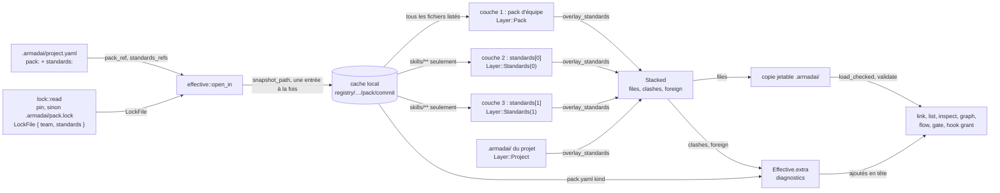
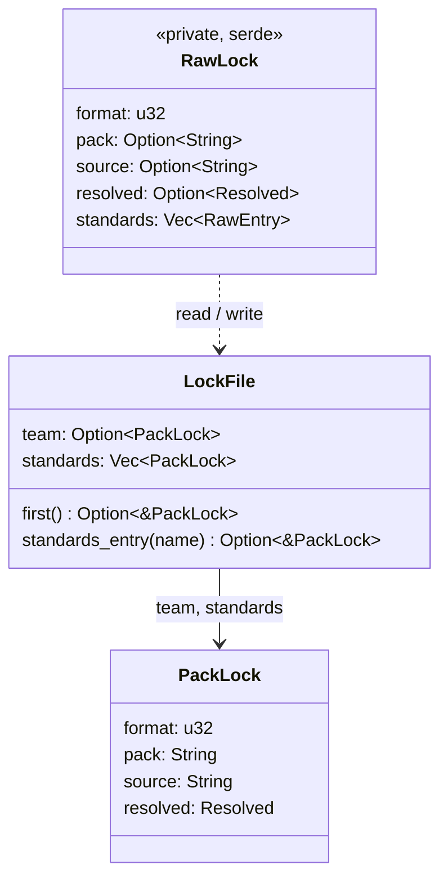
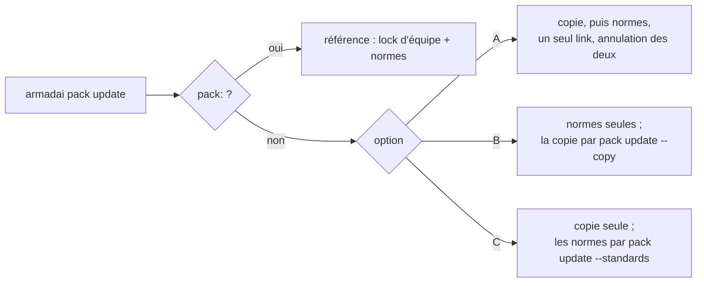

# Plan du lot C : les packs de normes

- Spec : `docs/superpowers/specs/2026-11-13-lot-c-packs-normes-design.md` (commit `df23795` après les rebases).
- Cadre : réponse de `framer` du 2026-11-13, décisions Q1 à Q5 de Dimitri du 2026-11-13. Elles ne sont pas rouvertes ici.
- Branche : `feat/lot-c-normes`, worktree `armadai-lotc`.
- Mesures : lecture du code par `architect` et trois passes d'`Explore` (lecture seule, 2026-11-13), citées « (Explore) ». Rien n'a été compilé ni lancé pour écrire ce plan.
- **Amendement du 2026-11-17**, après les tâches T1 à T7 et les décisions de Dimitri consignées au journal du lot C (points transmis par `lead`, le journal n'a pas été relu par `architect`). Les tâches approuvées ne se refont pas : les passages marqués « Livré » disent seulement où la livraison s'écarte du plan d'origine.

## 0. Ce que le plan tranche

### Les deux points de vérification du cadre

1. **Où vit `standards-wrong-kind` ?** Dans `crates/armadai`, pas dans le validateur d'`armadai-model`. Le type de `pack.yaml` est `armadai_core::starter::StarterPack` (`crates/armadai-core/src/starter.rs:16-33`), et `pack.yaml` n'entre jamais dans la vue effective : `native_pack::files` ne garde que la liste blanche (Explore). Le validateur pur ne voit donc jamais le `kind`. Il y a un précédent : `pack-test-path-escapes` et `ignored-pack-file` sont déjà émis dans `crates/armadai/src/cli/native_pack.rs:16-17`. La même règle range deux autres codes :
   - `standards-foreign-file` et `standards-skill-no-slot` sont émis dans `crates/armadai`, par un module neuf `pack/standards.rs`.
   - Pour `duplicate-standards-skill`, la détection est pure : `armadai_model::pack::overlay_standards` rend les collisions. Le diagnostic, lui, est construit dans `crates/armadai`, parce qu'il pointe le `SKILL.md` réel du snapshot.
   - `standards-empty-source` et `standards-empty-version` sont émis dans `crates/armadai-model/src/check.rs`, à côté de `pack-empty-source` et `pack-empty-version` (`check.rs:765-790`).
2. **`pack.yaml` est-il en `deny_unknown_fields` ?** Non (`starter.rs:16-33`, Explore). Le `kind` s'ajoute donc comme un champ optionnel de `StarterPack`, valeur par défaut `team`. Un binaire plus ancien l'ignore en silence : il lit un pack de normes comme un pack d'équipe qui ne porte que des skills. C'est inoffensif, et le CHANGELOG le dira. Il n'existe pas de schéma JSON de `pack.yaml` (`schemas/v1/` n'en a pas, Explore) : rien à régénérer pour `kind`. En revanche `project.schema.json` est régénéré pour `standards:`.

### Choix de conception (options, coût, recommandation)

**C1. Forme en mémoire du lock à N entrées.**

| Option | Coût | Effet |
|---|---|---|
| a. `PackLock` reçoit un champ `standards: Vec<…>`, et `pack`/`source`/`resolved` restent obligatoires | petit | un projet à `standards:` sans `pack:` n'a pas de lock possible : l'objectif 2 de la spec (« ou sans pack d'équipe ») n'est pas tenu |
| b. Rendre `pack`, `source` et `resolved` de `PackLock` optionnels | moyen | chaque lecteur déballe un `Option` ; `lock.pack` partout devient fragile |
| **c. `LockFile { team: Option<PackLock>, standards: Vec<PackLock> }`, sérialisé par une forme brute privée (`RawLock`)** | moyen, mécanique | un seul lecteur ; `PackLock` reste le type d'**une** entrée ; un lock rc.13 se relit et se réécrit octet pour octet |

Recommandation : **c**. `lock::read` change de type de retour et l'ancien `read() -> PackLock` disparaît. C'est la règle : supprimer la primitive tentante, pour qu'aucun lecteur ne lise l'équipe en oubliant les normes.

**C2. Fusion à N couches.** On garde `overlay(pack, project)` tel quel en façade, et on ajoute `overlay_standards(team, standards, project)`. `overlay` délègue à `overlay_standards(Some(pack), &[], project)`. Les tests existants d'`overlay` restent intacts : ils gardent le comportement à une couche.

**C3. Le dossier d'une skill de normes est une unité.** Quand le projet a `skills/<id>/`, le dossier de normes du même id est retiré **entier**, sans mélange fichier par fichier. Sinon les `scripts/` de deux packs se mélangeraient. Pour le pack d'équipe, la règle reste celle d'aujourd'hui (fusion par chemin) : la spec §4.4 la déclare inchangée.

**C4. `standards:` reste dans le `project.yaml` fusionné** (`pack:` en est retiré, comme aujourd'hui). C'est ce qui permet au validateur de voir une entrée vide et d'émettre `standards-empty-*`. Une entrée vide n'est pas cherchée au lock (`open_in` la saute), donc `validate` montre le diagnostic positionné au lieu d'un refus de lock. Sans `standards:`, rien ne change.

**C5. `pack add --standards` dans un `project.yaml` qui a déjà `standards:`.**

| Option | Coût | Effet |
|---|---|---|
| a. Réécrire le fichier par l'écrivain canonique | petit | les commentaires de l'utilisateur sont perdus |
| **b. Insérer l'entrée à la fin du bloc `standards:` quand il est en liste bloc (la forme que `pack add` écrit), refuser toute autre forme avec un message qui dit quoi faire** | petit | les commentaires restent ; une liste en ligne (`[…]`) est refusée, jamais réécrite |

Recommandation : **b**.

**C6. Les référents.** Les packs de normes ne sont **pas** enregistrés dans `pack-referents.yaml`. `referents::standing` lit `pack:` seul (`referents.rs:123`, Explore) : un projet à normes seules y figurerait « no longer references ». Conséquence : `pack status` n'a pas de ligne `Projects referencing it:` pour une entrée de normes, et `pack update` ne liste pas les autres projets d'une norme. C'est une limite écrite au wiki.

**C7. `pack test` sans dossier** teste le pack d'équipe seul, comme aujourd'hui. Un pack de normes se teste par `armadai pack test <dossier>`. Un projet à normes seules reçoit le message existant `this project references no pack: give a pack folder, armadai pack test <dir>`, inchangé.

**C8. Un pack `kind: standards` référencé par `pack:`** est accepté : c'est un pack d'équipe qui ne porte que des skills. Seul `standards:` exige `kind: standards`.

**C9. Rebase sur le lot 14 (master `a21f358`).** La règle du `.git` le plus proche du lot 14 s'applique au lot C :
- `lock::pin_path` passe par `worktree::git_dir_checked` et rend `anyhow::Result<Option<PathBuf>>` ; un `.git` qui ne mène à aucun dossier git est une erreur (T14), jamais un repli sur un autre checkout (vérifié dans `pack/lock.rs:144-156`) ;
- `lock::read` (donc `read_pin`) refuse sur un `.git` cassé (T14) au lieu de lire le lock commité ;
- `check_outgoing_links` (`cli/link.rs`) concerne un projet qui a `pack:` **ou** `standards:` : le test passe par `effective::references_packs`, et non plus par `pack:` seul.

**C10. Décisions de Dimitri pendant les tâches** (journal du lot C) :
- T2 : un lock commité illisible fait refuser `pack add`, qui n'écrit rien (« Refuser et dire pourquoi ») ;
- T3 : un pack cité dans `standards:` qui n'est pas `kind: standards` émet `standards-wrong-kind` **et** un `standards-foreign-file` par fichier hors `skills/`, `project.yaml` compris (« wrong-kind + foreign-file ») ; c'est ce que disait déjà la §2 ;
- T5 : `pack update` et `pack add` ôtent du lock les entrées de normes qui ne sont plus déclarées (« L'ôter du lock ») ; l'annulation du cas combiné (copie et normes) garde le message de la copie, `NOT_APPLIED_COPY` (« Garder le texte actuel ») ;
- T6 : le `pack.yaml` de `pack new --kind standards` met sa description entre guillemets JSON (« Guillemets, plan amendé »), voir N4.

## 1. Contraintes globales (toutes les tâches)

- Règles du dépôt : skill `armadai-rules` (barrière complète, `CARGO_TARGET_DIR` privé au worktree, `/usr/bin/grep`, `/bin/ls`, jamais `git stash`, aucune tâche en arrière-plan, `HOME` et `ARMADAI_CONFIG_DIR` isolés pour tout essai du binaire).
- **Sortie identique à l'octet sans `standards:`** (anti-objectif de la spec, règle « clé opt-in »). Aucune tâche ne modifie un fichier existant sous `crates/armadai/tests/golden/` : elle en ajoute seulement. Le `guardian` de chaque tâche vérifie que `git diff --stat master -- crates/armadai/tests/golden` ne liste que des fichiers neufs. Les gardes de cet octet près sont nommés en §4.
- `armadai-model` reste pur ; `armadai-core` et `armadai-model` compilent seuls.
- Chaque code neuf entre dans la table de `docs/wiki/project-format.md` dans la tâche qui l'émet. Aucun code n'est renommé.
- Lock et pin restent en `format: 1` : champ `standards` optionnel, absent quand la liste est vide. Un test relit un lock écrit par rc.13 et le réécrit à l'identique.
- Aucun test n'ouvre le réseau. Une source de normes est un dépôt git local servi en `file://`, sur le modèle d'`Env::release` de `crates/armadai/tests/pack_cmd.rs:717` (Explore). Un test unitaire du cache passe par `StarterFetcher` (`cache.rs:568`, `struct Local`). Livré : les tests de `pack_link.rs` (T4, T7) posent les snapshots à la main dans le cache au lieu de servir une source `file://` ; c'est équivalent, puisque `link` n'accède jamais au réseau.
- Fixtures à valeurs distinctes deux à deux (noms de packs, ids de skills, versions et commits différents) ; assertions sur des lignes entières.
- Chaque test nommé ci-dessous vient avec sa mutation : la casser, voir rouge, restaurer avec une mtime neuve (`touch`), reporter la sortie.
- Les textes de sortie de la §5 sont ceux du plan, validés par Dimitri à la relecture. Un spécialiste qui veut en changer un le rend à `lead`, il ne l'improvise pas.
- Ordre de coupe si le lot déborde (spec §6) : T1-T3, puis T4, puis T5-T6, puis T7.

## 2. La vue effective à N couches



Lecture du schéma :

- Les couches s'empilent de gauche à droite. D'abord le pack d'équipe (s'il y en a un), puis chaque pack de normes dans l'ordre de `standards:`, puis le projet. Seuls les fichiers `skills/**` d'un pack de normes entrent dans la vue ; tout autre fichier listé devient un `standards-foreign-file`, `project.yaml` compris. Un pack d'équipe cité dans `standards:` reçoit donc `standards-wrong-kind` et un `standards-foreign-file` par fichier hors `skills/` (décision de Dimitri, T3, C10).
- Deux sources de pack qui apportent le même id de skill donnent `duplicate-standards-skill` (erreur). Cela vaut pour normes contre normes et pour équipe contre normes. Si le projet a `skills/<id>/`, la collision tombe et c'est la skill du projet qui est lue (C3).
- Les diagnostics de la vue (`extra`) précèdent ceux du validateur. `load_checked` échoue s'ils contiennent une erreur : `link` s'arrête avant d'écrire, `list`, `graph`, `flow` et le gate refusent.
- Sans `standards:`, `open_in` suit exactement le chemin d'aujourd'hui (lecture en place, ou une seule couche de pack).

Forme du lock (C1) :



Le fichier sur disque garde l'ordre `format`, `pack`, `source`, `resolved`, puis `standards` (omis s'il est vide). Un lock rc.13 est donc le même texte.

## 3. Les lecteurs du lock, un par un

Inventaire d'`Explore`, vérifié sur `effective.rs`, `lock.rs`, `status.rs`, `pack/mod.rs`, `cli/pack.rs` et `pack_test.rs`. Depuis le rebase sur le lot 14 (C9), tout lecteur qui passe par `lock::read` ou `read_pin` refuse sur un `.git` cassé (T14).

| Lecteur | Où (aujourd'hui) | Ce qu'il fait des normes | Tâche | Test qui le prouve |
|---|---|---|---|---|
| Gate de politique | `claude_adapter/policy_gate.rs:129` `decide` → `effective::open` | rien à changer : la vue ouvre les normes ; une vue qui ne s'ouvre pas (lock sans l'entrée, cache absent) est refusée par le message existant `the project's pack cannot be read, so the delegation policy cannot be checked: <cause>` | T4 | `the_gate_denies_when_a_standards_entry_is_not_locked` |
| Hook `grant` | `claude_adapter/grant_hook.rs:266` `project_rules` → vue `.ok()?` | rien à changer : vue illisible = aucun avis, jamais `allow` (règle du hook de sécurité) | T4 | `the_grant_hook_has_no_opinion_when_a_standards_entry_is_not_locked` |
| `pack test` | `cli/pack_test.rs:255` `locked_snapshot_of` | lit `lock.team` seul (C7) | T2 | `pack_test_reads_the_team_entry_of_a_lock_with_standards` |
| `list` | `cli/list.rs:19` `load_with_origins` → vue | la ligne de prise nomme le pack de normes d'une skill | T6 | `list_names_the_standards_pack_of_a_slot_skill` |
| `inspect` | `cli/inspect.rs:5,9,64` | les lignes `Slots:` comme `list` ; `place` (agents) inchangé, un pack de normes n'a pas d'agent | T6 | `inspect_names_the_standards_pack_of_a_slot_skill` |
| `pack pin` | `pack/lock.rs:129` `pin` | copie le `LockFile` entier ; accepte un projet à normes seules | T6 | `pin_copies_every_entry_and_a_standards_only_project_pins` |
| `pack unpin` | `pack/lock.rs:156`, `cli/pack.rs:156-167` | une ligne par entrée retirée | T6 | `unpin_says_each_entry` |
| `pack status` | `pack/status.rs:119` `report`, `:58` `newer` | un bloc `Standards <nom> (reference)` par entrée ; note « newer » pour une norme | T6 | `status_shows_each_standards_pack` et `the_newer_note_names_a_standards_pack` |
| `pack update` | `pack/mod.rs:296` `update_in` | avance aussi chaque entrée de normes ; refus sous pin avant le réseau ; ôte du lock une entrée de normes qui n'est plus déclarée (C10) | T5 | `update_moves_every_standards_lock` et `update_under_a_pin_is_refused_before_the_network_with_standards` ; garde des entrées déclarées : tests passés en T2, reformulés en T5 |
| `pack add` | `pack/mod.rs:409` `add_in` | `--standards` ajoute une entrée ; un pack d'équipe ajouté garde les entrées de normes déclarées et ôte les autres ; un lock commité illisible fait refuser la commande, rien n'est écrit (C10) | T2, T5 | `add_standards_writes_the_entry_the_lock_and_links` ; garde des entrées : tests passés en T2, reformulés en T5 |
| `pack sync` | `cli/pack.rs:214` `sync`, `:306` `check_lock` | synchronise les sources des normes et pose leurs snapshots ; avertissements de tag par entrée | T5 | `sync_lays_the_snapshot_of_each_standards_entry` |
| `snapshot_path` | `pack/effective.rs:119` | vérifie le nom et la source de chaque entrée | T3 | tests de messages de T3 |
| `check_outgoing_links` | `cli/link.rs:921` (`read_pin(..).is_some()`) | type seul (`LockFile`) ; livré après rebase (C9) : s'applique à un projet qui a `pack:` ou `standards:` (`effective::references_packs`) | T2, T4 | test existant `link_outgoing_links.rs` inchangé |
| Rapport de `link` | `cli/link.rs:861` `report_view` | ligne `standards <nom>`, lignes de prise non consommée, provenance dans les lignes de prise | T4 | voir T4 |
| `armadai skills` | `cli/skills.rs:507` (`match &v.pack`) | une skill de normes affiche `standards <nom>, skills/<id>` | T6 | `skills_lists_a_standards_skill_with_its_pack` |
| `pack new --from-project` | `cli/pack.rs:404` `status::declared` | refuse aussi un projet à `standards:` | T6 | `new_from_project_refuses_a_project_with_standards` |
| Référents | `pack/referents.rs:123` `standing` | inchangé (C6) | — | — |
| Lecteurs par la vue sans code à changer | `validate.rs:10`, `unlink.rs:19,760`, `flow.rs:137,701`, `graph.rs:80`, `grant.rs:391`, `new.rs:455,512`, `new_wizard.rs:252`, `native_pack.rs:296`, `pack/mod.rs:185,227` | voient les normes par la vue | T3 (vue) | `unlink_after_a_link_with_standards_restores_the_tree` (T4), `validate` en T3 |
| `armadai models` | `cli/models.rs:218,380` (`armadai_model::load_checked(root)`, hors vue) | inchangé : ne réécrit que les fichiers du projet | — | — |

## 4. Les gardes de la sortie identique sans `standards:`

| Garde | Où | Ce qu'elle prouve |
|---|---|---|
| Étalons de `link` (aucun fichier modifié) | `tests/link_golden.rs:101`, `golden/link/*.txt` ; `link_migrated_golden.rs` | rapport et fichiers écrits inchangés |
| Étalons `init --pack` des 8 packs existants (aucun fichier modifié) | `tests/init_pack_golden.rs:136,176`, `golden/init_pack*/` | installation et `link` inchangés |
| Chaînes exactes de `pack status` | `tests/pack_cmd.rs:451,549,561,2476,2514` | `pack status`, ligne de pin |
| `a_lock_written_before_the_pin_existed_still_reads` (existant) et `an_rc13_lock_is_rewritten_byte_for_byte` (T2, neuf) | `pack/lock.rs` | lock relu et réécrit à l'octet près |
| Tests d'`overlay` existants | `armadai-model/src/pack.rs:148-337` | fusion à une couche inchangée |
| `a_plain_project_is_read_in_place` (existant) | `pack/effective.rs:439` | un projet sans pack ni normes n'est pas copié |
| `pack_link.rs:277` `link_reads_the_lock_not_the_range` (existant) | ligne `pack <nom>: compiled (…)` inchangée |
| `the_slot_line_of_a_team_pack_skill_is_unchanged` (T4, neuf) | `compile/mod.rs` | la provenance n'annote que les skills de normes |

## 5. Les textes de sortie nouveaux (à valider par Dimitri)

Une sortie se compose ainsi : `<nom>` est le nom d'un pack, `<v>` une version, `<id12>` les 12 premiers caractères du commit (ou du digest sans `sha256:`), `<src>` une source masquée comme aujourd'hui (`source::recorded`) et `<at>` vaut `tag <tag>, <id12>` ou `<id12>` (`status.rs:111`).

### 5.1 Erreurs d'ouverture de la vue (`link`, `list`, `inspect`, `graph`, `flow`, `validate`… ; préfixe `Error: ` d'anyhow)

| Cas | Texte |
|---|---|
| E1. `standards:` sans lock du tout | ``.armadai/project.yaml references standards <nom> but .armadai/pack.lock is missing: run `armadai pack update` `` |
| E2. lock présent, entrée absente | ``.armadai/project.yaml references standards <nom> but .armadai/pack.lock has no entry for it: run `armadai pack update` `` |
| E3. pin présent, entrée absente | `.armadai/project.yaml references standards <nom> but the pack pin of this checkout has no entry for it: run armadai pack unpin, then armadai pack update` |
| E4. lock pour une autre source | ``.armadai/pack.lock is for standards <nom> from <src-lock>, but .armadai/project.yaml references <nom> from <src>: run `armadai pack update` `` |
| E5. pin pour une autre source | `the pack pin of this checkout is for standards <nom> from <src-pin>, but .armadai/project.yaml references <nom> from <src>: run armadai pack unpin` |
| E6. snapshot absent du cache (critère 8) | ``standards <nom> <v> (<id12>) is not in the local cache: run `armadai pack sync` `` |
| E7. même nom deux fois dans `standards:` | `.armadai/project.yaml references standards <nom> twice: keep one entry` |
| E8. le `project.yaml` d'un pack d'équipe porte `standards:` | `pack <nom>: its own project.yaml references standards packs (standards:), which is not supported` |
| E9. lock dont l'équipe est incomplète (`pack` sans `source` ou `resolved`) | `<.armadai/pack.lock, ou the pack pin of this checkout>: pack, source and resolved go together` |
| E10. nom ou id invalide d'une entrée de normes au lock | `standards <nom> has an invalid name or version id: <valeur>` |

E1, E2 et E3 suivent la règle du 2026-11-13 (`link` s'arrête et nomme `armadai pack update`). Sous un pin, `pack update` est refusé : E3 nomme donc d'abord `armadai pack unpin`.

### 5.2 Diagnostics (`validate`, et `link` qui s'arrête dessus)

Rendu existant : `file:line:column: error[code]: message` puis `hint: …`.

| Code | Sévérité | Fichier | Message | Hint |
|---|---|---|---|---|
| `standards-foreign-file` | error | `<pack>/<rel>` | ``a standards pack holds only skills: `<rel>` is not under skills/`` | `move it to a team pack, or remove it` |
| `standards-skill-no-slot` | warning | `<pack>/skills/<id>/SKILL.md` | `skill <id> fills no slot: no agent will receive it from this pack` | `add metadata: { armadai-slot: <slot> } to its frontmatter` |
| `duplicate-standards-skill` | error | `SKILL.md` de la seconde source | `skill <id> comes from both <a> and <b>` (où `<a>` et `<b>` valent `pack <nom>` ou `standards <nom>`, dans l'ordre des couches) | `remove one of the two packs, or put your own skills/<id>/ in .armadai/ to choose` |
| `standards-empty-source` | error | `.armadai/project.yaml` | `` `standards[<i>].source` is empty `` | `the URL of the pack's source, as in registries.yaml` |
| `standards-empty-version` | error | `.armadai/project.yaml` | `` `standards[<i>].version` is empty `` | `latest, a version such as 1.2.3, or a range such as ^1.3` |
| `standards-wrong-kind` | error | `<snapshot>/pack.yaml` | `standards <nom> is a team pack (its pack.yaml has no kind: standards): reference it with pack:, not standards:` | `if it holds only skills, add kind: standards to its pack.yaml` |
| `bad-id` (existant) | error | `.armadai/project.yaml` | message existant `` `<nom>` is not a valid id `` sur `standards[<i>].name` | hint existant |

`<i>` est l'index de l'entrée, à partir de 0. Le chemin JSON du diagnostic (`path`) vaut `standards[<i>].source` (ou `.version`, ou `.name`).

### 5.3 Rapport de `link` (texte `<cible>: <élément>: <statut> (<raison>)` ; `--json` : mêmes lignes, champs inchangés)

| Ligne | Texte (cible `claude` en exemple) |
|---|---|
| R1. un pack de normes lu | `claude: standards <nom>: compiled (<v> (<id12>), from the cache)` |
| R2. prise remplie, provenance | `claude: agent implementer slot code-standards: compiled (project-standards, rust-conventions from rust-std)` : chaque skill venue d'un pack de normes est suivie de ` from <nom>` ; une skill du projet ou du pack d'équipe est écrite seule, comme aujourd'hui |
| R3. skill de normes sur une prise qu'aucun agent ne déclare (une ligne par prise) | `claude: standards <nom> skill <id>: not-compiled (no agent declares slot <slot>)` |
| inchangée | `claude: agent <id> slot <s>: not-compiled (no skill fills it)` |
| inchangée | la ligne `approximated` de la session principale de Claude (`NO_PRELOAD`) : la provenance n'y est pas ajoutée |

### 5.4 `pack add --standards`, `pack update`, `pack sync`

| Cas | Texte |
|---|---|
| A1. ajout réussi (stdout) | `Added standards <nom> <v> (<id12>): .armadai/project.yaml (version: <plage>) and .armadai/pack.lock` |
| A2. déjà référencé | ``.armadai/project.yaml already references standards <nom>: use `armadai pack update` `` |
| A3. `standards:` dans une forme que `pack add` n'étend pas (C5) | ``.armadai/project.yaml has a standards: key that pack add cannot extend (not a block list): add the entry by hand, then run `armadai pack update` `` |
| A4. le pack ajouté n'est pas `kind: standards` | le diagnostic `standards-wrong-kind` (§5.2), puis la ligne existante de `check`, adaptée : `standards <nom> <v> would make the project invalid; nothing was changed` |
| U1. une norme avancée | `Standards <nom>: <ancienne> -> <v> (<id12>), .armadai/pack.lock updated` (`<ancienne>` vaut `(none)` pour une entrée qui n'était pas au lock) |
| U2. une norme à jour | `Standards <nom> is up to date: <v> (<id12>)` |
| U3. `pack update <version>` sans `pack:` | `pack update <version> moves the pack: of .armadai/project.yaml, and this project has none; armadai pack update alone moves its standards` |
| U4. lien échoué après un update de normes (annulation) | `standards <nom> <v> was not applied: link failed, so .armadai/pack.lock, the referent record and the files link had written are back as they were` (même forme que le message existant, `pack` remplacé par `standards`). Cas combiné (pack copié et normes) : le message existant de la copie, `NOT_APPLIED_COPY`, inchangé (décision de Dimitri, C10) |
| U6. aucune version en cache ne tient la plage d'une norme (livré en T5, **à valider par Dimitri en PR**) | `no cached version of standards <nom> matches <range> …` (la suite de la ligne est celle du message existant pour `pack`) |
| H1. aide de `pack add --standards` (livré en T5, **à valider par Dimitri en PR**) | ``Add it to `standards:` (a pack of skills only) instead of making it the project's pack`` |
| U7. `pack pin`, `pack status` ou `pack update` sur un projet dont `standards:` ne porte que des entrées inachevées, sans `pack:` (livré, `pack/effective.rs` `unfinished_standards` ; décision de Dimitri du 2026-11-17, « Renvoyer à validate (Recommandé) » ; **à valider par Dimitri en PR**) | ``.armadai/project.yaml has a standards: entry that is not complete: fix the errors `armadai validate` reports in standards:, then run `armadai pack <cmd>` again`` (`<cmd>` vaut `pin`, `status` ou `update`) |
| U5. refus sous un pin à normes seules (avant le réseau) | `refused: this checkout pins standards <nom> <v> (armadai pack pin); run armadai pack unpin first` (avec un pack d'équipe au pin, le texte existant ne change pas) |
| S1. note d'une source de normes hors `registries.yaml` | `note: <src> comes from .armadai/project.yaml (standards <nom>), not from your registries.yaml` |
| S2. tag déplacé | `  warn: tag <tag> of standards <nom> now points to <new12>, .armadai/pack.lock says <old12>: the lock is kept (link uses its commit)` (sous un pin : les variantes existantes, `pack` remplacé par `standards`) |
| S3. tag disparu | `  warn: tag <tag> of standards <nom> no longer exists, .armadai/pack.lock keeps <old12>` (même règle sous un pin) |
| N1. note de version plus récente (`link`, `list`, `inspect`, `pack sync`) | ``note: standards <nom> <v> is in the cache (locked: <ancienne>): run `armadai pack update` `` |

### 5.5 `pack status`, `pack pin`, `pack unpin`, `pack new`

`pack status`, un bloc par entrée de normes, après le bloc `Pack` et séparé par une ligne vide (pas de section `Projects referencing it:`, C6) :

```
Standards rust-std (reference)
  source:    https://example.com/standards.git
  range:     ^1.0.0
  locked:    1.0.0 (tag rust-std-v1.0.0, 0123456789ab)
  in cache:  1.0.0 matches the range (newest: 1.1.0)
```

| Cas | Texte |
|---|---|
| P1. ligne de pin sous `locked:` d'un bloc `Standards` | `  pinned (worktree): <v> (<at>)` (suffixe existant ` (not in cache: run armadai pack sync)`) |
| P2. le pin n'a pas cette entrée | `  pinned (worktree): no entry (run armadai pack unpin)` |
| P3. bloc `Standards` sans entrée au lock commité | E2 (ou E1 sans lock), comme `lock_missing` pour `pack:` aujourd'hui |
| P4. `pack pin`, une ligne par entrée de normes (après la ligne existante du pack d'équipe) | `pinned standards <nom> <v> for this checkout; pack update is refused here until armadai pack unpin` |
| P5. `pack pin` déjà épinglé, à normes seules | `this checkout already pins standards <nom> <v>; run armadai pack unpin first` |
| P6. `pack unpin`, une ligne par entrée de normes | `unpinned standards <nom> (was <v>); this checkout follows .armadai/pack.lock (<maintenant>) again` (`<maintenant>` = l'entrée commitée, ou `missing`) |
| P7. `pack pin` sans `pack:` ni `standards:` | texte existant, inchangé. Livré : une entrée de normes inachevée (source ou version vide) est ignorée par `pin`, `status` et `newer` et laissée à `validate` ; un projet dont `standards:` ne porte que des entrées inachevées, sans `pack:`, ne reçoit pas P7 mais U7 (§5.4 ; décision de Dimitri du 2026-11-17, « Renvoyer à validate (Recommandé) ») |
| N2. `pack new <nom> --kind standards` | `Created pack <nom> in <dossier>: pack.yaml, skills/` |
| N3. `pack new --from-project` dans un projet à `standards:` | `this project references standards <nom>: its .armadai/ is an overlay, not a pack; create the pack from its source instead` (le premier nom de la liste) |
| N4. `pack.yaml` d'un `pack new --kind standards` | `format: 1\nname: <nom>\nkind: standards\ndescription: "<description>"\n` : description entre guillemets JSON, même règle que les packs d'équipe ; par défaut `description: "A standards pack"` (amendé, décision de Dimitri « Guillemets, plan amendé », C10) |

### 5.6 `list`, `inspect`, `skills`

| Cas | Texte |
|---|---|
| L1. `list`, section `Slots:` | `  code-standards: project-standards, rust-conventions from rust-std` (même règle que R2) |
| L2. `inspect <agent>`, lignes `Slots:` | même valeur que L1, dans la colonne existante |
| L3. `armadai skills`, origine d'une skill de normes | `standards <nom>, skills/<id>` (sur le modèle de `pack <nom>, skills/<id>`) |

## 6. Les tâches

Ordre : T1 → T2 → T3 → T4 → T5 → T6 → T7 → T8. T5 et T6 sont indépendantes l'une de l'autre une fois T4 faite. T7 ne dépend que de T1 et T3.

### T1 — Modèle : `standards:`, codes, fusion à N couches, `kind` (schema-specialist)

Fichiers :
- `crates/armadai-model/src/types.rs` : `Manifest` reçoit `#[serde(default, skip_serializing_if = "Vec::is_empty")] pub standards: Vec<PackRef>`.
- `crates/armadai-model/src/check.rs` : à côté du bloc `pack:` (`:745-790`), une boucle sur `m.standards` qui émet `bad-id` sur `name`, `standards-empty-source` et `standards-empty-version` (textes §5.2). La position est cherchée dans le bloc `standards:`, sur le modèle de `key_end(t, "pack")`.
- `crates/armadai-model/src/pack.rs` :
  ```rust
  pub enum Layer { Pack, Standards(usize), Project, Merged }   // reste Copy
  pub enum OverlayError { InvalidYaml { layer: Layer, message: String }, NestedPack, NestedStandards }
  pub struct SkillClash { pub skill: String, pub first: Option<usize>, pub second: usize } // None = pack d'équipe
  pub struct Stacked {
      pub files: BTreeMap<PathBuf, (Layer, Vec<u8>)>,
      pub clashes: Vec<SkillClash>,
      pub foreign: Vec<(usize, PathBuf)>,   // (index de la couche de normes, chemin relatif)
  }
  pub fn overlay_standards(
      team: Option<&BTreeMap<PathBuf, Vec<u8>>>,
      standards: &[&BTreeMap<PathBuf, Vec<u8>>],
      project: &BTreeMap<PathBuf, Vec<u8>>,
  ) -> Result<Stacked, OverlayError>;
  // overlay(pack, project) = overlay_standards(Some(pack), &[], project)?.files
  ```
  Règles : seuls les fichiers `skills/<id>/…` d'une couche de normes entrent dans la vue, les autres vont dans `foreign`. Il y a collision quand un id de skill vient de deux couches de pack et que le projet n'a aucun fichier sous `skills/<id>/`. Dans ce cas le dossier de la seconde couche n'entre pas et la collision est rendue. Si le projet a `skills/<id>/`, le dossier de normes du même id est retiré entier (C3). Le `project.yaml` fusionné retire le `pack` du projet et garde son `standards` (C4). `NestedStandards` est rendu quand le `project.yaml` du pack d'équipe a `standards`. Sans `standards` ni projet (`(None, None)`), le comportement reste celui d'aujourd'hui, branche par branche.
- `crates/armadai-model/src/slots.rs` : `filled_by` devient `pub` (T4 en a besoin), réexporté dans `lib.rs`.
- `crates/armadai-core/src/starter.rs` : `#[derive(Default, Deserialize, PartialEq, Eq, Debug, Clone, Copy)] #[serde(rename_all = "lowercase")] pub enum PackKind { #[default] Team, Standards }` et, dans `StarterPack`, `#[serde(default)] pub kind: PackKind`.
- `schemas/v1/project.schema.json` : régénéré (`cargo run -p armadai-model --example gen_schemas`).
- `docs/wiki/project-format.md` : la clé `standards:` dans l'exemple de `project.yaml` et un paragraphe ; les lignes `standards-empty-source` et `standards-empty-version` dans la table ; `standards[].name` dans la ligne `bad-id`.

Étapes :
- [ ] `Manifest.standards` et le schéma régénéré.
- [ ] Les codes de `check.rs` et leurs positions.
- [ ] `overlay_standards`, `Layer::Standards`, `NestedStandards`, et `overlay` qui délègue.
- [ ] `PackKind`.
- [ ] La documentation de la tâche.

Tests (unitaires, `armadai-model` et `armadai-core`) :

| Test | Mutation qui le fait rougir |
|---|---|
| `two_standards_layers_add_their_skills` : deux couches, skills `a-std` et `b-std`, chacune avec son `Layer::Standards(i)` | sauter la seconde couche (`standards.iter().take(1)`) |
| `a_skill_in_two_standards_is_a_clash` : rend `SkillClash { skill, first: Some(0), second: 1 }` | ne pas pousser la collision |
| `a_skill_in_the_team_pack_and_a_standards_is_a_clash` : rend `first: None` | comparer seulement les couches de normes entre elles |
| `the_project_skill_lifts_the_clash_and_takes_the_whole_folder` : normes avec `skills/s/scripts/x.sh`, projet avec `skills/s/SKILL.md` seul ; aucune collision, `x.sh` absent | garder les fichiers de normes non recouverts |
| `a_standards_layer_keeps_only_skills` : `agents/a.md` et `project.yaml` d'une couche de normes vont dans `foreign`, pas dans `files` | accepter tout fichier listé |
| `a_team_pack_with_standards_is_refused` : rend `NestedStandards` | retirer le contrôle |
| `the_merged_manifest_keeps_standards_and_drops_pack` | retirer `standards` comme `pack` |
| tests existants d'`overlay` (inchangés) | — (garde de l'octet près) |
| `standards_entries_are_checked` : `standards-empty-source`, `standards-empty-version` et `bad-id` sur trois entrées distinctes, `path` exact | intervertir les codes, ou tester `pack` au lieu de `standards` |
| `pack_kind_defaults_to_team_and_reads_standards` : absent → `Team`, `standards` → `Standards`, `other` → erreur | `#[serde(default)]` retiré, ou variante renommée |

Commit : `feat(model): standards key, codes and layered overlay`

### T2 — Le lock à N entrées, tous les lecteurs mis à jour sans changer de comportement (cli-specialist)

Fichiers : `crates/armadai/src/pack/lock.rs`, et chaque appelant de `lock::read`, `read_pin`, `read_committed`, `write`, `pin`, `unpin` et `pinned_refusal` listé en §3 (`effective.rs`, `status.rs`, `pack/mod.rs`, `cli/pack.rs`, `cli/pack_test.rs`, `cli/link.rs:921`, les tests de `policy_gate.rs` et `grant_hook.rs`).

Interfaces :
```rust
pub struct LockFile { pub team: Option<PackLock>, pub standards: Vec<PackLock> }
impl LockFile {
    pub fn first(&self) -> Option<&PackLock>;                 // team, sinon standards[0]
    pub fn standards_entry(&self, name: &str) -> Option<&PackLock>;
}
pub fn read(root: &Path) -> anyhow::Result<Option<LockFile>>;
pub fn read_pin(root: &Path) -> anyhow::Result<Option<LockFile>>;
pub fn read_committed(root: &Path) -> anyhow::Result<Option<LockFile>>;
pub fn write(root: &Path, lock: &LockFile) -> anyhow::Result<()>;
pub fn pin(root: &Path) -> anyhow::Result<LockFile>;
pub fn unpin(root: &Path) -> anyhow::Result<Option<LockFile>>;
pub fn pinned_refusal(pin: &LockFile) -> String;              // texte existant pour team, U5 sinon
// privé : RawLock / RawEntry en deny_unknown_fields, ordre des champs §2
```
`PackLock` reste le type d'une entrée. Pour une entrée de normes, son `format` est celui du fichier. Dans cette tâche, tous les lecteurs ne prennent que `team`, et les normes sont lues et réécrites sans être utilisées : comportement identique.

Étapes :
- [ ] `RawLock`, `LockFile`, lecture et écriture ; erreur E9.
- [ ] Remplacer chaque lecteur (§3) par `.team` ; `pin` et `unpin` copient et retirent le fichier entier.
- [ ] `pack test` lit `lock.team` (C7).

Tests :

| Test | Mutation |
|---|---|
| `an_rc13_lock_is_rewritten_byte_for_byte` : le texte exact d'un lock rc.13 → `read` → `write` → même texte | retirer `skip_serializing_if` sur `standards`, ou changer l'ordre des champs |
| `a_lock_with_standards_roundtrips` : équipe et deux entrées, valeurs distinctes | perdre la seconde entrée à l'écriture |
| `a_standards_only_lock_reads` : `format: 1` et `standards:` seuls → `team: None` | exiger `pack` |
| `a_partial_team_is_refused` : `pack` sans `resolved` → E9 exact | accepter `pack` seul |
| `an_unknown_key_in_a_standards_entry_is_refused` | retirer `deny_unknown_fields` de `RawEntry` |
| `pack_test_reads_the_team_entry_of_a_lock_with_standards` (`pack_test.rs`) | prendre `standards[0]` |
| tests existants de `lock.rs`, `pack_cmd.rs`, `pack_link.rs`, du gate et du hook, adaptés au type seul | — |

Livré (écarts au plan d'origine) :
- Les tests « `pack update` et `pack add` d'un pack d'équipe gardent les entrées de normes déclarées » sont passés en T2 (réécrire le lock sans perdre les normes en dépend), puis ont été reformulés en T5, quand la décision « L'ôter du lock » a fixé le sort des entrées non déclarées.
- `check` et `add_in` propagent l'erreur de lecture du lock commité. Un lock commité illisible fait refuser `pack add`, qui n'écrit rien (décision de Dimitri, « Refuser et dire pourquoi », C10).

Commit : `refactor(pack): read the lock as a file of entries`

### T3 — La vue effective à N couches et les diagnostics de normes (cli-specialist)

Fichiers :
- `crates/armadai/src/pack/standards.rs` (neuf) :
  ```rust
  pub const FOREIGN: &str = "standards-foreign-file";
  pub const NO_SLOT: &str = "standards-skill-no-slot";
  pub const DUPLICATE: &str = "duplicate-standards-skill";
  pub const WRONG_KIND: &str = "standards-wrong-kind";
  pub fn foreign(pack_dir: &Path, rels: &[PathBuf]) -> Vec<Diagnostic>;
  pub fn no_slot(pack_dir: &Path, project: &armadai_model::Project) -> Vec<Diagnostic>; // via slots::filled_by
  pub fn duplicate(skill: &str, a: &str, b: &str, file: PathBuf) -> Diagnostic;      // a, b = "pack x" | "standards y"
  pub fn wrong_kind(name: &str, pack_dir: &Path) -> Diagnostic;
  ```
- `crates/armadai/src/pack/effective.rs` :
  - `pub(crate) fn standards_refs(root) -> Vec<(String, String, String)>` lit le YAML brut, comme `pack_ref`.
  - `Effective` reçoit `pub standards: Vec<LockedPack>` et un champ privé `extra: Vec<Diagnostic>`.
  - `open_in` et `open_with_lock_in` prennent un `&LockFile`. Les entrées à nom, source ou version vides, ou à nom invalide, sont sautées (C4). Messages E1 à E8, E10.
  - `snapshot_path` est généralisé à une entrée (`kind: "pack" | "standards"` pour les textes).
  - `build` lit la couche d'équipe et les couches de normes : `native_pack::files`, `StarterPack::load(snapshot)?.kind`, puis `standards::wrong_kind` si ce n'est pas `Standards`. Il appelle `overlay_standards`, convertit `clashes` et `foreign` en diagnostics sur les fichiers réels des snapshots, et tient le bit exécutable par couche.
  - `remap` et `real` couvrent `Layer::Standards(i)`, qui mène à `standards[i].snapshot`.
  - `validate()` = `extra` puis validateur ; `load_checked()` et `load_project()` échouent ou portent `extra` dès qu'il contient une erreur.
  - `pub fn skill_packs(&self) -> BTreeMap<String, String>` : id de skill → nom du pack de normes, pour les seules skills dont `SKILL.md` vient d'une couche de normes.
- `crates/armadai/src/cli/native_pack.rs` : `stage` lit le `kind`. Pour `Standards`, il ajoute `standards::foreign` (fichiers de `pack.files` hors `skills/`) et `standards::no_slot` (sur le projet jetable). Pour `Team`, rien ne change.
- `docs/wiki/project-format.md` : les lignes `standards-foreign-file`, `standards-skill-no-slot`, `duplicate-standards-skill` et `standards-wrong-kind` dans la table.

Étapes :
- [ ] `standards_refs`, la recherche au lock et les messages.
- [ ] `build` à N couches, `extra`, le remap.
- [ ] `skill_packs`.
- [ ] `stage` pour un pack de normes (critère 2).

Tests (unitaires dans `effective.rs`, avec `Fx` étendu à une seconde source ; `native_pack.rs`) :

| Test | Mutation |
|---|---|
| `a_standards_only_project_reads_the_standards_skill` : origine sur le snapshot, vue copiée | garder la lecture en place quand `pack:` est absent |
| `team_and_two_standards_are_all_read` : skills des trois couches présentes | ne lire que `standards[0]` |
| `standards_lock_messages_are_the_planned_texts` : E1, E2, E3, E4, E5, E6, E7, E10, textes entiers | inverser lock et pin dans E4/E5, ou nommer `pack` au lieu de `standards` |
| `a_team_pack_with_standards_is_refused_by_name` : E8 | — (mutation de T1, rejouée ici) |
| `a_team_pack_named_in_standards_is_wrong_kind` : `standards-wrong-kind` sur `<snapshot>/pack.yaml`, plus un `standards-foreign-file` par fichier hors `skills/` (`project.yaml` compris), `load_checked` en erreur (décision de Dimitri « wrong-kind + foreign-file », C10 ; la §2 le disait déjà) | ne pas lire `kind` |
| `a_foreign_file_of_a_standards_pack_is_an_error` : `standards-foreign-file` sur `<snapshot>/agents/a.md` | ignorer `foreign` |
| `two_sources_of_one_skill_are_named` : message exact `skill s comes from both standards std-a and standards std-b`, puis `pack demo` et `standards std-a` ; avec `skills/s/` au projet, aucune erreur et `load_checked` lit la skill du projet | inverser l'ordre des noms, ou garder l'erreur malgré la skill du projet |
| `an_empty_standards_source_is_a_diagnostic_not_a_lock_error` : `validate` rend `standards-empty-source`, aucune erreur d'ouverture | chercher l'entrée vide au lock |
| `skill_packs_names_only_standards_skills` : skills d'équipe et du projet absentes de la table | inclure `Layer::Pack` |
| `a_plain_project_is_read_in_place` (existant) | — |
| `stage_of_a_standards_pack` (`native_pack.rs`) : un agent donne `standards-foreign-file` (erreur), une skill sans prise `standards-skill-no-slot` (avertissement), un pack d'équipe de mêmes fichiers rien de neuf | tester `Team` au lieu de `Standards` |

Commit : `feat(pack): overlay the standards packs in the effective view`

### T4 — Rapport de `link`, gate, hook `grant`, `unlink` (adapter-specialist)

Fichiers :
- `crates/armadai/src/compile/mod.rs` : `slot_lines` prend un argument de plus, `skill_packs: &BTreeMap<String, String>`. Une skill présente dans la table s'écrit `<id> from <nom>` (R2). La raison `approximated` ne change pas.
- `crates/armadai/src/compile/claude.rs:413,468`, `compile/opencode.rs:576` et la chaîne d'appel depuis `cli/link.rs` `prepare` : passer `view.skill_packs()`. `legacy_targets.rs` n'appelle pas `slot_lines` (Explore) : pas de changement.
- `crates/armadai/src/cli/link.rs:861` `report_view` : R1 pour chaque `view.standards`, puis R3. Pour R3, une ligne par (skill de normes, prise) dont la prise (`armadai_model::slots::filled_by`) n'est déclarée par aucun agent du projet ; `report_view` reçoit le `Project`.
- `docs/wiki/link.md` : les lignes R1, R2 et R3.
- Livré après le rebase sur le lot 14 (C9) : `check_outgoing_links` s'applique à un projet qui a `pack:` ou `standards:` (`effective::references_packs`) ; `lock::pin_path` passe par `git_dir_checked` et `lock::read` refuse sur un `.git` cassé (T14), donc le gate et le hook `grant` refusent ou se taisent sur ce cas comme sur une vue illisible.

Étapes :
- [ ] La provenance dans `slot_lines`.
- [ ] R1 et R3 dans `report_view`.
- [ ] Les tests du gate et du hook (aucun code à changer, §3).

Tests (intégration `crates/armadai/tests/pack_link.rs`, deux packs de normes `std-a` et `std-b` plus le pack d'équipe `demo` ; livré : snapshots posés à la main dans le cache plutôt qu'une source `file://`, équivalent puisque `link` n'accède pas au réseau) :

| Test | Mutation |
|---|---|
| `link_reports_each_standards_pack` (critère 3) : ligne R1 exacte | retirer la boucle sur `view.standards` |
| `two_standards_fill_one_slot_and_are_named` (critère 4) : l'agent `.claude/agents/<id>.md` liste `a-std` puis `b-std` ; ligne R2 exacte `compiled (a-std from std-a, b-std from std-b)` | ne pas annoter, ou trier par pack |
| `the_slot_line_of_a_team_pack_skill_is_unchanged` : skill du pack d'équipe sur une prise, ligne sans ` from` | annoter toute skill hors projet |
| `an_undeclared_slot_of_a_standards_skill_is_reported` (critère 6) : R3 exacte, et la ligne `no skill fills it` d'une autre prise reste | ne regarder que la première prise de la skill |
| `a_clash_stops_link_before_writing` (critère 5) : `link` en erreur `duplicate-standards-skill`, `.claude/` absent ; après `skills/<id>/` au projet, `link` compile la skill du projet (contenu du fichier écrit comparé) | — (mutation de T3 rejouée au binaire, après `cargo build`) |
| `link_without_the_standards_snapshot_stops` (critère 8) : E6 exact, rien d'écrit | — (garde de T3 au binaire) |
| `unlink_after_a_link_with_standards_restores_the_tree` (critère 9) : arbre identique à l'état initial | ne pas inscrire au manifeste les skills de normes écrites (mutation dans `linker::manifest`) |
| `the_gate_denies_when_a_standards_entry_is_not_locked` (`policy_gate.rs`) : `deny` avec `the project's pack cannot be read, so the delegation policy cannot be checked: ` suivi d'E2 | rendre `allow` sur une vue illisible |
| `the_grant_hook_has_no_opinion_when_a_standards_entry_is_not_locked` (`grant_hook.rs`) | rendre `allow` |
| `link_golden.rs`, `init_pack_golden.rs` (existants, inchangés) | — |

Commit : `feat(link): report the standards packs and the source of slot skills`

### T5 — `pack add --standards`, `pack update`, `pack sync` (cli-specialist)

Fichiers : `crates/armadai/src/cli/pack.rs` (clap : `Add { …, #[arg(long)] standards: bool }`), `crates/armadai/src/pack/mod.rs` (`add_in` reçoit `standards: bool`, `update_in`, `Undo` reçoit un libellé `pack <nom>` ou `standards <nom>` pour U4), `cli/pack.rs` `sync` et `check_lock`, `pack/status.rs` `newer` et `note` (N1 : `Newer` reçoit `what: &'static str`).

Comportements :
- `add_in(..., standards: true)` : refus sous pin avant le réseau (U5, ou le texte existant). A2 si le nom est déjà dans `standards:`. Ensuite la même résolution de source que `pack add`, puis `check` sur la vue avec le `LockFile` augmenté (A4 en cas d'erreur). L'insertion dans `project.yaml` suit C5 : sans clé, le bloc
  ```
  standards:
    - name: <nom>
      source: '<src>'
      version: '<plage>'
  ```
  est ajouté à la fin du fichier ; avec une liste bloc, l'entrée s'insère après sa dernière ligne ; sinon A3. Viennent ensuite le lock, puis A1. Pas d'inscription aux référents (C6).
- `update_in` : le pack d'équipe comme aujourd'hui, puis chaque entrée de normes résolue dans sa plage (`resolve_in`, `ensure_snapshot_in`). Un seul `check` et un seul `lock::write` pour le `LockFile` entier, une ligne U1 ou U2 par entrée. `version` donnée sans `pack:` → U3. Projet à pack copié et à normes : voir la question Q1.
- `sync` : les sources des entrées de normes sont synchronisées comme celle du pack (S1 si elles sont hors `registries.yaml`). `check_lock` boucle sur `team` et `standards` (snapshot, puis S2 et S3 par entrée). `newer` cherche d'abord l'équipe, puis chaque entrée de normes.

Livré (écarts au plan d'origine, décisions de Dimitri en C10) :
- `check` reçoit le `LockFile` lu une seule fois.
- `pack update` et `pack add` ôtent du lock les entrées de normes qui ne sont plus déclarées dans `standards:` ; les entrées déclarées sont gardées (tests venus de T2, reformulés ici).
- Le cas combiné (pack copié et normes) : l'annulation garde le message de la copie (`NOT_APPLIED_COPY`), U4 ne vaut que pour un projet à `pack:` ou à normes seules.
- Deux textes neufs, U6 et H1 (§5.4), à valider par Dimitri en PR.
- Une entrée inachevée (source ou version vide) est ignorée par `pin`, `status` et `newer`, et laissée à `validate` (C4). Un projet dont `standards:` ne porte que des entrées inachevées, sans `pack:`, reçoit U7 (§5.4) de `pin`, `status` et `update` (décision de Dimitri du 2026-11-17, « Renvoyer à validate (Recommandé) »).

Étapes :
- [ ] `pack add --standards` et l'insertion C5.
- [ ] `pack update` sur toutes les entrées.
- [ ] `pack sync` et la note N1.

Tests (intégration `crates/armadai/tests/pack_cmd.rs`, sources git locales) :

| Test | Mutation |
|---|---|
| `add_standards_writes_the_entry_the_lock_and_links` (critère 3) : texte exact de `project.yaml` après deux ajouts (le second inséré dans le bloc, un commentaire de l'utilisateur gardé), lock, A1, ligne R1 | écrire un second bloc `standards:` au lieu d'insérer |
| `add_standards_refuses_a_flow_list` : A3, fichier inchangé | réécrire la liste en ligne |
| `add_standards_twice_is_refused` : A2 | comparer à `pack:` seulement |
| `add_standards_of_a_team_pack_is_refused` : `standards-wrong-kind` puis A4, rien d'écrit | — (mutation de T3) |
| `update_moves_every_standards_lock` (critère 7) : deux entrées, versions 1.0.0 → 1.1.0 et 2.0.0 à jour ; U1 et U2 exactes ; `link` ensuite sans réseau (cache de la source supprimé du chemin réseau : URL du dépôt renommée après sync) | n'avancer que `standards[0]` |
| `update_under_a_pin_is_refused_before_the_network_with_standards` (critère 7) : U5 ou texte existant, aucun appel à la source (dépôt d'origine retiré avant la commande) | lire le pin après la synchronisation |
| `update_with_a_version_and_no_team_pack_is_refused` : U3 | — |
| `a_failed_link_puts_the_standards_lock_back` : U4, lock d'origine à l'octet | ne pas inclure le lock dans `Undo` |
| `sync_lays_the_snapshot_of_each_standards_entry` : après suppression du snapshot, `pack sync` puis `link` réussit | ne boucler que sur `team` |
| `the_newer_note_names_a_standards_pack` : N1 exacte | — |

Commit : `feat(pack): add, update and sync standards packs`

### T6 — `pack status`, `pin`, `unpin`, `pack new --kind`, `--from-project`, `list`, `inspect`, `skills` (cli-specialist)

Fichiers : `pack/status.rs` `report` (blocs §5.5, P1 à P3), `pack/lock.rs` `pin` (accepte un projet à normes seules ; P5), `cli/pack.rs` (`Pin`/`Unpin` : P4, P6 ; `New { …, #[arg(long, value_enum, conflicts_with = "from_project")] kind: Option<Kind> }` ; `new_from_project` : N3), `cli/new_wizard.rs` `plan_pack` (N4, squelette `pack.yaml` + `skills/.gitkeep` pour `standards`), `cli/list.rs` `slot_line` (prend `&BTreeMap<String, String>` : L1), `cli/inspect.rs` (L2), `cli/skills.rs:507` (L3), `docs/wiki/starter-packs.md` (commandes).

Tests :

| Test | Mutation |
|---|---|
| `status_shows_each_standards_pack` (critère 7) : sortie entière, pack d'équipe et deux normes | sauter le bloc d'une entrée |
| `status_under_a_pin_marks_each_entry` : P1 et P2 | lire le pin de l'équipe pour toutes les entrées |
| chaînes existantes de `pack status` (`pack_cmd.rs:451,549,561,2476,2514`) | — (garde) |
| `pin_copies_every_entry_and_a_standards_only_project_pins` : P4, pin égal au lock commité | exiger `pack:` |
| `unpin_says_each_entry` : P6 | — |
| `pack_new_kind_standards_validates` (critère 2) : N2, `pack.yaml` exact N4 (description entre guillemets, amendé), `armadai validate <dir>` code 0 ; un `agents/a.md` ajouté → code 1 et `standards-foreign-file` | écrire `kind` absent |
| `new_from_project_refuses_a_project_with_standards` : N3 | — |
| `list_names_the_standards_pack_of_a_slot_skill` / `inspect_names_the_standards_pack_of_a_slot_skill` : L1, L2 exactes ; et `list_shows_the_commands_and_the_skills_of_each_slot` (existant, inchangé) | ne pas passer la table |
| `skills_lists_a_standards_skill_with_its_pack` : L3 | — |

Commit : `feat(pack): status, pin and new for standards packs`

### T7 — Le pack embarqué `rust-standards` (schema-specialist)

Fichiers : `crates/armadai-core/starters/rust-standards/pack.yaml` et les deux `SKILL.md` (§7) ; `crates/armadai/tests/init_pack_golden.rs` (`PACKS` reçoit `rust-standards`) avec les étalons neufs `golden/init_pack/rust-standards.txt` et `golden/init_pack_opencode/rust-standards.txt` ; la table « Available Packs » de `starter-packs.md`.

À vérifier par le spécialiste : `init_then_link_matches_the_golden_snapshots` compare `.armadai/` au dossier du pack moins `pack.yaml`. Un pack sans `project.yaml` reçoit `DEFAULT_PROJECT` à l'installation : il faut l'écarter dans la comparaison pour ce pack, ou donner un `project.yaml` au pack. La seconde option est refusée : `project.yaml` est un fichier étranger d'un pack de normes. La première est retenue, avec un commentaire d'une ligne.

Tests :

| Test | Mutation |
|---|---|
| `init_then_link_matches_the_golden_snapshots` (étalon neuf de `rust-standards`) | — (étalon neuf) |
| `rust_standards_validates_without_a_diagnostic` : `armadai validate <starters>/rust-standards` sans aucune ligne | retirer `armadai-slot` d'une skill (rend `standards-skill-no-slot`) |
| `rust_standards_on_concept_to_code_fills_both_slots` (critère 10, partie automatique) : `init --pack concept-to-code`, puis `init --pack rust-standards --force`, `validate` sans diagnostic ; `link --target claude` : `claude: agent implementer slot code-standards: compiled (rust-conventions)` et `…slot security: compiled (rust-security)`, puis le même à `--target opencode` | changer `armadai-slot` de `rust-security` |
| `every_embedded_pack_installs_validates_and_links` (existant, `init_pack.rs:335`) couvre `rust-standards` | — |

Livré : les tests de `pack_link.rs` de cette tâche posent les snapshots à la main dans le cache, comme en T4. Le cas `rust-dev` du §8 est mesuré : l'ancienne skill `rust-conventions` est gardée, avec l'avertissement.

Commit : `feat(starters): rust-standards pack`

### T8 — Documentation et CHANGELOG (cli-specialist)

Fichiers :
- `docs/wiki/starter-packs.md` : une section « Standards packs » (le `kind`, le contenu admis, `standards:`, l'ordre des couches, les collisions, les commandes, le pin, les limites C6, C7 et C8, et le fait qu'un binaire plus ancien lit un pack de normes comme un pack d'équipe).
- `CHANGELOG.md` : la clé `standards:`, `kind`, les commandes, `rust-standards`. Il dit aussi qu'un lock avec `standards:` est illisible par un binaire plus ancien (le projet est refusé, pas corrompu), comme un `project.yaml` à `standards:` (`deny_unknown_fields`).

Test : aucun. Le `guardian` relit chaque texte de la doc contre la §5.

Commit : `docs: standards packs`

## 7. Le texte de `rust-standards` (à valider par Dimitri)

`crates/armadai-core/starters/rust-standards/pack.yaml` :

```yaml
format: 1
name: rust-standards
kind: standards
description: "Rust standards: code conventions (slot code-standards) and security rules (slot security)"
```

`crates/armadai-core/starters/rust-standards/skills/rust-conventions/SKILL.md` :

````markdown
---
name: rust-conventions
description: Rust code conventions (formatting, lints, errors, types, tests, documentation, dependencies). Load before writing, changing or reviewing Rust code.
metadata:
  armadai-slot: code-standards
---
# Rust conventions

Follow the project's own rules first; these apply where it says nothing.

## Before a commit
- `cargo fmt --all -- --check` passes.
- `cargo clippy --all-targets -- -D warnings` passes.
- `cargo test` passes.
- Silence a lint only on the item that needs it, with a comment saying why. Prefer `#[expect(lint)]` over `#[allow(lint)]`: it warns once the lint no longer fires.

## Naming
- `snake_case` for functions, methods, variables and modules. `UpperCamelCase` for types, traits and enum variants. `SCREAMING_SNAKE_CASE` for constants and statics.
- Conversions: `as_` is cheap and borrowed, `to_` is costly or owned, `into_` consumes `self`. A getter has no `get_` prefix.

## Errors
- Return `Result` and propagate with `?`. A library defines its error types (an enum, with `thiserror` if the project uses it). An application may use `anyhow::Result` and add `.context(...)` naming what failed and on what.
- No `unwrap()` outside tests. `expect("…")` only for an invariant the code itself guarantees, and the message states that invariant.
- Never `panic!` on bad input: report it.

## Types and APIs
- Make invalid states unrepresentable: an enum instead of several booleans, a newtype instead of a bare `String` or integer for an id or a unit.
- Take borrowed parameters (`&str`, `&[T]`, `&Path`) and return owned values.
- Keep visibility as small as it can be: private by default, then `pub(crate)`, `pub` only for the real API.
- Derive `Debug` on public types. Derive `Clone`, `PartialEq`, `Eq`, `Default` when they have a meaning.
- Prefer iterators to index loops. Do not `clone()` only to satisfy the borrow checker: change the ownership instead.

## Structure
- One responsibility per module. Keep pure logic apart from I/O, so that it is tested without disk, network or clock.
- Short functions. A function that needs a comment per section is several functions.

## Tests
- Unit tests in `#[cfg(test)] mod tests` beside the code, integration tests in `tests/`.
- Assert the whole value (`assert_eq!` on the complete output), not a fragment that another output would also contain.
- A test must fail when the code it protects is wrong: break that code once, see the test fail, restore it.
- Temporary files through `tempfile`. A test never touches the network nor the user's home.

## Documentation
- `///` on every public item: what it does and what it returns. Add `# Errors` and `# Panics` sections where they apply.
- A comment says why, not what the code already says.

## Dependencies
- Before adding a crate, check the standard library and the crates already in `Cargo.lock`.
- Enable only the features you use (`default-features = false` when it helps).
- Commit `Cargo.lock` for a binary.
````

`crates/armadai-core/starters/rust-standards/skills/rust-security/SKILL.md` :

````markdown
---
name: rust-security
description: Security rules for Rust code (unsafe, untrusted input, files and paths, processes, secrets, cryptography, dependencies). Load before writing or reviewing Rust code that reads input, touches files, runs processes or uses the network.
metadata:
  armadai-slot: security
---
# Rust security

## unsafe
- A crate that needs no `unsafe` declares `#![forbid(unsafe_code)]`.
- Otherwise keep `unsafe` in one module per feature. Each block carries a `// SAFETY:` comment stating the invariant it relies on. Enable `clippy::undocumented_unsafe_blocks`.
- A signal handler only does async-signal-safe work.

## Untrusted input
- Validate at the boundary: parse into typed values, refuse instead of guessing. With serde, use `#[serde(deny_unknown_fields)]` for files you own.
- Bound everything an input controls: lengths, counts, nesting depth, bytes read (`Read::take`).
- Arithmetic on input uses `checked_*` or `saturating_*`. Convert integers with `try_from`, never with an `as` that truncates.
- No indexing or slicing with an unchecked value: use `get`.

## Files and paths
- A path built from input must not be absolute nor contain `..`. Check it before joining it to a base directory.
- Do not follow symbolic links by accident: inspect with `symlink_metadata` before writing.
- Write a file atomically: a temporary file in the same directory, then `rename`. Use `create_new(true)` when a file must not be overwritten.
- Temporary files and folders through `tempfile`, never a fixed name in a shared directory.

## Processes
- Run programs with `std::process::Command` and separate arguments, never a shell string built from input (`sh -c`).
- Put `--` (or the tool's own end-of-options marker) before arguments that come from input.
- Pass a child process only the environment it needs.

## Secrets
- Never log, print or put in an error message a secret, a token or a URL carrying credentials. Mask them.
- A type holding a secret does not derive `Debug`: write one that masks it, or use a crate such as `secrecy`.
- Compare secrets in constant time (`subtle`).

## Cryptography and randomness
- No home-made cryptography: use maintained, audited crates.
- Secrets and tokens come from the operating system's generator (`getrandom`, or `rand`'s OS generator), never a seeded or fast generator.

## Network
- Keep TLS certificate verification on.
- Every request has a timeout.

## Dependencies
- Run `cargo audit` (RustSec advisories) in CI. `cargo deny` also checks licenses and sources when the project uses it.
- Before adding a crate, look at its maintenance, its `unsafe` and its `build.rs`.

## Concurrency
- Never hold a lock across an `.await`.
- No `static mut`: use atomics, `OnceLock` or a `Mutex`.
````

Les deux textes sont des pratiques Rust publiques et génériques : ils ne nomment ni ArmadAI, ni Claude Code, ni rien de privé.

## 8. Risques

- **Nom `rust-conventions` déjà pris.** Les packs embarqués `rust-dev` et `armadai-dev` ont déjà une skill `rust-conventions`, sans `armadai-slot` (Explore, pour `rust-dev`). Un `init --pack rust-standards --force` sur un projet `rust-dev` garde la skill existante, avec l'avertissement `skills/rust-conventions exists, kept…`. La prise `code-standards` ne reçoit alors rien de `rust-standards`. Le nom est la décision Q5 de Dimitri et n'est pas rouvert : le wiki le dira. Mesuré en T7 : l'ancienne skill `rust-conventions` est gardée, avec l'avertissement.
- Deux packs installés par copie (`concept-to-code` puis `rust-standards`) : `pack update` refuse (limite connue, spec §6). C'est la configuration de l'essai réel du critère 10 : il ne passe pas par `pack update`.
- La provenance (R2) dépend de `view.skill_packs()`. Un appelant de `slot_lines` qui passerait une table vide tairait la provenance en silence. `slot_lines` n'a que trois appelants (Explore) et le test `two_standards_fill_one_slot_and_are_named` couvre Claude et OpenCode.

## Questions pour Dimitri

**Q1. `pack update` dans un projet dont le pack d'équipe est installé par copie et qui branche des normes par `standards:`.** C'est la configuration de l'essai réel du critère 10 (`concept-to-code` copié, puis une norme référencée). Aujourd'hui, `update_in` passe à la mise à jour par copie dès que `pack:` est absent (`pack/mod.rs:304`).



- **A (recommandée)** : `pack update` fait les deux. D'abord la copie, puis les normes, puis un seul `link`. Si le `link` échoue, les deux sont annulées : `Done.undo` devient une liste. Coût moyen, une seule commande à retenir.
- B : `pack update` avance les normes seules dès que `standards:` existe, et la copie demande un drapeau neuf. Coût petit, mais le comportement d'un projet copié change dès qu'on y ajoute une norme.
- C : la copie reste le comportement par défaut, et les normes demandent `pack update --standards`. Coût petit, mais deux commandes pour un projet.

Le plan (T5) est écrit pour A. B ou C ne changeraient que T5.

**Tranchée** par Dimitri le 2026-11-13, avant les tâches (journal du lot C) : « Copie + normes, un link (Recommandé) », soit l'option A. `pack update` fait la copie, puis les normes, puis un seul `link`, et annule les deux si `link` échoue.

**Q2. Les textes de la §5 et de la §7** sont à valider ligne par ligne (règle du 2026-10-27). Amendement du 2026-11-17 : U6 et H1 (§5.4), écrits pendant T5, et U7 (§5.4), écrit après la décision du 2026-11-17, restent à valider par Dimitri à la relecture de la PR.
