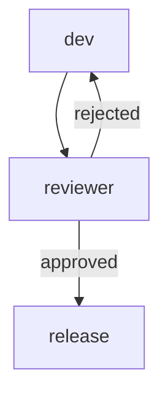

# Templates

Templates are the starting points of `armadai new`: **agent templates** (Markdown files in the
canonical agent format) and **flow templates** (shapes laid over agents of the project).

Every `armadai new` command writes one file under `.armadai/` of the current project, then
validates the project: a creation that would introduce an error is undone, and nothing is left
behind (a file replaced with `--force` is put back). Ids are lowercase letters, digits and hyphens
(`[a-z0-9][a-z0-9-]{0,63}`); an id that is not one is refused, never rewritten.

`armadai new` alone opens a guided menu, and `armadai new <kind> -i` asks for every value of
one kind (agent: template, description, stack, tier, skills of the project, capabilities; flow:
template, agents of the project and their order, with a Mermaid preview before writing). Both
need a terminal; in a script, pass the options.

## Agent templates

```bash
armadai new agent rust-reviewer --template dev-review --stack rust
armadai new agent sec-reviewer --template security-review -d "Audits the payment code" --tier max
armadai new agent helper --skills release-notes          # skills of the project
```

| Template | Purpose |
|---|---|
| `basic` (default) | General-purpose agent |
| `dev-review` | Code review; structured reviews with severity levels |
| `dev-test` | Test generation |
| `planning` | Implementation plans with tasks and risks |
| `security-review` | Security review (OWASP, CVE) |
| `debug` | Debugging with systematic root cause analysis |
| `tech-debt` | Technical debt analysis and remediation plan |
| `tdd-red` / `tdd-green` / `tdd-refactor` | The three steps of a TDD cycle (see the flow below) |
| `tech-writer` | Documentation |

Options: `--description` (replaces the template's default description), `--stack`, `--tier`
(`fast`, `pro`, `max`), `--skills a,b`, `--force` (replace an existing file).

### Where agent templates are read from

The templates above are **embedded in the binary**. A file with the same name in a templates
directory **overrides** the embedded one, and a file with a new name adds a template of your own.
The directory is `templates/` in the current directory if it exists, otherwise
`~/.config/armadai/templates/`.

### Writing an agent template

A template is an agent file: a YAML frontmatter, then the prompt as the body
(see [Project format](project-format.md)).

```markdown
---
description: Reviews database migrations for locking and data loss
tier: pro
tags: [db, review]
---
You review the migrations of {{stack}} for locks, data loss and rollback paths.
Your role: {{description}}.
```

- The frontmatter is parsed, never substituted into: `--description`, `--tier` and `--skills`
  are set on it. Give it a real default `description` (a template whose description is a
  placeholder needs `--description`).
- `{{name}}` (the id, title-cased), `{{description}}` and `{{stack}}` are replaced in the body
  only. Without `--stack`, `{{stack}}` reads "this project's stack". Other placeholders are left
  as written, and listed.
- A template in the legacy format (`# Name`, `## Metadata`, `## System Prompt`) is refused with
  a clear error: rewrite it with a frontmatter, or put it in a project and run `armadai migrate`.

## Flow templates

```bash
armadai new flow ship --agents planner,dev,qa                     # pipeline (default)
armadai new flow review --template review-loop --agents dev,reviewer,release
armadai new flow feature --template plan-build-verify --agents planner,dev,qa
armadai new flow delivery --template fan-out --agents lead,backend,frontend,qa
armadai graph review
```

The agents must exist in the project; step ids are the agent ids, in the order given.

| Template | Agents | Shape |
|---|---|---|
| `pipeline` | 2 or more | `a → b → c …` |
| `review-loop` | 2 or 3 | author → reviewer; `rejected` goes back to the author, `approved` on to the third agent (none: the flow ends) |
| `plan-build-verify` | 3 | planner → builder → verifier; a failed verification (`on_failure`) goes back to the builder |
| `fan-out` | 2 or more | the first agent (a lead) → each other agent: a lead handing work to its specialists |

`review-loop` with `dev,reviewer,release`, as `armadai graph` prints it:



### Example: the TDD cycle

The former `## Pipeline` sections of the `tdd-*` templates (red → green → refactor) are a flow
now:

```bash
armadai new agent red --template tdd-red --stack rust
armadai new agent green --template tdd-green --stack rust
armadai new agent refactor --template tdd-refactor --stack rust
armadai new flow tdd --agents red,green,refactor
```

## Automations and skills

```bash
armadai new automation fmt --event after-tool --run "cargo fmt"
armadai new skill release-notes --description "Write release notes from the git log"
```

Events: `session-start`, `session-end`, `before-tool`, `after-tool`, `on-prompt`, `on-stop`.
A skill is created as `.armadai/skills/<id>/SKILL.md`, a skeleton to fill in.

## The former form

`armadai new <name>` is now `armadai new agent <name>`; the former form is refused with that
hint.
